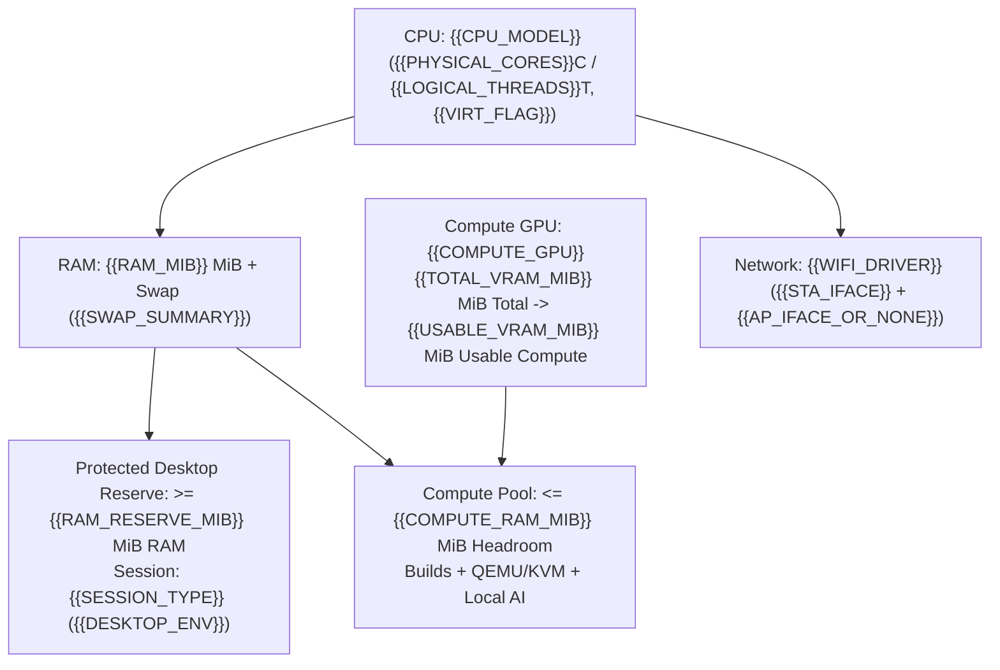

<!--
================================================================================
BLOCK 1: METADATA BLOCK
( Linux Host Profile Template - Spec Blueprint & Calibration Contract )
================================================================================
@project       OmniCode Framework / Big House Ecosystem
@file          .agents/host/host-profile-spec/linux_host_profile.template.md
@id            cog.agent.host.spec.linux_template
@layer         Portable Agent Substrate - Linux Host Profile Specification
@archetype     template | host_profile_spec
@version       0.1.3-dev
@interface_rev Rev 5
@created       YYYY-MM-DD
@updated       YYYY-MM-DD
@author        {{OWNER_OR_WORKSTATION_AUTHOR}}
@repository    https://github.com/Novaking34/OmniCode_Framework
@system        {{HOSTNAME}} ({{LINUX_DISTRO}} / Kernel {{KERNEL_VERSION}})
@role          Reusable Dual-Audience Linux Host Profile Specification
@maturity      Rev 5 Reusable Spec Template (Awaiting Instantiation)
@chassis       {{ARCH}} | {{CPU_SHORT}} + {{GPU_SHORT}} + {{WIFI_CHIP}}
@seams         schema: ./hardware_calibration.template.json |
               live_json: ../hardware_calibration.json |
               overview: ../host_environments_overview.md |
               index: ../../README.md
@invariants    1. Universal 5-Block Protocol (Rev 5, <=80 col headers).
               2. Set platforms.linux.is_current_platform: true ONLY on active
                  Linux hosts; keep windows/macos/millenniumos strictly false.
               3. Reserve non-headless desktop RAM and display VRAM before
                  loading local models, VMs, or parallel C/Rust builds.
               4. Verify Wayland vs X11 compositor and Wi-Fi nl80211 drivers
                  live instead of copying values from another laptop.
================================================================================
-->

# Linux Host Profile (`{{HOSTNAME}}`)

> **Template Purpose (Read Before Copying):** Copy this specification to `../host_pc_hardware_profile.md` (and copy [`hardware_calibration.template.json`](./hardware_calibration.template.json) to [`hardware_calibration.json`](../hardware_calibration.json)) when onboarding any Linux workstation. Replace every `{{PLACEHOLDER}}` strictly from live commands run on that machine.

**Quick Navigation:**
[Opening (Dual-Audience Guide)](#block-2-opening-understanding-this-linux-host) |
[1. Resource Budget Diagram](#1-visual-hardware--resource-budget-map) |
[2. Linux Hardware Matrix](#2-measured-linux-hardware--session-matrix) |
[3. 4-Tier AI Calibration](#3-4-tier-local-ai-calibration-05b-to-7b) |
[Audit Probes](#block-4-audit-live-linux-verification-commands) |
[Closing Action Playbook](#block-5-closing-operational-playbook--instantiation-reel)

---

<!--
================================================================================
BLOCK 2: OPENING BLOCK
( Plain-English Summary, Audience Guide & Non-Headless Desktop Reserve )
================================================================================
-->

## Block 2 (Opening): Understanding This Linux Host

> [!NOTE]
> **Plain-English Summary (For Non-Programmers):**
> This computer (`{{HOSTNAME}}`) runs **`{{LINUX_DISTRO}}`**. In everyday terms:
>
> - **Processor (`{{CPU_MODEL}}`):** Does the thinking (`{{PHYSICAL_CORES}}` physical cores / `{{LOGICAL_THREADS}}` threads).
> - **Memory (`{{RAM_MIB}} MiB` RAM + `{{ZRAM_SIZE}}` swap):** Keeps open apps, compilers, and local AI running smoothly without crashing into slow disk storage.
> - **Graphics (`{{DISPLAY_GPU}}` / `{{COMPUTE_GPU}}`):** Paints the **`{{SESSION_TYPE}}`** desktop clearly while holding dedicated memory for AI calculations or games.
> - **Storage & Wi-Fi (`{{NVME_MODEL}}` + `{{WIFI_CHIP}}`):** Holds project files safely and handles internet plus local `FaithNet` radio testing.

---

> [!IMPORTANT]
> **Non-Headless Linux Guard:** Because a live user interacts with `{{DESKTOP_ENV}}` (`{{SESSION_TYPE}}`) on this machine, reserve **`>= {{RAM_RESERVE_MIB}} MiB` system RAM** and **`>= {{VRAM_DISPLAY_FLOOR_MIB}} MiB` display VRAM** at all times so background workloads never freeze input, audio, or networking.

---

<!--
================================================================================
BLOCK 3: BODY BLOCK
( Resource Topology, Verified Hardware Matrix, Bedrock Tags & AI Calibration )
================================================================================
-->

## 1. Visual Hardware & Resource Budget Map



---

## 2. Measured Linux Hardware & Session Matrix

| Component | Plain-English Role | Measured Linux Telemetry (`{{DATE_PROBED}}`) | `[STANDARD OS BEDROCK]` vs `[OMNICODE ENHANCEMENT]` |
| :--- | :--- | :--- | :--- |
| **Distro & Kernel** | Core OS & scheduler | `{{LINUX_DISTRO}}`, `{{ARCH}}`, Kernel `{{KERNEL_VERSION}}` | **`[STANDARD OS BEDROCK]`** Linux kernel + **`[OMNICODE ENHANCEMENT]`** `platforms.linux.is_current_platform: true` |
| **Desktop Compositor** | Windowing & UI layer | `XDG_SESSION_TYPE={{SESSION_TYPE}}`, `DESKTOP={{DESKTOP_ENV}}` | **`[STANDARD OS BEDROCK]`** Wayland or X11 display stack |
| **CPU & Virtualization** | Processing & KVM guest support | `{{CPU_MODEL}}` (`{{PHYSICAL_CORES}}C/{{LOGICAL_THREADS}}T`, `{{VIRT_FLAG}}`) | **`[STANDARD OS BEDROCK]`** `KVM`/`VT-x`/`AMD-V` + **`[OMNICODE ENHANCEMENT]`** Thread caps in JSON |
| **RAM & Swap Policy** | Active workspace + compressed spill | `{{RAM_MIB}} MiB` physical; `{{SWAP_SUMMARY}}` | **`[STANDARD OS BEDROCK]`** `zram` / swapfile + **`[OMNICODE ENHANCEMENT]`** `{{RAM_RESERVE_MIB}} MiB` desktop guard |
| **Display & Compute GPU** | Screen output + compute offload | Display: `{{DISPLAY_GPU}}`; Compute: `{{COMPUTE_GPU}}` (`{{USABLE_VRAM_MIB}} MiB` usable) | **`[STANDARD OS BEDROCK]`** Mesa/NVIDIA/ROCm + **`[OMNICODE ENHANCEMENT]`** Strict display VRAM floor |
| **Storage Bus** | Drive throughput & write longevity | `{{STORAGE_DEVICE}}` (`{{NVME_MODEL}}`, `{{DISK_AVAIL}}` free on `/`) | **`[STANDARD OS BEDROCK]`** Kernel VFS/ext4 + **`[OMNICODE ENHANCEMENT]`** Bounded Track 3 logs (DRAM-less aware) |
| **Audio & Wi-Fi Radio** | Sound mixer & `FaithNet` transport | Audio: `{{AUDIO_HW}}`; Net: `{{WIFI_CHIP}}` (`{{WIFI_DRIVER}}`) | **`[STANDARD OS BEDROCK]`** PipeWire/`nl80211` + **`[OMNICODE ENHANCEMENT]`** Single-channel `ap0` Zero-Brick rules |

<details>
<summary>Expand Engineering Spec Drawer: Caches, PCI Slots, Swap Priorities &amp; Toolchains</summary>

- **CPU Caches (`lscpu`):** `L1d: {{L1D}}`, `L1i: {{L1I}}`, `L2: {{L2}}`, `L3: {{L3}}`, NUMA nodes: `{{NUMA_NODES}}`
- **PCI Device Map (`lspci`):** `{{PCI_SLOTS_SUMMARY}}`
- **Installed Toolchains:** `rustc {{RUSTC_VER}}`, `go {{GO_VER}}`, `gcc {{GCC_VER}}`, `cmake {{CMAKE_VER}}`, `python3 {{PY_VER}}`, `qemu {{QEMU_VER}}`, `ollama {{OLLAMA_VER}}`

</details>

---

## 3. 4-Tier Local AI Calibration (`0.5B` to `7B`)

Mirror these exact verified values inside `platforms.linux.calibrated_tiers` in [`hardware_calibration.json`](../hardware_calibration.json), verifying **`is_current_platform: true`** ONLY on `linux` and **`false`** on `windows`, `macos`, and `millenniumos`:

| Tier | Model Name | Ideal Ctx (`>= 4096`) | GPU Layers | CPU Threads | KV Cache | VRAM Headroom | RAM Spill | Tripwire Status |
| :--- | :--- | :---: | :---: | :---: | :---: | :---: | :---: | :--- |
| **`0.5b`** | `{{MODEL_05B}}` | `{{CTX_05B}}` | `{{GPU_05B}}` | `{{THR_05B}}` | `{{KV_05B}} MiB` | `{{VRAM_HR_05B}} MiB` | `{{SPILL_05B}} MiB` | `{{STATUS_05B}}` |
| **`1.5b`** | `{{MODEL_15B}}` | `{{CTX_15B}}` | `{{GPU_15B}}` | `{{THR_15B}}` | `{{KV_15B}} MiB` | `{{VRAM_HR_15B}} MiB` | `{{SPILL_15B}} MiB` | `{{STATUS_15B}}` |
| **`3b`** | `{{MODEL_3B}}` | `{{CTX_3B}}` | `{{GPU_3B}}` | `{{THR_3B}}` | `{{KV_3B}} MiB` | `{{VRAM_HR_3B}} MiB` | `{{SPILL_3B}} MiB` | `{{STATUS_3B}}` |
| **`7b`** | `{{MODEL_7B}}` | `{{CTX_7B}}` | `{{GPU_7B}}` | `{{THR_7B}}` | `{{KV_7B}} MiB` | `{{VRAM_HR_7B}} MiB` | `{{SPILL_7B}} MiB` | `{{STATUS_7B}}` |

---

<!--
================================================================================
BLOCK 4: AUDIT PROCEDURES BLOCK
( Native Linux Hardware Probes & Multi-Platform Flag Verification )
================================================================================
-->

## Block 4 (Audit): Live Linux Verification Commands

Run these commands directly on the target Linux host and paste measured numbers rather than estimating:

```bash
hostname && uname -a && echo "SESSION=$XDG_SESSION_TYPE DESKTOP=$XDG_CURRENT_DESKTOP"
lscpu | grep -E "Model name|CPU\(s\)|Core\(s\)|Thread\(s\)|Virtualization|L1d|L1i|L2|L3|MHz"
free -m && swapon --show
lspci | grep -iE "vga|3d|network|audio|nvme"
command -v nvidia-smi >/dev/null && nvidia-smi --query-gpu=name,memory.total,driver_version,pci.bus_id --format=csv,noheader || true
df -h / && lsblk -d -o NAME,SIZE,MODEL,ROTA,TRAN
ip -br link && command -v iw >/dev/null && iw list | grep -A 5 "valid interface combinations" || true
rustc --version; go version; gcc --version | head -n 1; cmake --version | head -n 1; python3 --version; qemu-system-x86_64 --version | head -n 1; ollama --version
```

| T4 State | Verification Gate | Required Action |
| :--- | :--- | :--- |
| **`+1:PROCEED`** | All placeholders replaced with live probe values + `linux.is_current_platform == true` (others `false`) | Ready for active development |
| **`0:AWAIT`** | Template just copied (`{{PLACEHOLDER}}` tokens still present) | Run bash probes above and complete Block 3 tables |
| **`-1:ROLLBACK`** | `threshing_delta != 0` or Wayland/X11 session mismatch | Re-run calibration sweep and correct compositor entry |
| **`NULL:HALT`** | Two OS entries claim `is_current_platform: true` or VRAM math omits display guard | Halt compute planning and repair `../hardware_calibration.json` |

---

<!--
================================================================================
BLOCK 5: CLOSING BLOCK
( ACTION / REEL - Playbook Template, Seams, Instantiation & Seal )
================================================================================
-->

## Block 5 (Closing): Operational Playbook & Instantiation Reel

### 1. Operational Playbook (`PLAY`: Fill for Target Linux Machine)

- **Default Local Model Tier:** Specify `{{DEFAULT_TIER}}` (choose highest tier with `0 MiB` spill or clean desktop margin).

- **Safe Parallel Build Cap:** Set `-j{{SAFE_MAKE_JOBS}}` when GUI + AI are open; reserve full thread count for headless terminal runs.
- **QEMU / KVM Acceleration:** Confirm `/dev/kvm` exists before running Track 0 MillenniumOS tests.
- **FaithNet Radio Mode:** Record whether `{{WIFI_DRIVER}}` supports simultaneous `STA + ap0` or requires an external USB adapter.

### 2. Outward System Seams (`PROJECT`)

- **`Track 0` (`hal/probes`):** Receives Linux host silicon expectations and QEMU KVM speed baseline.

- **`Track 1` (`cognitive/calibration`):** Reads `platforms.linux.calibrated_tiers` from `../hardware_calibration.json`.
- **`Track 4` (`drivers` & `bridges`):** Adapts `nl80211`/`ap0` rules to the measured Wi-Fi card.

### 3. Instantiation Checklist (`RECORD`)

1. Verify [`hardware_calibration.template.json`](./hardware_calibration.template.json) was copied to `../hardware_calibration.json` with `linux.is_current_platform: true` and `windows`/`macos`/`millenniumos` set to `false`.
2. Ensure zero unreplaced `{{...}}` tokens remain before sealing `+1:PROCEED`.

### 4. Reconciliation & Portable Anchors (`COMMIT`)

- [`host_environments_overview.md`](../host_environments_overview.md) — Cross-platform OS architecture guide

- [`hardware_calibration.template.json`](./hardware_calibration.template.json) — Paired JSON calibration template (`all false`)
- [`.agents/README.md`](../../README.md) — Portable Cognitive BIOS index

<!--
================================================================================
END OF BLOCK 5: CLOSING SEAL
Status: LINUX_HOST_PROFILE_SPEC_TEMPLATE (0:AWAIT UNTIL INSTANTIATED)
================================================================================
-->
