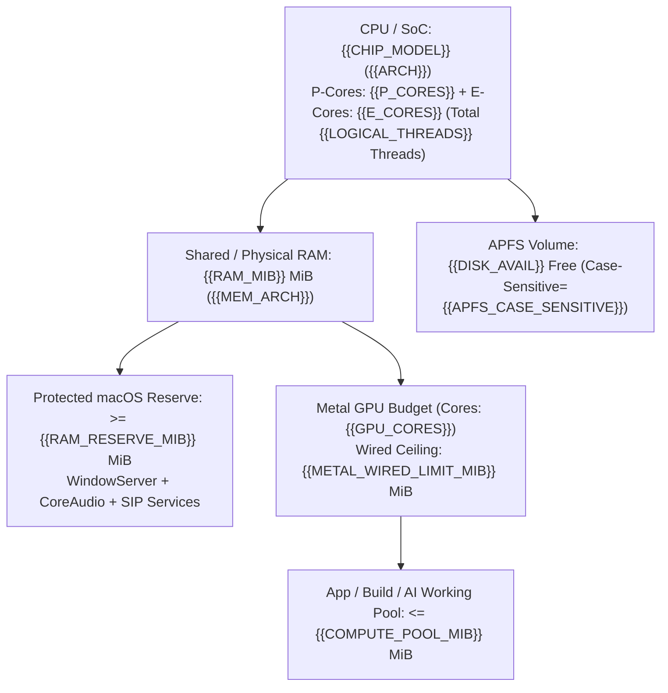

<!--
================================================================================
BLOCK 1: METADATA BLOCK
( macOS Host Profile Template - Spec Kit Blueprint & Unified Memory Contract )
================================================================================
@project       OmniCode Framework / Big House Ecosystem
@file          .agents/host/host-profile-spec/macos_host_profile.template.md
@id            cog.agent.host.spec.macos_template
@layer         Portable Agent Substrate - macOS Host Profile Specification
@archetype     template | host_profile_spec
@version       0.1.3-dev
@interface_rev Rev 5
@created       YYYY-MM-DD
@updated       YYYY-MM-DD
@author        {{OWNER_OR_WORKSTATION_AUTHOR}}
@repository    https://github.com/Novaking34/OmniCode_Framework
@system        {{HOSTNAME}} (macOS {{MACOS_VERSION}} / {{ARCH}})
@role          Reusable Dual-Audience macOS Host Profile Specification
@maturity      Rev 5 Reusable Spec Template (Awaiting Instantiation)
@chassis       {{ARCH}} | {{CHIP_SHORT}} + Unified {{RAM_MIB}} MiB + APFS
@seams         schema: ./hardware_calibration.template.json |
               live_json: ../hardware_calibration.json |
               overview: ../host_environments_overview.md |
               index: ../../README.md
@invariants    1. Universal 5-Block Protocol (Rev 5, <=80 col headers).
               2. Set platforms.macos.is_current_platform: true ONLY on real
                  macOS hosts; keep linux/windows/millenniumos strictly false.
               3. On Apple Silicon Unified Memory, enforce macOS desktop RAM
                  floor AND Metal wired_limit_mb before calculating AI context.
               4. Never inject Linux nl80211 ap0 Wi-Fi assumptions onto macOS;
                  account for AWDL jitter and CoreAudio/WindowServer safety.
================================================================================
-->

# macOS Host Profile (`{{HOSTNAME}}`)

> **Template Purpose (Read Before Copying):** Copy this specification to `../host_pc_hardware_profile.md` (and copy [`hardware_calibration.template.json`](./hardware_calibration.template.json) to [`hardware_calibration.json`](../hardware_calibration.json)) when running OmniCode on a Mac (Apple Silicon `arm64` or Intel `x86_64`). Fill every `{{PLACEHOLDER}}` strictly from live macOS terminal probes.

**Quick Navigation:**
[Opening (Dual-Audience Guide)](#block-2-opening-understanding-this-macos-host) |
[1. Unified Memory Map](#1-visual-hardware--unified-memory-budget-map) |
[2. macOS Hardware Matrix](#2-measured-macos-hardware--os-matrix) |
[3. 4-Tier AI Calibration](#3-4-tier-local-ai-calibration-05b-to-7b) |
[Audit Probes](#block-4-audit-macos-terminal-verification-commands) |
[Closing Action Playbook](#block-5-closing-operational-playbook--instantiation-reel)

---

<!--
================================================================================
BLOCK 2: OPENING BLOCK
( Plain-English Summary, Unified Memory Mental Model & Metal Safety Floor )
================================================================================
-->

## Block 2 (Opening): Understanding This macOS Host

> [!NOTE]
> **Plain-English Summary (For Non-Programmers):**
> This Mac (`{{HOSTNAME}}`) runs **`macOS {{MACOS_VERSION}}`** on **`{{CHIP_MODEL}}`**. The big difference on modern Macs is **Unified Memory**:
>
> - **One Shared Pool (Instead of Two Separate Cards):** On Apple Silicon, the CPU (brains) and GPU (graphics/AI accelerator) sit on the same chip sharing **`{{RAM_MIB}} MiB` of fast memory**. Nothing needs copying back and forth—**but** macOS draws a hard ceiling (`Metal wired limit`) so an AI model cannot starve `Finder`, `WindowServer`, or `CoreAudio`.
> - **Case-Insensitive Disk (`APFS`):** macOS usually treats `File.txt` and `file.txt` as the same name on disk unless on a case-sensitive volume—something we guard carefully in codebases shared with Linux.
> - **Closed Wi-Fi Firmware:** Apple locks down low-level Wi-Fi AP+STA creation (`ap0`), so Macs participate in `FaithNet` cleanly as stations/peers rather than dual-mode software access points.

---

> [!IMPORTANT]
> **Unified Memory Safety Law:** Always reserve **`>= {{RAM_RESERVE_MIB}} MiB`** for macOS + `WindowServer` and stay comfortably below **`iogpu.wired_limit_mb` (`{{METAL_WIRED_LIMIT_MIB}} MiB`)** so local Ollama/Metal sessions never trigger system compression freezes.

---

<!--
================================================================================
BLOCK 3: BODY BLOCK
( Resource Topology, Verified macOS Specs, Bedrock Tags & AI Calibration )
================================================================================
-->

## 1. Visual Hardware & Unified Memory Budget Map



---

## 2. Measured macOS Hardware & OS Matrix

| Component | Plain-English Role | Measured macOS Telemetry (`{{DATE_PROBED}}`) | `[STANDARD OS BEDROCK]` vs `[OMNICODE ENHANCEMENT]` |
| :--- | :--- | :--- | :--- |
| **macOS & Arch** | Darwin kernel & CPU family | `macOS {{MACOS_VERSION}}` (`Build {{MACOS_BUILD}}`, `{{ARCH}}`) | **`[STANDARD OS BEDROCK]`** XNU Mach/BSD + **`[OMNICODE ENHANCEMENT]`** `platforms.macos.is_current_platform: true` |
| **Processor Topology** | Sprint vs background cores | `{{CHIP_MODEL}}` (`{{P_CORES}}P` + `{{E_CORES}}E`, `{{LOGICAL_THREADS}}T`) | **`[STANDARD OS BEDROCK]`** Apple QoS scheduler + **`[OMNICODE ENHANCEMENT]`** P-core thread calibration |
| **Memory & Metal Limit** | Unified or split GPU memory | `{{RAM_MIB}} MiB` (`{{MEM_ARCH}}`); Wired ceiling: `{{METAL_WIRED_LIMIT_MIB}} MiB` | **`[STANDARD OS BEDROCK]`** Metal unified buffers + **`[OMNICODE ENHANCEMENT]`** Strict desktop floor |
| **Storage (`APFS`)** | Fast SSD & filename casing rules | `APFS` (`{{DISK_AVAIL}}` avail, Case-Sensitive: `{{APFS_CASE_SENSITIVE}}`) | **`[STANDARD OS BEDROCK]`** APFS snapshots + **`[OMNICODE ENHANCEMENT]`** Filename collision check vs Linux |
| **Audio & Networking** | Sound & FaithNet peer connectivity | Audio: `CoreAudio` (`{{AUDIO_DEV}}`); Wi-Fi: `{{WIFI_HW}}` (`raw ap0=false`) | **`[STANDARD OS BEDROCK]`** CoreAudio / AWDL + **`[OMNICODE ENHANCEMENT]`** Client/LAN `FaithNet` role |
| **Virtualization (`HVF`)** | Running Track 0 MillenniumOS VMs | `Virtualization.framework` (`{{HVF_SUPPORT}}`), `QEMU/UTM {{VM_TOOL}}` | **`[STANDARD OS BEDROCK]`** macOS Hypervisor.framework + **`[OMNICODE ENHANCEMENT]`** Architecture parity rules |

<details>
<summary>Expand Engineering Spec Drawer: SIP Status, Xcode CLT &amp; Homebrew Toolchains</summary>

- **Security & System Integrity:** `csrutil status = {{SIP_STATUS}}`, Apple CLT: `{{XCODE_CLT_VER}}`
- **Installed Toolchains:** `rustc {{RUSTC_VER}}`, `go {{GO_VER}}`, `clang/gcc {{CC_VER}}`, `cmake {{CMAKE_VER}}`, `python3 {{PY_VER}}`, `ollama {{OLLAMA_VER}}`

</details>

---

## 3. 4-Tier Local AI Calibration (`0.5B` to `7B`)

Record verified Unified Memory / Metal measurements inside `platforms.macos.calibrated_tiers` in [`hardware_calibration.json`](../hardware_calibration.json) with **`macos.is_current_platform: true`** and inactive OS flags **`false`**:

| Tier | Model Name | Ideal Ctx (`>= 4096`) | GPU Layers (Metal) | CPU Threads | KV Cache | Wired Headroom | Active OS Headroom | Tripwire Status |
| :--- | :--- | :---: | :---: | :---: | :---: | :---: | :---: | :--- |
| **`0.5b`** | `{{MODEL_05B}}` | `{{CTX_05B}}` | `{{GPU_05B}}` | `{{THR_05B}}` | `{{KV_05B}} MiB` | `{{VRAM_HR_05B}} MiB` | `{{RAM_HR_05B}} MiB` | `{{STATUS_05B}}` |
| **`1.5b`** | `{{MODEL_15B}}` | `{{CTX_15B}}` | `{{GPU_15B}}` | `{{THR_15B}}` | `{{KV_15B}} MiB` | `{{VRAM_HR_15B}} MiB` | `{{RAM_HR_15B}} MiB` | `{{STATUS_15B}}` |
| **`3b`** | `{{MODEL_3B}}` | `{{CTX_3B}}` | `{{GPU_3B}}` | `{{THR_3B}}` | `{{KV_3B}} MiB` | `{{VRAM_HR_3B}} MiB` | `{{RAM_HR_3B}} MiB` | `{{STATUS_3B}}` |
| **`7b`** | `{{MODEL_7B}}` | `{{CTX_7B}}` | `{{GPU_7B}}` | `{{THR_7B}}` | `{{KV_7B}} MiB` | `{{VRAM_HR_7B}} MiB` | `{{RAM_HR_7B}} MiB` | `{{STATUS_7B}}` |

---

<!--
================================================================================
BLOCK 4: AUDIT PROCEDURES BLOCK
( Native macOS Terminal Probes & Metal / APFS / AWDL Checks )
================================================================================
-->

## Block 4 (Audit): macOS Terminal Verification Commands

Run on the target Mac to populate real telemetry with zero guesswork:

```bash
hostname && sw_vers && uname -m
sysctl hw.ncpu hw.physicalcpu hw.memsize machdep.cpu.brand_string kern.hv_support 2>/dev/null || true
sysctl perflevel0.physicalcpu perflevel1.physicalcpu iogpu.wired_limit_mb 2>/dev/null || true
system_profiler SPHardwareDataType SPDisplaysDataType | grep -E "Chip|Model|Memory|VRAM|Metal|Total Number of Cores"
vm_stat && diskutil info / | grep -E "File System|Case-sensitive|Container Free|Volume Total"
csrutil status; networksetup -listallhardwareports | head -n 20
rustc --version; go version; clang --version | head -n 1; cmake --version | head -n 1; python3 --version; ollama --version
```

| T4 State | Verification Gate | Required Action |
| :--- | :--- | :--- |
| **`+1:PROCEED`** | Live `sysctl`/`system_profiler` values recorded + `macos.is_current_platform: true` (others `false`) | Ready for Apple builds & Metal AI runs |
| **`0:AWAIT`** | Placeholders still present or Metal wired ceiling unknown | Run macOS probe block above |
| **`-1:ROLLBACK`** | WindowServer stuttering from context length pushing past wired limit | Reduce `num_ctx` (`32768 -> 8192`) or lower model tier |
| **`NULL:HALT`** | Script attempts Linux `iw dev ... interface add ap0` or `is_current_platform` conflicts | Halt immediately and restore macOS client-only network rules |

---

<!--
================================================================================
BLOCK 5: CLOSING BLOCK
( ACTION / REEL - macOS Playbook, Seams, Instantiation & Seal )
================================================================================
-->

## Block 5 (Closing): Operational Playbook & Instantiation Reel

### 1. Operational Playbook (`PLAY`: Fill for Target Mac)

- **Unified Memory AI Rule:** Set `num_ctx` cleanly below `iogpu.wired_limit_mb` minus desktop floor (`{{RAM_RESERVE_MIB}} MiB`) so Metal inference runs fast without compressor thrashing.

- **QEMU / Cross-Architecture Discipline:** If on `arm64` Apple Silicon booting `x86_64` MillenniumOS images (`Track 0`), document expected TCG emulation overhead explicitly (never expect KVM speed on cross-arch emulation).
- **FaithNet on macOS:** Operate strictly as a LAN/Wi-Fi station peer; expect periodic `AWDL` beacons on shared AirDrop channels during low-latency wireless benchmarks.

### 2. Outward System Seams (`PROJECT`)

- **`Track 1` (`cognitive/calibration`):** Reads Unified Memory headroom rather than separate VRAM spill numbers.

- **`Track 3` (`vfs/`):** Guards against case-only filename collisions on case-insensitive `APFS`.
- **`Track 5` & `Track 6` (`Cornerstone` / *Tenebris and Lux*):** Targets Metal/WindowServer + `CoreAudio` parity.

### 3. Instantiation Checklist (`RECORD`)

1. Copy [`hardware_calibration.template.json`](./hardware_calibration.template.json) to `../hardware_calibration.json` and set **`macos.is_current_platform: true`** (keep `linux`, `windows`, `millenniumos` strictly `false`).
2. Replace every `{{...}}` placeholder cleanly from macOS probes.

### 4. Reconciliation & Portable Anchors (`COMMIT`)

- [`host_environments_overview.md`](../host_environments_overview.md) — Cross-platform OS architecture guide

- [`hardware_calibration.template.json`](./hardware_calibration.template.json) — Paired JSON calibration template (`all false`)
- [`.agents/README.md`](../../README.md) — Portable Cognitive BIOS index

<!--
================================================================================
END OF BLOCK 5: CLOSING SEAL
Status: MACOS_HOST_PROFILE_SPEC_TEMPLATE (0:AWAIT UNTIL INSTANTIATED)
================================================================================
-->
