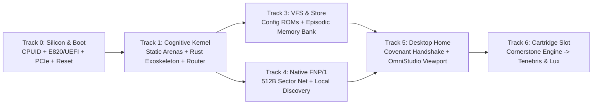

<!--
================================================================================
BLOCK 1: METADATA BLOCK
( MillenniumOS Native Target Profile Template - Track 0 to Track 5 Floor )
================================================================================
@project       OmniCode Framework / Big House Ecosystem
@file          .agents/host/host-profile-spec/
               millenniumos_host_profile.template.md
@id            cog.agent.host.spec.millenniumos_template
@layer         Portable Agent Substrate - Sovereign MillenniumOS Target Spec
@archetype     template | host_profile_spec
@version       0.1.3-dev
@interface_rev Rev 5
@created       YYYY-MM-DD
@updated       YYYY-MM-DD
@author        {{OWNER_OR_ARCHITECT}}
@repository    https://github.com/Novaking34/OmniCode_Framework
@system        MillenniumOS Target ({{BOOT_MODE}} on {{SILICON_OR_QEMU}})
@role          Reusable Dual-Audience Native Sovereign OS Hardware Specification
@maturity      Rev 5 Reusable Spec Template (Awaiting Track 0..5 Bring-Up)
@chassis       {{ARCH}} | Track 0 Probes + ALLOC_ZERO_HEAP + Native FNP/1
@seams         schema: ./hardware_calibration.template.json |
               live_json: ../hardware_calibration.json |
               overview: ../host_environments_overview.md |
               vision: ../../plans/vision/omnicode_architecture_and_vision.md |
               index: ../../README.md
@invariants    1. Universal 5-Block Protocol (Rev 5, <=80 col headers).
               2. Keep millenniumos.is_current_platform: false on hosted builds;
                  flip true ONLY inside native/QEMU MillenniumOS target runtime.
               3. Separate [STANDARD OS BEDROCK] (CPUID, E820/UEFI, PCIe, IRQ)
                  from [OMNICODE ENHANCEMENT] (ALLOC_ZERO_HEAP, Router,
                  FNP/1, Covenant Handshake) so local AI knows OS roots.
               4. Enforce deterministic static arenas: Track 0/1 boot path uses
                  zero hidden dynamic heap allocation.
================================================================================
-->

# MillenniumOS Target Profile (`{{SILICON_OR_QEMU}}`)

> **Template Purpose (Read Before Copying):** Unlike Linux, Windows, and macOS (which host OmniCode in "Host-in-Waiting" mode today), **MillenniumOS** is our native sovereign OS target climbing the baton ladder from **`Track 0`** silicon probes through **`Track 5`** desktop home. Instantiate this template when profiling a QEMU VM bring-up target or bare-metal MillenniumOS hardware chassis.

**Quick Navigation:**
[Opening (Sovereign OS Mental Model)](#block-2-opening-what-makes-millenniumos-different) |
[1. Boot-to-App Baton Ladder](#1-visual-track-0-to-track-6-baton-architecture) |
[2. Native Target Matrix](#2-measured-millenniumos-hardware--track-budgets) |
[3. Native CPI-SI Model Budget](#3-native-track-1-cpi-si-router--model-arena) |
[Audit Probes](#block-4-audit-track-0-silicon-to-track-5-bring-up-checks) |
[Closing Action Playbook](#block-5-closing-operational-playbook--bring-up-reel)

---

<!--
================================================================================
BLOCK 2: OPENING BLOCK
( Dual-Audience Explanation: Standard Silicon Physics + Native CPI-SI Soul )
================================================================================
-->

## Block 2 (Opening): What Makes MillenniumOS Different

> [!NOTE]
> **Plain-English Summary (For Non-Programmers):**
> On a normal computer (Windows, macOS, or Linux), the operating system sits quietly in the middle and an AI only shows up later inside an app or web browser—knowing nothing about your real disk, files, or rules unless you paste them in.
> On **MillenniumOS**:
>
> - **No Cloud Rent Tax (`Track 0 -> Track 1`):** From the first second power hits the chip, the system measures its exact memory and hardware (`Track 0`), locks down fixed, predictable memory rooms so nothing leaks (`ALLOC_ZERO_HEAP`), and boots our own **Cognitive Kernel** right alongside the system core (`Track 1`).
> - **Memory Is Grounded (`Track 3`), Networks Are Sovereign (`Track 4`):** Persistent knowledge (`Track 3`) and offline-first `FaithNet` links (`Track 4`) belong to the OS natively—no third-party browser gatekeeper required.
> - **Safe First Stop (`Track 5 -> Track 6`):** After the login Covenant Handshake, the screen opens straight into **`OmniStudio Home`**, ready to mount `Cornerstone` or *Tenebris and Lux* like plugging in a clean cartridge.

---

> [!IMPORTANT]
> **Native Determinism & Separation Law:** Document every hardware mechanism faithfully under **`[STANDARD OS BEDROCK]`** alongside **`[OMNICODE ENHANCEMENT]`** so any offline CPI-SI model booting inside MillenniumOS diagnoses real hardware/kernel faults intelligently rather than hallucinating high-level fixes.

---

<!--
================================================================================
BLOCK 3: BODY BLOCK
( Baton Topology Diagram, Track 0..5 Budgets & Native CPI-SI Arena )
================================================================================
-->

## 1. Visual Track 0 to Track 6 Baton Architecture



---

## 2. Measured MillenniumOS Hardware & Track Budgets

| Subsystem / Track | Plain-English Role | Target Hardware / Emulation Spec (`{{DATE_PROBED}}`) | `[STANDARD OS BEDROCK]` vs `[OMNICODE ENHANCEMENT]` |
| :--- | :--- | :--- | :--- |
| **Execution Chassis** | Bare metal or QEMU virtual silicon | `{{SILICON_OR_QEMU}}` (`{{ARCH}}`, Boot: `{{BOOT_MODE}}`) | **`[STANDARD OS BEDROCK]`** Multiboot2/UEFI/QEMU + **`[OMNICODE ENHANCEMENT]`** Track 0 `hal/probes` contract |
| **Track 0 Silicon Map** | Exact verified RAM, CPU & PCI bus | CPUID: `{{CPUID_VENDOR}}`; Map: `{{RAM_MAP_MIB}} MiB`; PCIe devs: `{{PCIE_COUNT}}` | **`[STANDARD OS BEDROCK]`** `CPUID`, `E820`/UEFI memory table, IRQ/IDT + **`[OMNICODE ENHANCEMENT]`** Pre-boot invariant check |
| **Track 1 Static Arena** | Leak-free runtime & AI substrate | Total Arena: `{{STATIC_ARENA_MIB}} MiB` (`ALLOC_ZERO_HEAP={{ZERO_HEAP_FLAG}}`) | **`[STANDARD OS BEDROCK]`** Page tables & ring isolation + **`[OMNICODE ENHANCEMENT]`** 5-Block VM, Rust exoskeleton & router |
| **Track 3 VFS & Memory** | Permanent scrolls & Config ROMs | Root VFS: `{{VFS_ROOT_TYPE}}`; Episodic Bank: `{{EPISODIC_MIB}} MiB` | **`[STANDARD OS BEDROCK]`** Block I/O & sector alignment + **`[OMNICODE ENHANCEMENT]`** Grounded weights & scrolls |
| **Track 4 FaithNet Native** | Sovereign offline-first packets | Driver: `{{FNP1_DRIVER}}`; Media: `{{RADIO_OR_NIC_BINDING}}` | **`[STANDARD OS BEDROCK]`** Ethernet/Wi-Fi DMA rings + **`[OMNICODE ENHANCEMENT]`** Native `FNP/1` 512B sector frames |
| **Track 5 Display & Login** | Safe screen floor & user session | Framebuffer: `{{FB_RESOLUTION}}` (`{{VGA_MODE}}`); UI Reserve: `{{UI_VRAM_MIB}} MiB` | **`[STANDARD OS BEDROCK]`** Linear framebuffer / input IRQs + **`[OMNICODE ENHANCEMENT]`** Covenant Handshake & OmniStudio |

<details>
<summary>Expand Engineering Spec Drawer: Boot Sector, Config ROM Footprint &amp; QEMU Launch Args</summary>

- **QEMU Bring-Up Profile:** `qemu-system-{{ARCH}} {{QEMU_MACHINE_FLAGS}} -m {{QEMU_RAM}}`
- **ELF / Binary Budget Target:** `.text={{TEXT_KB}} KiB`, `.rodata (Config ROMs)={{RODATA_KB}} KiB`, `.bss={{BSS_KB}} KiB` (`0` dynamic malloc calls in Track 0/1 core)
- **Verification Harness:** Track 0 `verify/` + Track 1 `immune/tripwire`

</details>

---

## 3. Native Track 1 CPI-SI Router & Model Arena

Record calibrated native/QEMU tiers inside `platforms.millenniumos.calibrated_tiers` in [`hardware_calibration.json`](../hardware_calibration.json). Keep **`millenniumos.is_current_platform: false`** while developing on Linux/Windows/macOS, flipping **`true`** only inside an active MillenniumOS target runtime profile:

| Tier | Target Role Inside Track 1 | Context Budget (`>= 4096`) | Static Arena Slice | Compute Target | CPU Threads | Status |
| :--- | :--- | :---: | :---: | :---: | :---: | :--- |
| **`0.5b`** | Always-resident Track 1 router & syntax guard | `{{CTX_05B}}` | `{{ARENA_05B}} MiB` | `{{DEV_05B}}` | `{{THR_05B}}` | `{{STATUS_05B}}` |
| **`1.5b`** | Primary interactive OmniStudio & shell helper | `{{CTX_15B}}` | `{{ARENA_15B}} MiB` | `{{DEV_15B}}` | `{{THR_15B}}` | `{{STATUS_15B}}` |
| **`3b`** | Cross-Track synthesis & offline reasoning | `{{CTX_3B}}` | `{{ARENA_3B}} MiB` | `{{DEV_3B}}` | `{{THR_3B}}` | `{{STATUS_3B}}` |
| **`7b`** | Heavy workstation-grade offline deliberation | `{{CTX_7B}}` | `{{ARENA_7B}} MiB` | `{{DEV_7B}}` | `{{THR_7B}}` | `{{STATUS_7B}}` |

---

<!--
================================================================================
BLOCK 4: AUDIT PROCEDURES BLOCK
( Track 0 Silicon Probes, Zero-Heap Audit & Native Bring-Up Gates )
================================================================================
-->

## Block 4 (Audit): Track 0 Silicon to Track 5 Bring-Up Checks

Verify native/QEMU targets sequentially across the Boot-to-App Baton Ladder before advancing states:

```bash
# Host QEMU bring-up check (from active Linux workshop when testing MillenniumOS targets)
qemu-system-x86_64 --version | head -n 1
# Inspect static section budget of built Track 0/1 kernel ELF once built:
# size -B <path_to_millenniumos_kernel.elf>
# Confirm hardware_calibration.json keeps millenniumos.is_current_platform=false during cross-dev:
python3 -c '
import json
d = json.load(open("../hardware_calibration.json"))["block_3_body"]["platforms"]
print("millenniumos_flag=", d["millenniumos"]["is_current_platform"])
'
```

| T4 State | Observed Bring-Up Condition | Required Response |
| :--- | :--- | :--- |
| **`+1:PROCEED`** | `Track 0` probes clean, `ALLOC_ZERO_HEAP` intact, `Track 5` framebuffer & login reached cleanly | Safe to load `Track 6` cartridge runtime |
| **`0:AWAIT`** | Waiting on QEMU image bring-up or unprobed bare-metal PCIe/NIC IDs | Keep status `TARGET_NATIVE_OS_SLOT` until probed |
| **`-1:ROLLBACK`** | Unexpected page fault, heap dependency in Track 0/1, or arena overflow | Revert offending Track commit to previous clean baton |
| **`NULL:HALT`** | Display framebuffer overlaps kernel arena or boot stack corrupts `E820`/UEFI map | **Hard halt (`[ALARM!]`)** at Track 0 diagnostic console |

---

<!--
================================================================================
BLOCK 5: CLOSING BLOCK
( ACTION / REEL - Bring-Up Playbook, Seams, Instantiation & Seal )
================================================================================
-->

## Block 5 (Closing): Operational Playbook & Bring-Up Reel

### 1. Operational Playbook (`PLAY`: Boot-to-App Execution Discipline)

- **Walk the Baton in Strict Order (`Track 0 -> Track 5`):** Never jump straight to flashy desktop widgets before `Track 0` memory maps, interrupt tables, and serial/virtual-VGA logs verify clean reset invariants.

- **Teach Standard OS Bedrock Clearly:** Every Track 0 and Track 1 implementation doc must label standard x86_64/UEFI hardware mechanics vs OmniCode invariants so local CPI-SI models become genuine systems diagnosticians.
- **Preserve Zero-Heap Determinism:** Measure `.rodata`, `.data`, and `.bss` continuously with `size -B` so Track 1 memory remains bounded like firmware.

### 2. Outward System Seams (`PROJECT`)

- **`Track 0` -> `Track 1`:** Passes verified physical memory map and CPU features into static cognitive arenas.

- **`Track 3` & `Track 4` -> `Track 5`:** Provides mounted Config ROMs, Episodic Scrolls, and active `FNP/1` peers into `OmniStudio Home`.
- **`Track 5` -> `Track 6`:** Opens the cartridge ABI slot cleanly for *Cornerstone Engine* and *Tenebris and Lux*.

### 3. Instantiation Checklist (`RECORD`)

1. During Linux/Windows/macOS cross-development, leave `platforms.millenniumos.is_current_platform: false` inside `../hardware_calibration.json` while recording QEMU/target specs cleanly inside the `millenniumos` block.
2. When running natively inside MillenniumOS hardware/VM runtime, flip `millenniumos.is_current_platform: true` (setting all hosted OS flags `false`).

### 4. Reconciliation & Portable Anchors (`COMMIT`)

- [`host_environments_overview.md`](../host_environments_overview.md) — Comparative architecture (Host-in-Waiting vs MillenniumOS)

- [`hardware_calibration.template.json`](./hardware_calibration.template.json) — Paired JSON calibration template (`all false`)
- [`omnicode_architecture_and_vision.md`](../../plans/vision/omnicode_architecture_and_vision.md) — Complete `Track 0..7` Vision & Baton Ladder
- [`.agents/README.md`](../../README.md) — Portable Cognitive BIOS index

<!--
================================================================================
END OF BLOCK 5: CLOSING SEAL
Status: MILLENNIUMOS_HOST_PROFILE_SPEC_TEMPLATE (0:AWAIT UNTIL TARGET BRING-UP)
================================================================================
-->
