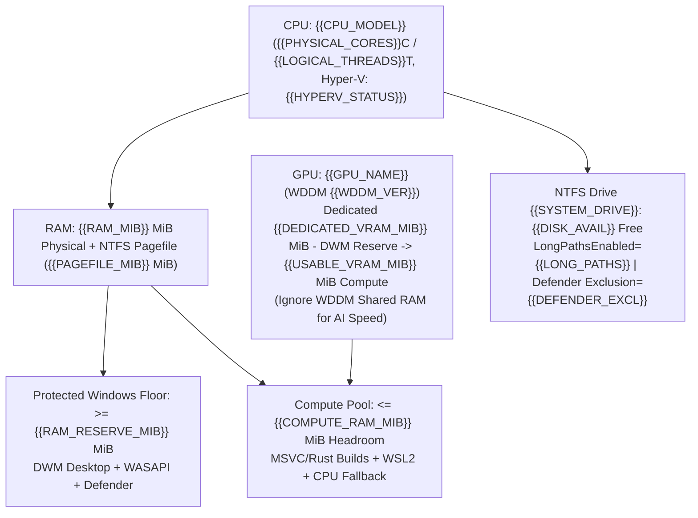

<!--
================================================================================
BLOCK 1: METADATA BLOCK
( Windows Host Profile Template - Spec Blueprint & WDDM Calibration )
================================================================================
@project       OmniCode Framework / Big House Ecosystem
@file          .agents/host/host-profile-spec/windows_host_profile.template.md
@id            cog.agent.host.spec.windows_template
@layer         Portable Agent Substrate - Windows Host Profile Specification
@archetype     template | host_profile_spec
@version       0.1.3-dev
@interface_rev Rev 5
@created       YYYY-MM-DD
@updated       YYYY-MM-DD
@author        {{OWNER_OR_WORKSTATION_AUTHOR}}
@repository    https://github.com/Novaking34/OmniCode_Framework
@system        {{HOSTNAME}} ({{WINDOWS_EDITION}} Build {{WINDOWS_BUILD}})
@role          Reusable Dual-Audience Windows Host Profile Specification
@maturity      Rev 5 Reusable Spec Template (Awaiting Instantiation)
@chassis       {{ARCH}} | {{CPU_SHORT}} + {{GPU_SHORT}} + {{NTFS_DRIVE}}
@seams         schema: ./hardware_calibration.template.json |
               live_json: ../hardware_calibration.json |
               overview: ../host_environments_overview.md |
               index: ../../README.md
@invariants    1. Universal 5-Block Protocol (Rev 5, <=80 col headers).
               2. Set platforms.windows.is_current_platform: true ONLY on an
                  active Windows host; keep linux/macos/millenniumos false.
               3. Never treat WDDM "Shared GPU Memory" as fast dedicated VRAM;
                  subtract DWM display reserve from dedicated VRAM only.
               4. Enforce LF line endings, NTFS LongPathsEnabled awareness, and
                  realistic FaithNet Wi-Fi limits (no Linux ap0 tricks).
================================================================================
-->

# Windows Host Profile (`{{HOSTNAME}}`)

> **Template Purpose (Read Before Copying):** Copy this specification to `../host_pc_hardware_profile.md` (and copy [`hardware_calibration.template.json`](./hardware_calibration.template.json) to [`hardware_calibration.json`](../hardware_calibration.json)) when setting up OmniCode, Cornerstone, or *Tenebris and Lux* on a Windows machine. Fill every `{{PLACEHOLDER}}` strictly from PowerShell probes on that computer.

**Quick Navigation:**
[Opening (Dual-Audience Guide)](#block-2-opening-understanding-this-windows-host) |
[1. Windows Resource Map](#1-visual-hardware--wddm-budget-map) |
[2. Windows Hardware Matrix](#2-measured-windows-hardware--os-matrix) |
[3. 4-Tier AI Calibration](#3-4-tier-local-ai-calibration-05b-to-7b) |
[Audit Probes](#block-4-audit-powershell--windows-verification-commands) |
[Closing Action Playbook](#block-5-closing-operational-playbook--instantiation-reel)

---

<!--
================================================================================
BLOCK 2: OPENING BLOCK
( Plain-English Summary, Audience Guide & Windows Non-Headless / WDDM Law )
================================================================================
-->

## Block 2 (Opening): Understanding This Windows Host

> [!NOTE]
> **Plain-English Summary (For Non-Programmers):**
> This computer (`{{HOSTNAME}}`) runs **`{{WINDOWS_EDITION}}`**. Here is what each hardware part means in plain terms:
>
> - **Processor (`{{CPU_MODEL}}`):** Drives Windows apps, compilers, and games across `{{PHYSICAL_CORES}}` cores / `{{LOGICAL_THREADS}}` threads.
> - **Memory (`{{RAM_MIB}} MiB` RAM + `{{PAGEFILE_MIB}} MiB` pagefile):** Keeps Windows desktop (`DWM`), browser tabs, and security tools responsive without disk thrashing.
> - **Graphics (`{{GPU_NAME}}`):** Windows lets GPUs borrow slow normal RAM if dedicated graphics memory runs out—that keeps games from crashing instantly, **but makes local AI crawl**, so we strictly measure **dedicated VRAM** (`{{DEDICATED_VRAM_MIB}} MiB`) minus Windows screen overhead.
> - **Storage & Network (`NTFS` + `{{WIFI_ADAPTER}}`):** Windows Defender scans new executables automatically, and most Windows Wi-Fi drivers block simultaneous hotspot + internet routing on one card.

---

> [!IMPORTANT]
> **Windows Dedicated-VRAM & Non-Headless Law:** Keep **`>= {{RAM_RESERVE_MIB}} MiB` RAM** free for Windows + Defender + `DWM` and **`>= {{VRAM_DISPLAY_FLOOR_MIB}} MiB` dedicated VRAM** for the desktop compositor. **Never count WDDM Shared GPU Memory toward local AI offload limits.**

---

<!--
================================================================================
BLOCK 3: BODY BLOCK
( Resource Topology, Measured Windows Matrix, Bedrock Tags & AI Calibration )
================================================================================
-->

## 1. Visual Hardware & WDDM Budget Map



---

## 2. Measured Windows Hardware & OS Matrix

| Component | Plain-English Role | Measured Windows Telemetry (`{{DATE_PROBED}}`) | `[STANDARD OS BEDROCK]` vs `[OMNICODE ENHANCEMENT]` |
| :--- | :--- | :--- | :--- |
| **OS & Build** | Windows edition & scheduler | `{{WINDOWS_EDITION}}` (`Build {{WINDOWS_BUILD}}`, `{{ARCH}}`) | **`[STANDARD OS BEDROCK]`** Windows NT + **`[OMNICODE ENHANCEMENT]`** `platforms.windows.is_current_platform: true` |
| **CPU & Hyper-V** | Cores, threads & VM acceleration | `{{CPU_MODEL}}` (`{{PHYSICAL_CORES}}C/{{LOGICAL_THREADS}}T`, Hyper-V `{{HYPERV_STATUS}}`) | **`[STANDARD OS BEDROCK]`** Hyper-V / WHPX + **`[OMNICODE ENHANCEMENT]`** Safe build thread cap |
| **RAM & Pagefile** | Active workspace & disk swap | `{{RAM_MIB}} MiB` RAM; Pagefile `{{PAGEFILE_MIB}} MiB` | **`[STANDARD OS BEDROCK]`** NT virtual memory + **`[OMNICODE ENHANCEMENT]`** Desktop floor protection |
| **WDDM GPU Budget** | Display vs fast dedicated VRAM | Dedicated: `{{DEDICATED_VRAM_MIB}} MiB`; Shared: `{{SHARED_VRAM_MIB}} MiB`; Compute: `{{USABLE_VRAM_MIB}} MiB` | **`[STANDARD OS BEDROCK]`** WDDM memory virtualization + **`[OMNICODE ENHANCEMENT]`** Dedicated-only offload ceiling |
| **NTFS Storage & Security** | Disk paths, speed & Defender scans | `{{SYSTEM_DRIVE}}` `NTFS` (`{{DISK_AVAIL}}` free), `LongPaths={{LONG_PATHS}}` | **`[STANDARD OS BEDROCK]`** NTFS + Defender AV + **`[OMNICODE ENHANCEMENT]`** Repo scan exclusion & `LF` `.gitattributes` |
| **Audio & Networking** | Sound API & FaithNet client role | Audio: `WASAPI` (`{{AUDIO_DEV}}`); Net: `{{WIFI_ADAPTER}}` (`AP Host={{AP_SUPPORT}}`) | **`[STANDARD OS BEDROCK]`** Winsock / WLAN API + **`[OMNICODE ENHANCEMENT]`** Client/LAN mode unless dedicated AP adapter verified |

<details>
<summary>Expand Engineering Spec Drawer: WSL2 Bridge, Defender Exclusions &amp; Windows Toolchains</summary>

- **WSL2 / Virtualization:** `WSL2 Installed: {{WSL2_STATUS}}`, `WHPX Available: {{WHPX_STATUS}}`, `Developer Mode (symlinks): {{DEV_MODE}}`
- **Installed Toolchains:** `MSVC/clang-cl: {{MSVC_VER}}`, `rustc {{RUSTC_VER}}`, `go {{GO_VER}}`, `cmake {{CMAKE_VER}}`, `python3 {{PY_VER}}`, `ollama {{OLLAMA_VER}}`

</details>

---

## 3. 4-Tier Local AI Calibration (`0.5B` to `7B`)

Mirror these probed values into `platforms.windows.calibrated_tiers` inside [`hardware_calibration.json`](../hardware_calibration.json) with **`windows.is_current_platform: true`** and inactive OS flags **`false`**:

| Tier | Model Name | Ideal Ctx (`>= 4096`) | GPU Layers | CPU Threads | KV Cache | Dedicated VRAM Headroom | RAM Spill | Tripwire Status |
| :--- | :--- | :---: | :---: | :---: | :---: | :---: | :---: | :--- |
| **`0.5b`** | `{{MODEL_05B}}` | `{{CTX_05B}}` | `{{GPU_05B}}` | `{{THR_05B}}` | `{{KV_05B}} MiB` | `{{VRAM_HR_05B}} MiB` | `{{SPILL_05B}} MiB` | `{{STATUS_05B}}` |
| **`1.5b`** | `{{MODEL_15B}}` | `{{CTX_15B}}` | `{{GPU_15B}}` | `{{THR_15B}}` | `{{KV_15B}} MiB` | `{{VRAM_HR_15B}} MiB` | `{{SPILL_15B}} MiB` | `{{STATUS_15B}}` |
| **`3b`** | `{{MODEL_3B}}` | `{{CTX_3B}}` | `{{GPU_3B}}` | `{{THR_3B}}` | `{{KV_3B}} MiB` | `{{VRAM_HR_3B}} MiB` | `{{SPILL_3B}} MiB` | `{{STATUS_3B}}` |
| **`7b`** | `{{MODEL_7B}}` | `{{CTX_7B}}` | `{{GPU_7B}}` | `{{THR_7B}}` | `{{KV_7B}} MiB` | `{{VRAM_HR_7B}} MiB` | `{{SPILL_7B}} MiB` | `{{STATUS_7B}}` |

---

<!--
================================================================================
BLOCK 4: AUDIT PROCEDURES BLOCK
( Native PowerShell Probes & WDDM / NTFS / FaithNet Verification )
================================================================================
-->

## Block 4 (Audit): PowerShell & Windows Verification Commands

Run in PowerShell on the target Windows host (`cmd` / PowerShell 5+ or `pwsh`):

```powershell
$env:COMPUTERNAME; Get-CimInstance Win32_OperatingSystem | Select-Object Caption, Version, BuildNumber, OSArchitecture
Get-CimInstance Win32_Processor | Select-Object Name, NumberOfCores, NumberOfLogicalProcessors, VirtualizationFirmwareEnabled
Get-CimInstance Win32_PhysicalMemory | Measure-Object -Property Capacity -Sum
Get-CimInstance Win32_VideoController | Select-Object Name, AdapterRAM, DriverVersion
if (Get-Command nvidia-smi -ErrorAction SilentlyContinue) { nvidia-smi --query-gpu=name,memory.total,driver_version --format=csv,noheader }
Get-Volume | Where-Object DriveLetter | Select-Object DriveLetter, FileSystem, SizeRemaining, Size
Get-ItemProperty -Path "HKLM:\SYSTEM\CurrentControlSet\Control\FileSystem" -Name LongPathsEnabled
netsh wlan show drivers | Select-String "Hosted network supported|Radio types"
wsl --status
rustc --version; go version; cmake --version; python --version; ollama --version
```

| T4 State | Verification Gate | Required Action |
| :--- | :--- | :--- |
| **`+1:PROCEED`** | Live PowerShell telemetry filled + WDDM dedicated VRAM respected + `windows.is_current_platform: true` | Ready for Windows builds, playtesting & local AI |
| **`0:AWAIT`** | Template placeholders unfilled or `Defender`/`LongPaths` unchecked | Complete probes and record exact values |
| **`-1:ROLLBACK`** | Model silently spilling through WDDM Shared GPU RAM causing multi-second lag | Lower `gpu_layers` until compute stays inside dedicated VRAM |
| **`NULL:HALT`** | Linux `iw`/`zram` assumptions leaked into config or dual `is_current_platform: true` flags | Halt script execution and fix `../hardware_calibration.json` |

---

<!--
================================================================================
BLOCK 5: CLOSING BLOCK
( ACTION / REEL - Windows Playbook, Seams, Instantiation & Seal )
================================================================================
-->

## Block 5 (Closing): Operational Playbook & Instantiation Reel

### 1. Operational Playbook (`PLAY`: Fill for Target Windows Host)

- **Build Hygiene (`NTFS` & Defender):** Add workspace `build/` and `target/` directories to Defender exclusions (with operator approval) so `gcc`/`msvc`/`cargo` compiles aren't throttled per `.obj` file, and keep `core.autocrlf = input` so `C`/`Go`/`.tape` files stay `LF`.

- **Local Model Sizing:** Cap `gpu_layers` strictly inside **dedicated VRAM** (`{{DEDICATED_VRAM_MIB}} MiB` minus display floor) so WDDM never swaps KV layers silently over PCIe.
- **FaithNet Role on Windows:** Operate as LAN/STA client (`FNP/1` peer or playtest receiver) unless a dedicated USB AP interface is explicitly configured; check Windows Defender Firewall inbound rules for test ports.

### 2. Outward System Seams (`PROJECT`)

- **`Track 3` (`vfs/`):** Handles case-insensitive `NTFS`, drive-letter mapping, and `LongPathsEnabled` checks.

- **`Track 4` (`bridges/`):** Binds Windows Winsock client loops safely without assuming Linux `nl80211`.
- **`Track 5` & `Track 6` (`Cornerstone` / *Tenebris and Lux*):** Drives native `DWM` viewport + `WASAPI` audio validation.

### 3. Instantiation Checklist (`RECORD`)

1. Copy [`hardware_calibration.template.json`](./hardware_calibration.template.json) to `../hardware_calibration.json` and set **`windows.is_current_platform: true`** (keep `linux`, `macos`, `millenniumos` strictly `false`).
2. Replace every `{{...}}` placeholder cleanly from live PowerShell output.

### 4. Reconciliation & Portable Anchors (`COMMIT`)

- [`host_environments_overview.md`](../host_environments_overview.md) — Cross-platform OS architecture guide

- [`hardware_calibration.template.json`](./hardware_calibration.template.json) — Paired JSON calibration template (`all false`)
- [`.agents/README.md`](../../README.md) — Portable Cognitive BIOS index

<!--
================================================================================
END OF BLOCK 5: CLOSING SEAL
Status: WINDOWS_HOST_PROFILE_SPEC_TEMPLATE (0:AWAIT UNTIL INSTANTIATED)
================================================================================
-->
