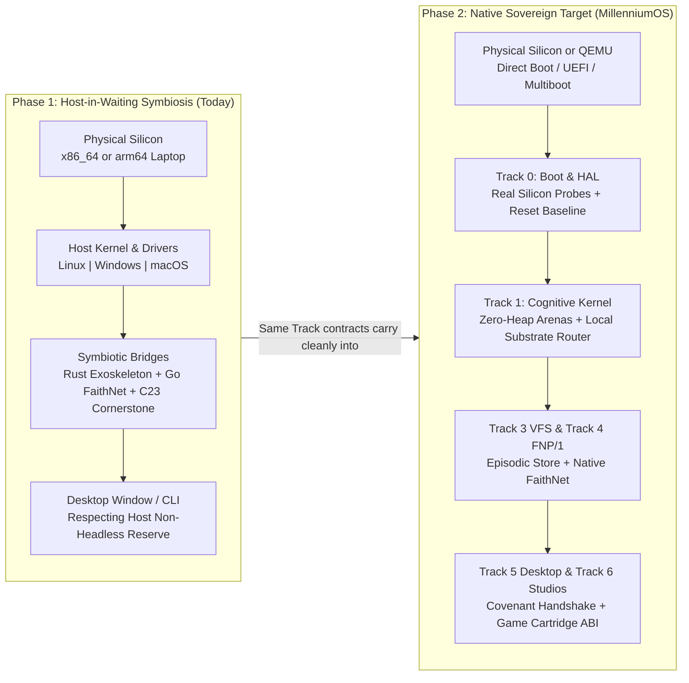

<!--
================================================================================
BLOCK 1: METADATA BLOCK
( Multi-OS Architecture Map: Linux, Windows, macOS & Sovereign MillenniumOS )
================================================================================
@project       OmniCode Framework / Big House Ecosystem
@file          .agents/host/host_environments_overview.md
@id            cog.agent.host.environments_overview
@layer         Portable Agent Substrate - Cross-Platform Host Architecture Guide
@archetype     operational | architectural_reference
@version       0.1.3-dev
@interface_rev Rev 5
@created       2026-11-19
@updated       2026-11-19
@author        CreativeWorkzStudio LLC / ProfessorSeanEX (Seanje Lenox-Wise)
@repository    https://github.com/Novaking34/OmniCode_Framework
@system        Hosted Hosts (Linux, Windows, macOS) + MillenniumOS Target
@role          Dual-Audience Comparison Across All 4 Platforms & Symbiosis Rules
@maturity      Rev 5 Verified Baseline (2026-11-19)
@chassis       portable-substrate | Zero OS-specific hallucination across hosts
@seams         data: ./hardware_calibration.json |
               live: ./host_pc_hardware_profile.md |
               specs: ./host-profile-spec/ |
               architecture: ../plans/vision/omnicode_architecture_and_vision.md
@invariants    1. Universal 5-Block Protocol (Rev 5, <=80 col headers).
               2. Explicitly separate [STANDARD OS BEDROCK] from
                  [OMNICODE ENHANCEMENT] on every OS so humans and offline AI
                  models diagnose OS vs OmniCode issues cleanly.
               3. Verify is_current_platform: true inside calibration JSON
                  before running OS-specific shell, GPU, or Wi-Fi commands.
               4. Never force Linux-only features (rtw89 ap0, KVM, /dev/zram0)
                  onto Windows or macOS templates, nor Windows/macOS clutter
                  into native MillenniumOS hardware tracks.
================================================================================
-->

# Host Environments Overview (`Linux`, `Windows`, `macOS`, `MillenniumOS`)

> **Why This Document Exists:** Right now our daily workshop lives on Linux, contributors and game playtesters arrive on **Windows** and **macOS**, and our entire framework is climbing toward **MillenniumOS** (`Track 0 -> Track 5`). If an engineer—or an offline AI model—doesn't clearly understand how those four operating systems handle memory, GPUs, files, audio, and radios differently, it will hallucinate commands that break someone's machine or conflate standard OS bugs with OmniCode design.

**Quick Navigation:**
[Opening (OS Mental Model)](#block-2-opening-what-an-operating-system-actually-does) |
[1. Symbiosis vs Sovereign Target](#1-host-in-waiting-symbiosis-vs-native-millenniumos) |
[2. 4-Platform Engineering Matrix](#2-side-by-side-4-platform-comparison-matrix) |
[3. Per-OS Deep Dives](#3-per-os-bedrock-vs-omnicode-enhancement-drawers) |
[Audit & Selection Check](#block-4-audit-non-hallucination-platform-checks) |
[Closing Action Playbook](#block-5-closing-platform-selection--onboarding-reel)

---

<!--
================================================================================
BLOCK 2: OPENING BLOCK
( Plain-English OS Explanation & Why Dual Tagging Matters )
================================================================================
-->

## Block 2 (Opening): What an Operating System Actually Does

Think of an **Operating System (OS)** as the building manager standing between raw physical silicon (CPU, RAM, screen, disk, Wi-Fi antenna) and the apps you actually open (a game, a compiler, a text editor, an AI assistant). Nobody wants to talk directly to raw memory chips just to save a story or draw a sprite, so the OS hands every app tidy doors for memory, files, graphics, sound, and network packets.

Why do we track **four** different OS environments here?

1. **Three Mainstream Hosts (`Linux`, `Windows`, `macOS`):** These are our **"Host-in-Waiting"** rooms today. OmniCode, Cornerstone (`C`/`C++`), FaithNet (`Go`), and our Rust exoskeleton live inside a host OS cleanly without requiring you to wipe your hard drive on day one. Each of those three host OSes speaks a different hardware dialect—so what works out of the box on Linux (like splitting one Wi-Fi chip into `wlp3s0` + `ap0`) behaves completely differently on Windows or macOS.
2. **One Native Sovereign OS (`MillenniumOS`):** This is the machine we are building **from silicon up (`Track 0` -> `Track 5`)**, where AI is not bolted onto a commercial browser tab or API wrapper, and `ALLOC_ZERO_HEAP` + `FaithNet FNP/1` live right inside the OS grain itself.

> [!NOTE]
> **Why We Label `[STANDARD OS BEDROCK]` vs `[OMNICODE ENHANCEMENT]`:**
> Even inside a custom OS like MillenniumOS, hardware physics (CPUID, page tables, PCIe bars, interrupts, framebuffers) still work like real computers. Labeling standard OS mechanics separately from OmniCode additions trains both non-programmers **and** our local offline CPI-SI models to spot whether an error belongs to standard OS behavior (say, Windows Defender locking a `.exe`, or macOS Unified Memory wiring limits) rather than blindly rewriting OmniCode files.

---

<!--
================================================================================
BLOCK 3: BODY BLOCK
( Symbiosis vs Native Topology, 4-OS Comparison Matrix & Per-OS Drawers )
================================================================================
-->

## 1. Host-in-Waiting Symbiosis vs. Native MillenniumOS



---

## 2. Side-by-Side 4-Platform Comparison Matrix

| Dimension | Linux (Ubuntu Workshop) | Windows (Playtest & Build Host) | macOS (Apple Silicon / Portable) | MillenniumOS (Native Sovereign Target) |
| :--- | :--- | :--- | :--- | :--- |
| **Status Today** | **`is_current_platform: true`** (Active primary host) | `is_current_platform: false` (Template slot ready) | `is_current_platform: false` (Template slot ready) | `is_current_platform: false` (`Track 0..5` bring-up target) |
| **Boot & Kernel** | UEFI/GRUB -> monolithic Linux `7.x` (`PREEMPT_DYNAMIC`) | Windows Boot Manager -> hybrid NT kernel | Secure Boot / iBoot -> XNU Mach/BSD hybrid kernel | `Track 0` Stage2/UEFI/Multiboot -> sovereign modular kernel (`Track 1`) |
| **Memory & GPU / VRAM** | Separate system RAM + discrete VRAM (`MX570 A` `1,387 MiB` usable) + `zram0` swap | WDDM splits **Dedicated VRAM** vs **Shared System GPU Memory**; silent CPU spillover hurts latency | Apple Silicon uses **Unified Memory** (`RAM == GPU pool` under Metal wired ceiling); Intel Mac uses discrete/iGPU | Static deterministic arenas (**`ALLOC_ZERO_HEAP`**) + exact `Track 0` E820/UEFI budget + calibrated `Track 1` AI slice |
| **Filesystem & Paths** | POSIX `/`, case-sensitive `ext4`, `LF` line endings, clean symlinks | Drive letters (`C:\`), case-insensitive `NTFS`, `260`-char legacy path trap unless `LongPathsEnabled`, `CRLF` risk | Case-insensitive `APFS` by default (`/`), `LF` endings, resource forks / extended attributes | **`Track 3` VFS & Grounded Memory** (explicit static bounds, Episodic Scrolls, Config ROMs) |
| **Display & Audio** | `Wayland` (or `X11`) + PipeWire/ALSA (`cAVS`) | `DWM` compositor + `WASAPI` / DirectSound | `WindowServer` / Metal + `CoreAudio` | **`Track 5` Viewport / Virtual VGA** + static `Track 1`/`Track 6` PCM audio ring |
| **Networking & `FaithNet`** | **`nl80211` native `ap0` + `wlp3s0` concurrency**; full raw packet & mDNS control | Tight driver lockouts on SoftAP/Hosted Network; ICS quirks & Defender Firewall prompts | Closed Wi-Fi stack (`AWDL` interferes on 5 GHz, **no raw `ap0` AP+STA concurrency**) | **`Track 4` Native `FNP/1`** (512B Floppy Sector Invariant sovereign from ring-0/driver boundary up) |
| **Virtualization** | **`KVM` + `QEMU 10.2.1`** near-native speed via `VT-x` | `Hyper-V` + `WSL2` (or QEMU `whpx`) | `Virtualization.framework` (`arm64` native, `x86_64` emulated in UTM/QEMU) | Target guest inside QEMU today -> bare-metal physical silicon tomorrow |
| **Main Role in Ecosystem** | Daily compiler + `FaithNet` AP radio + `0.5b..7b` local AI + `Track 0` KVM lab | Windows desktop builds of *Tenebris and Lux* / Cornerstone + collaborator laptops | Unified-memory local AI testing + POSIX workstation compatibility | The end-state sovereign home where OmniCode and CPI-SI live without cloud rent |

---

## 3. Per-OS Bedrock vs. OmniCode Enhancement Drawers

<details>
<summary>1. Linux Host Drawer (Active Primary Workshop &amp; FaithNet Radio Lab)</summary>

* **`[STANDARD OS BEDROCK]`:** POSIX paths, `systemd`, `NetworkManager`/`nl80211`, Wayland compositor (`ubuntu:GNOME`), `zram` compressed RAM swap, `KVM` hardware virtualization (`VT-x`), and open NVML/PCI inspection (`nvidia-smi`, `lspci`, `lscpu`).
* **`[OMNICODE ENHANCEMENT]`:** Strict `3,072 MiB` non-headless RAM reserve, `350 MiB` Wayland VRAM display floor protecting our `MX570 A` (`1,387 MiB` compute ceiling), Realtek `rtw89_8852ce` Zero-Brick STA+AP (`ap0`) channel rules, and `hardware_calibration.json` 4-tier `threshing_delta = 0` envelopes.
* **Watch-Out:** Never let Linux silent swap fallback (`/swap.img`) hide a runaway model load on DRAM-less NVMe hardware, and never assume `X11` when the live session reports `Wayland`.

</details>

<details>
<summary>2. Windows Host Drawer (Cross-Platform Cornerstone &amp; Collaborator Laptops)</summary>

* **`[STANDARD OS BEDROCK]`:** `NTFS` with `C:\` paths, `WDDM` GPU memory virtualization (automatically spills full VRAM silently into slower system RAM), Windows Defender real-time antivirus scanning, `WASAPI` audio, and `WSL2`/`Hyper-V` isolation boundaries.
* **`[OMNICODE ENHANCEMENT]`:** Enforces `LF` line-ending discipline across `.gitattributes`, portable C23/C11 + Rust targets, non-headless `WDDM` dedicated-only VRAM ceiling checks (never count WDDM "Shared GPU Memory" as real fast VRAM for local models!), and clean Defender build-folder exclusions.
* **Watch-Out:** Windows Wi-Fi drivers frequently block simultaneous STA+AP virtual interfaces (`Hosted Network` deprecated on modern Wi-Fi 6 cards). Treat Windows as a **station/client node (`wlp`/`Wi-Fi`) or LAN peer** in FaithNet unless tested USB/AP adapters prove otherwise. Also check `LongPathsEnabled=1` before deep checkouts.

</details>

<details>
<summary>3. macOS Host Drawer (Unified Memory Silicon &amp; Strict Sandboxing)</summary>

* **`[STANDARD OS BEDROCK]`:** Darwin/XNU kernel, `APFS` (case-insensitive by default), System Integrity Protection (`SIP`), `CoreAudio`, Metal GPU API, `AWDL` (Apple Wireless Direct Link), and Unified Memory on M-series chips (`RAM` and `VRAM` share one physical pool, governed by `sysctl iogpu.wired_limit_mb`).
* **`[OMNICODE ENHANCEMENT]`:** When calibrating `0.5b..7b`+ models on Apple Silicon, subtract BOTH the macOS WindowServer/desktop reserve **and** respect the Metal wired limit (`maxRecommendedWorkingSetSize`) so large contexts never lock Finder/WindowServer. Run `Track 0` QEMU targets through `hvf` (`Virtualization.framework`) on matching arch.
* **Watch-Out:** macOS **does not expose Linux-style `nl80211` `ap0` simultaneous STA+AP interfaces**, and `AWDL` can periodically hop channels causing jitter during low-latency wireless tests. Do not copy Linux `iw` radio assumptions into macOS host profiles.

</details>

<details>
<summary>4. MillenniumOS Native Drawer (Track 0 Silicon Up -&gt; Track 5 Sovereign Desktop)</summary>

* **`[STANDARD OS BEDROCK]`:** Real x86_64/UEFI/Multiboot hardware initialization: CPU privilege rings, `CPUID`, `E820`/UEFI memory maps, GDT/IDT/interrupt tables, PCIe enumeration, linear framebuffers, and bounded packet rings. Learning and documenting these truthfully keeps our local CPI-SI model fluent in real OS engineering.
* **`[OMNICODE ENHANCEMENT]`:** Removes commercial background bloat completely: `Track 0` probes physical reality directly (`verify` + `hal/probes`), **`Track 1`** enforces `ALLOC_ZERO_HEAP` static arenas and hosts the native Rust CPI-SI cognitive router cleanly inside the kernel/runtime grain, **`Track 3`** anchors persistent memory in grounded VFS/episodic banks instead of ad-hoc temp files, **`Track 4`** runs `FaithNet FNP/1` natively, and **`Track 5`** boots straight from Covenant Handshake into `OmniStudio Home` and **`Track 6`** (`Cornerstone Engine` cartridge ABI).
* **Watch-Out:** Until bare-metal drivers mature per chip, treat **QEMU (`VT-x` KVM on Linux)** as the primary reproducible target profile inside `millenniumos_host_profile.template.md`, separating emulated hardware behavior (`Virtual VGA`, virtio/e1000) from future bare-metal silicon targets.

</details>

---

<!--
================================================================================
BLOCK 4: AUDIT PROCEDURES BLOCK
( Active Platform Enforcement & Zero-Hallucination Guardrails )
================================================================================
-->

## Block 4 (Audit): Non-Hallucination Platform Checks

Before an agent runs any host shell script, builds an installer, tests Wi-Fi AP mode, or plans model VRAM offload, run this guard check inside `.agents/host/`:

```bash
python3 -c '
import json
cal = json.load(open("hardware_calibration.json"))
platforms = cal["block_3_body"]["platforms"]
active = [k for k, v in platforms.items() if v.get("is_current_platform") is True]
assert len(active) == 1, f"Expected exactly 1 active platform, got {active}"
assert cal["block_2_opening"]["active_platform"] == active[0]
print(f"ACTIVE_PLATFORM_VERIFIED={active[0]}")
'
```

| T4 State | Observed Audit Condition | Meaning & Immediate Rule |
| :--- | :--- | :--- |
| **`+1:PROCEED`** | Exactly **one** platform in [`hardware_calibration.json`](./hardware_calibration.json) has `is_current_platform: true`, and inactive platforms are `false` | Use only commands, path rules, GPU math, and Wi-Fi assumptions valid for that active OS |
| **`0:AWAIT`** | Switching laptops, booting a Windows/macOS collaborator machine, or starting a QEMU MillenniumOS target | Pause and instantiate matching template from `./host-profile-spec/` before profiling compute loads |
| **`-1:ROLLBACK`** | Script calls Linux `iw`/`zram` commands on Windows/macOS, or counts WDDM Shared Memory as fast VRAM | Stop mixed-OS command generation immediately and fall back to the verified active platform profile |
| **`NULL:HALT`** | Two platforms claim `is_current_platform: true` or zero platforms are active in a non-template copy | **Lock execution assumptions** until [`hardware_calibration.json`](./hardware_calibration.json) restores strict 1-of-4 state |

---

<!--
================================================================================
BLOCK 5: CLOSING BLOCK
( ACTION / REEL - Platform Selection Playbook, Seams & Onboarding Handoff )
================================================================================
-->

## Block 5 (Closing): Platform Selection & Onboarding Reel

Block 5 turns the four-OS comparison into clear working decisions so contributors and agents always pick the right machine, right template, and right boundary.

### 1. Operational Selection Playbook (`PLAY`: Choosing the Right Host Room)

* **Stay on Linux (`Inspiron 16 5640`, active `true`):** Use Linux for daily framework building (`rustc`, `go`, `gcc`/`cmake`), `0.5b..7b` local calibration, **all `FaithNet` dual-interface (`wlp3s0` + `ap0`) field testing**, and fast `KVM`-accelerated QEMU iterations for `Track 0` -> `MillenniumOS`.
* **Spin Up a Windows Profile (`is_current_platform: false` slot):** Use Windows strictly for native *Tenebris and Lux* / `Cornerstone` UI/audio verification and collaborator Windows onboarding; never rely on Windows SoftAP tricks for `FaithNet` routing or count WDDM Shared RAM as compute VRAM.
* **Spin Up a macOS Profile (`is_current_platform: false` slot):** Use macOS strictly to test `POSIX` portability, `CoreAudio`/`WindowServer` presentation, and Apple Silicon Unified Memory AI tiers; never invoke Linux `ap0` radio expectations on macOS.
* **Boot MillenniumOS (`is_current_platform: false` target slot):** Use `Track 0` QEMU/bare-metal probes to verify clean boot-to-login-to-desktop handoffs where `[STANDARD OS BEDROCK]` stays visibly distinct from `[OMNICODE ENHANCEMENT]`.

### 2. Outward System Seams (`PROJECT`: Cross-Track Contract Handoff)

* **`Track 0` (`hal/` & `boot/`):** Abstracts host vs QEMU silicon differences cleanly behind one uniform probe contract.
* **`Track 1` (`runtime/` & `cognitive/router`):** Adapts thread scheduling, static arena guards, and GPU/VRAM budgets per active `platforms.<os>` flag without touching higher layers.
* **`Track 3` (`vfs/`):** Shields Tracks 2/5/6 from host path traps (`NTFS` long paths/CRLF vs case-sensitive `ext4` vs `APFS`) before converging on native Track 3 VFS.
* **`Track 4` (`bridges/`):** Maps `FNP/1` directly onto raw Linux `nl80211`/`ap0` today, gracefully steps down on Windows/macOS clients, and binds natively on MillenniumOS.

### 3. Onboarding a New Machine (`RECORD`: Using `host-profile-spec/`)

When bringing a new computer or VM online, follow this exact pairing workflow:

1. Pick the matching Markdown template inside `./host-profile-spec/`:
   * [`linux_host_profile.template.md`](./host-profile-spec/linux_host_profile.template.md)
   * [`windows_host_profile.template.md`](./host-profile-spec/windows_host_profile.template.md)
   * [`macos_host_profile.template.md`](./host-profile-spec/macos_host_profile.template.md)
   * [`millenniumos_host_profile.template.md`](./host-profile-spec/millenniumos_host_profile.template.md)
2. Copy [`hardware_calibration.template.json`](./host-profile-spec/hardware_calibration.template.json) to `./hardware_calibration.json` on that machine's workspace.
3. Flip `is_current_platform` to **`true` ONLY on that active platform** (keep the other three strictly **`false`**), run the Block 4 probes from the matching OS template, and record verified numbers without guessing.

### 4. Reconciliation Back to Block 1 & Portable Anchors (`COMMIT`)

This overview fulfills Block 1's four invariants: clear `[STANDARD OS BEDROCK]` vs `[OMNICODE ENHANCEMENT]` separation, zero OS-feature leakage across Linux/Windows/macOS/MillenniumOS, live `is_current_platform` parity enforcement, and full portability across `.agents/` mirrors:

* [`host_pc_hardware_profile.md`](./host_pc_hardware_profile.md) — Active live Linux profile (`professorseanex-Inspiron-16-5640`)
* [`hardware_calibration.json`](./hardware_calibration.json) — Machine-readable 4-platform contract (`linux: true`, `windows`/`macos`/`millenniumos: false`)
* [`hardware_calibration.template.json`](./host-profile-spec/hardware_calibration.template.json) — Blank JSON schema template (`all false`)
* [`.agents/README.md`](../README.md) — Portable Cognitive BIOS root index
* [`omnicode_architecture_and_vision.md`](../plans/vision/omnicode_architecture_and_vision.md) — Full `Track 0..7` framework skeleton

<!--
================================================================================
END OF BLOCK 5: CLOSING SEAL
Status: HOST_ENVIRONMENTS_OVERVIEW_ACTIVE_AND_BOUNDED (+1:PROCEED)
================================================================================
-->
