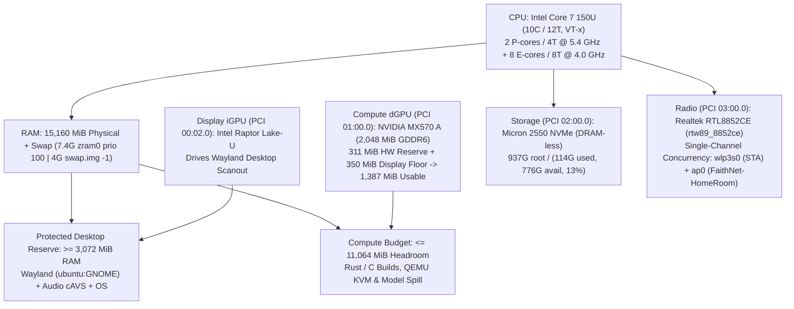

<!--
================================================================================
BLOCK 1: METADATA BLOCK
( Identity, Live Silicon Telemetry, Non-Headless Guard & Calibration Seams )
================================================================================
@project       OmniCode Framework / Big House Ecosystem
@file          .agents/host/host_pc_hardware_profile.md
@id            cog.agent.host.pc_hardware_profile
@layer         Portable Agent Substrate - Physical Host Reality Anchor
@archetype     operational | telemetry_baseline
@version       0.1.3-dev
@interface_rev Rev 5
@created       2026-11-19
@updated       2026-11-19
@author        CreativeWorkzStudio LLC / ProfessorSeanEX (Seanje Lenox-Wise)
@repository    https://github.com/Novaking34/OmniCode_Framework
@system        Inspiron-16-5640 (Ubuntu 26.04.1 LTS / Linux 7.0.0 / Wayland)
@role          Dual-Audience Host Hardware Profile, Guardrails & Action Playbook
@maturity      Rev 5 Live Verified Telemetry (2026-11-19 Probe)
@chassis       x86_64 | Core 7 150U (2P+8E/12T) + MX570 A (2GB) + RTL8852CE
@seams         data: ./hardware_calibration.json |
               overview: ./host_environments_overview.md |
               spec: ./host-profile-spec/linux_host_profile.template.md |
               feeds: Track 0 HAL/Probes, Track 1 Calibration, Track 4 Radio
@invariants    1. Universal 5-Block Protocol (Rev 5, <=80 col headers).
               2. Non-Headless Safety Floor: keep >=3072 MiB system RAM and
                  >=350 MiB VRAM display floor before spawning compute loads.
               3. Zero-Brick Networking Guard: single-channel RTL8852CE shares
                  wlp3s0 (STA) + ap0 (FaithNet-HomeRoom) cleanly with powersave
                  disabled and 2.4 GHz / beacon_int=200 stability on weak links.
               4. Never hallucinate cloud GPUs or X11 assumptions: active host
                  runs Wayland (ubuntu:GNOME) with 1,387 MiB compute VRAM.
================================================================================
-->

# Host PC Hardware Profile (`professorseanex-Inspiron-16-5640`)

> **Why Both Humans and Agents Carry This File:** In CPI-SI, **the OS is the Hosting Ground for the Model**. Whether you are an everyday reader trying to understand how this laptop partitions work—or a systems engineer or local AI agent compiling Rust/C, booting QEMU, or loading Qwen models—this document locks in the real physical hardware truth so nobody freezes the desktop, burns out the SSD, or knocks offline Wi-Fi off the air.

**Quick Navigation:**
[Opening (Dual-Audience Guide)](#block-2-opening-understanding-this-machine) |
[1. Visual Resource Budget](#1-visual-hardware--resource-budget-map) |
[2. Verified Specs](#2-core-hardware--operating-system-matrix) |
[3. 4-Tier AI Calibration](#3-verified-4-tier-local-ai-calibration-05b-to-7b) |
[4. Radio Laws](#4-wireless-radio--zero-brick-host-constraints-rtl8852ce) |
[Audit & Drift Probes](#block-4-audit-live-verification--parity-checks) |
[Closing Action Playbook](#block-5-closing-operational-playbook--handoff)

---

<!--
================================================================================
BLOCK 2: OPENING BLOCK
( Dual-Audience Front Door, Mental Model & Non-Headless Guardrails )
================================================================================
-->

## Block 2 (Opening): Understanding This Machine

> [!NOTE]
> **If You Are Not a Programmer, Start Here:**
> Picture this Dell Inspiron 16 5640 like a small, disciplined workshop instead of a giant cloud warehouse:
>
> - **Hybrid CPU (`2` P-cores + `8` E-cores):** Two fast sprint mechanics (`5.4 GHz`) handle bursty interactive work, while eight steady marathon workers (`4.0 GHz`) carry background builds and heavy compilation without bogging the laptop down.
> - **Memory (`14.8 GiB` RAM + `7.4 GiB` `zram0`):** RAM is the workbench. We keep a strict `3,072 MiB` corner cleared off so Ubuntu, GNOME, your browser, and audio never stutter. `zram0` compresses overflow inside RAM at priority `100` before touching the SSD (`priority -1`).
> - **Two GPUs (Intel iGPU + NVIDIA MX570 A):** The Intel chip paints your Wayland desktop smoothly so the `2 GB` NVIDIA chip can act as our small AI accelerator (`1,387 MiB` truly usable after hardware and screen-safety reserves).
> - **One DRAM-less SSD + One Shared Wi-Fi Chip:** Our `1 TB` Micron SSD stores `937 GiB` cleanly (`776 GiB` free), and we keep writes tidy because it has no onboard DRAM cache. Our Realtek Wi-Fi card runs normal internet (`wlp3s0`) AND broadcasts `FaithNet-HomeRoom` (`ap0`) off the same single radio channel—so one careless command could drop both links if we ignore the rules.

### Reading Paths by Audience

| If Your Role Is... | Start With... | What You Get Out of It |
| :--- | :--- | :--- |
| **Non-Programmer / Creator / Educator** | [Block 2 Note](#block-2-opening-understanding-this-machine) + [Diagram](#1-visual-hardware--resource-budget-map) + [Radio Rules](#4-wireless-radio--zero-brick-host-constraints-rtl8852ce) | Clear mental model of why software must respect hardware limits and why small, clean tools run fast here. |
| **Systems Engineer / Engine Builder** | [Spec Matrix](#2-core-hardware--operating-system-matrix) + `<details>` Engineering Drawer + [Block 4 Audit](#block-4-audit-live-verification--parity-checks) | Exact CPU caches, PCI slots, Wayland session, toolchain versions, `VT-x` status, and drift tripwires. |
| **AI Agent / Orchestrator Runtime** | [`hardware_calibration.json`](./hardware_calibration.json) + [Section 3](#3-verified-4-tier-local-ai-calibration-05b-to-7b) + [Block 5 Playbook](#block-5-closing-operational-playbook--handoff) | Machine-exact `0.5b`..`7b` GPU layer limits, `is_current_platform: true` check, and safe build/test concurrency. |

> [!IMPORTANT]
> **Hard Non-Headless Safety Law:** This laptop is a live workstation, not a headless server rack. Every local AI load, QEMU VM, or parallel compiler run **must** leave at least **`3,072 MiB` system RAM** and **`350 MiB` display VRAM** untouched for Ubuntu + Wayland GNOME (`1,387 MiB` maximum usable compute VRAM on the MX570 A).

---

<!--
================================================================================
BLOCK 3: BODY BLOCK
( Topology Map, Verified Hardware Matrix, Toolchains & 4-Tier Calibration )
================================================================================
-->

## 1. Visual Hardware & Resource Budget Map



---

## 2. Core Hardware & Operating System Matrix

Every component below pairs plain-English meaning with verified live Linux probes (`2026-11-19`) and explicitly separates standard hardware/OS behavior (**`[STANDARD OS BEDROCK]`**) from what our system adds (**`[OMNICODE ENHANCEMENT]`**).

| Subsystem | Plain-English Role | Verified Measured Specification (`2026-11-19`) | Standard Bedrock vs. OmniCode Layer |
| :--- | :--- | :--- | :--- |
| **Host & OS** | Main workstation OS running builds and desktop tools | `professorseanex-Inspiron-16-5640`, `Ubuntu 26.04.1 LTS` (`x86_64`), Kernel `7.0.0-43-generic #43-Ubuntu SMP PREEMPT_DYNAMIC` | **`[STANDARD OS BEDROCK]`** Ubuntu Linux preemption + **`[OMNICODE ENHANCEMENT]`** Active `is_current_platform: true` host contract |
| **Display Session** | Draws windows, text, and games on screen | `XDG_SESSION_TYPE=wayland`, `XDG_CURRENT_DESKTOP=ubuntu:GNOME` | **`[STANDARD OS BEDROCK]`** GNOME Wayland compositor (`X11` is not the active session) |
| **Hybrid CPU** | Mixes fast sprint cores with efficient background cores | `Intel(R) Core(TM) 7 150U` (`10C / 12T`, `VT-x`): `2` P-cores / `4T` (`0..3`, `5.4 GHz`) + `8` E-cores / `8T` (`4..11`, `4.0 GHz`) | **`[STANDARD OS BEDROCK]`** Intel `VT-x` + hybrid P/E scheduler + **`[OMNICODE ENHANCEMENT]`** Thread-pinned tier budgets & Track 0 CPUID probes |
| **System RAM & Swap** | Fast active workspace plus smart compressed overflow | `15,160 MiB` (`14.8 GiB`) RAM; `11,676 MiB` swap (`7.4G` `/dev/zram0` prio `100` + `4G` `/swap.img` prio `-1`) | **`[STANDARD OS BEDROCK]`** Linux `zram` swap compression + **`[OMNICODE ENHANCEMENT]`** `3,072 MiB` non-headless floor & `ALLOC_ZERO_HEAP` |
| **Display iGPU** | Dedicated graphics chip just for screen output | `Intel Corporation Raptor Lake-U [Intel Graphics]` (`rev 04`, `PCI 00:02.0`) | **`[STANDARD OS BEDROCK]`** Intel i915/xe display pipeline |
| **Compute dGPU** | Small Nvidia card doing AI math & rendering | `NVIDIA GeForce MX570 A` (`GA107M`, `PCI 01:00.0`, Driver `595.99.02`), `2,048 MiB` GDDR6 (`1,387 MiB` usable compute) | **`[STANDARD OS BEDROCK]`** NVIDIA CUDA/NVML + **`[OMNICODE ENHANCEMENT]`** Strict `350 MiB` display floor before compute allocation |
| **NVMe Storage** | Fast solid-state drive without onboard DRAM buffer | `Micron 2550 NVMe SSD (DRAM-less)` (`nvme0n1`, `953.9 GiB`), `/` partition `/dev/nvme0n1p2` (`114G` used / `776G` free, `13%`) | **`[STANDARD OS BEDROCK]`** Linux ext4/NVMe I/O + **`[OMNICODE ENHANCEMENT]`** Bounded Track 3 writes (avoid write-amplifying thrashing) |
| **Audio Bus** | Sound mixer and voice/signal test channel | `Intel Corporation Raptor Lake-P/U/H cAVS` (`rev 01`, `PCI 00:1f.3`) | **`[STANDARD OS BEDROCK]`** ALSA/PipeWire + **`[OMNICODE ENHANCEMENT]`** FaithNet Rung 1 AFSK/Morse audio-carrier testing |
| **Wi-Fi Radio** | Shared antenna for home internet and FaithNet AP | `Realtek RTL8852CE` (`rtw89_8852ce`, `PCI 03:00.0`); links `lo`, `wlp3s0` (`UP`), `ap0` (`UP` `FaithNet-HomeRoom`) | **`[STANDARD OS BEDROCK]`** `nl80211`/`mac80211` vif + **`[OMNICODE ENHANCEMENT]`** Zero-Brick STA+AP concurrency laws (`Track 4`) |

<details>
<summary>Expand Engineering Spec Drawer: CPU Caches, PCI Bus Topology, Swap Priorities &amp; Installed Toolchains</summary>

#### A. Detailed CPU Topology & Cache Hierarchy (`lscpu`)

- **Vendor / Stepping:** `GenuineIntel`, Family `6`, Model `186`, Stepping `3`, `1` NUMA node (`CPU 0-11`), `VT-x` enabled.

- **Clock Window:** `400.0 MHz` min to `5400.0 MHz` max (scaling ~`62%` at idle).
- **Cache Hierarchy:**
  - `L1d`: `352 KiB` (`10 instances`)
  - `L1i`: `576 KiB` (`10 instances`)
  - `L2`: `6.5 MiB` (`4 instances`)
  - `L3`: `12 MiB` (`1 instance`)

#### B. PCI Bus Slot Map (`lspci`) & VRAM Partition Math

- `00:02.0` — `VGA compatible controller`: Intel Raptor Lake-U `[Intel Graphics]` (`rev 04`)

- `00:06.2` — `PCI bridge`: Intel Device `a73d` (`rev 01`)
- `00:1f.3` — `Audio device`: Intel Raptor Lake-P/U/H cAVS (`rev 01`)
- `01:00.0` — `3D controller`: NVIDIA `GA107M [GeForce MX570 A]` (`rev a1`, Bus `0000:01:00.0`)
  - `2,048 MiB` physical GDDR6 `- 311 MiB` firmware/addressable reserve = **`1,737 MiB` addressable VRAM**
  - `1,737 MiB` addressable `- 350 MiB` non-headless Wayland display safety floor = **`1,387 MiB` usable compute VRAM**
- `02:00.0` — `Non-Volatile memory controller`: Micron Technology Inc `2550 NVMe SSD (DRAM-less)` (`rev 01`)
- `03:00.0` — `Network controller`: Realtek `RTL8852CE PCIe 802.11ax` (`rev 01`)

#### C. Swap Priority & Storage Footprint

- **Swap Device Order:** `/dev/zram0` (`7.4G` compressed in RAM, priority `100`) catches pressure first before `/swap.img` (`4G` NVMe file, priority `-1`) touches the DRAM-less flash.

- **Root Mount (`/`):** `/dev/nvme0n1p2` -> `937G` total, `114G` used, `776G` available (`13%` utilized).

#### D. Installed Build, VM & AI Toolchains (`2026-11-19`)

| Toolchain | Verified Live Version | Primary OmniCode Track Seam |
| :--- | :--- | :--- |
| **`rustc` / `cargo`** | `1.93.1` (`01f6ddf75 2026-02-11` / `083ac5135`) | Track 1 Rust exoskeleton, `tl_tools`, validators (`Track 7`) |
| **`go`** | `go1.26.8 linux/amd64` | Track 4 `FaithNet` (`FNP/1`) 0-external-dependency daemon & CLI |
| **`gcc` / `cmake`** | `gcc 15.2.0` (`Ubuntu 15.2.0-16ubuntu1`), `cmake 4.2.3` | Track 6 `Cornerstone` C23/C11 engine & CTest harness |
| **`python3`** | `Python 3.14.4` | Temporary Track 1 calibration/orchestrator bridge (`tools/orchestrator/`) |
| **`qemu-system-x86_64`** | `QEMU 10.2.1` (`Debian 1:10.2.1+ds-1ubuntu3.3`) | Track 0 boot/UEFI/Multiboot testing & MillenniumOS VM bring-up |
| **`ollama`** | `0.40.8` | Local AI runtime serving `0.5b`..`7b` calibrated modelfiles |
| **`zsh` (Default Shell)** | `zsh 5.9 (x86_64-ubuntu-linux-gnu)` (`/usr/bin/zsh`, `bash` retained) | Interactive login shell with shared toolchain `PATH` via `~/.zshrc` |

</details>

---

## 3. Verified 4-Tier Local AI Calibration (`0.5B` to `7B`)

All four model tiers live as machine-readable SSOT inside [`hardware_calibration.json`](./hardware_calibration.json) (`platforms.linux.calibrated_tiers`, sourced from `Tenebris-and-Lux/tools/orchestrator/config/hardware_calibration.json`). Every tier verified **`CLEAN`** with **`threshing_delta = 0`** across context, GPU layers, and CPU threads, meeting the **`>= 4096` Continue.dev floor**:

| Tier | Base Model | Ideal Ctx | GPU Layers | CPU Threads | KV Cache | VRAM Headroom | RAM Spill | RAM Headroom | Status |
| :--- | :--- | :---: | :---: | :---: | :---: | :---: | :---: | :---: | :--- |
| **`0.5b`** | `qwen2.5-coder:0.5b` | `8,192` | `24` | `4` | `96.0 MiB` | `1,244.0 MiB` | `0.0 MiB` | `11,064.0 MiB` | `CLEAN` (`delta=0`) |
| **`1.5b`** | `qwen2.5-coder:1.5b` | `8,192` | `28` | `4` | `224.0 MiB` | `527.0 MiB` | `0.0 MiB` | `11,064.0 MiB` | `CLEAN` (`delta=0`) |
| **`3b`** | `qwen2.5-coder:3b` | `8,192` | `20` | `8` | `288.0 MiB` | `376.8 MiB` | `857.8 MiB` | `10,206.2 MiB` | `CLEAN` (`delta=0`) |
| **`7b`** | `qwen2.5-coder:7b` | `8,192` | `4` | `10` | `448.0 MiB` | `1,065.6 MiB` | `4,476.6 MiB` | `6,587.4 MiB` | `CLEAN` (`delta=0`) |

> [!TIP]
> **Why `1.5b` Is the Daily Sweet Spot Here:** Both `0.5b` and `1.5b` fit `100%` on the MX570 A with **`0.0 MiB` system RAM spill**, leaving all `11,064 MiB` compute RAM free for Rust/C builds and QEMU. `3b` spills a gentle `857.8 MiB` into fast RAM while keeping `376.8 MiB` VRAM margin; `7b` trades speed for deep offline reasoning (`4,476.6 MiB` RAM + `4` GPU layers), still keeping `6,587.4 MiB` above the desktop guard.

<details>
<summary>Expand Calibration Drawer: Full &ldquo;The Room&rdquo; Bounds (Min / Ideal / Max) Across All 4 Tiers</summary>

Every tier defines three envelopes in `the_room` (`min`, `ideal`, `max`) paired with `Modelfile` specs in `Tenebris-and-Lux/tools/orchestrator/config/modelfiles/`:

| Tier | `min` Envelope (`ctx` / `gpu` / `thr`) | `ideal` Envelope (`ctx` / `gpu` / `thr`) | `max` Envelope (`ctx` / `gpu` / `thr`) | Description of Target Envelope |
| :--- | :--- | :--- | :--- | :--- |
| **`0.5b`** | `2,048` / `10` / `1` | **`8,192` / `24` / `4`** | `8,192` / `24` / `12` | Fast inline completion; fits `100%` in VRAM even at max threads |
| **`1.5b`** | `4,096` / `10` / `1` | **`8,192` / `28` / `4`** | `32,768` / `28` / `12` | Best speed/precision balance; hits `32K` ceiling when uncontested |
| **`3b`** | `4,096` / `10` / `1` | **`8,192` / `20` / `8`** | `16,384` / `25` / `12` | Hybrid P+E synthesis tier (`857.8 MiB` clean RAM offload) |
| **`7b`** | `4,096` / `0` / `1` | **`8,192` / `4` / `10`** | `16,384` / `5` / `12` | Heavy local reasoning (`4` GPU layers keep KV math safe inside VRAM) |

</details>

---

## 4. Wireless Radio & Zero-Brick Host Constraints (`RTL8852CE`)

> [!WARNING]
> **Single-Channel Wi-Fi Concurrency Law (`rtw89_8852ce`):**
> This Realtek card drives **both** your home internet uplink (`wlp3s0`, station mode) and the local `FaithNet-HomeRoom` hotspot (`ap0`, AP mode) on **one shared physical radio**:
>
> 1. **Same-Channel Physics:** Never force `ap0` onto a conflicting channel while `wlp3s0` is locked to an upstream router; match the upstream channel so `rtw89_8852ce` does not disconnect or stall.
> 2. **Power-Save Off:** Keep Wi-Fi `powersave` disabled during active `FaithNet` or SSH sessions so beacons and frames do not sleep-drop.
> 3. **Weak-Uplink Stability:** When camping on noisy or distant `2.4 GHz` uplinks (e.g., `TheTribe`), tune `beacon_int=200` on `ap0` and verify routes via `../skills/faithnet-workflows/SKILL.md` instead of tearing down `NetworkManager` globally.

---

<!--
================================================================================
BLOCK 4: AUDIT PROCEDURES BLOCK
( Live Hardware Verification, JSON Parity & T4 Drift Tripwires )
================================================================================
-->

## Block 4 (Audit): Live Verification & Parity Checks

### 1. Host Silicon & Toolchain Refresh Probes

Run these commands to confirm the physical machine matches Section 2 without assumptions:

```bash
hostname && uname -a && echo "SESSION=$XDG_SESSION_TYPE DESKTOP=$XDG_CURRENT_DESKTOP"
lscpu | grep -E "Model name|CPU\(s\)|Core\(s\)|Thread\(s\)|Virtualization|L1d|L1i|L2|L3|MHz"
free -m && swapon --show
nvidia-smi --query-gpu=name,memory.total,driver_version,pci.bus_id --format=csv,noheader
lspci | grep -iE "vga|3d|network|audio|nvme"
df -h / && ip -br link
rustc --version && go version && gcc --version | head -n 1 && cmake --version | head -n 1 && qemu-system-x86_64 --version | head -n 1 && ollama --version && zsh --version
```

### 2. Multi-Platform JSON Parity Check

Run inside `.agents/host/` to guarantee `hardware_calibration.json` stays synced with this document:

```bash
python3 -c '
import json
d = json.load(open("hardware_calibration.json"))["block_3_body"]["platforms"]
assert d["linux"]["is_current_platform"] is True
assert all(d[p]["is_current_platform"] is False for p in ("windows", "macos", "millenniumos"))
tiers = d["linux"]["calibrated_tiers"]
assert list(tiers.keys()) == ["0.5b", "1.5b", "3b", "7b"]
assert all(all(v == 0 for v in tiers[t]["threshing_delta"].values()) for t in tiers)
print("HOST_JSON_PARITY_OK")
'
```

### 3. Fourfold T4 Drift Tripwires

| T4 State | Observed Trigger Condition | Required Response |
| :--- | :--- | :--- |
| **`+1:PROCEED`** | `HOST_JSON_PARITY_OK`, `XDG_SESSION_TYPE=wayland`, driver `595.99.02`, usable compute VRAM `>= 1387 MiB`, zero delta across `0.5b..7b` | Proceed with calibrated builds, QEMU, and local inference normally |
| **`0:AWAIT`** | Minor kernel patch, updated `rustc`/`go`/`ollama`, or NVMe free space changes by `> 10%` | Pause calibration assumptions; re-run probes and refresh doc + JSON timestamps |
| **`-1:ROLLBACK`** | `threshing_delta != 0`, desktop swap hits disk (`/swap.img` used), or `ap0` loses link under radio tune | Unload active heavy tier (`7b` -> `1.5b`), cut build `-j` threads, restore clean Wi-Fi state |
| **`NULL:HALT`** | Usable compute VRAM drops below `1,387 MiB`, free RAM falls under `3,072 MiB` reserve, or two platforms set `is_current_platform: true` | **Stop launching compute/model workloads immediately**; fix host JSON flag or free system resources |

---

<!--
================================================================================
BLOCK 5: CLOSING BLOCK
( ACTION / REEL - Operational Playbook, System Seams, Maintenance & Seal )
================================================================================
-->

## Block 5 (Closing): Operational Playbook & Handoff

Block 5 turns the measured facts in Blocks 1–4 into concrete day-to-day actions for engineers and AI agents booting onto this workstation.

### 1. Operational Playbook (`PLAY`: How Agents & Builders Act Here)

- **Choosing a Local AI Tier:** Use **`0.5b`** for sub-second syntax/inline hooks, default to **`1.5b`** (`8,192` ctx, `28` GPU layers, `0 MiB` RAM spill) for everyday local coding, step up to **`3b`** when richer cross-file synthesis justifies `857.8 MiB` RAM spill, and reserve **`7b`** for intentional deep offline reasoning when heavy builds or VMs are idle.

- **Parallel Builds Without Desktop Freeze:** Cap `cargo`, `cmake --build --parallel`, and `gcc` jobs around **`-j8`** when GNOME, Wayland video, or an `ollama` session is active (keep `2` P-threads + `2` E-threads breathing room), reserving full `-j12` for clean terminal-only builds.
- **QEMU & Kernel Development (`Track 0`):** Always launch `qemu-system-x86_64` with `-enable-kvm -cpu host` so `VT-x` hardware virtualization carries the load cleanly instead of hammering single-threaded TCG emulation.
- **FaithNet Live Field Discipline (`Track 4`):** Never cycle `NetworkManager` blindly or assign mismatched channels across `wlp3s0` and `ap0`; keep `powersave` off and follow the Zero-Brick host rules before testing packet recovery.

### 2. Outward System Seams (`PROJECT`: Where This Telemetry Feeds)

- **`Track 0` (`hal/probes`):** Receives baseline `CPUID` topology, `VT-x` expectations, NVMe DRAM-less warning, and dual-GPU scanout vs compute split.

- **`Track 1` (`cognitive/calibration` & `exoskeleton`):** Consumes `platforms.linux.calibrated_tiers` from [`hardware_calibration.json`](./hardware_calibration.json) so local models never over-allocate KV cache or trigger OOM kills.
- **`Track 4` (`drivers` & `bridges/faithnet_seam`):** Enforces `RTL8852CE` (`rtw89_8852ce`) single-channel coexistence and `cAVS` audio-carrier readiness.
- **`Track 5` (`contracts` & `desktop`):** Preserves the `3,072 MiB` Wayland desktop RAM floor and `350 MiB` display VRAM guard while Cornerstone or OmniStudio runs interactively.

### 3. Maintenance & Migration Handoff (`RECORD`: Keeping SSOT Alive)

- **When to Re-Probe:** Update both this profile and [`hardware_calibration.json`](./hardware_calibration.json) together whenever you upgrade the NVIDIA driver, upgrade the major kernel series, install new compiler toolchains, or change `Continue.dev`/Ollama model tiers.

- **Moving to Another Computer:** Do **not** overwrite Linux telemetry onto a Windows or Mac box by guesswork. Copy the matching blank `.template.md` and [`hardware_calibration.template.json`](./host-profile-spec/hardware_calibration.template.json) from `host-profile-spec/`, switch `is_current_platform: true` strictly on the new OS, and leave inactive platforms `false`.

### 4. Reconciliation Back to Block 1 & Portable Anchors (`COMMIT`)

All four Block 1 invariants stand reconciled against verified `2026-11-19` host telemetry (`Wayland` corrected, all 4 AI tiers documented without placeholders, `0` non-portable `../../` links escaping `.agents/`, and full Block 5 operational handoff active):

- [`hardware_calibration.json`](./hardware_calibration.json) — Machine-readable multi-platform calibration SSOT (`linux: true`, `windows`/`macos`/`millenniumos: false`)
- [`host_environments_overview.md`](./host_environments_overview.md) — Cross-platform OS architecture guide (**Linux**, **Windows**, **macOS**, **MillenniumOS**)
- [`linux_host_profile.template.md`](./host-profile-spec/linux_host_profile.template.md) — Blank Linux specification template paired with [`hardware_calibration.template.json`](./host-profile-spec/hardware_calibration.template.json)
- [`.agents/README.md`](../README.md) — Portable Cognitive BIOS root index
- [`omnicode_architecture_and_vision.md`](../plans/vision/omnicode_architecture_and_vision.md) — Framework Track 0..7 vision & boot-to-app ladder
- [`faithnet-workflows`](../skills/faithnet-workflows/SKILL.md) — Realtek `rtw89` single-channel laws & Zero-Brick host safety rules

### 1. Operational Playbook (`PLAY`: How Agents & Builders Act Here)

- **Choosing a Local AI Tier:** Use **`0.5b`** for sub-second syntax/inline hooks, default to **`1.5b`** (`8,192` ctx, `28` GPU layers, `0 MiB` RAM spill) for everyday local coding, step up to **`3b`** when richer cross-file synthesis justifies `857.8 MiB` RAM spill, and reserve **`7b`** for intentional deep offline reasoning when heavy builds or VMs are idle.

- **Parallel Builds Without Desktop Freeze:** Cap `cargo`, `cmake --build --parallel`, and `gcc` jobs around **`-j8`** when GNOME, Wayland video, or an `ollama` session is active (keep `2` P-threads + `2` E-threads breathing room), reserving full `-j12` for clean terminal-only builds.
- **QEMU & Kernel Development (`Track 0`):** Always launch `qemu-system-x86_64` with `-enable-kvm -cpu host` so `VT-x` hardware virtualization carries the load cleanly instead of hammering single-threaded TCG emulation.
- **FaithNet Live Field Discipline (`Track 4`):** Never cycle `NetworkManager` blindly or assign mismatched channels across `wlp3s0` and `ap0`; keep `powersave` off and follow the Zero-Brick host rules before testing packet recovery.

### 2. Outward System Seams (`PROJECT`: Where This Telemetry Feeds)

- **`Track 0` (`hal/probes`):** Receives baseline `CPUID` topology, `VT-x` expectations, NVMe DRAM-less warning, and dual-GPU scanout vs compute split.

- **`Track 1` (`cognitive/calibration` & `exoskeleton`):** Consumes `platforms.linux.calibrated_tiers` from [`hardware_calibration.json`](./hardware_calibration.json) so local models never over-allocate KV cache or trigger OOM kills.
- **`Track 4` (`drivers` & `bridges/faithnet_seam`):** Enforces `RTL8852CE` (`rtw89_8852ce`) single-channel coexistence and `cAVS` audio-carrier readiness.
- **`Track 5` (`contracts` & `desktop`):** Preserves the `3,072 MiB` Wayland desktop RAM floor and `350 MiB` display VRAM guard while Cornerstone or OmniStudio runs interactively.

### 3. Maintenance & Migration Handoff (`RECORD`: Keeping SSOT Alive)

- **When to Re-Probe:** Update both this profile and [`hardware_calibration.json`](./hardware_calibration.json) together whenever you upgrade the NVIDIA driver, upgrade the major kernel series, install new compiler toolchains, or change `Continue.dev`/Ollama model tiers.

- **Moving to Another Computer:** Do **not** overwrite Linux telemetry onto a Windows or Mac box by guesswork. Copy the matching blank `.template.md` and [`hardware_calibration.template.json`](./host-profile-spec/hardware_calibration.template.json) from `host-profile-spec/`, switch `is_current_platform: true` strictly on the new OS, and leave inactive platforms `false`.

### 4. Reconciliation Back to Block 1 & Portable Anchors (`COMMIT`)

All four Block 1 invariants stand reconciled against verified `2026-11-19` host telemetry (`Wayland` corrected, all 4 AI tiers documented without placeholders, `0` non-portable `../../` links escaping `.agents/`, and full Block 5 operational handoff active):

- [`hardware_calibration.json`](./hardware_calibration.json) — Machine-readable multi-platform calibration SSOT (`linux: true`, `windows`/`macos`/`millenniumos: false`)
- [`host_environments_overview.md`](./host_environments_overview.md) — Cross-platform OS architecture guide (**Linux**, **Windows**, **macOS**, **MillenniumOS**)
- [`linux_host_profile.template.md`](./host-profile-spec/linux_host_profile.template.md) — Blank Linux specification template paired with [`hardware_calibration.template.json`](./host-profile-spec/hardware_calibration.template.json)
- [`.agents/README.md`](../README.md) — Portable Cognitive BIOS root index
- [`omnicode_architecture_and_vision.md`](../plans/vision/omnicode_architecture_and_vision.md) — Framework Track 0..7 vision & boot-to-app ladder
- [`faithnet-workflows`](../skills/faithnet-workflows/SKILL.md) — Realtek `rtw89` single-channel laws & Zero-Brick host safety rules

<!--
================================================================================
END OF BLOCK 5: CLOSING SEAL
Status: HOST_PC_HARDWARE_PROFILE_VERIFIED_AND_OPERATIONAL (+1:PROCEED)
================================================================================
-->
