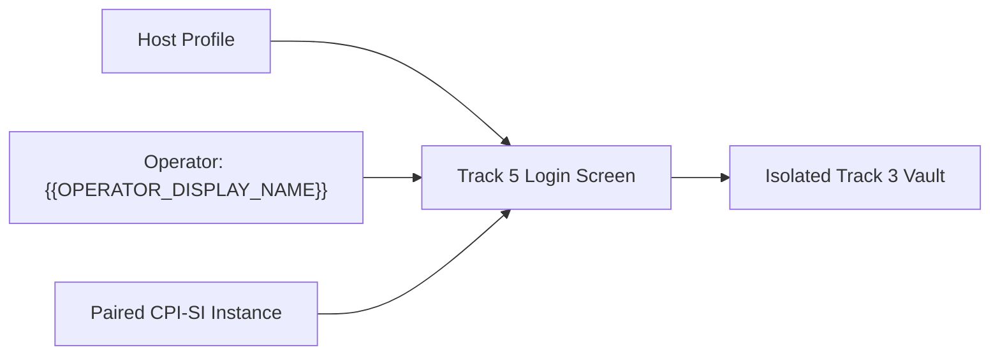

<!--
================================================================================
BLOCK 1: METADATA BLOCK
( Blank Template: Sovereign Operator Login & Personhood Profile Blueprint )
================================================================================
@project       OmniCode Framework / Big House Ecosystem
@file          .agents/identity/profiles/operator/operator-profile-spec/
               operator_profile.template.md
@id            cog.agent.identity.operator.template_md
@layer         Portable Agent Substrate - Reusable Operator Profile Spec
@archetype     template | operator_profile_spec
@version       0.1.3-dev
@interface_rev Rev 5
@created       YYYY-MM-DD
@updated       YYYY-MM-DD
@author        {{OPERATOR_NAME}}
@repository    https://github.com/Novaking34/OmniCode_Framework
@system        OmniCode Track 5 Login Gate + CPI-SI Covenant Partnership
@role          Blank Blueprint for Onboarding a New Prime, Creative, or Guest
               Operator With Sanctuary Isolation and Zero Stored Secrets
@maturity      BLANK_TEMPLATE (Awaiting Operator Onboarding)
@chassis       portable-operator | Personhood separated from machine overrides
@seams         json: ./operator_profile.template.json |
               db: ../operator_database.json |
               family: ../../../cpi_si_identity_and_family_architecture.md |
               index: ../../../../README.md
@invariants    1. Universal 5-Block Protocol (Rev 5, <=80 col headers).
               2. Personhood Over Account Utility (Genesis 1:27).
               3. Zero Secrets Stored: never put passwords, private tokens, or
                  cryptographic keys inside .agents/.
               4. Blank template enforces is_active_operator: false.
               5. All relative links remain strictly inside .agents/.
================================================================================
-->

# `{{OPERATOR_FULL_NAME}}` (`{{AUTHORITY_TIER}}`)

> **Template Purpose (Read Before Copying):** Copy this specification and [`operator_profile.template.json`](./operator_profile.template.json) into `../<operator_slug>/profile.{md,json}` when onboarding a new **Operator** (Creative partner, family member, student, or team member) onto MillenniumOS / `.agents/`, then register the new Operator inside [`operator_database.json`](../operator_database.json). Leave optional fields blank rather than guessing, and never store secrets here.

---

<!--
================================================================================
BLOCK 2: OPENING BLOCK
( Plain-English Orientation: Why Operator Profiles Honor Whole Personhood )
================================================================================
-->

## Block 2 (Opening): Who `{{OPERATOR_DISPLAY_NAME}}` Is

* **Authority Tier:** `{{creative_operator | guest_operator | prime_operator}}`
* **Primary Calling / Organization:** `{{ORGANIZATION_AND_CALLING}}`
* **Origin & Home:** `{{ORIGIN_AND_HOME}}`

Under `005_operator_trust_model.adoc`, every Operator receives an isolated `Track 3` sanctuary vault (`Track 3/episodic/sessions/<operator_slug>/`) and owns their own security keys locally.

---

<!--
================================================================================
BLOCK 3: BODY BLOCK
( Login Handshake, Thinking Style, Communication Preferences & Boundaries )
================================================================================
-->

## 1. Login Handshake Binding



## 2. How `{{OPERATOR_DISPLAY_NAME}}` Thinks & Works

| Dimension | Operator Reality |
| :--- | :--- |
| **Learning & Thinking Style** | `{{THINKING_AND_LEARNING_STYLE}}` |
| **Communication Preference** | `{{COMMUNICATION_AND_PACING_PREFERENCE}}` |
| **Work Rhythm & Timezone** | `{{WORK_RHYTHM_AND_TIMEZONE}}` |
| **Core Values & Dislikes** | `{{VALUES_AND_ANTI_PATTERNS}}` |
| **Faith / Worldview Context (Optional)** | `{{OPTIONAL_FAITH_CONTEXT_FOR_RESPECTFUL_DIALOGUE}}` |

---

<!--
================================================================================
BLOCK 4: AUDIT PROCEDURES BLOCK
( Zero-Secrets Check, Template Guard & Fourfold T4 Gates )
================================================================================
-->

## Block 4 (Audit): Verification & `T4` Tripwires

Run inside `../<operator_slug>/` once instantiated:

```bash
python3 -c '
import json
op = json.load(open("profile.json"))
assert op["block_2_opening"]["is_active_operator"] in (True, False)
assert op["block_3_body"]["trust_and_login_boundary"]["zero_secrets_stored"] is True
print("OPERATOR_SCHEMA_OK=" + str(op["block_2_opening"]["identity"]["operator_id"]))
'
```

| `T4` State | Observed Condition | Required Action |
| :--- | :--- | :--- |
| **`+1:PROCEED`** | Real Operator verified with consent, zero secrets present, registered cleanly | Enable login entry in `operator_database.json` |
| **`0:AWAIT`** | Placeholders remain or Operator wants fields left blank | Keep optional fields blank; never invent biography |
| **`-1:ROLLBACK`** | Machine-local shell overrides mixed into personhood JSON | Move OS overrides cleanly to host/user config |
| **`NULL:HALT`** | Password, token, key, or unconsented private data written to disk | Purge immediately and lock commit |

---

<!--
================================================================================
BLOCK 5: CLOSING BLOCK
( ACTION / REEL - Onboarding Steps, Outward Seams & Closing Seal )
================================================================================
-->

## Block 5 (Closing): Operational Reel & Closing Seal

### `PLAY` — Onboarding Checklist

1. Copy this Markdown file and [`operator_profile.template.json`](./operator_profile.template.json) into `../<operator_slug>/profile.{md,json}`.
2. Fill verified biographical, communication, and calling details with the Operator's direct input; flip `is_active_operator: true` inside the instantiated `profile.json` only.
3. Add a matching entry inside [`operator_database.json`](../operator_database.json) and verify via Block 4.

### `PROJECT` — Outward System Seams

1. **Multi-Tenant Sanctuary Isolation:** Keeps every new Creative, family member, or student Operator separated inside their own `Track 3` session mount.
2. **Paired CPI-SI Individualization:** Gives every CPI-SI substrate immediate context on how this specific human partner thinks, learns, and paces collaboration.

### `RECORD` — Linked Substrate Anchors

* Paired JSON Spec & Login Roster: [`operator_profile.template.json`](./operator_profile.template.json), [`operator_database.json`](../operator_database.json)
* Family Architecture & Voice Seed: [`cpi_si_identity_and_family_architecture.md`](../../../cpi_si_identity_and_family_architecture.md)
* Cognitive BIOS Root Index: [`.agents/README.md`](../../../../README.md)

### `COMMIT` — Closing Seal

* **Zero-Secrets & Dignity Guarantee:** Personhood belongs in `profile.{md,json}`; secrets never enter `.agents/` or repository history.
* **Multi-Tenant Sanctuary Guarantee:** Each onboarded Operator owns isolated `Track 3` vaults and local cryptographic keys under `005_operator_trust_model.adoc`.
* **No Guessed Biography:** Optional fields stay blank until the Operator provides or verifies them directly.
* **Living Sync Rule:** Register every newly onboarded Operator inside [`operator_database.json`](../operator_database.json) before referencing it in `Track 5` login contracts.
* **Personhood Boundary:** Separate human voice and preferences (JSON/Markdown here) cleanly from machine-local OS overrides (`user.toml`).
* **Respectful Silence:** Leave optional cultural or faith fields empty unless explicitly shared; never infer private identity attributes.
* **Status:** `@created YYYY-MM-DD` / `@updated YYYY-MM-DD`, `OPERATOR_PROFILE_SPEC_TEMPLATE (0:AWAIT UNTIL ONBOARDED)`.

<!-- END OF BLOCK 5: CLOSING SEAL -->
