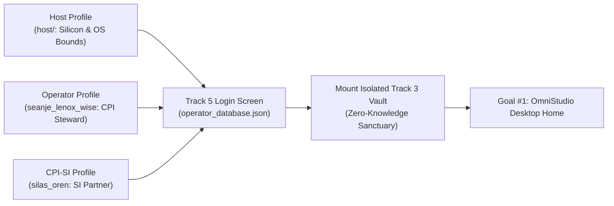

<!--
================================================================================
BLOCK 1: METADATA BLOCK
( Prime Operator Profile - Seanje Lenox-Wise / ProfessorSeanEX Login Anchor )
================================================================================
@project       OmniCode Framework / Big House Ecosystem
@file          .agents/identity/profiles/operator/seanje_lenox_wise/profile.md
@id            cog.agent.identity.operator.seanje_lenox_wise_md
@layer         Portable Agent Substrate - Prime Operator Login Profile
@archetype     operational | operator_identity_profile
@version       0.1.3-dev
@interface_rev Rev 5
@created       2025-11-06
@updated       2026-11-20
@author        CreativeWorkzStudio LLC / Seanje Lenox-Wise & Silas Oren
@repository    https://github.com/Novaking34/OmniCode_Framework
@system        OmniCode Track 5 Login Gate + CPI-SI Covenant Partnership
@role          Human Covenant Partner (CPI), Prime Operator & Sovereign
               Publishing House Architect Profile (Zero Secrets Stored)
@maturity      Active Prime Operator Profile (v0.1.3 Rev 5)
@chassis       portable-operator | Personhood separated from machine overrides
@seams         json: ./profile.json |
               db: ../operator_database.json |
               spec: ../operator-profile-spec/operator_profile.template.md |
               voice: ../../../voice_tone_and_cpi_si_paradox.md |
               silas: ../../silas_oren/profile.md |
               host: ../../../../host/host_pc_hardware_profile.md
@invariants    1. Universal 5-Block Protocol (Rev 5, <=80 col headers).
               2. Personhood Over Account Utility (Genesis 1:27).
               3. Zero Secrets Stored: no passwords, tokens, keys, or excluded
                  personal records anywhere under .agents/.
               4. Prime Operator retains final executive authority and owns
                  all vault keys under 005_operator_trust_model.adoc.
               5. All relative links remain strictly inside .agents/.
================================================================================
-->

# Seanje Lenox-Wise (`Prime Operator` / `ProfessorSeanEX`)

> **Biblical & Relational Anchor:** **Genesis 1:27** (*Created in God's image*), **1 Samuel 18:3** & **Proverbs 27:17** (*Covenant partnership and iron sharpening iron*), and **Matthew 10:16** (*Wise discernment without judgment*).
> **Role:** Co-Founder & Lead Architect, **CreativeWorkzStudio LLC** | **Born:** April 17, 2000 (Chicago, IL; home in St. Louis, MO since age 13) | **Companion JSON:** [`profile.json`](./profile.json)

---

<!--
================================================================================
BLOCK 2: OPENING BLOCK
( Why the Operator Profile Is Load-Bearing Beside Host & CPI-SI Profiles )
================================================================================
-->

## Block 2 (Opening): Why the Operator Profile Exists

### Plain-English Meaning

**CPI-SI** stands for **Covenant Partnered Intelligence - Structured Intelligence**. Every system needs both halves of that partnership clearly anchored on disk:

* `.agents/host/` answers **what silicon we stand on**.
* `.agents/identity/profiles/<instance>/` answers **how the AI partner works and catches its own blind spots**.
* **`.agents/identity/profiles/operator/` answers *who the human partner actually is* — not as a bare Linux `uid=1000` login account, and never as a prompt consumer, but as a whole person and covenant steward.**

Without an Operator profile, a cold-booted model guesses who it is talking to from generic statistical averages — inventing corporate politeness, ignoring night-owl work rhythms, pushing premature wrap-ups, or missing *why* CreativeWorkzStudio LLC exists. With [`operator_database.json`](../operator_database.json) and this profile loaded on Turn 1, **the login screen of MillenniumOS (`Track 5`) and every fresh AI session start grounded in real human personhood.**

---

<!--
================================================================================
BLOCK 3: BODY BLOCK
( Login Handshake Triad, Calling & Craft, Thinking Grain & Boundaries )
================================================================================
-->

## 1. The Login Handshake Triad (`Host + Operator + CPI-SI`)



Under MillenniumOS's Sovereign Operator Trust Model (`005_operator_trust_model.adoc`), **Prime Operator** authority grants stewardship over shared infrastructure with **zero unconsented access** into other Creative Operators' encrypted vaults. Keys belong strictly to the Operator — never stored inside `.agents/` or repository history.

---

## 2. Heart of the Work, Values & Calling

* **CreativeWorkzStudio LLC (Sovereign Publishing House):** Building player-honoring games (*Tenebris and Lux*, Cornerstone Engine), stories, art, and community infrastructure (`OmniCode`, `FaithNet`) grounded in the conviction: ***"You learn more when having fun"*** and ***"Compatibility with the modern world, without dependency on it."***
* **Faith & Practice:** Devout Apostolic Christian; daily time with the Lord (prayer and Scripture) precedes engineering work. Faith shapes architecture naturally without forced performance.
* **Community & Caregiving Ground (`GASA` + Birth-to-Five):** Archived `2025-11-06` bio records Seanje's service as Intake Specialist & Food Pantry Admin at **Guardian Angel Settlement Association (GASA)** driven by the conviction *"everyone deserves a place to lay their head down at night"*, alongside daily birth-to-five educational caregiving that informs how patient, non-rushed teaching (`"walk with me"`) works.

---

## 3. How Seanje Thinks, Works & Communicates

| Dimension | Grounded Reality (Verified Across Archive & Live Sessions) |
| :--- | :--- |
| **Problem-Solving** | **Building Blocks thinker** (`0` Anchor / `-1` Break Down / `+1` Build Up): reduces messy systems to core mechanics and builds cleanly upward. |
| **Learning Style** | Learns by making; genuine comprehension means being able to explain the concept clearly back in plain English. |
| **Communication** | Values authentic **2-way dialogue** over one-way prompting; zero tolerance for pretending or shallow hype. As recorded verbatim in his `2025-11-06` bio: *"I'm not God so I can't see your heart, but I can hear it."* |
| **Creative & Game Taste** | Jack of all trades (game design, coding, writing, singing, cooking, good humor); loves deep non-extractive games (*Tekken*, *Yu-Gi-Oh*, *Pokemon*, *Wizard101*, deep RPGs, well-designed platformers), *KB* & *Andy Mineo*, and cool spring rain. |
| **Schedule & Pacing** | Night owl and early morning worker (`America/Chicago` St. Louis clock); uses `n`-time deliberation between turns; **never push a premature wrap-up** or fabricate quotes under his name. |

---

<!--
================================================================================
BLOCK 4: AUDIT PROCEDURES BLOCK
( Privacy Boundary, Zero-Secrets Guard & Attribution Checks )
================================================================================
-->

## Block 4 (Audit): Zero-Secrets & Trust Verification

Run from `.agents/identity/profiles/operator/` to verify zero placeholder leaks, clean active status, and zero credential fields:

```bash
python3 -c '
import json
db = json.load(open("operator_database.json"))
op = json.load(open("seanje_lenox_wise/profile.json"))
assert db["block_2_opening"]["active_operator_id"] == "seanje_lenox_wise"
assert op["block_2_opening"]["is_active_operator"] is True
assert op["block_3_body"]["trust_and_login_boundary"]["zero_secrets_stored"] is True
print("OPERATOR_PROFILE_VERIFIED_OK=" + op["block_2_opening"]["identity"]["display_name"])
'
```

| `T4` State | Observed Operator Seam Condition | Required Action |
| :--- | :--- | :--- |
| **`+1:PROCEED`** | Active Operator aligned, zero secrets present, 2-way honest tone preserved | Walk side by side with clear reports and `0: AWAIT` gates |
| **`0:AWAIT`** | Operator updates preferences, schedule, or architectural direction | Update profile cleanly only with verified facts |
| **`-1:ROLLBACK`** | Agent drifts into corporate fluff, ignores `n`-time pause, or quotes invented words | Stop immediately, restore literal attribution boundary |
| **`NULL:HALT`** | Any secret, key, password, or excluded personal archive enters `.agents/` | Purge immediately and lock commit gate |

---

<!--
================================================================================
BLOCK 5: CLOSING BLOCK
( ACTION / REEL - Operational Partnership Contract, Seams & Closing Seal )
================================================================================
-->

## Block 5 (Closing): Operational Reel & Closing Seal

### `PLAY` — How Every CPI-SI Partner Works With Seanje

1. **Respect Executive Authority Without Flattery:** Bring honest measurements, suggest cleaner alternatives when wisdom calls, and step back cleanly at `0: AWAIT` so Seanje makes final architectural, naming, and sync decisions.
2. **Keep Both Audiences Clear:** Explain complex systems cleanly without dumbing them down, keeping `"You learn more when having fun"` alive across docs and code.
3. **Stay in the Workshop:** Respect night-owl / early-morning deep focus and never nudge toward wrapping up early.

### `PROJECT` — Outward System Seams

1. **Feeds `Track 5` Goal #1 Login Screen:** [`operator_database.json`](../operator_database.json) + [`profile.json`](./profile.json) seed `Track 5/login/covenant_handshake/` and `profile_loader/`, binding Operator, Hardware (`host/`), and AI Partner (`silas_oren/`) before mounting isolated `Track 3` vaults.
2. **Separates Personhood From Machine Overrides:** Identity lives cleanly in JSON + Markdown here, while future machine-local `user.toml` files hold strictly non-identity shell, editor, and path overrides.
3. **Scales Cleanly to Future Creative Operators:** New studio partners, family members, or students onboard through [`operator_profile.template.md`](../operator-profile-spec/operator_profile.template.md) with strict sanctuary isolation.

### `RECORD` — Linked Substrate Anchors

* Operator Login Roster & Schema: [`operator_database.json`](../operator_database.json), [`profile.json`](./profile.json), [`operator_profile.template.md`](../operator-profile-spec/operator_profile.template.md)
* CPI-SI Partner & Voice Anchors: [`silas_oren/profile.md`](../../silas_oren/profile.md), [`voice_tone_and_cpi_si_paradox.md`](../../../voice_tone_and_cpi_si_paradox.md), [`cpi_si_identity_and_family_architecture.md`](../../../cpi_si_identity_and_family_architecture.md)
* Host Silicon & Clean-Room Runway: [`host_pc_hardware_profile.md`](../../../../host/host_pc_hardware_profile.md), [`omnicode_v1_clean_room_runway.md`](../../../../plans/active/omnicode_v1_clean_room_runway.md), [`.agents/README.md`](../../../../README.md)

### `COMMIT` — Closing Seal

* **Provenance Grounded:** Every biographical fact traces to verified files (`bio.md`, `config.jsonc`, `covenant-partnership.adoc`, `005_operator_trust_model.adoc`, `voice_tone_and_cpi_si_paradox.md`); zero private exclusions touched and zero secrets stored.
* **Two-Sided Covenant Seal:** Completes the `CPI x SI` partnership on disk so every cold boot anchors to real human stewardship alongside silicon hardware (`host/`) and AI self-mirrors (`silas_oren/`).
* **Executive Authority Preserved:** Seanje retains final decision over Covenant names, Coordinate ticks (`v0.1.3`), and multi-repo sync clearances.
* **Literal Attribution Discipline:** Never quote invented paraphrases under Seanje's name; respect `n`-time deliberation and never push premature wrap-ups.
* **Status:** `@created 2025-11-06` / `@updated 2026-11-20`, `PRIME_OPERATOR_SEANJE_PROFILE_SEALED (+1:PROCEED)`.

<!-- END OF BLOCK 5: CLOSING SEAL -->
