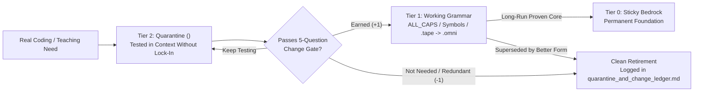

<!--
================================================================================
BLOCK 1: METADATA BLOCK
( OmniCode Living Language Charter - Sticky Bedrock vs Living Evolution Gate )
================================================================================
@project       OmniCode Framework / Big House Ecosystem
@file          .agents/language/language_living_charter.md
@id            cog.agent.language.living_charter
@layer         Portable Agent Substrate - Living Language Governance
@archetype     operational | living_charter
@version       0.1.3-dev
@interface_rev Rev 5
@created       2026-11-19
@updated       2026-11-19
@author        CreativeWorkzStudio LLC / Seanje Lenox-Wise & Silas Oren
@repository    https://github.com/Novaking34/OmniCode_Framework
@system        OmniCode Spatial & Relational Language (v0.1.3 Living Floor)
@role          Define Sticky Bedrock vs Mutable Tiers & Change Proposal Rules
@maturity      Rev 5 Living Charter | Coordinate v0.1.3 (13%)
@chassis       ascii-first | Chronological Clarity + Safe Grammar Evolution
@seams         registry: ./language_registry.json |
               syntax: ./reference/SYNTAX.md |
               keyword: ./reference/KEYWORD.md |
               ledger: ./evolution/quarantine_and_change_ledger.md |
               index: ../README.md
@invariants    1. Universal 5-Block Protocol (Rev 5, <=80 col headers).
               2. Timestamp Integrity: separate @created (immutable origin)
                  from @updated (living edit) to eliminate Temporal Flattening.
               3. Separate Sticky Bedrock (Tier 0) from Working Grammar (Tier 1)
                  and Quarantined Experiments (Tier 2).
               4. Welcome empirical additions, modifications, and retirements
                  through the 5-Question Gate rather than premature lock-in.
================================================================================
-->

# OmniCode Living Language Charter

> **Why This Charter Exists:** A real programming and thinking language cannot stay frozen like concrete while it is still learning from compilers, bare metal, and everyday writers—yet if *everything* shifts at once, nothing holds together. This charter marks what is permanent **Sticky Bedrock**, what is **Active Working Grammar**, and how any symbol or keyword earns addition, adjustment, or clean retirement over time.

**Quick Navigation:**
[Opening (Why Bedrock & Growth Coexist)](#block-2-opening-why-a-living-language-needs-both-anchors-and-room) |
[1. Stability Lifecycle Diagram](#1-language-stability-lifecycle) |
[2. Three Stability Tiers](#2-the-three-stability-tiers-bedrock-working-quarantine) |
[3. The 5-Question Change Gate](#3-the-5-question-gate-for-additions-modifications-or-removals) |
[Audit & Registry Parity](#block-4-audit-registry-parity--chronology-checks) |
[Closing Action Playbook](#block-5-closing-living-language-workflow-reel)

---

<!--
================================================================================
BLOCK 2: OPENING BLOCK
( Plain-English Orientation & Solving Temporal Flattening )
================================================================================
-->

## Block 2 (Opening): Why a Living Language Needs Both Anchors and Room

Think of building a language like building a house you actually plan to live in while adding rooms:

* **You do not move the foundation footings every Tuesday** (`Tier 0 Bedrock`: plain standard-keyboard keys, spatial geometry, 4-state `T4` truth, order-sensitive pairs, self-grounded origin `=<God>=`).
* **You *do* adjust interior shelving, door hardware, and workbenches** (`Tier 1 Working` and `Tier 2 Quarantine`) as building real programs like `manifest.tape`, `.omni` kernels, and *Cornerstone* teaches you what fits cleanly and what gets in the way.

> [!NOTE]
> **Fighting Temporal Flattening (`@created` vs `@updated`):**
> Because LLMs read every file in a folder simultaneously into one timeless *"now"*, missing dates make older exploration docs (like `Nov 15–17` `Live_OmniCode` crossover specs) look like contradictions beside `Nov 19` specs—and raw filesystem modification times (`mtime`) invert true order whenever a folder moves. Carrying explicit **`@created`** (birth) alongside **`@updated`** (latest verified polish) lets agents read evolution honestly instead of hallucinating conflict.

---

<!--
================================================================================
BLOCK 3: BODY BLOCK
( Lifecycle Flowchart, Stability Tiers Table, 5-Question Gate & Timeline )
================================================================================
-->

## 1. Language Stability Lifecycle



---

## 2. The Three Stability Tiers (`Bedrock`, `Working`, `Quarantine`)

Every operator, border, register, and keyword in [`language_registry.json`](./language_registry.json) lives inside one explicit stability tier:

| Stability Tier | Plain Meaning | What Belongs Here Right Now (`v0.1.3`) | Policy on Changes |
| :--- | :--- | :--- | :--- |
| **`tier_0_bedrock`** | **Sticky Core:** What makes OmniCode *OmniCode* | Plain-ASCII Keyboard Floor, Spatial Dot Geometry (`.`, `. .`, `. . .`), `T4` (`0`, `+1`, `-1`, `NULL`), `=` Anchor & Flipped-Order Polarity (`!=` vs `=!`), `5Ws + H`, 5-Block Fractal (`METADATA -> HEAD -> BODY -> AUDIT -> REEL`), 3 Case Registers, `=<God>=` Origin, Concept Quarantine rule | Rarely modified; requires deep multi-Track architectural proof (`0:AWAIT` consensus) |
| **`tier_1_working`** | **Active Grammar:** Today's compiler & spec vocabulary | `16` Borders (`<[{()}]>`), `14` Directional Arrows (`-->`, `_/^`, etc.), Freestanding Keyword Law (`FOCUS = <FOCUS>` `11`), `%` (`ABOUT`/`RATIO`) isolated from `REM`/`MOD`, Systems/Compiler/Math/Audit/Reel keyword sets lowering `.tape -> .omni` | Open to careful **additions, edits, or removals** via the 5-Question Gate whenever live compilers reveal friction |
| **`tier_2_quarantine`** | **Experiment Bench:** Ideas being tried without premature lock-in | `6` Boundary Casting Molds (`[+]`, `[-]`, `<+>`, `<->`, `{+}`, `{-}`), `<focus>` concept trials, `[BLOCK Eval]` methodological tag, early multi-target Transpiler IR forms (`C23`, `Rust`, `C++20`) | Freely trialed, refined, promoted to `tier_1_working`, or retired cleanly with zero shame |
| **`retired`** | **Honored Retirements:** Tried earlier, cleanly superseded | Legacy `--` (`NOT`, replaced by positional `!`), Unicode `≈` (replaced by order-sensitive ASCII `=~` / `~=`), pre-Freestanding `[FOCUS]`-only lock | Kept visible in the ledger so future models never accidentally resurrect retired clutter |

<details>
<summary>Expand Chronology Drawer: How 2026-11-15 to 2026-11-19 Built Today&rsquo;s Grammar</summary>

1. **`2026-11-15 -> 2026-11-17` (`v0.1.2-dev`) — [`omnicode_syntax_keywords_operators.md`](./evolution/omnicode_syntax_keywords_operators.md):** The `Live_OmniCode` genesis bridge birthed `[!X]` vs `[X!]` bang polarity, Concept-vs-Keyword quarantine, `[BLOCK Eval]`, 4-Section Testing Sensors, Boundary Casting Molds, and Multi-Target Transpilation mappings.
2. **`2026-11-19` (`v0.1.3-dev`) — [`SYNTAX.md`](./reference/SYNTAX.md):** Locked the 100% Plain-ASCII keyboard floor (`=~`/`~=` replacing `≈`, removing `--`), expanded borders `6 -> 16` (`4x4`), and completed the `14` arrows + `< > -> ( )` Weight Scale + `=<God>=`.
3. **`2026-11-19` (`v0.1.3-dev`) — [`KEYWORD.md`](./reference/KEYWORD.md):** Paired 1-to-1 with `SYNTAX.md` to define Freestanding Keyword Law (`FOCUS = <FOCUS>` `11`), Three Capitalization Registers, `.tape -> .omni` (`C -> .asm`) lowering, and Audit/Reel execution primitives.

</details>

---

## 3. The 5-Question Gate for Additions, Modifications, or Removals

Whenever writing `.tape` tapes, `.omni` modules, or Rust parser rules (`Track 1` / `Track 2`) reveals a gap or friction point, pass the proposed change through five calm questions in [`language_change_proposal.template.md`](./evolution/language_change_proposal.template.md):

1. **Irreducibility (Gall's Law):** Can existing primitives compose this cleanly, or does it earn a distinct atom?
2. **Standard-Keyboard Floor:** Is every character 100% typeable on a plain English keyboard with no `Alt`-key hacks?
3. **Zero Semantic Collision:** Does it collide with an existing meaning (such as preserving `%` for `ABOUT`/`RATIO` and `REM`/`MOD` for remainder)?
4. **Compiler & Readability Payoff:** Does real `.tape -> .omni` lowering get clearer AND does reading aloud stay natural for learners?
5. **Reversible Memory:** Is the change first trialed in `tier_2_quarantine` — and if removing/modifying an older form, is the rationale logged clearly in [`quarantine_and_change_ledger.md`](./evolution/quarantine_and_change_ledger.md)?

---

<!--
================================================================================
BLOCK 4: AUDIT PROCEDURES BLOCK
( Registry Parity, Timestamp Discipline & Tier Separation Audit )
================================================================================
-->

## Block 4 (Audit): Registry Parity & Chronology Checks

Run inside `.agents/language/` to verify `language_registry.json`, `tier_0_bedrock`, `tier_1_working`, `tier_2_quarantine`, and `retired_artifacts` agree cleanly:

```bash
python3 -c '
import json
d = json.load(open("language_registry.json"))
b3 = d["block_3_body"]
assert d["block_1_metadata"]["created"] == "2026-11-19"
assert len(b3["tier_1_working"]["borders_16"]["all"]) == 16
assert len(b3["tier_1_working"]["directionals_14"]["all"]) == 14
assert any(r["symbol"] == "--" for r in b3["retired_artifacts"])
assert d["block_4_audit"]["ascii_only_symbols"] is True
print("LANGUAGE_REGISTRY_PARITY_OK")
'
```

| T4 State | Observed Grammar Condition | Required Response |
| :--- | :--- | :--- |
| **`+1:PROCEED`** | `LANGUAGE_REGISTRY_PARITY_OK`, `@created`/`@updated` honored, new ideas tested in `tier_2_quarantine` | Write `.tape`/`.omni`/compiler code confidently |
| **`0:AWAIT`** | Operator, keyword, or border feels awkward in real `.tape`/`.omni` work | Pause before ad-hoc inventing; draft a brief RFC in `evolution/` and review with Seanje |
| **`-1:ROLLBACK`** | Non-ASCII symbol snuck into canonical spec, or `%` got conflated with modulo | Roll back conflicting edit immediately to preserve ASCII + semantic isolation |
| **`NULL:HALT`** | Proposed change violates `T4` truth, erases order polarity, or locks concept silently | **Halt compiler promotion** until 5-Question Gate clears |

---

<!--
================================================================================
BLOCK 5: CLOSING BLOCK
( ACTION / REEL - Living Language Workflow, Track Seams, Change Handoff & Seal )
================================================================================
-->

## Block 5 (Closing): Living Language Workflow Reel

Block 5 keeps OmniCode rooted enough to build a real compiler (`Track 1`/`Track 2`) today while loose enough to grow wiser every week.

### 1. Day-to-Day Working Playbook (`PLAY`)

* **When Writing `.tape` or `.omni`:** Use `tier_0_bedrock` and `tier_1_working` directly from [`SYNTAX.md`](./reference/SYNTAX.md), [`KEYWORD.md`](./reference/KEYWORD.md), and [`language_registry.json`](./language_registry.json).
* **When Needing a New Word:** Keep new words `lowercase` inside `<concept>` or `{context}` until empirical use proves they earn `ALL CAPS` keyword status.
* **When Reading Older History:** Read `@created` first so `2026-11-15` genesis concepts inform today without overriding `2026-11-19` active specs.

### 2. Outward System Seams (`PROJECT`: Where This Charter Feeds)

* **`Track 1` (`compiler/parser`, `ast`, `assembler`) & `Track 7` (`validator`):** Parses `language_registry.json` to separate permanent opcodes from quarantined trials cleanly.
* **`Track 2` (`grammar`, `lexicon`, `stdlib`):** Grounds dictionary promotion from `lowercase` entries into standard-library modules.
* **Root Repository Specs:** Syncs design decisions cleanly with repo root `docs/SYNTAX.md` and `docs/KEYWORD.md`.

### 3. Proposing an Addition, Edit, or Removal (`RECORD`)

1. Copy [`language_change_proposal.template.md`](./evolution/language_change_proposal.template.md) inside `./evolution/` (or raise directly during a live build session).
2. Answer all five gate questions with real `.tape`/`.omni` before-and-after examples.
3. Upon agreement, update [`language_registry.json`](./language_registry.json), record the transition in [`quarantine_and_change_ledger.md`](./evolution/quarantine_and_change_ledger.md), and mirror any promoted changes to root `docs/`.

### 4. Reconciliation Back to Block 1 & Portable Anchors (`COMMIT`)

All Block 1 invariants reconcile cleanly (`<= 80` col headers, explicit `@created`/`@updated`, strict separation of Sticky Bedrock vs Mutable Tiers, and `.agents/`-bounded links):

* [`language_registry.json`](./language_registry.json) — Compact machine-readable grammar SSOT
* [`SYNTAX.md`](./reference/SYNTAX.md) — Portable Plain-ASCII Symbolic Assembly Floor (`@created 2026-11-19`)
* [`KEYWORD.md`](./reference/KEYWORD.md) — Portable Keyword Rosetta & `.tape -> .omni` Reference (`@created 2026-11-19`)
* [`quarantine_and_change_ledger.md`](./evolution/quarantine_and_change_ledger.md) — Living Quarantine, Experiment & Retirement Ledger
* [`omnicode_syntax_keywords_operators.md`](./evolution/omnicode_syntax_keywords_operators.md) — Preserved `Live_OmniCode` Genesis Archive (`@created 2026-11-15`)
* [`.agents/README.md`](../README.md) — Portable Cognitive BIOS root index

<!--
================================================================================
END OF BLOCK 5: CLOSING SEAL
Status: OMNICODE_LANGUAGE_LIVING_CHARTER_ACTIVE (+1:PROCEED)
================================================================================
-->
