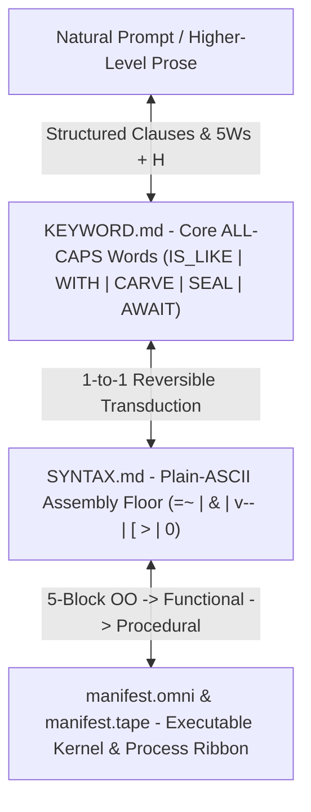

<!--
================================================================================
BLOCK 1: METADATA BLOCK
( Identity, Provenance, Keyword Audit Scope & Symbol-to-Keyword Contracts )
================================================================================
@project       OmniCode Framework
@file          .agents/language/reference/KEYWORD.md
@id            root.docs.keyword_guide
@layer         Living Language Guide (docs/ & .agents/language/)
@archetype     living_guide | keyword_taxonomy_and_rosetta_stone
@version       0.1.3-dev
@interface_rev Rev 5
@created       2026-11-19
@updated       2026-11-19
@author        CreativeWorkzStudio LLC / ProfessorSeanEX (Seanje Lenox-Wise)
@repository    https://github.com/Novaking34/OmniCode_Framework
@system        OmniCode Spatial & Relational Language (Keyword Layer)
@role          Audit manifest.tape Keywords & Decipher Symbol -> Keyword Forms
@maturity      Rev 5 Compiler Alignment | Coordinate v0.1.3 (13%)
@chassis       ascii-first | lowercase concept -> ALL CAPS keyword ladder
@scale         O(1) bidirectional map: SYNTAX symbols <-> KEYWORD words
@seams         in: ./SYNTAX.md, ../language_registry.json |
               from: docs/KEYWORD.md (portable copy)
@invariants    1. Universal 5-Block Lifecycle Protocol (Rev 5, <=80 col walls).
               2. Concept Quarantine: lowercase words live in <> / dictionary
                  until empirical use earns ALL-CAPS KEYWORD lock-in.
               3. Order & Polarity Preserved: flipped symbols (=!/!=, =~/~=,
                  =:/:=, [!X]/[X!], 16 borders, 14 arrows) keep distinct words.
               4. Living Alignment: pairs 1-to-1 with docs/SYNTAX.md and
                  governs the complete 5-Block manifest.tape process ribbon.
================================================================================
-->

<div align="center">

# OmniCode Living Keyword Reference

### Auditing `manifest.tape` & Deciphering the Keyword Form of Every Syntax Symbol

*Where plain-keyboard symbols step upward into readable keywords without losing a single direction, border weight, or flipped meaning.*

[-2ea44f?style=flat-square)](../../README.md)
[](SYNTAX.md)
[](../language_registry.json)

[Why Keywords Exist](#why-keywords-step-up-from-syntax-symbols) · [Freestanding Law & Compiler](#the-freestanding-keyword-law) · [Part 1: manifest.tape Audit](#part-1-keyword-audit-of-manifesttape-baseline-audit-behind-the-5-block-refactor) · [Part 2: Symbol to Keyword Map](#part-2-deciphering-the-keyword-form-of-every-syntax-symbol) · [Part 3: .tape Compilation](#part-3-why-this-setup-matters-for-tape-compilation) · [Pocket Cheat-Sheet](#pocket-keyword-cheat-sheet)

</div>

---

<!--
================================================================================
BLOCK 2: OPENING BLOCK
( Why Keywords Sit Directly Above Symbolic Syntax & Concept Quarantine Rule )
================================================================================
-->

## Why Keywords Step Up From Syntax Symbols

In [`SYNTAX.md`](SYNTAX.md), every operator is built from plain-keyboard spatial geometry: points (`.`), arrows (`-->`, `_/^`), borders (`<[{()}]>`), and ordered pairs (`=!` vs `!=`, `=:` vs `:=`). That is the **Symbolic Assembly Floor**.

Directly above that floor sits the **Keyword Layer**:

* **Lowercase `<concept>` vs. `ALL CAPS` `[KEYWORD]`:** As formalized in [`SYNTAX.md` Step 7 & Step 8](SYNTAX.md#step-7-border-weights-keywords-and-self-grounded-being) and [`.agents/language/` evolution genesis](../evolution/omnicode_syntax_keywords_operators.md), new ideas begin as lowercase concepts tested across contexts (`{ ... }`), and only lock in as **`ALL CAPS` KEYWORDS** when repeated structural work proves they are core primitives of the machine.
* **Bidirectional Lossless Translation:** Every symbol in [`SYNTAX.md`](SYNTAX.md) already expresses a natural-speech relationship. Naming its exact `ALL CAPS` keyword equivalent creates a **two-way Rosetta Stone**:
  * **Humans and LLMs** can read a symbolic roll aloud using exact keywords (`WITH`, `BECOME`, `BUT`, `SEAL`, `CAPTURE`).
  * **Higher-level OmniCode** can use clean keyword forms (`IS_NOT`, `LIKE_IS`, `CARVE`, `IMPORT`, `AWAIT`) and compile straight down to deterministic Assembly symbols with zero semantic drift.



### The Freestanding Keyword Law

> **Core Rule:** Unguarded freestanding `KEYWORD` resolves automatically as `<KEYWORD>` (`11`), assuming dictionary membership unless explicitly guarded.

Because every `ALL CAPS` word in OmniCode is assumed to already reside in the core keyword dictionary and standard library, **an unguarded freestanding `KEYWORD` resolves automatically as `<KEYWORD>`** — top-weight invariant truth (`11`), even with no angle brackets written around it.

To deliberately lower a keyword out of universal `< >` law into a concrete implementation (`[ ]`), shared mutable context (`{ }`), or personal aside (`( )`), you **guard** it inside those lower borders. Bare unbordered lowercase words carry `0` wall weight.

| Expression | Resolution State | Weight Breakdown | Plain Reading & Compiler Order |
| :--- | :--- | :---: | :--- |
| **`FOCUS`** | Equivalent to **`<FOCUS>`** | **`5 + 5 + 1 = 11`** | **Highest:** Unguarded freestanding keyword; resolves as `<FOCUS>` law |
| **`<FOCUS>`** | Explicit Universal Keyword | **`5 + 5 + 1 = 11`** | Same top weight written explicitly in rigid `< >` law walls |
| **`<focus>`** | Universal Concept | **`5 + 5 = 10`** | Singular root concept / dictionary entry in rigid `< >` law walls |
| **`[FOCUS]`** | Guarded Concrete Keyword | **`4 + 4 + 1 = 9`** | Keyword locked into a concrete physical record, slot, or boundary |
| **`[focus]`** | Concrete Definition | **`4 + 4 = 8`** | Concrete defined entity (`=` `{ FOCUS >` and `< FOCUS }` bridge weight) |
| **`{FOCUS}`** | Guarded Context Keyword | **`2 + 2 + 1 = 5`** | Guarded `{ }` strips `< >` law status and scopes keyword to live context |
| **`{focus}`** | Living Context Concept | **`2 + 2 = 4`** | Lowercase noun/concept active in mutable shared context |
| **`(FOCUS)`** | Guarded Aside Keyword | **`1 + 1 + 1 = 3`** | Keyword held lightly as a personal framing note |
| **`(focus)`** | Personal Aside | **`1 + 1 = 2`** | Pure human/AI aside frame |
| **`focus`** | Bare Unbordered Word | **`0`** | Lowest: Unbordered lowercase word; needs borders or `FOCUS` promotion |

**Resolution answer (`<focus>` vs `focus` vs `[focus]` vs `{FOCUS}`):**

```text
FOCUS (= <FOCUS>, 11) > <focus> (10) > [FOCUS] (9) > [focus] (8) > {FOCUS} (5) > {focus} (4) > (focus) (2) > focus (0)
```

Notice why **`<focus>` (10) outranks `[focus]` (8), `[focus]` outranks `{FOCUS}` (5), and `{FOCUS}` outranks bare `focus` (0)**: universal `< >` outranks concrete `[ ]`, concrete `[ ]` outranks guarded context `{ }`, and even a guarded keyword (`+1`) stays above its lowercase neighbor (`{FOCUS}` `5` > `{focus}` `4`) while bare `focus` sits at `0` until framed.

---

### The `.tape` $\longrightarrow$ `.omni` Compiler Relationship (`C -> .asm`)

A **`.tape`** Process Ribbon is the higher-rung compiled source language (like **C**), whereas an **`.omni`** manifest is the explicit low-level assembly floor (like **`.asm`**). The syntax symbols from [`SYNTAX.md`](SYNTAX.md) do **not** disappear in `.tape` — direction (`-->`), borders (`[ ]`, `{ }`, `( )`), state (`+1`, `0`, `-1`), ratios (`%`), and spans (`. .`) stay wherever structural precision matters, while freestanding `ALL CAPS` keywords replace verbose symbolic scaffolding and lower down into full 5-Block `.omni` assembly:

```text
Prompt / Prose  <-->  .tape (C-Level Keyword Ribbon)  -->  .omni (Explicit Symbolic Assembly)  -->  Kernel
```

### Core Systems & Compiler Keywords (Lowering `.tape` to `.omni`)

| Group | Keywords | Primary Role in `.tape` $\longrightarrow$ `.omni` |
| :--- | :--- | :--- |
| **Origin & Allocation** | `ORIGIN`, `ESTABLISH`, `DEFINE`, `ALLOCATE`, `PARTITION`, `INSCRIBE`, `BIND`, `IMPORT`, `ANCHOR` | Ground `=<God>=`, initialize 5W+H headers, carve fixed memory cells, lock Decalogue/laws, import modules |
| **Constraints & Pacing** | `REQUIRE`, `FORBID`, `REST` | Enforce invariants (`[ ]`), prohibit unsafe/evil state (`-1`), enter Sabbath/Sovereign Rest (`0` equilibrium) |
| **Compiler & Execution** | `TRANSDUCE`, `BALANCE`, `EVALUATE`, `RECONSTRUCT`, `GUARD`, `THINK`, `REPEAT` | Translate forms (`.tape` -> `.omni`), balance `(+1) + (-1) = 0`, weigh consensus & bounded loops |
| **$\mathbb{T}_4$ Audit & Breakers** | `PROVE`, `VERIFY`, `CATCH`, `INQUIRE`, `THROW`, `FALSIFY`, `TRIPWIRE`, `LOCK`, `HALT` | `CATCH` receives `+1` frame / `0` inquiry / recoverable `THROW`; `THROW` (`-1:ROLLBACK`) fires `[!ALARM]`; `TRIPWIRE` (`NULL:HALT`) snaps `[ALARM!]` circuit breaker bypassing soft `CATCH` |
| **Closing Reel & Manifestation** | `REEL`, `PLAY`, `EXECUTE`, `TRACK`, `SCENE`, `PROJECT`, `RECORD`, `COMMIT`, `SEAL`, `RECONCILE` | `REEL` steps declared `BODY` `TAPE`s/`ROLL`s (`PLAY` / `EXECUTE`) into a runtime **`TRACK`** or **`SCENE`**, writes `Covenant Journal`, and reconciles back to `=<God>=` |

#### Three Capitalization Registers & 5-Block `.tape` Spine

* **Three Capitalization Registers:** **`ALL CAPS`** (`HEAD`, `BODY`, `TAPE`, `ROLL`, `PROCEED`) = reserved **`KEYWORD`** (`<KEYWORD>` unless guarded); **`Proper Case`** cast in borders (`[ Project ]`, `< Law One >`, `[ AI Cortex ]`) = Proper Noun / Named Identity; **`lowercase`** (`focus`, `project`, `acknowledge`) = common noun / concept.
* **5-Block `.tape` Spine:** `METADATA` (`WHO & WHERE`) $\longrightarrow$ `HEAD` (`WHAT & WHEN`) $\longrightarrow$ `BODY` (`TAPE`s & `ROLL`s, non-executing `HOW & WHY`) $\longrightarrow$ `AUDIT` (`CATCH` / `THROW` / `TRIPWIRE`) $\longrightarrow$ `REEL` (`PLAY` $\longrightarrow$ live `TRACK` / `SCENE`).

> [!IMPORTANT]
> **Living Setup Status:** Just like [`SYNTAX.md`](SYNTAX.md), this reference is our living map derived directly from `manifest.tape`, `manifest.omni`, `arithmetic.omni`, and [`SYNTAX.md`](SYNTAX.md), mirrored into `.agents/language/`. As Seanje (the living Linter and Compiler) reviews these classifications, words can be promoted, renamed, or returned to lowercase concepts.

---

<!--
================================================================================
BLOCK 3: BODY BLOCK
( Part 1: manifest.tape Audit · Part 2: Symbol->Keyword Rosetta · Part 3: Next )
================================================================================
-->

## Part 1: Keyword Audit of `manifest.tape` (Baseline Audit Behind the 5-Block Refactor)

> **Historical Baseline Note:** The `L12`–`L195` line citations recorded across Parts `A`–`E` below come from our initial audit of the pre-refactor `199`-line flat `manifest.tape` (`Phase 1`–`Phase 5`), which motivated separating setup into `HEAD`, functional logic into non-executing `BODY` (`TAPE`s & `ROLL`s), breakers into `AUDIT`, and play-by-play execution into `REEL` inside today's `manifest.tape`.

Inspecting the baseline `manifest.tape` (`199` lines, originally `22` flat rolls) alongside our updated 5-Block `manifest.omni` revealed **five distinct groups** of capitalized words on the tape—and exposed where core language keywords must be separated from ordinary dictionary verbs.

### A. The 6 Cardinal Clauses (Paired `5Ws + 1H`)

Appearing in the ribbon header (`baseline L13-L18`) and embedded inside baseline Rolls 9–18 (`baseline L89-L145`) of `manifest.tape`, these six anchors structure every context and execution block:

| Clause Pair | Role in 5-Block Sentence | Where Observed in `manifest.tape` | Status |
| :--- | :--- | :--- | :---: |
| **`WHO` & `WHERE`** | Sovereign actor (`Metadata`) + physical site (`@`) | Block 1 (`WHO { OmniCode Kernel }`, `WHERE { Covenant Storehouse }`) | **Core** |
| **`WHAT` & `WHEN`** | Staged vessels/essence (`Opening` / `HEAD`) + precondition window | Block 1 & Block 2 `HEAD` (`Intent`, `Genesis Boot`, `t = 0`) | **Core** |
| **`HOW` & `WHY`** | Causal execution state (`Body` / `REEL`) + teleological aside `( )` | Block 1 & Block 3 (`HOW`, `WHY (...)`, `TAPE`s & `ROLL`s) | **Core** |

### B. Structural Ribbon & 5-Block Lifecycle Keywords

These name the physical containers of OmniCode programs and tapes:

| Keyword | Where Seen | Role in Machine & Tape Architecture | Status |
| :--- | :--- | :--- | :---: |
| **`TAPE`** | `manifest.tape` | Non-executing Block 3 functional ribbon grouping causal `ROLL`s | **Core** |
| **`PROCESS`** | Baseline `manifest.tape` (`L12`) | Named runtime task concept (`ManifestCovenant` header) | **Core** |
| **`ROLL`** | `manifest.tape` | Atomic non-executing step declared inside a Block 3 `TAPE` (`ROLL 1..12`) | **Core** |
| **`HEAD`** | `manifest.omni:L451` & `manifest.tape` | Declarative functional router (**Block 2 Opening** in `.tape`; top of `Body` in `.omni`) | **Core** |
| **`REEL`** | `manifest.tape` | **Block 5 Closing** play-by-play sequencer turning `BODY` `TAPE`s into a live `TRACK` / `SCENE` | **Core** |
| **`METADATA` / `OPENING` / `BODY` / `AUDIT` / `CLOSING`** | `manifest.omni` & `manifest.tape` | The 5-Block macro lifecycle spine (`METADATA -> HEAD -> BODY -> AUDIT -> REEL`) | **Core** |

### C. Quad-State $\mathbb{T}_4$ Execution & Guard Keywords

These appear in baseline Roll 20–22 (`baseline L162-L195`) and Block 4–5 of `manifest.tape`, forming the deterministic circuit-breaker and commit gate:

| Keyword | Trit Value | Where Seen | Meaning | Status |
| :--- | :---: | :--- | :--- | :---: |
| **`PROCEED`** | `+1` | `manifest.tape` (`HEAD`, `AUDIT`, `REEL`) | Advance forward along the causal tape; commit verified state | **Core** |
| **`AWAIT`** | `0` | `manifest.tape` (`Law Four`, `CATCH` Inquiry) | Hold in equilibrium pending resolution | **Core** |
| **`ROLLBACK`** | `-1` | `manifest.tape` (`THROW`, `REEL` Commit) | Rewind / reverse causal tape back to prior verified state | **Core** |
| **`HALT`** / **`NULL`** | `NULL` | `manifest.tape` (`TRIPWIRE`, `REEL` Commit) | Out-of-band stop; cessation of clock on hard breach | **Core** |
| **`GUARD`** | — | `manifest.tape` (`ROLL 10` Sentinel) | Adversative sentinel gate paired with `!` / `BUT` | **Core** |
| **`REPEAT`** | — | `manifest.tape` (`REEL` `0:AWAIT`) | Loop continuation directive paired with `::` while holding `0:AWAIT` | **Core** |

### D. Runtime Status Signals & Watch Flags *(Review: Keyword vs. Register State)*

Inside baseline Roll 22 (`L185, L189`), `manifest.omni` Block 4–5, and Block 4–5 of `manifest.tape`, several words act as **hardware/session condition flags**:

* **Observed in baseline `manifest.tape` (`L185-L189`):** `BUSY`, `PENDING`, `STOP`, `INTERRUPT` — now cleanly cast as `{ Busy }`, `{ Pending }`, and `<HALT>` in refactored `manifest.tape`.
* **Observed in `manifest.omni` & `manifest.tape`:** `ARMED` (`[ +1 : ARMED ]`), `LOCKED` (`[ NULL : LOCKED ]`), `ALARM` (`[!ALARM]` / `[ALARM!]`), `Bound`, `Turn`.
* **Audit Note:** Keeping `BUSY`/`PENDING` as `{ Busy }`/`{ Pending }` inside borders preserves `ALL CAPS` strictly for true compiler keywords (`ARMED`, `LOCKED`, `ALARM`).

### E. Memory Verbs, Quarantined Domain Verbs & Legacy Artifacts

Reading baseline `manifest.tape` line by line resolved what belonged in the core compiler vocabulary versus ordinary lowercase concepts:

1. **Low-Level Tape / Memory / Audit / Reel Verbs (Core Compiler Primitives):**
   * Promoted from `manifest.tape`, `manifest.omni`, and Block 4/5 design: **`ESTABLISH`**, **`ALLOCATE`**, **`PARTITION`**, **`INSCRIBE`**, **`BIND`**, **`TRANSDUCE`**, **`EVALUATE`**, **`RECONSTRUCT`**, **`CATCH`**, **`THROW`**, **`TRIPWIRE`**, **`REEL`**, **`PLAY`**, **`PROJECT`**, **`TRACK`**, **`SCENE`**, **`RECORD`**, **`COMMIT`**, **`RECONCILE`**.
   * These directly allocate cells, bind modules, wire breakers (`CATCH`/`THROW`/`TRIPWIRE`), and drive the `REEL` into a live `TRACK` or `SCENE`.
2. **Quarantined Domain Ethical Verbs *(Not Core Compiler Keywords!)*:**
   * Baseline Rolls 9–18 (`L89-L145`) used 10 English moral verbs: `ACKNOWLEDGE`, `PROHIBIT`, `REVERE`, `ENFORCE`, `HONOR`, `DEFEND`, `PRESERVE`, `PROTECT`, `MANDATE`, `GUARD`.
   * Promoting 10 domain-specific ethical verbs into reserved language keywords violates [`SYNTAX.md`](SYNTAX.md) Step 8 (`Concept -> ALL CAPS Keyword Quarantine`). Both `manifest.omni` and refactored `manifest.tape` express the Ten Laws cleanly using structural `REQUIRE` / `FORBID` / `REST` / `SEAL` over cast proper concepts!
3. **Legacy Artifacts Cleaned Up in Refactored `manifest.tape`:**
   * **`plus`** (`baseline L155`, `[(+1) plus (-1) <=> 0]`) $\longrightarrow$ replaced by **`ADD`** (`( +1 ADD -1 ) <=> 0`).
   * **Leading `= [Tape]: ...`**, backtick primes (`` Status` ``, `` Verify` ``), double-colon prefixes (`:: { ... }`), and flat 4-phase scripts (`PHASE 1..5`) $\longrightarrow$ aligned cleanly to the 5-Block `METADATA -> HEAD -> BODY -> AUDIT -> REEL` standard.

---

## Part 2: Deciphering the Keyword Form of Every Syntax Symbol

Because [`SYNTAX.md`](SYNTAX.md) was built from everyday human relations and spatial geometry, **every symbol already carries an exact spoken core word**. Below is the complete **1-to-1 Symbol $\leftrightarrow$ Keyword Rosetta Stone** deciphering Steps 1 through 7 of [`SYNTAX.md`](SYNTAX.md).

### 2.1 Truth & Time ($\mathbb{T}_4$ — Step 1)

| Symbol | Time / Declaration Keyword | Execution Keyword | Plain Meaning |
| :---: | :---: | :---: | :--- |
| **`0`** | **`IS`** | **`AWAIT`** | Present ground truth; calm equilibrium / wait |
| **`+1`** | **`WILL`** | **`PROCEED`** | Forward intent / commitment / execution |
| **`-1`** | **`NOT`** | **`ROLLBACK`** | Active opposition / undo / rewind |
| **`NULL`** | **`IS_NOT`** *(or **`VOID`**)* | **`HALT`** | Structural absence; full stop without fabricating an opposite |

### 2.2 Being, `=` Anchor Law & Self-Grounded Origin (Step 2 & Step 7C)

Remember the **`=` Anchor Law** from [`SYNTAX.md` Step 2](SYNTAX.md#step-2-being-and-why-order-changes-meaning): whichever side `=` touches is the side whose being leads. Put **`IS` / `BE`** first when `=` sits on the left, and put the modifier first when `=` sits on the right!

| Symbol | Keyword Form | Order Law | How `A op B` Reads in Keyword Form |
| :---: | :---: | :--- | :--- |
| **`=`** | **`IS`** / **`BE`** | Copula anchor | `A IS B` *(being / identity)* |
| **`=!`** | **`IS_NOT`** | `=` touches **`A`** | `A IS_NOT { sad }` *(`A` itself is compared)* |
| **`!=`** | **`NOT_IS`** | `=` touches **`B`** | `A IS { happy } NOT_IS { sad }` *(`B` is the contrasting standard)* |
| **`=~`** | **`IS_LIKE`** | `=` touches **`A`** | `Jerry IS_LIKE { bird }` *(`Jerry` is likened to `bird`)* |
| **`~=`** | **`LIKE_IS`** | `=` touches **`B`** | `Tommy ACT LIKE_IS { lion }` *(moving like `lion`'s way of being)* |
| **`=:`** | **`IS_AS`** | `=` touches **`A`** | `A IS_AS B` *(`A` framed in role/perspective of `B`)* |
| **`:=`** | **`BECOME`** *(or **`AS_IS`**)* | `=` touches **`B`** | `A BECOME B` *(`A` transforms into `B`'s being)* |
| **`<=>`** | **`BALANCE`** | Two-way lock | `A BALANCE B` *(`A` holds if and only if `B` holds)* |
| **`<` / `>`** | **`LESS`** / **`GREATER`** | Magnitude | Standard ordered magnitude |
| **`<=` / `>=`** | **`AT_MOST`** / **`AT_LEAST`** | Inclusive bound | Bounded scale comparisons |
| **`=<...>=`** | **`ORIGIN`** / **`I_AM`** | Self-grounded (`=` both sides) | `ORIGIN <God>` = `I_AM <God> I_AM` *(no external parent)* |

> [!TIP]
> **Notice How Natural Compositional Keywords Are:** You only need **`IS`** (`=`), **`NOT`** (`!`), **`LIKE`** (`~`), and **`AS`** (`:`). Flipping the order of the symbol literally flips the compound word: **`IS_NOT`** (`=!`) vs. **`NOT_IS`** (`!=`), **`IS_LIKE`** (`=~`) vs. **`LIKE_IS`** (`~=`), and **`IS_AS`** (`=:`) vs. **`AS_IS` / `BECOME`** (`:=`)!

### 2.3 Connectives, Site & Three-Way `!` (Step 3)

| Symbol | Keyword Form | Grammatical Distinction | Example |
| :---: | :---: | :--- | :--- |
| **`:`** | **`AS`** *(or **`AS_TO`** / **`OF`**)* | Links entity to role, type, or ratio context | `[ Res = +1 AS { <PROCEED> } >` |
| **`::`** | **`AND`** | **Independent AND** (both hold, each stands alone) | `A AND B` |
| **`&`** | **`WITH`** *(or **`BOUND`**)* | **Dependent AND** (mutually bound / inseparable pair) | `<law_one> WITH <law_two>` |
| **`\|`** | **`OR`** | Disjunctive branching alternative | `A OR B` |
| **`!`** *(standalone)* | **`BUT`** | Adversative caveat guard (`A` holds **BUT** `B` must hold) | `A BUT B` |
| **`[!X]`** *(prefix)* | **`WARN`** *(or **`GUARD`**)* | Level 1 advisory pause before crossing seam | `WARN` (`[!ALARM]` / `[!DING]`) |
| **`[X!]`** *(postfix)* | **`ALARM`** *(or **`LOCK`**)* | Level 2 hard stop / post-condition failure | `ALARM` (`[ALARM!]` / `[DING!]`) |
| **`!`** *(attached)* | **`NOT`** | Negates the attached operator or term directly | `NOT Deceit` (`!Deceit`) |
| **`@`** | **`AT`** | Spatial coordinate, register offset, or site (`WHERE`) | `Manifest_Partition AT 0` |

### 2.4 Ratio & Geometric Dots (Step 4)

| Symbol | Geometry | Keyword Form | Everyday Meaning | Example |
| :---: | :---: | :---: | :--- | :--- |
| **`%`** | `o / o` | **`ABOUT`** *(or **`RATIO`**)* | Approximation or proportion relative to context | `Mia ABOUT [ 7 ft ] AS { water }` |
| **`.`** | `1 pt` | **`POINT`** *(or **`FOCUS`**)* | Pinpoints the single focal detail | `POINT special_water_shoes` |
| **`. .`** | `2 pts` | **`SPAN`** *(or **`STEP`** / **`THROUGH`**)* | Connective span or sequential range `A` to `B` | `ROLL 1 SPAN ROLL 12` |
| **`. . .`** | `3 pts` | **`THINK`** *(or **`DELIBERATE`**)* | Active reasoning / deliberation before output | `[ 4 + 4 ] THINK ACT 8` |

### 2.5 Directions & Action Verbs — All 14 Plain-Keyboard Arrows (Step 5)

Every physical and structural verb compresses to **axis + head direction** (`6` cardinals + `8` diagonals):

#### A. The 6 Cardinal Directionals

| Symbol | Axis & Flow | Primary Keyword | Spatial / Structural Equivalents |
| :---: | :--- | :---: | :--- |
| **`-->`** | +X *(Left $\to$ Right)* | **`ACT`** | **`TO`**, **`SEND`**, **`PROJECT`** *(forward causation)* |
| **`<--`** | -X *(Right $\to$ Left)* | **`FROM`** | **`PULL`**, **`RETURN`**, **`LOAD`** *(feedback / source input)* |
| **`--^`** | +Y *(Left $\to$ Right-Up)* | **`RISE`** | **`LIFT`**, **`BUILD`**, **`PROMOTE`** *(rise up into)* |
| **`--v`** | -Y *(Left $\to$ Right-Down)* | **`DROP`** | **`LOWER`**, **`DESCEND`**, **`STORE`** *(drop down into)* |
| **`^--`** | +Y *(Right $\to$ Left-Up)* | **`RAISE_FROM`** | **`ASCEND_FROM`**, **`RECONSTRUCT`** *(build upward from ground)* |
| **`v--`** | -Y *(Right $\to$ Left-Down)* | **`CARVE`** | **`DERIVE`**, **`SPLIT_FROM`** *(partition down from parent)* |

#### B. The 8 Diagonal Directionals

| Head Side | Symbol | Primary Keyword | Spatial / Computational Action |
| :--- | :---: | :---: | :--- |
| **Right (`_/` or `_\`)** | **`_/^`** | **`CLIMB`** | **`AMPLIFY`**, **`ESCALATE`** *(step up along forward incline)* |
| **Right** | **`_/v`** | **`SLOPE_DOWN`** | **`EASE`**, **`ATTENUATE`** *(taper downward forward)* |
| **Right** | **`_\^`** | **`SCALE_UP`** | **`REACH_OVER`** *(step across & up from grounded base)* |
| **Right** | **`_\v`** | **`IMPORT`** | **`LOWER_INTO`** *(bring higher library down into target vessel)* |
| **Left (`^/` `v/` `^\` `v\`)** | **`^/_`** | **`DRAW_UP`** | **`RECALL_UP`** *(pull stored state up to active line)* |
| **Left** | **`v/_`** | **`REDUCE`** | **`DRAIN`**, **`CONVERGE`** *(step back & down from slope)* |
| **Left** | **`^\_`** | **`REFLECT_UP`** | **`REVIEW`** *(ascend backward to inspect origin)* |
| **Left** | **`v\_`** | **`UNPACK`** | **`UNWIND_DOWN`** *(step down & back into components)* |

### 2.6 The 16 Borders & Weight Law — Pure and Hybrid Keyword Forms (Step 6 & Step 7)

Because every border is simply **`Opening Wall -> Closing Wall`**, its keyword form names **what enters** and **what phase transition occurs**:

#### A. The 4 Pure Borders *(Steady Phase Containers)*

| Border | Weight Tier | Keyword Name | Spoken Framing |
| :---: | :---: | :---: | :--- |
| **`< ... >`** | Highest *(Rigid 1pt)* | **`LAW`** *(or **`THE`**)* | `LAW < ... >` *(root truth, sovereign identity, unbreakable axiom)* |
| **`[ ... ]`** | High *(Rigid 2pt)* | **`DEF`** *(or **`A`**)* | `DEF [ ... ]` *(concrete bounded definition, vessel, measure)* |
| **`{ ... }`** | Medium-Low *(Fluid 3pt)* | **`CONTEXT`** *(or **`IN`**)* | `IN { ... }` *(shared living environment, room, mutable scope)* |
| **`( ... )`** | Lowest *(Fluid Curve)* | **`ASIDE`** *(or **`FOR`**)* | `FOR ( ... )` *(teleological purpose, human reason, *why*)* |

#### B. The 6 Outward Hybrids *(Opening Heavier $\to$ Closing Lighter: Stepping Into the World)*

| Border | Phase Flow | Deciphered Keyword | Plain Meaning |
| :---: | :--- | :---: | :--- |
| **`< ... ]`** | THE Def $\to$ A Def | **`APPLY`** | Apply a universal law down into one concrete definition |
| **`< ... }`** | THE Def $\to$ THE Ctx | **`MANIFEST`** | Bring a root truth directly out into the living shared world |
| **`< ... )`** | THE Def $\to$ A Ctx | **`SPEAK`** | Express a universal truth inside a single personal aside |
| **`[ ... }`** | A Def $\to$ THE Ctx | **`PROJECT`** *(or **`EMERGE`**)* | **Inside-Out:** project a concrete entity out into shifting context |
| **`[ ... )`** | A Def $\to$ A Ctx | **`NUANCE`** | Soften a fixed definition with personal note or intent |
| **`{ ... )`** | THE Ctx $\to$ A Ctx | **`FRAME`** | Narrow a broad shared context into one personal frame |

#### C. The 6 Inward Hybrids *(Opening Lighter $\to$ Closing Heavier: Locking Into Proof & Law)*

| Border | Phase Flow | Deciphered Keyword | Plain Meaning |
| :---: | :--- | :---: | :--- |
| **`[ ... >`** | A Def $\to$ THE Def | **`SEAL`** *(or **`ELEVATE`**)* | Lock a verified concrete state upward into universal law |
| **`{ ... >`** | THE Ctx $\to$ THE Def | **`CRYSTALLIZE`** *(or **`ANCHOR`**)* | Lock shared lived experience upward into a root truth |
| **`( ... >`** | A Ctx $\to$ THE Def | **`TESTIFY`** *(or **`VOW`**)* | Seal a personal conviction as an unbreakable covenant witness |
| **`{ ... ]`** | THE Ctx $\to$ A Def | **`CAPTURE`** *(or **`PROVE`**)* | **Outside-In:** lock shifting runtime context into fixed concrete proof |
| **`( ... ]`** | A Ctx $\to$ A Def | **`DEFINE`** *(or **`COMMIT`**)* | Turn a personal intention or thought into a concrete definition |
| **`( ... }`** | A Ctx $\to$ THE Ctx | **`SHARE`** *(or **`OPEN`**)* | Open a private aside into shared living context |

---

### 2.7 Math & Balanced Ternary Arithmetic Keywords

Math keywords bridge human equations, `manifest.tape` proofs, and the Core Library primitives in `arithmetic.omni` and `arithmetic_verbs.omni`. Note one critical guard rule: **`%` is already bound in [`SYNTAX.md`](SYNTAX.md) to `ABOUT` / `RATIO`**, so integer remainder uses **`REM`** or **`MOD`** — never `%`.

| Category | Keyword(s) | Symbol / Micro | Meaning & Balanced Ternary Role |
| :--- | :--- | :---: | :--- |
| **Basic Arithmetic** | `ADD` (`PLUS`) | `+` | Addition (`A ADD B` / `10 plus 5 = 15`) |
| **Basic Arithmetic** | `SUB` (`MINUS`) | `-` | Subtraction (`A SUB B`) |
| **Basic Arithmetic** | `MUL` (`TIMES`) | `*` | Multiplication (`A MUL B`) |
| **Basic Arithmetic** | `DIV` | `/` | Division (`A DIV B`) |
| **Remainder / Modulo** | `REM` / `MOD` | *(no `%`)* | Integer remainder (`%` stays reserved strictly for `ABOUT` / `RATIO`) |
| **Powers & Magnitude** | `POW`, `ROOT` | `^` | Exponentiation (`POW`) and root extraction (`ROOT`) |
| **Polarity & Sign** | `NEG`, `ABS` | `-x`, `\|x\|` | Unary negation (`NEG` flips `+1 <-> -1`) and absolute value (`ABS`) |
| **Aggregation & Ratio** | `SUM`, `RATIO` | `SUM`, `%` | Sum over range/list (`SUM`) and ratio relation (`RATIO` = `%`) |
| **Quantization** | `FLOOR`, `CEIL`, `ROUND` | *(fn)* | Round down (`FLOOR`), up (`CEIL`), or nearest (`ROUND`) |
| **Ternary Poles** | `NEG_ONE`, `ZERO`, `ONE` | `-1`, `0`, `+1` | Explicit balanced trit constants (`(-1) ADD (+1) = 0`) |
| **Ternary Gates** | `MIN`, `MAX` | *(ALU)* | `MIN` = ternary `AND` (`min(a,b)`); `MAX` = ternary `OR` (`max(a,b)`) |

### 2.8 Seeing All Three Forms Together (Assembly $\leftrightarrow$ Keyword $\leftrightarrow$ Speech)

Look at one real line from our updated `manifest.omni` translated through this exact Rosetta Stone:

```text
ASSEMBLY (SYNTAX.md):
  { Audit = [ Fourfold T4 Covenant Proof ] : { <body> --> [ Verified Frame' ] } ] --> <audit>

KEYWORD FORM (KEYWORD.md):
  CAPTURE Audit IS DEF Fourfold_T4_Covenant_Proof AS
      IN ( <body> ACT DEF Verified_Frame' ) --> LAW <audit>

NATURAL SPEECH:
  "Lock live Body output acting into Verified Frame' down into concrete Audit proof,
   establishing <audit>."
```

And one hybrid resonance line from ``manifest.omni`Law Four`:

```text
ASSEMBLY (SYNTAX.md):
  [ Resonance = 0 : { <AWAIT> } >

KEYWORD FORM (KEYWORD.md):
  SEAL Resonance IS 0 AS IN <AWAIT>

NATURAL SPEECH:
  "Seal Resonance at equilibrium (0) in relation to living AWAIT into universal law."
```

---

## Part 3: Why This Setup Matters for `.tape` Compilation

With [`SYNTAX.md`](SYNTAX.md) (Symbolic Assembly) and [`KEYWORD.md`](KEYWORD.md) (Keyword Layer) sitting side by side:

1. **No Keyword Bloat in `manifest.tape`:** By separating **Structural & Compiler Keywords** (`METADATA`, `HEAD`, `BODY`, `TAPE`, `ROLL`, `AUDIT`, `CATCH`, `THROW`, `TRIPWIRE`, `REEL`, `PLAY`, `TRACK`, `SCENE`), **Relational Keywords** (`IS`, `WITH`, `AND`, `BUT`, `CARVE`, `SEAL`), and **Math Keywords** (`ADD`, `SUB`, `MUL`, `DIV`, `REM`/`MOD`, `MIN`, `MAX`, `ZERO`/`ONE`/`NEG_ONE`) from **Domain Verbs** (`acknowledge`, `revere`, `honor`, `defend`, `protect`), `manifest.tape` reads cleanly like `C` without leaking domain prose into the compiler dictionary.
2. **Freestanding Keyword Law + Guarding Discipline:** Any unguarded `ALL CAPS` token in `manifest.tape` resolves immediately as `<KEYWORD>` (`11`), while borders (`[KEYWORD]` `9`, `{KEYWORD}` `5`, `(KEYWORD)` `3`) lower its weight cleanly whenever context scoping or concrete locking is intended — powering the full 5-Block `.tape` pipeline (`METADATA -> HEAD -> BODY -> AUDIT -> REEL`) in parity with `manifest.omni`.

---

## Pocket Keyword Cheat-Sheet

<details>
<summary><strong>Quick One-Screen Keyword Rosetta (SYNTAX.md Symbols &lt;-&gt; ALL-CAPS Keywords)</strong></summary>

```text
CASE REGISTERS:  ALL_CAPS = <KEYWORD>  |  [ Proper Case ] = Cast Noun  |  lowercase = Concept
5-BLOCK TAPE:    METADATA --> HEAD --> BODY (TAPE/ROLL) --> AUDIT --> REEL (TRACK/SCENE)
KEYWORD LAW:     FOCUS (= <FOCUS>, 11) > <focus> (10) > [FOCUS] (9) > [focus] (8) > {FOCUS} (5) > focus (0)
T4 TRUTH/TIME:   0 = IS (AWAIT)   +1 = WILL (PROCEED)   -1 = NOT (ROLLBACK)   NULL = IS_NOT (HALT)
6 CLAUSES:       WHO & WHERE   |   WHAT & WHEN   |   HOW & WHY
SYSTEMS/CORE:    ORIGIN ESTABLISH DEFINE ALLOCATE PARTITION INSCRIBE BIND IMPORT ANCHOR
COMPILER/EXEC:   REQUIRE FORBID REST TRANSDUCE BALANCE EVALUATE RECONSTRUCT GUARD THINK REPEAT
AUDIT/BREAKERS:  PROVE VERIFY CATCH INQUIRE THROW FALSIFY TRIPWIRE GUARD LOCK HALT ARMED LOCKED
REEL/MANIFEST:   REEL PLAY EXECUTE TRACK SCENE PROJECT RECORD COMMIT SEAL REPEAT RECONCILE
MATH/ARITHMETIC: ADD (+) SUB (-) MUL (*) DIV (/) REM/MOD (no %) POW ROOT NEG ABS SUM RATIO (%)
QUANTIZE/TRITS:  FLOOR CEIL ROUND | NEG_ONE (-1) ZERO (0) ONE (+1) | MIN (AND) MAX (OR)
BEING PAIRS:     = IS   =! IS_NOT   != NOT_IS   =~ IS_LIKE   ~= LIKE_IS   =: IS_AS   := BECOME   <=> BALANCE
ORIGIN FORM:     =<...>= ORIGIN (I_AM ... I_AM)
CONNECTIVES:     : AS   :: AND   & WITH   | OR   ! BUT   [!X] WARN   [X!] ALARM   !word NOT   @ AT
RATIO & DOTS:    % ABOUT/RATIO   . POINT   . . SPAN   . . . THINK
6 CARDINALS:     --> ACT   <-- FROM   --^ RISE   --v DROP   ^-- RAISE_FROM   v-- CARVE
8 DIAGONALS:     _/^ CLIMB  _/v SLOPE_DOWN  _\^ SCALE_UP  _\v IMPORT
                 ^/_ DRAW_UP  v/_ REDUCE  ^\_ REFLECT_UP  v\_ UNPACK
4 PURE BORDERS:  < > LAW   [ ] DEF   { } CONTEXT   ( ) ASIDE
6 OUT HYBRIDS:   < ] APPLY   < } MANIFEST   < ) SPEAK   [ } PROJECT   [ ) NUANCE   { ) FRAME
6 IN  HYBRIDS:   [ > SEAL   { > CRYSTALLIZE   ( > TESTIFY   { ] CAPTURE   ( ] DEFINE   ( } SHARE
```

</details>

---

<!--
================================================================================
BLOCK 4: AUDIT PROCEDURES BLOCK
( Completeness vs. SYNTAX.md, manifest.tape Audit & Concept Quarantine )
================================================================================
-->

## Keyword Reference Audit Checks

* **Complete `SYNTAX.md` + Math & Breaker/Reel Coverage:** Every symbol defined in [`SYNTAX.md`](SYNTAX.md) (`4` $\mathbb{T}_4$ states, `9` being/comparison forms + `=<...>=`, `9` connective/bang/site forms, `%` + `3` dot forms, `14` directionals, and all `16` borders) maps to a distinct keyword preserving operand order and direction, alongside **Core Systems/Compiler**, **Math & Balanced Ternary** (`REM`/`MOD` kept strictly separate from `%` = `ABOUT`/`RATIO`), **Audit Breakers** (`CATCH`, `THROW`, `TRIPWIRE`), and **Closing Reel** (`REEL`, `PLAY`, `TRACK`, `SCENE`) primitives.
* **Freestanding Keyword Law & Three-Case Registers Verified:** Unguarded `FOCUS` resolves as `<FOCUS>` (`11`), yielding `FOCUS (= <FOCUS>, 11) > <focus> (10) > [FOCUS] (9) > [focus] (8) > {FOCUS} (5) > {focus} (4) > (FOCUS) (3) > (focus) (2) > focus (0)`, with `[ Proper Case ]` cast nouns isolated from `ALL CAPS` dictionary keywords and `lowercase` concepts.
* **Complete 5-Block `manifest.tape` Alignment:** `manifest.tape` now implements the full `METADATA -> HEAD -> BODY (TAPE / ROLL) -> AUDIT (CATCH / THROW / TRIPWIRE) -> REEL (PLAY -> TRACK / SCENE)` lifecycle and `docs/KEYWORD.md` mirrors cleanly across `.agents/language/` and `~/.gemini/`.

---

<!--
================================================================================
BLOCK 5: CLOSING BLOCK
( ACTION / REEL - Compiler Playbook, Seams, Keyword Evolution & Closing Seal )
================================================================================
-->

## Block 5 (Closing): Keyword Compilation & Evolution Reel

Block 5 turns the Rosetta Stone and Freestanding Keyword Law above into concrete rules for compiler writers, `.tape` authors, and living language stewardship.

### 1. Compilation & Keyword Playbook (`PLAY`)

* **Default Keyword Weight:** Treat every unguarded `ALL CAPS` token as `<KEYWORD>` (`11`), using explicit `[KEYWORD]`, `{KEYWORD}`, or `(KEYWORD)` walls only when deliberately scoping weight downward.
* **Keep Registers & Operators Clean:** Reserve `ALL CAPS` strictly for verified core keywords, `[ Proper Case ]` for cast nouns, `lowercase` for ordinary values/quarantined concepts, and `%` (`ABOUT`/`RATIO`) separated from `REM`/`MOD`.

### 2. Outward System Seams (`PROJECT`: Where This Reference Feeds)

* **`manifest.tape` & `manifest.omni`:** Exercises the complete `METADATA -> HEAD -> BODY -> AUDIT -> REEL` lowering pipeline on live code.
* **`Track 1` (`compiler/parser`, `ast`) & `Track 2` (`stdlib`, `lexicon`):** Reads promoted keywords directly against [`SYNTAX.md`](SYNTAX.md) and [`language_registry.json`](../language_registry.json).

### 3. Proposing Keyword Promotions, Adjustments, or Retirements (`RECORD`)

Never hard-lock a domain verb as a global keyword prematurely. Keep emerging terms `lowercase` inside `<concept>` / `{context}`, test them through [`language_living_charter.md`](../language_living_charter.md) + [`language_change_proposal.template.md`](../evolution/language_change_proposal.template.md), and record accepted shifts in [`quarantine_and_change_ledger.md`](../evolution/quarantine_and_change_ledger.md).

### 4. Reconciliation Back to Block 1 & Connected Anchors (`COMMIT`)

All four Block 1 invariants hold across `.tape` and `.omni` (`<= 80` col walls, concept quarantine preserved, operand polarity intact, and 1-to-1 `SYNTAX.md` pairing active):

* [`SYNTAX.md`](SYNTAX.md) — Plain-ASCII Symbolic Assembly Guide (paired 1-to-1 floor in `docs/`)
* `manifest.omni` — Complete 5-Block Root Covenant Manifest (`v0.1.3`, `Rev 5`)
* `manifest.tape` — Complete 5-Block Process Tape Ribbon (`METADATA -> HEAD -> BODY -> AUDIT -> REEL`)
* `lib/core/arithmetic.omni` — Core arithmetic primitives (`ADD`, `SUB`, `MUL`, `DIV`)
* `lexicon/03_verbs/arithmetic_verbs.omni` — Natural-language arithmetic verb prototypes (`Plus`, `Minus`, `Times`, `Div`)
* [`language_living_charter.md`](../language_living_charter.md) — Three Stability Tiers & 5-Question Change Gate
* [`omnicode_syntax_keywords_operators.md`](../evolution/omnicode_syntax_keywords_operators.md) — Historical `2026-11-15 -> 2026-11-17` concept quarantine genesis
* [`.agents/scratchpads/studies/manifest_omni_translation_scratchpad.md`](../../scratchpads/studies/manifest_omni_translation_scratchpad.md) — Paragraph translation across Assembly, Structured Prose, and Prompt

<!--
================================================================================
END OF BLOCK 5: CLOSING SEAL
Status: KEYWORD_COMPILATION_AUDIT_REEL_SEALED (+1:PROCEED)
================================================================================
-->
