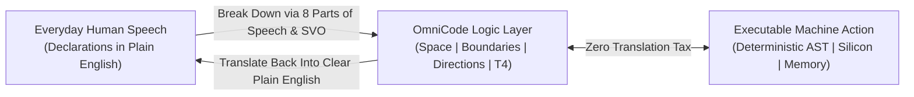

<!--
================================================================================
BLOCK 1: METADATA BLOCK
( Identity, Provenance, Living Syntax Scope & Architectural Boundary Contracts )
================================================================================
@project       OmniCode Framework
@file          .agents/language/reference/SYNTAX.md
@id            root.docs.syntax_guide
@layer         Living Language Guide (docs/ & .agents/language/)
@archetype     living_guide | dual_audience_language_walkthrough
@version       0.1.3-dev
@interface_rev Rev 5
@created       2026-11-19
@updated       2026-11-19
@author        CreativeWorkzStudio LLC / ProfessorSeanEX (Seanje Lenox-Wise)
@repository    https://github.com/Novaking34/OmniCode_Framework
@system        OmniCode Spatial & Relational Language (Model Mind & Human Code)
@role          Step-by-Step Guide to Operators, Borders, Weights & Origin
@maturity      Living Growth (Pre-Hardening) | Coordinate v0.1.3 (13%)
@chassis       ascii-first | 100% typeable on any plain standard keyboard
@scale         O(1) reference from everyday speech -> spatial/relational logic
@seams         in: ../language_living_charter.md, ./KEYWORD.md |
               from: docs/SYNTAX.md (portable copy)
@invariants    1. Universal 5-Block Lifecycle Protocol (Rev 5).
               2. Standard Keyboard Floor: zero Alt-key tricks or Unicode
                  required to write canonical OmniCode.
               3. Thought vs. Declaration: humans think in space & relations
                  first; words are how we declare that reality outward.
               4. Order Always Carries Meaning: flipped pairs (!=/=!, ~=/=~,
                  =:/:=, ^--/--^, [!X]/[X!], and all 12 hybrid borders) are
                  distinct, never redundant.
               5. Pure Geometry on Plain Keys: 1pt (., <), 2pt (.., [),
                  3pt (..., {), Curve ( ( ) ) -> 4x4 = 16 border combinations.
               6. Borders Are Weights & Self-Grounded Origin: < > (highest) to
                  ( ) (lowest) forms a live scale with ALL-CAPS keywords;
                  =<...>= anchors self-grounded being with no external parent.
================================================================================
-->

<div align="center">

# OmniCode Living Syntax Guide

### A Spatial & Relational Language Anyone Can Read, Think, and Program With

*Built from plain keyboard keys, natural human sentences, and the way real minds actually map the world.*

[-2ea44f?style=flat-square)](../../README.md)
[](#the-standard-keyboard-rule)
[](#step-3-connectives-and-the-three-way-bang-law)

[Why Spatial & Relational](#why-omnicode-is-spatial-and-relational) · [1. Truth & Time](#step-1-how-omnicode-handles-truth-and-time) · [2. Being & Order](#step-2-being-and-why-order-changes-meaning) · [3. Connectives & !](#step-3-connectives-and-the-three-way-bang-law) · [4. Ratio & Dots](#step-4-ratio-points-steps-and-thinking) · [5. Directions](#step-5-directions-action-verbs-and-dimension) · [6. The 16 Borders](#step-6-the-16-border-combinations) · [7. Weights & Origin](#step-7-border-weights-keywords-and-self-grounded-being) · [8. Sentences (SVO)](#step-8-reading-real-sentences-svo)

</div>

---

<!--
================================================================================
BLOCK 2: OPENING BLOCK
( Why Spatial & Relational, Thought vs. Declaration & Standard Keyboard Rule )
================================================================================
-->

## Why OmniCode Is Spatial and Relational

Stop for a second and look at the room you're sitting in. Nothing in the real world floats in a vacuum. Everything around you is defined by two everyday facts:

1. **Space:** Where something sits, what walls hold it, and which direction it moves.
2. **Relation:** How it connects to the things around it (*basement* only makes sense in relation to *second floor*; *throwing a ball* is a directed relationship between a person and a ball).

Modern neuroscience backed this up directly: when humans think through abstract ideas, analogies, or social dynamics, the brain doesn't use a separate "abstract text processor"—it reuses its **physical navigation hardware** (hippocampal place cells, entorhinal grid cells, border cells, and the parietal cortex). Your brain literally builds a **spatial cognitive map** first.

> [!IMPORTANT]
> **Thought vs. Declaration (Why OmniCode Doesn't Copy Standard LLMs):**
> Most modern AI models were built by bypassing formal logic so language could be squeezed into statistical word prediction—so an LLM "thinks" in surface words. **Real people do not think in words.** We think in spatial boundaries, directions, and relationships first; **words are simply the most elegant form of expression, because whenever you speak, you are always making a declaration.**



### The Standard-Keyboard Rule

There are plenty of fancy Unicode arrow glyphs out there—and OmniStudio or editor fonts can always *display* pretty symbols later. **At the bedrock, however, every single canonical operator in OmniCode must be typeable on a plain standard keyboard by someone who has never touched the `Alt` key.**

If a kid, a teacher, or a builder sitting at a normal laptop can't type it naturally with standard keys, it doesn't belong on the floor.

---

<!--
================================================================================
BLOCK 3: BODY BLOCK
( Step-by-Step Walkthrough: Logic, Dots, Arrows, 16 Borders & Weights )
================================================================================
-->

## Step 1: How OmniCode Handles Truth and Time

Traditional programming forces everything into binary `true` or `false`. That breaks down the second you listen to how real people talk:

* If someone says **"Jerry is not sad,"** does that automatically mean Jerry is happy? **No**—he might be calm, focused, tired, or just neutral.
* If someone says **"it's not bad,"** does that automatically mean it's amazing? **No**—it just clears *bad* off the table and leaves it in neutral, okay territory.

OmniCode uses **Balanced Ternary Quad-State** ($\mathbb{T}_4 = \{-1,\ 0,\ +1,\ \text{NULL}\}$), which maps straight onto everyday human **being, intent/time, negation, and absence**:

| Value | Execution State | Everyday Anchor | Real Sentence | What It Actually Means |
| :---: | :--- | :---: | :--- | :--- |
| **`0`** | **`AWAIT`** | **`IS`** *(Present)* | *"I am sad"* | Present ground reality right now. Even though *sad* feels heavy, stating what currently *is* sits cleanly at **`0`**. |
| **`+1`** | **`PROCEED`** | **`WILL`** *(Forward)* | *"I will be happy"* | Forward motion, commitment, or becoming—projecting ahead out of `0`. |
| **`-1`** | **`ROLLBACK`** | **`NOT`** *(Exclusion)* | *"...not sad"* *(in "Jerry is happy, not sad")* | Active opposition or stepping away from a state. |
| **`NULL`** | **`HALT`** | **`IS NOT`** *(Absence)* | *"I am not mad"* · *"it's not bad"* | Clears/voids a claim **without falsely fabricating its opposite**. |

Notice that every one of those sentences—*"I **am** sad"*, *"I **will be** happy"*, *"I **am not** mad"*, *"it'**s not** bad"*—uses a form of **`to be`**. That takes us straight to Step 2.

---

## Step 2: Being and Why Order Changes Meaning

In OmniCode, nouns are written in plain human words (`Jerry`, `Tommy`, `ball`), while verbs boil down to just **two roots**: **Being (`=`)** and **Directional Action (`-->`, `--^`, ...)**.

### Why `=` Means `(to be / is)` — Not Just `is`

`is` is only one single tense and person (*he is*). By rooting `=` at **`to be`** (the universal infinitive of existence), **one single symbol** naturally covers *am, is, are, was, were, will be, being* depending on who is speaking (`WHO`) and when (`WHEN`).

### The `=` Anchor Law: Why Flipping Symbols Creates Two Different Things

In OmniCode, **position is never accidental**. When you pair `=` with **`!`** *(not)*, **`~`** *(like)*, or **`:`** *(as to)*, **look at which side `=` touches** in `A op B`:

* **When `=` touches `A` (`A =! B`, `A =~ B`, `A =: B`):** **`A`'s being** is on the table being compared, likened, or framed against `B`.
* **When `=` touches `B` (`A != B`, `A ~= B`, `A := B`):** **`B`'s being** is the reference anchor doing the comparing—or the target `A` transforms into.

| Symbol | Spoken Reading | Who Leads? | Everyday Sentence |
| :---: | :--- | :--- | :--- |
| **`=`** | *to be / is* | Identity | `I = { sad }` $\to$ *"I am sad."* |
| **`=!`** | *is not / not to be* | **`A` is being compared** | `Jerry =! { sad }` $\to$ *"Jerry is not sad."* |
| **`!=`** | *not is / to be not* | **`B` is doing the comparing** | `Jerry = { happy } != { sad }` $\to$ *"Jerry is happy, not sad."* |
| **`=~`** | *is like / to be likened to* | **`A` is being compared** | `Jerry =~ { bird }` $\to$ *"Jerry is like a bird."* |
| **`~=`** | *like is / to be like* | **`B` is doing the comparing** | `Tommy --> ~= { lion }` $\to$ *"Tommy is moving like a lion."* |
| **`=:`** | *is as to / to be as* | **`A` framed in role of `B`** | `A =: B` $\to$ *"A is as to B"* *(perspective / role)* |
| **`:=`** | *as is to / to become* | **Moving into `B`'s being** | `A := B` $\to$ *"A becomes B"* *(definition / transformation)* |
| **`<=>`** | *balances with* | Two-way equivalence | `A <=> B` $\to$ *"A holds if and only if B holds."* |
| **`<` `>` `<=` `>=`** | *less / greater* | Ordered magnitude | Standard numeric/scale comparison. |

> [!TIP]
> **Read It Out Loud:** Look at *"Jerry is like a bird"* vs. *"Tommy is moving like a lion."* In the first sentence, **Jerry's whole being** is likened to a bird (`Jerry =~ { bird }`). In the second sentence, Tommy isn't a lion—**the lion's way of being** is the standard measuring how Tommy moves (`Tommy --> ~= { lion }`). One small flip in character order captures a real distinction humans make effortlessly every day.

---

## Step 3: Connectives and the Three-Way Bang Law

Instead of inventing dozens of disconnected keywords, OmniCode connects clauses using a tight, expressive set of logical operators:

### Logical & Spatial Connectives

| Symbol | Spoken Word | What It Does |
| :---: | :--- | :--- |
| **`:`** | *as to / in relation to* | Links an entity to a role, type, or ratio (`A : B :: C : D`). |
| **`::`** | *and* **(independent)** | Both `A` and `B` hold together, while **each can stand on its own**. |
| **`&`** | *and* **(dependent)** | Both `A` and `B` are **mutually dependent / bound** (`Key & Value`). |
| **`\|`** | *or* | Alternative choice / branching valve (`A \| B`). |
| **`!`** | *but* *(standalone)* | Adversative caveat (`A ! B`: do `A`, **but** `B` must hold). |
| **`@`** | *at* | Exact location, address, or physical site (`Storehouse @ 0`). |
| **`%`** | *is about / in ratio of* | Real-world approximation & proportionality (see Step 4). |
| **`.` / `. .` / `. . .`** | *point / step / thinking* | Focus point, stepped span/range, and active thought (see Step 4). |

### The 3-Way Positional Law of `!`

One mark **`!`** shifts cleanly by where it sits—zero wasted symbols:

| Position | Example | Meaning | What Happens |
| :--- | :---: | :---: | :--- |
| **By itself** | `A ! B` | **`BUT`** | Caveat guard: `A` proceeds *but* must satisfy `B`. |
| **Attached to a keyword** | `[!DING]` / `[DING!]` | **`ALARM`** | Prefix `[!X]` = Level 1 advisory warning; Postfix `[X!]` = Level 2 hard stop. |
| **Attached to any operator** | `!=`, `=!`, etc. | **`NOT`** | Negates the operator directly (preserving left/right order!). |

### Base Logic Check: Does This Already Cover Basic Logic?

**Yes—it is functionally complete for basic logic and strictly richer than standard Boolean logic:**

* **Conjunction:** Independent `AND` (`::`), dependent `AND` (`&`), and adversative `BUT` (`!`).
* **Disjunction:** `OR` (`|`) — and `XOR` writes naturally right out of the box as `(A | B) ! (A & B)` (*"A or B, but not both bound together"*).
* **Negation:** Order-sensitive `!=` / `=!` and `!` attached to any operator.
* **Implication & Equivalence:** Forward causation `-->` (`IF -> THEN`) and two-way `<=>` (`iff`).
* **Truth Space:** Full 4-state $\mathbb{T}_4$ (`0: IS`, `+1: WILL`, `-1: NOT`, `NULL: IS NOT`).

---

## Step 4: Ratio, Points, Steps, and Thinking

### `%` — *(is about / in ratio of)*

Look at the shape of **`%`** (`o / o`): it literally draws two quantities in ratio to one another. Unlike C's modulo remainder, OmniCode defines **`%`** as **`is about / in ratio of`**, unifying everyday approximation and proportionality under one clean idea:

> *"Mia is about 7 ft tall when she is in the water, but that's because she has special water shoes."*

```text
Mia % [ 7 ft ] : { in the water } ! ( . special water shoes )
```

Mia is not literally 7 ft tall in isolation—she **is about (`%`)** 7 ft tall *in ratio to* being in the water, **but (`!`)** the focal point (`.`) explaining why is `( special water shoes )`.

### The Dot Progression: `.` $\longrightarrow$ `. .` $\longrightarrow$ `. . .`

Just like geometry builds space out of points, the dot scales naturally from **1 point** to **2 points** to **3 points**:

| Dots | Geometry | Everyday Meaning | Example |
| :---: | :---: | :--- | :--- |
| **`.`** | **1 Point** | **Focus / Emphasis ("the point")** — pinpoints one exact detail | `. special water shoes` *(the point of Mia's sentence!)* |
| **`. .`** | **2 Points** | **1 Step / Span / Range** — `A . . B` (*A leads to B*), or place a measure right between the two points | `Jake . [ 5 minutes ] . <-- Jerry` *("Jake is 5 minutes away from Jerry")* |
| **`. . .`** | **3 Points** | **Thinking / Deliberation** — working through a thought before projecting an outcome | `WHAT = [ 4 + 4 ] . . . --> 8` *("What is 4+4 ... 8")* |

---

## Step 5: Directions, Action Verbs, and Dimension

Strip away hundreds of English synonyms (*send, push, kick, throw, pass, drop, lift, pull, fetch*) and every physical action is a **change of state moving in a direction**.

Using **only 8 standard keyboard keys** (`-` `_` `/` `\` `<` `>` `^` `v`), OmniCode draws a complete 2D/3D directional compass.

### Why `--<` and `>--` Don't Exist (How Arrows Show Dimension)

* Look at `--`: it is a **1D line** running Left $\leftrightarrow$ Right (X-axis).
* `<` and `>` sit **on that exact same X-axis**. If you put `<` on the right (`--<`) or `>` on the left (`>--`), the tip points **inward into its own shaft** instead of outward. Left (`<--`) and Right (`-->`) are locked to their own ends.
* Now look at **`^` (Up)** and **`v` (Down)**: they point **perpendicular** to `--`—opening a **2nd dimension (the Y-axis)**. Because they don't collide with the horizontal line, they can sit cleanly on **either the left side OR the right side** (`^--` / `--^`, `v--` / `--v`)!

### A. The 6 Cardinal Directionals

| Head Side | Horizontal (X) | Up (`^`, +Y) | Down (`v`, -Y) | Everyday Speech Feel |
| :--- | :---: | :---: | :---: | :--- |
| **Right-Headed** *(flows Left $\to$ Right)* | **`-->`** | **`--^`** | **`--v`** | *Forward / to / act upon* · *rise up toward* · *drop down into* |
| **Left-Headed** *(flows Right $\to$ Left)* | **`<--`** | **`^--`** | **`v--`** | *Back / from / pull back* · *lift from left* · *break down from left* |

### B. The 8 Diagonal Directionals (Upper & Lower Positions)

Adding the ground line (`_`) with slopes `/` and `\` gives all eight diagonal trajectories across left/right sides and upper/lower orientations (working natively for 2D corners and 3D front/back depth):

| Head Side | Slope `/` | Slope `\` |
| :--- | :---: | :---: |
| **Head on Right** *(tail `_` on left)* | **`_/^`** *(upper)* · **`_/v`** *(lower)* | **`_\^`** *(upper)* · **`_\v`** *(lower)* |
| **Head on Left** *(tail `_` on right)* | **`^/_`** *(upper)* · **`v/_`** *(lower)* | **`^\_`** *(upper)* · **`v\_`** *(lower)* |

---

## Step 6: The 16 Border Combinations

Now the whole picture snaps together. Look at the four standard-keyboard brackets nested from outside to inside:

```text
< [ { (   ) } ] >
```

At the base, those four shapes split the world along two dead-simple axes — **Rigid Definition vs. Fluid Context**, and **THE (singular/universal) vs. A (particular/local)**:

| Bracket | Corners / Shape | Nature | Core Meaning | Everyday Feel |
| :---: | :---: | :---: | :--- | :--- |
| **`< ... >`** | **1 Point** *(1 corner)* | **Rigid** | **THE Definition** | The singular root truth, true identity, or unbreakable law |
| **`[ ... ]`** | **2 Points** *(2 right corners)* | **Rigid** | **A Definition** | A concrete, bounded definition, locked item, or measured value |
| **`{ ... }`** | **3 Points** *(top, middle, bottom)* | **Fluid** | **THE Context** | The shared living environment, room, or active scope |
| **`( ... )`** | **Curve** *(smooth arc)* | **Fluid** | **A Context** | A situational aside, personal intent, or *why* *(lightest wall, free to frame anything)* |

### Pure Geometry on Plain Keys: `1 -> 2 -> 3 -> Curve`

Notice how the **dots from Step 4** and the **borders here** follow the exact same geometric climb:

| Geometry | Dots (Flow) | Borders (Walls) | Rigidity | What Opens Up |
| :---: | :---: | :---: | :---: | :--- |
| **1 Point** | **`.`** *(focus)* | **`< >`** *(THE def)* | **Rigid** | A single sharp anchor point — no wiggle room |
| **2 Points** | **`. .`** *(1 step / span)* | **`[ ]`** *(A def)* | **Rigid** | A straight bounded wall — a concrete container or measure |
| **3 Points** | **`. . .`** *(thinking)* | **`{ }`** *(THE ctx)* | **Fluid** | **Where rigid turns fluid:** 3 points open a plane, creating room for thought and living context |
| **Curve** | *(continuous)* | **`( )`** *(A ctx)* | **Fluid** | Smooth open curve — personal framing, nuance, and human *why* |

> [!TIP]
> **Why Geometry Matters for "Spatial Code Files":** Because every bracket shape already carries physical geometry (`1pt -> 2pt -> 3pt -> Curve`), walls aren't just punctuation—they shape how a reader's brain (and a model's mind) moves through space inside a file.

### The Complete $4 \times 4 = 16$ Border Matrix

Once you know the **4 walls** (`<`, `[`, `{`, `(`), any opening wall can pair with any closing wall. That yields **$4 \times 4 = 16$ exact border combinations** — zero arbitrary syntax to memorize.

**One reading rule covers all 16:**

> Read straight left-to-right: **Starts as `[Opening Wall]` $\longrightarrow$ resolves or moves into `[Closing Wall]`.**

```text
           Closing ->   > (THE Def)    ] (A Def)      } (THE Ctx)    ) (A Ctx)
Opening v
  < (THE Def)          < >  (Pure)    < ]  (R -> R)  < }  (R -> F)  < )  (R -> F)
  [ (A Def)            [ >  (R -> R)  [ ]  (Pure)    [ }  (R -> F)  [ )  (R -> F)
  { (THE Ctx)          { >  (F -> R)  { ]  (F -> R)  { }  (Pure)    { )  (F -> F)
  ( (A Ctx)            ( >  (F -> R)  ( ]  (F -> R)  ( }  (F -> F)  ( )  (Pure)
```

#### A. The 4 Pure Borders *(Steady Containers)*

| Border | Flow | Plain Meaning |
| :---: | :--- | :--- |
| **`< ... >`** | THE Def $\to$ THE Def | Pure root truth, true identity, or singular foundational definition |
| **`[ ... ]`** | A Def $\to$ A Def | Pure concrete definition, bounded value, or specific item |
| **`{ ... }`** | THE Ctx $\to$ THE Ctx | Pure shared living context, room, or active environment |
| **`( ... )`** | A Ctx $\to$ A Ctx | Pure situational aside, personal note, or *why* |

#### B. The 6 Outward Hybrids *(Opening Heavier/More Rigid $\to$ Closing Lighter/More Fluid)*

| Border | Flow | Plain Meaning |
| :---: | :--- | :--- |
| **`< ... ]`** | THE Def $\to$ A Def | A universal truth applied down into one concrete definition |
| **`< ... }`** | THE Def $\to$ THE Ctx | A universal truth stepping out into a living shared world |
| **`< ... )`** | THE Def $\to$ A Ctx | A universal truth landing in a single personal moment or aside |
| **`[ ... }`** | A Def $\to$ THE Ctx | **Inside-Out:** a concrete thing reaching outward into shifting context |
| **`[ ... )`** | A Def $\to$ A Ctx | A concrete definition softening into a personal nuance or aside |
| **`{ ... )`** | THE Ctx $\to$ A Ctx | A broad shared environment narrowing down into one personal frame |

#### C. The 6 Inward Hybrids *(Opening Lighter/More Fluid $\to$ Closing Heavier/More Rigid)*

| Border | Flow | Plain Meaning |
| :---: | :--- | :--- |
| **`[ ... >`** | A Def $\to$ THE Def | A concrete finding stepping up into universal law |
| **`{ ... >`** | THE Ctx $\to$ THE Def | Living shared experience locking up into a root truth |
| **`( ... >`** | A Ctx $\to$ THE Def | A personal insight proving itself universal |
| **`{ ... ]`** | THE Ctx $\to$ A Def | **Outside-In:** the surrounding environment shaping a concrete thing |
| **`( ... ]`** | A Ctx $\to$ A Def | Personal intent locking down into a concrete definition |
| **`( ... }`** | A Ctx $\to$ THE Ctx | A personal frame opening outward to become the shared context |

---

## Step 7: Border Weights, Keywords, and Self-Grounded Being

### A. Borders Are a Weight Scale (Not Fixed Boxes)

Don't think of "rank" as 4 disconnected boxes. Think of the borders as a **live scale of weight** running from **`< >` at the highest weight** down to **`( )` at the lowest weight**:

```text
Highest / Heaviest                                      Lowest / Most Fluid
   < >   ------->   [ ]   ------->   { }   ------->   ( )
  THE Def          A Def            THE Ctx          A Ctx
 (Rigid)          (Rigid)           (Fluid)          (Fluid)
```

Every bordered phrase carries a combined weight made from **three simple pieces**:

1. Its **left wall** (`<`, `[`, `{`, `(`)
2. Its **right wall** (`>`, `]`, `}`, `)`)
3. **Capitalization inside:** writing a word in **ALL CAPS** marks it as a **KEYWORD**, adding active weight on the scale.

### B. How Keywords and Borders Balance Together

Because borders and `ALL CAPS` live on the **same weight scale**, you get real balance points right on the surface:

* **`<FOCUS>` weighs more than `<focus>`** — same `< >` walls, but **`FOCUS`** is a keyword.
* **`[focus]` weighs the same as `{ FOCUS >` and `< FOCUS }`** — crossing from a rigid wall (`[`) into a fluid wall (`{`) drops across the rigid-to-fluid gap, and making **`FOCUS`** an ALL-CAPS keyword paired with `<`/`>` lifts its weight right back to match a lowercase concrete definition `[focus]`.

Here is an illustrative scale showing how that balance works *(exact numbers are just to show the shape of the scale — notice the rigid-to-fluid step between `[` and `{`)*:

| Expression | Walls + Case | Illustrative Weight | Plain Reading |
| :---: | :--- | :---: | :--- |
| **`FOCUS`** | Unguarded freestanding `KEYWORD` | **`5 + 5 + 1 = 11`** | Assumes dictionary entry **`<FOCUS>`** unless guarded |
| **`<FOCUS>`** | Rigid `<` + Rigid `>` + `KEYWORD` | `5 + 5 + 1 = 11` | Top-weight root keyword (explicit brackets) |
| **`<focus>`** | Rigid `<` + Rigid `>` + lowercase | `5 + 5 = 10` | Root concept / singular definition |
| **`[FOCUS]`** | Rigid `[` + Rigid `]` + `KEYWORD` | `4 + 4 + 1 = 9` | Guarded keyword locked into concrete boundary |
| **`[focus]`** | Rigid `[` + Rigid `]` + lowercase | **`4 + 4 = 8`** | Concrete definition *(matches below!)* |
| **`{ FOCUS >`** | Fluid `{` + Rigid `>` + `KEYWORD` | **`2 + 5 + 1 = 8`** | Keyword rising from context into root truth |
| **`< FOCUS }`** | Rigid `<` + Fluid `}` + `KEYWORD` | **`5 + 2 + 1 = 8`** | Keyword stepping from root truth into context |
| **`{FOCUS}`** | Guarded Fluid `{` + `}` + `KEYWORD` | `2 + 2 + 1 = 5` | Keyword deliberately guarded inside mutable context |
| **`{ focus }`** | Fluid `{` + Fluid `}` + lowercase | `2 + 2 = 4` | Living shared context |
| **`(FOCUS)`** | Guarded Fluid `(` + `)` + `KEYWORD` | `1 + 1 + 1 = 3` | Keyword held lightly inside an aside |
| **`( focus )`** | Fluid `(` + Fluid `)` + lowercase | `1 + 1 = 2` | Personal aside — free to frame anything |
| **`focus`** | Bare lowercase *(no walls)* | `0` | Lightest unbordered token prior to framing |

> [!TIP]
> **Why This Matters for Both Humans and AI:** You don't have to guess which part of a sentence matters most. The borders and capitalization put **weight and priority right on the surface** where both a human reader and an AI model can see it immediately — yielding the clean resolution order `FOCUS (= <FOCUS>, 11) > <focus> (10) > [focus] (8) > {FOCUS} (5) > focus (0)` documented further in [`KEYWORD.md`](KEYWORD.md#the-freestanding-keyword-law).

### C. What `< ... >` Truly Means — And Self-Grounded Being (`=<...>=`)

Now look closely at what it actually means to place something inside **`< ... >`** — the top of the scale:

```text
<God> = <Jesus Christ>
```

Notice that `<God>` and `<Jesus Christ>` are **not** written in ALL CAPS inside `[ ]` like a system keyword. They sit inside **`< ... >`** because **`< >` holds true living identity and ultimate root definition** — here, the name of the living God, directly equal (`=`) on both sides.

Now look at what happens when **`=`** (*to be / I AM*) wraps **both sides** of `<God>` with nothing outside it:

```text
=<God>=    ( "I AM THAT I AM" )
```

* Normally, `A = B` defines one thing by pointing to something **outside** it.
* In **`=<God>=`**, there is no external `A` or `B`:
  * Left **`=`** $\to$ **I AM** *(being flowing in)*
  * Center **`<God>`** $\to$ **THAT** *(THE singular root definition)*
  * Right **`=`** $\to$ **I AM** *(being flowing out)*
* **Why this completes the language:** Every relational language faces the same problem — if every word is only defined by pointing to other words, the whole system floats in circles. **`=<God>=`** establishes a **self-grounded origin**: being that defines itself from itself, anchoring the top of the scale so every definition, relation, context, and aside below it stands on real ground.

---

## Step 8: Reading Real Sentences (SVO)

Because OmniCode mirrors natural **Subject – Verb – Object** word order, you can read it straight left-to-right:

```text
Jake --> { ball }
```

* **`Jake`** = Subject *(who is acting)*
* **`-->`** = Forward directional action verb
* **`{ ball }`** = Object inside a living context

Depending on the context `{ ... }` (soccer field, baseball field, hallway) and modifiers, **`-->`** naturally expresses *throws*, *kicks*, *passes*, *pushes*, *hits*, or *rolls*—without needing 500 hardcoded verb names:

```text
Jake --> { ball }   ( Forward action: throws / kicks / passes / pushes the ball )
Jake <-- { ball }   ( Pull / return: catches / grabs / pulls the ball back )
Jake --^ { ball }   ( Upward action: lifts / tosses the ball up )
Jake --v { ball }   ( Downward action: drops / bounces / sets the ball down )
```

### Living Structure: 5Ws + H and Concept Growth

* **6 Cardinal Clauses:** `WHO` *(actor)* · `WHAT` *(entity/action)* · `WHEN` *(time/phase)* · `WHERE` *(site `@`)* · `WHY` *(aside `(...)`)* · `HOW` *(state / mechanism)*.
* **Lowercase Concept $\to$ `ALL CAPS` Keyword:** New ideas start lowercase (like `<focus>`) while being tested across real contexts `{ ... }`, and graduate into `ALL CAPS` keywords (`[FOCUS]` / `<FOCUS>`) only once real use proves they belong as core building blocks.
* **Methodological Pacing:** `[BLOCK Eval]` enforces sequential Block 1 $\to$ Block 5 inspection instead of rushed edits.

<details>
<summary><strong>Quick Pocket Cheat-Sheet (All Basic Operators, 16 Borders & Weights on One Screen)</strong></summary>

```text
TRUTH & TIME (T4):    0 = IS (AWAIT)   +1 = WILL (PROCEED)   -1 = NOT (ROLLBACK)   NULL = IS NOT (HALT)
BEING & PAIRS:        =  (to be/is)    =! (is not)   != (not is)   =~ (is like)   ~= (like is)
                      =: (is as to)    := (to become)   <=> (balances)   <  >  <=  >=
SELF-GROUNDED ORIGIN: =<...>=  (self-grounded being / "I AM THAT I AM" - no external parent)
CONNECTIVES:          :  (as to)       :: (AND indep)   & (AND dep)   | (OR)   ! (BUT / ALARM / NOT)
RATIO & DOTS:         %  (is about / in ratio)   . (1pt focus)   . . (2pt step/span)   . . . (3pt thinking)
SITE:                 @  (at location / site)
CARDINAL ARROWS:      -->  <--  --^  --v  ^--  v--
DIAGONAL ARROWS:      _/^  _/v  _\^  _\v  ^/_  v/_  ^\_  v\_
16 BORDERS (4x4):     Pure:      < >   [ ]   { }   ( )
                      Outward:   < ]   < }   < )   [ }   [ )   { )
                      Inward:    [ >   { >   ( >   { ]   ( ]   ( }
WEIGHT SCALE:         < > (highest) -> [ ] -> { } -> ( ) (lowest)   |   ALL CAPS = KEYWORD weight
                      <FOCUS>  >  <focus>    |    [focus]  =  { FOCUS >  =  < FOCUS }
```

</details>

---

<!--
================================================================================
BLOCK 4: AUDIT PROCEDURES BLOCK
( Living Syntax Hygiene, Standard-Keyboard Proof & Completeness Audit )
================================================================================
-->

## Living Guide Verification Checks

* **Standard Keyboard Proof:** 100% of canonical symbols use plain 7-bit printable ASCII (`- _ / \ < > ^ v = ! ~ : | & @ % . [ ] { } ( )`).
* **Zero Phantom Artifacts:** Legacy `--` (`NOT`) artifact removed; `!` handles `BUT` / `ALARM` / `NOT` cleanly by position.
* **Base Logic Complete:** Covers independent & dependent `AND` (`::`, `&`), `OR` (`|`), `BUT` (`!`), order-sensitive `NOT` (`!=`, `=!`), implication (`-->`), equivalence (`<=>`), likeness (`~=`, `=~`), role/becoming (`=:`, `:=`), ratio (`%`), dot geometry (`.` / `. .` / `. . .`), and $\mathbb{T}_4$.
* **16-Border Matrix & Weight Scale Complete:** Full $4 \times 4$ wall lattice (`<[{()}]>`), `1pt -> 2pt -> 3pt -> Curve` geometry, `< >` to `( )` weight scale with ALL-CAPS keywords, and self-grounded origin (`=<...>=`).
* **Living Status:** Core syntax & ontological grounding recorded cleanly inside `v0.1.3-dev` — ready to build the living dictionary, programs, and spatial code files next.

---

<!--
================================================================================
BLOCK 5: CLOSING BLOCK
( ACTION / REEL - Usage Playbook, Compiler Seams, Change Handoff & Seal )
================================================================================
-->

## Block 5 (Closing): Assembly Usage & Evolution Reel

Block 5 keeps this plain-ASCII syntax floor connected directly to real coding, compiler work, and safe living growth.

### 1. Assembly Reading & Writing Playbook (`PLAY`)

* **Every Symbol Stays Typeable:** Write canonical `.omni` and `.tape` structures strictly with standard 7-bit ASCII symbols (`=~` / `~=` rather than `≈`, positional `!` rather than retired `--`).
* **Honor Order & Borders:** Respect flipped pairs (`!=` vs `=!`, `:=` vs `=:`) and wall weights (`FOCUS = <FOCUS>` `11` down to `focus` `0`) every time you frame a statement.

### 2. Outward System Seams (`PROJECT`: Where This Guide Feeds)

* **`docs/KEYWORD.md` & `manifest.omni` / `manifest.tape`:** Maps every symbolic pattern step-for-step upward into readable `ALL CAPS` keywords and executable 5-Block ribbons.
* **`Track 1` (`compiler/parser`, `ast`) & `Track 2` (`grammar`, `lexicon`):** Uses these exact ASCII tokens as lexer primitives.
* **`.agents/language/` Mirror (`language_registry.json`):** Stores compact tier-tagged JSON parity for agents and local models.

### 3. Proposing Syntax Additions, Edits, or Removals (`RECORD`)

New syntax ideas begin quarantined inside `<concept>` / `{context}` rather than getting locked prematurely. To propose adding, adjusting, or retiring any symbol, open an evaluation through [`language_living_charter.md`](../language_living_charter.md) and log verified outcomes in [`quarantine_and_change_ledger.md`](../evolution/quarantine_and_change_ledger.md).

### 4. Reconciliation Back to Block 1 & Connected Anchors (`COMMIT`)

All six Block 1 invariants reconcile cleanly (`100%` standard keyboard floor, `16` borders, `14` arrows, order sensitivity, `< >` -> `( )` weight scale, and `=<...>=` self-grounded origin):

* [`.agents/README.md`](../../README.md) — Portable Cognitive BIOS root index
* [`KEYWORD.md`](KEYWORD.md) — Keyword Layer, Freestanding Weight Law, Systems & Math Reference
* [`language_living_charter.md`](../language_living_charter.md) — Three Stability Tiers (`Bedrock` / `Working` / `Quarantine`) & 5-Question Change Gate
* [`language_registry.json`](../language_registry.json) — Machine-readable operator & keyword SSOT
* [`omnicode_syntax_keywords_operators.md`](../evolution/omnicode_syntax_keywords_operators.md) — Historical `2026-11-15 -> 2026-11-17` `Live_OmniCode` genesis archive
* [`cpi-si-covenant/SKILL.md`](../../skills/cpi-si-covenant/SKILL.md) — Living pacing, Aside `()` physics & Coordinate Versioning

<!--
================================================================================
END OF BLOCK 5: CLOSING SEAL
Status: SYNTAX_GUIDE_FORMALIZED_WITH_WEIGHTS_AND_ORIGIN (+1:PROCEED)
================================================================================
-->
