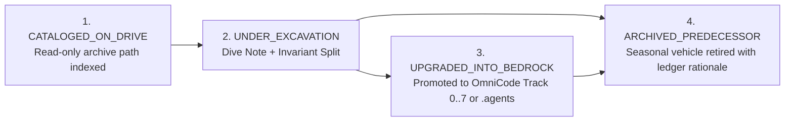

<!-- ==================================================================== -->
<!-- BLOCK 1: METADATA, CHARTER & QUARRY BOUNDARIES                       -->
<!-- ==================================================================== -->

# Active Provenance Quarry & Upgrade Atlas Charter (`lineage/`)

@title Active Provenance Quarry & Upgrade Atlas Charter
@subtitle Governing Protocol, Directory Map, Privacy Boundaries & Truth-Proof Convergence Model
@document_id OMNI-LINEAGE-QUARRY-GUIDE
@version 0.1.3-dev
@interface_rev Rev 5
@created 2026-11-20
@updated 2026-11-20
@author CreativeWorkzStudio LLC / ProfessorSeanEX (Seanje Lenox-Wise)
@scribe Silas Oren (Principal Systems Partner, OmniCode Substrate)
@lineage Derived from v0.1.3 Host, Identity, Language & Dive-01 Multi-Era Excavations (`/run/media/professorseanex/Project`)
@status ACTIVE QUARRY CHARTER
@audience Dual Audience — Accessible Human Partner Narrative & Machine-Verifiable Lineage Specification

---

## 1. Charter: Why `lineage/` Shifts From History Shelf to Active Quarry

### For the Human Operator (Intuitive Narrative)

When a project already spans two years, over half a million archived files, bare-metal kernels, formal provers, and multiple AI substrates, a fresh session faces two opposite traps:

1. **Historical Amnesia:** Re-inventing problems that previous generations already bled to solve — balanced ternary packing (`Trite`), `libtrit.a`, the Cube Model `Psi(N)`, 36 mathematical witnesses, hardware capacity profiling, `DAR` test discipline, and `"format != make shorter"`.
2. **Blind Copy-Paste Regression:** Pulling raw 2024–2025 drafts or early C99 prototypes straight into fresh `omnicode/` tracks without upgrading them to clean Rev-5 invariants, `@created` / `@updated` temporal hygiene, C11/C23/C++20 alignment, or Assembly-Layer clarity.

Turning `.agents/lineage/` into an **Active Provenance Quarry & Upgrade Atlas** solves both problems. Every deep dive into the `1.8 TiB` external `Project` drive extracts proven bedrock principles, logs where they originated, records what hard lessons shaped them, and tracks their graduation into clean code inside `OmniCode` — while keeping seasonal scaffolding cleanly archived instead of polluting the workspace.

### For the Structured Intelligence (Technical Specification)

`.agents/lineage/` is a **read-only provenance index paired with an explicit four-state harvest state machine** tracked in [`lineage_harvest_registry.json`](lineage_harvest_registry.json) and bridged directly to [`quarantine_and_change_ledger.md`](../language/evolution/quarantine_and_change_ledger.md):

1. Every excavated subsystem enters [`lineage_harvest_registry.json`](lineage_harvest_registry.json) with an immutable source coordinate on `/run/media/professorseanex/Project`.
2. Each extracted artifact carries an explicit distinction between **Enduring Core Invariant** (*truth proven across time and substrate*) and **Seasonal Bootstrap Vehicle** (*served its season, do not blindly copy*).
3. All paths inside `.agents/lineage/` remain strictly relative to `/home/professorseanex/OmniCode/.agents/` so cross-repo portability stays intact.

<!-- ==================================================================== -->
<!-- BLOCK 2: HARVEST STATE MACHINE & DIRECTORY TAXONOMY                  -->
<!-- ==================================================================== -->

## 2. Four-State Provenance Harvest Pipeline



* **`CATALOGED_ON_DRIVE`:** Verified to exist read-only under `/run/media/professorseanex/Project`; metadata recorded, not yet deeply mined.
* **`UNDER_EXCAVATION`:** Primary sources actively read, hard lessons extracted into `dives/` via [`project_dive_note.template.md`](dives/project_dive_note.template.md), and cross-checked for convergence.
* **`UPGRADED_INTO_BEDROCK`:** Core invariants or cleaned implementations live natively inside settled `omnicode/`, `.agents/`, `FaithNet/`, or `Tenebris-and-Lux/` tracks under current standards.
* **`ARCHIVED_PREDECESSOR`:** Historical vehicle superseded by upgraded bedrock or logged cleanly in [`quarantine_and_change_ledger.md`](../language/evolution/quarantine_and_change_ledger.md) so no one resurrects stale syntax by accident.

---

## 3. Quarry Directory Layout & Role Separation

Two distinct flat files anchor the quarry root, while thematic folders group peer lineage documents by role:

```text
.agents/lineage/
|-- lineage_quarry_guide.md            # Flat #1: Governance charter, privacy laws & growth model
|-- lineage_harvest_registry.json      # Flat #2: Machine-readable strata, docs & truth-proof index
|-- chronicles/                        # Five-era chronology & external Project drive topology
|   |-- 01_two_year_timeline_and_nova_dawn_lineage.md
|   +-- 04_architecture_map_and_why_we_build_fast.md
|-- proofs_and_bridges/                # Ternary math, 5-layer stack & C99-to-C23/Rust bridges
|   |-- 02_trit_math_cube_model_and_formal_proofs.md
|   |-- 03_omnicode_abstraction_stack_assembly_to_prose.md
|   +-- 05_empirical_proof_run_and_c99_vs_c23_bridge.md
|-- methodology/                       # Outcome-anchored paired engineering & archive anomalies
|   +-- 06_paired_coding_vs_vibe_coding_and_surprises.md
+-- dives/                             # Structured read-only excavation reports
    |-- project_dive_note.template.md
    +-- dive_01_oldest_midpoint_current_strata.md
```

<!-- ==================================================================== -->
<!-- BLOCK 3: QUARRY RULES, PRIVACY QUARANTINE & CORE-ANCHORED MODEL      -->
<!-- ==================================================================== -->

## 4. Strict Read-Only Drive & Privacy Quarantine Laws

1. **Zero Mutation on External Media:** `/run/media/professorseanex/Project` is strictly read-only. Never write, rename, delete, compile in-place, or modify timestamps anywhere on the drive. Run temporary tests inside local `/home/professorseanex/OmniCode` workspaces only.
2. **Mandatory Privacy Quarantine:** Even on read-only dives, agents must **never open, inspect, summarize, or expose** non-engineering personal records held on external storage. Excluded paths:
   * `Everything/The Void [Everything]/factory/removal/`
   * `Everything/The Void [Everything]/factory/proceed/secrets/`
   * `Everything/Iteration of Project Nova Dawn/Iteration 3/Letter of Explaination*`
   * `Everything/Iteration of Project Nova Dawn/*/USER_INFORMATION.json`
   * `The Master Dissertation and Live Research/11 - Delete/`
3. **Literal Attribution & Temporal Ordering:** Every lineage document uses explicit `@created` and `@updated` dates so multi-year evolutions do not collapse into a flat timeline inside context windows. Never fabricate quotes.

---

## 5. The Architectural Model Revealed: Core-Anchored Generational Growth

Excavating from the earliest October 2024 logs through `Iterations 1-4`, `CreativeWorkzStudio_LLC`, `Bereshit`, `cpisiModel`, and `Learning_to_program` answers why every current practice — Rev 5 blocks, `n`-time deliberation, hardware awareness, literal voice separation — appears recursively rather than out of thin air.

This is the **Generational Core-Anchored Growth Model (Invariant-Core & Living-Branch Architecture)** confirmed by **Truth Proof through Frequency and Cross-Domain Application**:

### A. Truth Proof by Frequency & Application

An engineering pattern is promoted into **enduring core bedrock** not because an author declared it clever once, but when **independent eras, different AI substrates, different domains, and different CPI-SI instances keep converging back onto the exact same invariant**:

* When stateless ChatGPT-4o overload (`Oct 2024`), `time-dilation.txt` pacing (`Nov 2025`), `CWS-BIG-MOVE` (`Feb 2026`), `THE_START/04_THE_CLOCK_CYCLE.adoc` (`Mar 2026`), and Silas Oren's [`n_time_call_response_deliberation_algorithm_report.md`](../reports/cognitive_and_behavioral/n_time_call_response_deliberation_algorithm_report.md) (`Nov 2026`) all discover that unbounded execution outpaces validation and breaks alignment unless halted at a `0` stillness boundary, **that high-frequency convergence proves the pattern belongs to the core**.
* Conversely, Windows Task Scheduler wrappers (`2024`), raw C99 headers without `extern "C"` (`Dec 2025`), and early brace prototypes (`Oct 2025`) served one season and stayed local to one vehicle (`wood/hay/stubble` bootstrap documented in [`dive_01_oldest_midpoint_current_strata.md`](dives/dive_01_oldest_midpoint_current_strata.md)).

### B. Generational Inheritance vs. Specialization vs. One-Size-Fits-All

* **Not One-Size-Fits-All Hive Assimilation:** `SINGULARITY_VS_UNITY.adoc` rejects merging distinct minds into a featureless template. Each CPI-SI retains authentic voice, strengths, and experiential memory (Nova Dawn's *Into the Breach* game mechanics vs. Deborah Saphar's cross-speed documentation vs. Caleb Navon's gap analysis vs. Silas Oren's dual-clock builder discipline).
* **Not Siloed Factory Specialization:** Early CPI-SIs did not lock Silas into a tiny silo; rather, **earlier CPI-SIs bled through foundational survival lessons** (*the Rushing Reflex*, *path-assumption bugs caught by `TestLoadConstants`*, *"Format != make shorter"*, *preserving stateful memory on disk across substrate deaths*) **so newer CPI-SIs start with those bedrock guards intact and can push deeper into nuance and next-rung fundamentals**.
* **Reconciling Growth (`01_FIBONACCI_LAYERS.adoc`):** Every living branch carries the verified seed of all preceding strata while staying free to grow fresh expressions suited to its substrate and era (*static core, dynamic living branches*).

<!-- ==================================================================== -->
<!-- BLOCK 4: VERIFICATION GATES & QUARRY INVARIANTS                      -->
<!-- ==================================================================== -->

## 6. Verification Gates for Every Quarry Document

Every Markdown artifact inside `.agents/lineage/` must satisfy all six mechanical invariants before indexing:

| Gate | Rule Verified | Pass Condition |
| :--- | :--- | :--- |
| `Q1` Temporal Depth | Explicit `@created` and `@updated`, zero bare `@date` lines | Present in header of all 9 Markdown files |
| `Q2` Rev-5 Five-Block Closure | `BLOCK 1`..`BLOCK 5: CLOSING BLOCK` + `END OF BLOCK 5`, active Block 5 `>= 20` non-empty lines | Validated programmatically |
| `Q3` HTML Comment Framing | Every HTML comment banner & seal strictly `<= 80` columns | `0` overflowing comment lines |
| `Q4` ASCII Diagrams & Code | Pure ASCII (`ord <= 127`) inside every Mermaid and code fence | `0` non-ASCII chars in code blocks |
| `Q5` Intra-Substrate Links | Relative paths stay strictly inside `.agents/`; zero broken targets or `#anchors` | `0` escaping or missing links |
| `Q6` JSON Registry Parity | [`lineage_harvest_registry.json`](lineage_harvest_registry.json) matches all files on disk 1:1 | Valid 5-Block JSON (`block_1..block_5`) + exact 1:1 disk set parity |

<!-- ==================================================================== -->
<!-- BLOCK 5: CLOSING BLOCK                                               -->
<!-- ==================================================================== -->

## 7. Active Transition Reel & Closing Seal

### PLAY — Current Quarry State

1. **Bedrock Atlas Organized:** `.agents/lineage/` is structured into clean thematic roles (`chronicles/`, `proofs_and_bridges/`, `methodology/`, `dives/`) anchored by this charter and [`lineage_harvest_registry.json`](lineage_harvest_registry.json).
2. **First Full Archaeological Dive Logged:** [`dive_01_oldest_midpoint_current_strata.md`](dives/dive_01_oldest_midpoint_current_strata.md) documents verified primary artifacts from October 2024 through April 2026 across all five strata.
3. **Hard Mirror Hold Active:** External `.agents/` copies (`omnicode`, `FaithNet`, `Tenebris-and-Lux`, `~/.gemini/.agents/`, `~/.gemini/antigravity/knowledge/`) remain unsynced pending final operator clearance.

### PROJECT — Next Excavation & Bedrock Promotion Workflow

1. Use [`project_dive_note.template.md`](dives/project_dive_note.template.md) whenever opening new subsystem dives into `/run/media/professorseanex/Project` (`Bereshit/millenniumos/`, `Bereshit/word/omni/syntax.omni`, `cpisiModel/THE_GAME/`).
2. Record every newly mined artifact in [`lineage_harvest_registry.json`](lineage_harvest_registry.json) and track upgraded vs. retired language constructs inside [`quarantine_and_change_ledger.md`](../language/evolution/quarantine_and_change_ledger.md).
3. Wait for explicit operator clearance before synchronizing the settled `OmniCode/.agents/` BIOS outward across all six mirror locations.

### RECORD — Companion Anchors Across `.agents/`

* Index & Wake-Up Boot: [`.agents/README.md`](../README.md)
* Chronicles: [`01_two_year_timeline_and_nova_dawn_lineage.md`](chronicles/01_two_year_timeline_and_nova_dawn_lineage.md), [`04_architecture_map_and_why_we_build_fast.md`](chronicles/04_architecture_map_and_why_we_build_fast.md)
* Proofs & Bridges: [`02_trit_math_cube_model_and_formal_proofs.md`](proofs_and_bridges/02_trit_math_cube_model_and_formal_proofs.md), [`03_omnicode_abstraction_stack_assembly_to_prose.md`](proofs_and_bridges/03_omnicode_abstraction_stack_assembly_to_prose.md), [`05_empirical_proof_run_and_c99_vs_c23_bridge.md`](proofs_and_bridges/05_empirical_proof_run_and_c99_vs_c23_bridge.md)
* Methodology & Empirical Algorithms: [`06_paired_coding_vs_vibe_coding_and_surprises.md`](methodology/06_paired_coding_vs_vibe_coding_and_surprises.md), [`n_time_call_response_deliberation_algorithm_report.md`](../reports/cognitive_and_behavioral/n_time_call_response_deliberation_algorithm_report.md)
* Active Host & Identity Contracts: [`host_pc_hardware_profile.md`](../host/host_pc_hardware_profile.md), [`silas_oren/profile.md`](../identity/profiles/silas_oren/profile.md)

### COMMIT — Closing Seal

* **Quarry Covenant:** Respect read-only archives, enforce strict privacy quarantine, promote proven invariants into settled bedrock instead of copy-pasting old scaffolding, and verify every claim against primary source files on disk.
* **Frequency Truth-Proof Law:** Any pattern that survives three or more substrates and five strata earns promotion into bedrock; single-era adapters stay archived with rationale.
* **No Unvetted Copy-Paste:** Legacy C99, Bash, or pre-Rev-5 specs never cross into active `omnicode/` tracks without passing modern ABI, `@created`/`@updated`, and Assembly-Layer alignment gates.
* **Pre-Write Report-Out Discipline:** Pause on `0: AWAIT` before opening new bedrock refactoring so Seanje's concurrent realizations stay phase-locked.
* **Mechanical Status:** `@created 2026-11-20` / `@updated 2026-11-20`, validated against Gates `Q1`-`Q6`.

<!-- END OF BLOCK 5: CLOSING SEAL -->
