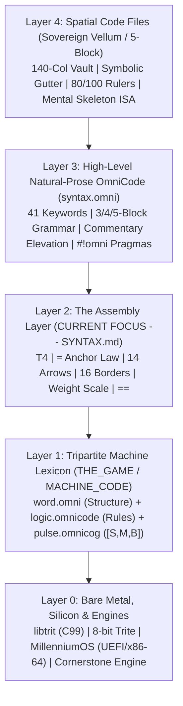

<!--
================================================================================
BLOCK 1: METADATA BLOCK
( Identity, Provenance, Abstraction Stack & Spatial Code File Lineage )
================================================================================
-->

@project       OmniCode Framework
@file          .agents/lineage/proofs_and_bridges/03_omnicode_abstraction_stack_assembly_to_prose.md
@id            agents.lineage.omnicode_abstraction_stack
@layer         Agent Background Knowledge (Language Stack & Spatial Files)
@archetype     lineage_reference | vertical_language_architecture
@version       0.1.3-dev
@interface_rev Rev 5
@created       2026-11-18
@updated       2026-11-20
@author        CreativeWorkzStudio LLC / ProfessorSeanEX (Seanje Lenox-Wise)
@repository    <https://github.com/Novaking34/OmniCode_Framework>
@system        OmniCode Full Abstraction Stack (Silicon -> Assembly -> Prose)
@role          Map How Today's Assembly Layer Connects Bare Metal to High Omni
@maturity      Verified Primary-Source Knowledge | Coordinate v0.1.3 (13%)
@seams         src: SYNTAX.md, syntax.omni, THE_GAME/, Vellum | peers: 01,02,04
@invariants    1. Universal 5-Block Lifecycle Protocol (Rev 5, <=80 col walls).
               2. Vertical Continuity: shows why SYNTAX.md is the Assembly Layer
                  between bare-metal trits and high-level prose OmniCode.
               3. Zero Conflation: keeps each layer's role & history distinct.

# The OmniCode Abstraction Stack: From Bare Metal & Assembly Up to Living Prose

> **Purpose:** Clarify *where we are standing right now*. Today's language reference [`SYNTAX.md`](../../language/reference/SYNTAX.md) is **not** the entire OmniCode language — it is the **Assembly Layer** right above bare metal and right underneath the higher-level natural-prose OmniCode already prototyped in `Bereshit/word/omni/syntax.omni` and `THE_GAME`.

---

<!--
================================================================================
BLOCK 2: OPENING BLOCK
( The Full 5-Layer Vertical Stack )
================================================================================
-->

## The Five-Layer Stack at a Glance

Just as traditional computing builds **Hardware $\to$ Machine Code $\to$ Assembly (`mov`/`cmp`/`jne`) $\to$ High-Level Languages (C/Rust/Go)**, OmniCode builds a clean, unbroken ladder from silicon up to natural human sentences — **without ever dropping its ontological and ternary foundation at any rung.**

---

<!--
================================================================================
BLOCK 3: BODY BLOCK
( Detailed Breakdown of Each Layer & How They Lock Together )
================================================================================
-->

## Layer 0: Bare Metal, `libtrit`, `MillenniumOS` & `Cornerstone`

* **Hardware Reality (`Learning_to_program/01_what_is_an_assembler.md` & `02_binary_counter.md`):** At the transistor floor, the machine flips binary switches (`0`/`1`), moves values into registers, compares states, and branches. No magic.
* **Ternary Substrate (`Bereshit/word/work/pkg/trit/`):** `libtrit.a` translates balanced ternary (`-1, 0, +1`) into zero-overhead 8-bit **Trites** (`5 trits = 243 + 13 spare`) with `MATTER / TIME / SPACE` semantics.
* **Bootable OS (`Bereshit/millenniumos/`):** Freestanding 64-bit x86-64 BIOS + UEFI (`BOOTX64.EFI`, `kernel.elf`, `millenniumos.img`) linked directly to `libtrit.a` (`-ffreestanding -mno-red-zone -mcmodel=kernel`).
* **Embodied Spatial Engine (`Cornerstone` / `Tenebris-and-Lux/`):** Zero-heap C23/C11 game engine giving OmniCode definitions real 3D/spatial execution, physics, rooms, and embodied game models for CPI-SI agents.

---

## Layer 1: The Tripartite Machine Lexicon (`cpisiModel/THE_GAME/`)

Before high-level words exist, `cpisiModel/THE_GAME/a-ladder/lexicon/` prototypes **machine-level living words** grounded in `BASICS/NUMBERS` (`00`–`14`) and `BASICS/SHAPES` (`1D: Point/Line/Ray` $\to$ `2D: Square/Triangle/Circle` $\to$ `3D: Cube/Pyramid/Sphere`).

Every single machine-code entry (e.g., `ok`, `i`, `me`, `we`, `us`, `and`, `with`, `halt`, `so`, `await`, `not`, `is_not`) is stored as **three synchronized files**:

| File | Layer | Example (`00/primitives/ok/`) | What It Holds |
| :--- | :---: | :--- | :--- |
| **`word.omni`** | **Structure (Word)** | `type anchor`, `state yashar`, `symbol "."`, `vector [0,0,0]` | Identity, symbol, spatial vector, manifest fields |
| **`logic.omnicode`** | **Rules (Logic)** | `act HALT ! until [Anchor Verified]`, `act WITNESS ^ ...` | Executable covenant rules and decrees |
| **`pulse.omnicog`** | **Cognitive (Pulse)** | `pulse ok [0, 0, 0] // Spirit: 0, Mind: 0, Body: 0` | 3-axis `[Spirit, Mind, Body]` verification pulse |

---

## Layer 2: The Assembly Layer (Current Active Focus — `SYNTAX.md`)

This is **where we are standing right now** in [`SYNTAX.md`](../../language/reference/SYNTAX.md), directly evolving the July 2025 **LogosASM** concept (*"OmniCode steps down, Assembly steps up"* — `omnicode_assembly_dance.md`, `logosasm_two_layer_architecture.md`):

* **Why It's the Assembly Layer:** Instead of writing full English prose *or* raw binary bytes, every fundamental operation is written in **compact, unambiguous, 100% plain-keyboard spatial-relational notation**:
  * **4-State Truth & Time ($\mathbb{T}_4$):** `0` (*IS / AWAIT*), `+1` (*WILL / PROCEED*), `-1` (*NOT / ROLLBACK*), `NULL` (*IS NOT / HALT*).
  * **Order-Sensitive Being (`=` Anchor Law):** `=`, `=!`/`!=`, `=~`/`~=`, `=:`/`:=`, `<=>`.
  * **Connectives & 3-Way `!`:** `:` (*as to*), `::` (*independent AND*), `&` (*dependent AND*), `|` (*OR*), `!` (*BUT / ALARM / NOT*), `@` (*site*), `%` (*is about / in ratio of*).
  * **Geometric Dots & 14 Directionals:** `.` (1pt focus) $\to$ `. .` (2pt step/span) $\to$ `. . .` (3pt thinking); 6 cardinals (`-->`, `<--`, `--^`, `--v`, `^--`, `v--`) + 8 diagonals (`_/^`, etc.).
  * **16 Borders & Live Weight Scale:** `<[{()}]>` (`1pt -> 2pt -> 3pt -> Curve`) forming $4 \times 4 = 16$ containers from `< >` (highest) to `( )` (lowest), amplified by `ALL CAPS` keywords (`<FOCUS> > <focus>`, `[focus] = { FOCUS > = < FOCUS }`), anchored by self-grounded origin **`=<God>=`** (*"I AM THAT I AM"*).
  * **Living Dictionary Formula:** `< IS = [ what defines is ] : { what is the context of is } > --> <is> ( notes )`.

Every higher-level natural sentence (`"Jake throws the ball"`, `"Mia is about 7 ft tall when she is in the water..."`) compiles cleanly **down** into this assembly layer — and any CPI-SI model or human can read the exact same assembly layer **up** into clear speech.

---

## Layer 3: Higher-Level Natural-Prose OmniCode (`Bereshit/word/omni/syntax.omni`)

Already designed across `2,728` lines in `Bereshit/word/omni/syntax.omni` (Nov–Dec 2025) and backed by the Go bootstrap compiler (`divisions/tech/language/compiler/bin/omnic`):

### Three Internal Audiences

1. **Layer 1 — Structural Syntax (Compiler):** Native block grammar (`#!omni [type] --[format] -[modifier]` + `meta.key`, `meta.from`, `meta.at` derivation chain):
   * **3-Block (`Word` / `+1`):** `METADATA -> CONTENT -> CLOSING` *(interfaces, simple data, `root.omni` folders)*
   * **4-Block (`Work` / `0`):** `METADATA -> SETUP -> BODY -> CLOSING` *(executable code & libraries)*
   * **5-Block (`Fruit` / `-1`):** `METADATA -> HEADER -> CONTEXT -> CONTENT -> FOOTER` *(documentation & teaching)*
2. **Layer 2 — Code Syntax (Machine):** **41 biblically grounded keywords** that read like natural prose:
   * Declarations: `let`, `establish`, `create` · Functions: `work`, `takes`, `returns`, `that`, `provide`
   * Flow: `when`, `otherwise`, `repeat`, `until`, `through`, `from`/`to`/`by`
   * Memory & Safety: `own`, `share`, `ref`, `steward`, `attempt`/`recover`/`ensure`, `fail`, `witness`
   * Types: `count` (signed int), `whole` (unsigned), `measure` (float), `word` (UTF-8), `char`, `scroll`, `truth` (`yes`/`no`), **`covenant`** (ternary: `granted`/`deferred`/`denied`), `gathering` (collection), `assembly` (struct).
3. **Layer 3 — Commentary Elevation Model (Humans):** Optional structured annotations (`meaning`, `teaching`, `cautioning`, `examples`, inline `// because`, `// teach`, `// see`) — code compiles cleanly without them (`0`), and elevates into auto-testable curriculum when present (`+1`).

### The Compilation & File Extension Pipeline (`LANG-ARCH-003`)

* `.omni` *(source)* $\to$ `.logos` *(assembly)* $\to$ `.vessel` *(object)* $\to$ `.treasury` *(static lib)* / `.living` *(dynamic lib)* $\to$ `.gen` *(machine code)*, plus `.witness` *(logs)*, `.health` *(scores)*, `.rev` *(decoded)*, `.jdg` *(debug)*.
* **Bidirectional Stepping Down:** `#!omni code --go / --c / --rs / --adoc / --md / --toml / --json` allows OmniCode to transpile cleanly to existing ecosystems while preserving full structural identity.

---

## Layer 4: Spatial Code Files — The Sovereign Vellum Standard

* **Primary Sources:** `cpisiModel/THE_GAME/a-ladder/lexicon/TEACHING/01_Sovereign_Vellum_Standard/` (`01_the_vault_and_the_gutter.adoc`, `wireframe_example.rs`) and `03_Sensory_Mind_and_Personhood/05_the_mental_skeleton_as_isa.adoc`.
* **The Core Idea ("The Death of the Context Puddle"):**
  * Ordinary source files are unstructured token puddles where LLMs drift and hallucinate.
  * **Sovereign Vellum** treats a source file as a **physical room with walls and a control plane**:
    * **The Vault:** Fixed visual column walls (`140`-column Vault in `cpisiModel` / `Bereshit` SDK, and our crisp `80`-col framing + `100`-col code ceiling in `OmniCode v0.1.3`). If a line breaks the right-hand wall (`// ║`), the structural fracture is immediately visible before compilation.
    * **The Symbolic Gutter (Control Plane):** Right-hand margin carrying live OmniCode state symbols (`[!]`, `[ | ]`, `⊗ SYNTYNE`, `^ WITNESS`, `[SETUP] --> [BODY]`) so both humans and hypervisors/agents can scan a file's state machine at O(1) glance without parsing every line of Rust/C/Lean.
    * **Mental Skeleton as ISA:** Enforcing `METADATA -> SETUP -> BODY -> CLOSING` (and 5-Block Rev 5) turns file layout itself into an instruction set that keeps both humans and AI grounded.

---

<!--
================================================================================
BLOCK 4: AUDIT PROCEDURES BLOCK
( Layer Consistency & Source Verification )
================================================================================
-->

## Verification Notes

* Verified directly against [`SYNTAX.md`](../../language/reference/SYNTAX.md), `Bereshit/word/omni/syntax.omni` (`2,728` lines), `Bereshit/root.omni`, `LANG-ARCH-003-DOC-omni-vision.md`, `omnicode_assembly_dance.md`, `logosasm_two_layer_architecture.md`, `THE_GAME/a-ladder/lexicon/MACHINE_CODE/00/primitives/ok/*`, `01_the_vault_and_the_gutter.adoc`, `wireframe_example.rs`, and `05_the_mental_skeleton_as_isa.adoc`.

---

<!--
================================================================================
BLOCK 5: CLOSING BLOCK
( Cross-References & Active Abstraction Stack Transition Reel )
================================================================================
-->

## Active Transition Reel & Closing Seal

### PLAY — Current Vertical Rung State

1. **Five-Layer Stack Mapped:** Connects silicon & bare metal (`Layer 0`) -> tripartite lexicon (`Layer 1`) -> today's plain-ASCII Assembly Layer ([`SYNTAX.md`](../../language/reference/SYNTAX.md), `Layer 2`) -> prose OmniCode (`Layer 3`) -> Sovereign Vellum spatial files (`Layer 4`).
2. **Quarry Hygiene Upgraded:** All three escaping `../../docs/SYNTAX.md` links repaired cleanly to [`SYNTAX.md`](../../language/reference/SYNTAX.md), Mermaid diagram converted to pure ASCII, and `@created 2026-11-18` / `@updated 2026-11-20` applied.
3. **Why We Stepped Down Confirmed:** Cross-linked with [`../dives/dive_01_oldest_midpoint_current_strata.md`](../dives/dive_01_oldest_midpoint_current_strata.md) (`Learning_to_program/` `Apr 2026` bare-metal step-down).

### PROJECT — Stack Promotion & Language Evolution Workflow

1. Keep Layer 2 ([`SYNTAX.md`](../../language/reference/SYNTAX.md) & [`KEYWORD.md`](../../language/reference/KEYWORD.md)) completely square inside `omnicode/` before hoisting Layer 3 `syntax.omni` constructs upward.
2. Vet any newly excavated Layer 1/Layer 3 syntax shifts through [`language_living_charter.md`](../../language/language_living_charter.md) and [`quarantine_and_change_ledger.md`](../../language/evolution/quarantine_and_change_ledger.md).
3. Update [`../lineage_harvest_registry.json`](../lineage_harvest_registry.json) whenever `THE_GAME` or `syntax.omni` modules promote into bedrock.

### RECORD — Linked Canon Across `.agents/`

* Quarry Charter & Registry: [`../lineage_quarry_guide.md`](../lineage_quarry_guide.md), [`../lineage_harvest_registry.json`](../lineage_harvest_registry.json)
* Chronicles & Dives: [`../chronicles/01_two_year_timeline_and_nova_dawn_lineage.md`](../chronicles/01_two_year_timeline_and_nova_dawn_lineage.md), [`../chronicles/04_architecture_map_and_why_we_build_fast.md`](../chronicles/04_architecture_map_and_why_we_build_fast.md), [`../dives/dive_01_oldest_midpoint_current_strata.md`](../dives/dive_01_oldest_midpoint_current_strata.md)
* Proofs & Bridge Peers: [`02_trit_math_cube_model_and_formal_proofs.md`](02_trit_math_cube_model_and_formal_proofs.md), [`05_empirical_proof_run_and_c99_vs_c23_bridge.md`](05_empirical_proof_run_and_c99_vs_c23_bridge.md)
* Live Assembly Floor: [`SYNTAX.md`](../../language/reference/SYNTAX.md), [`KEYWORD.md`](../../language/reference/KEYWORD.md)

### COMMIT — Closing Seal

* **Stack Law:** Never confuse the current assembly rung with the ceiling — build the assembly bridge rock-solid so Layer 0 hardware and Layer 3 prose snap cleanly together without drift.
* **Structural ISA Fidelity:** Keep Sovereign Vellum vault walls (`80/100/140` cols) and active Block 5 transitions unbroken across languages.
* **Repaired Intra-Substrate Links:** All Assembly Layer links resolve directly to `.agents/language/reference/SYNTAX.md` without escaping `.agents/`.
* **Bottom-Up Validation Rule:** Square Layer 2 operators and 16-border weights before lifting Layer 3 `syntax.omni` grammar upward.
* **Status:** `LINEAGE_DOC_03_QUARRY_UPGRADED (+1:PROCEED)`.

<!-- END OF BLOCK 5: CLOSING SEAL -->
