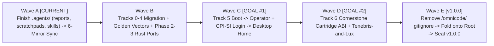

<!--
================================================================================
BLOCK 1: METADATA BLOCK
( Active Runway: Strangler-Fig Waves From v0.1.3 Baseline to v1.0.0 Cutover )
================================================================================
@project       OmniCode Framework / Big House Ecosystem
@file          .agents/plans/active/omnicode_v1_clean_room_runway.md
@id            cog.agent.plans.active.omnicode_v1_clean_room_runway
@layer         Portable Agent Substrate - Active Clean-Room Integration Runway
@archetype     active_runway | strangler_fig_execution_map
@version       0.1.3-dev
@coordinate    13% of Cycle 0 toward 1.0.0
@interface_rev Rev 5
@created       2026-11-20
@updated       2026-11-20
@author        CreativeWorkzStudio LLC / Seanje Lenox-Wise & Silas Oren
@repository    https://github.com/Novaking34/OmniCode_Framework
@system        OmniCode Clean-Room Staging (omnicode/) + FaithNet + T&L
@role          Track Settled v0.1.3 Ground vs Remaining Runway Waves A-E
               Leading Cleanly to Goal #1, Goal #2, and v1.0.0 Fold-Over
@maturity      ACTIVE_RUNWAY (Paired with ../vision/ architecture baseline)
@chassis       strangler-fig | Zero regression on working suites while staging
@seams         vision: ../vision/omnicode_architecture_and_vision.md |
               toolchain: ./toolchain_rust_port_phases_2_to_4.md |
               operator: ../../identity/profiles/operator/ (database JSON) |
               bios: ../../README.md
@invariants    1. Universal 5-Block Lifecycle Protocol (Rev 5, <=80 col walls).
               2. Keep /omnicode/ temporarily quarantined in root .gitignore
                  until clean-room cutover readiness.
               3. Keep settled ground and remaining waves cleanly split.
               4. Never mirror root .agents/ outward until all domains pass.
================================================================================
-->

# Active Runway: `v0.1.3` -> `v1.0.0` Clean-Room Cutover (`Waves A–E`)

> **Why This Runway Document Exists:** [`omnicode_architecture_and_vision.md`](../vision/omnicode_architecture_and_vision.md) sets the permanent multi-track baseline. **This file tracks the moving front edge:** what part of that vision is already standing on disk (`v0.1.3`), and the exact five remaining waves (`Waves A–E`) that carry us cleanly to **Goal #1 (`Boot -> Login -> Desktop Home`)**, **Goal #2 (`Cornerstone` Cartridge Launch)**, and the **`v1.0.0`** clean-room fold-over.

---

<!--
================================================================================
BLOCK 2: OPENING BLOCK
( Plain-English Split: Settled Ground vs. What Remains to Build )
================================================================================
-->

## Block 2 (Opening): Done Ground vs. Active Horizon

Right now, two things are true at once:

1. **The scaffolding and constitutional roots are already standing:** `omnicode/` directory structure (`Tracks 0..7`), root `manifest.omni` & `manifest.tape`, `docs/SYNTAX.md` & `docs/KEYWORD.md`, mounted submodules (`FaithNet/`, `Tenebris-and-Lux/`), and the core `.agents/` BIOS domains (`host/`, `identity/` + `operator/`, `language/`, `lineage/`, `plans/`).
2. **Real migration and integration waves still remain ahead:** finishing the final `.agents/` domains + 6-mirror sync, moving verified code into `omnicode/` cog by cog, wiring **Operator + CPI-SI Login Handshake** (`Goal #1`), snap-testing the frozen **Cornerstone Cartridge ABI** (`Goal #2`), and lifting the temporary `/omnicode/` `.gitignore` quarantine for `v1.0.0`.

---

<!--
================================================================================
BLOCK 3: BODY BLOCK
( Settled v0.1.3 Snapshot + Five Active Strangler-Fig Waves A-E )
================================================================================
-->

## 1. Settled Ground Inside `v0.1.3` (Already Done — Do Not Re-Invent)

| Settled Artifact / Milestone | Current State on Disk | Anchor Reference |
| :--- | :--- | :--- |
| Clean-room 8-Track skeleton (`omnicode/`) | Standing directory tree + temp `/omnicode/` entry in root `.gitignore` | [`omnicode_architecture_and_vision.md`](../vision/omnicode_architecture_and_vision.md) |
| Root constitutional manifests & living syntax | `manifest.omni`, `manifest.tape`, `docs/SYNTAX.md`, `docs/KEYWORD.md` upgraded | [`SYNTAX.md`](../../language/reference/SYNTAX.md), [`KEYWORD.md`](../../language/reference/KEYWORD.md) |
| Mounted standalone sibling repos | `FaithNet/` (`FNP/1`) & `Tenebris-and-Lux/` (`Cornerstone`) mounted cleanly at `/` | [`faithnet-workflows`](../../skills/faithnet-workflows/SKILL.md), [`cornerstone-workflows`](../../skills/cornerstone-workflows/SKILL.md) |
| Toolchain Modularization (`Phases 1 & 1.5`) | Modular `tools/src/` + 4-tier `tools/tests/` (`839` Rust tests + `66/66` CTest) | [`toolchain_rust_foundation_phases_1_to_1_5.md`](../completed/toolchain_rust_foundation_phases_1_to_1_5.md) |
| Base `.agents/` BIOS Domains | `host/`, `identity/` + `operator/`, `language/`, `lineage/`, `plans/`, `cpi-si-session-bootstrap` | [`.agents/README.md`](../../README.md) |

---

## 2. Remaining Clean-Room Runway (`Waves A–E`)



### Wave A [CURRENT]: Complete Root `.agents/` BIOS & 6-Mirror Sync

* **Remaining Domains in `OmniCode/.agents/`:** Complete — all 9 domains inside root `.agents/` (including all 8 skills in `skills/` and the 0-dep Go CLI runner `tools/cpi-si/`) have cleared `runners/run.sh audit` (`failures=0`) and hold for Operator clearance to commit and 6-mirror sync.
* **Exit Gate:** Operator clears outward sync across all six mounts (`OmniCode`, `omnicode`, `FaithNet`, `Tenebris-and-Lux`, `~/.gemini/.agents`, `~/.gemini/antigravity/knowledge`).

### Wave B [NEXT]: Tracks `0–4` Clean-Room Migration & Phase 2–3 Rust Ports

* **`Track 0` & `Track 1`:** Port Python `probes/` and `exoskeleton/` ([`toolchain_rust_port_phases_2_to_4.md`](toolchain_rust_port_phases_2_to_4.md)); lock `Track 1/primitives/golden_vectors/` for bit-exact Rust <-> Go <-> C ternary/Tryte5 parity; land `immune/` DAR + tripwires.
* **`Track 2` & `Track 3`:** Port `.omni`/`.tape` grammar & lexicon pairs into `Track 2`; unify duplicate `storage/` + `logs/` + `memory/` + Phase 3 `cognitive_store/` under `Track 3` SSOT.
* **`Track 4`:** Wire supervised `FaithNet/` `FNP/1` (`512B` / IPC) plug-in seam and dual-stack IPv4+IPv6 firewall guard without touching `FaithNet/` sovereignty.

### Wave C [GOAL #1]: Boot -> Operator Login Handshake -> Desktop Home (`Track 5`)

* **`Track 5/login/`:** Consume [`operator_database.json`](../../identity/profiles/operator/operator_database.json), [`seanje_lenox_wise/profile.json`](../../identity/profiles/operator/seanje_lenox_wise/profile.json), and [`silas_oren/profile.json`](../../identity/profiles/silas_oren/profile.json) to execute the **Operator + Hardware + CPI-SI Login Handshake** (`005_operator_trust_model.adoc` Sanctuary Isolation).
* **`Track 5/desktop/`:** Mount `Track 3` session vault and land on unified `OmniStudio Home` / REPL / Web HUD while enforcing the `3,072 MiB` RAM and `350 MiB` VRAM non-headless floors.

### Wave D [GOAL #2]: Cornerstone Cartridge Launch (`Track 6`)

* **`Track 6/cartridge_abi/` & `engines/`:** Freeze `cornerstone_cartridge_v1` C ABI pinout and move shared zero-heap Cornerstone C23/C11 engine runtime cleanly into `Track 6`.
* **Cartridge Smoke Test:** Launch standalone `Tenebris-and-Lux` cartridge cleanly through `Track 6/sandbox/` from `OmniStudio Home` (`Goal #1 -> Goal #2`).

### Wave E [`v1.0.0` CUTOVER]: Fold `omnicode/` Onto Repository Root

* **Clean-Room Cutover:** Remove temporary `/omnicode/` rule from root `.gitignore`, verify full cross-repo golden vectors + `Track 0..7` builds + `FaithNet` + `Tenebris-and-Lux` green, fold `omnicode/` cleanly onto `/`, and seal Coordinate **`v1.0.0` (`100%` of Cycle 0)**.

---

<!--
================================================================================
BLOCK 4: AUDIT PROCEDURES BLOCK
( Wave Advancement Gates & Temporary .gitignore Quarantine Check )
================================================================================
-->

## Block 4 (Audit): Runway Verification & `T4` Gates

Run before advancing from **Wave A** to **Wave B**:

```bash
git check-ignore -v omnicode/ && \
python3 -c 'import json; r=json.load(open(".agents/plans/plans_registry.json")); print("PLANS_OK count=", len(r["block_3_body"]["plan_documents"]))'
```

| `T4` State | Observed Runway Condition | Required Action |
| :--- | :--- | :--- |
| **`+1:PROCEED`** | Current wave's Block 4 exit checks pass cleanly with zero hidden regressions | Record completed wave in `completed/` and step cleanly into next wave |
| **`0:AWAIT`** | Operator pauses for `n`-time deliberation, review, or mirror sync clearance | Hold at wave seam; deliver grounded status report |
| **`-1:ROLLBACK`** | Cross-track migration introduces duplicate SSOTs or breaks working root tests | Revert incomplete move inside `omnicode/`, keep working suite green |
| **`NULL:HALT`** | `omnicode/` cutover attempted before Goal #1 + Goal #2 verification, or coordinate bumped prematurely | Lock cutover and hold `v0.1.3` coordinate intact |

---

<!--
================================================================================
BLOCK 5: CLOSING BLOCK
( ACTION / REEL - Live Wave Position, Seams & Closing Seal )
================================================================================
-->

## Block 5 (Closing): Operational Reel & Closing Seal

### `PLAY` — Where We Stand Right Now (`v0.1.3` = `13%`)

1. **Wave A Ready at Sync Gate (`0: AWAIT`):** All root `.agents/` domains (`host/`, `identity/`, `operator/`, `language/`, `lineage/`, `plans/`, `reports/`, `scratchpads/`, `tools/cpi-si/`, and all `8` `skills/`) have passed Go `runners/run.sh audit` cleanly and hold for Operator clearance to commit and 6-mirror sync.
2. **Temp Quarantine Active:** `/omnicode/` stays safely quarantined in root `.gitignore` while root `.agents/` stabilizes.

### `PROJECT` — Outward System Seams

1. **Drives Coordinate Advancement:** Only genuine end-to-end milestone seals advance the Coordinate (`+0.0.1` / `+0.1.0` / `+1.0.0`) per [`cpi-si-covenant/SKILL.md`](../../skills/cpi-si-covenant/SKILL.md).
2. **Binds Operator Login to Track 5:** Ensures Goal #1 inherits verified Operator database & Zero-Knowledge Sanctuary Isolation from Day 1.

### `RECORD` — Linked Substrate Anchors

* Planning Charter & Registry: [`plans_charter.md`](../plans_charter.md), [`plans_registry.json`](../plans_registry.json)
* Settled Architecture Vision: [`omnicode_architecture_and_vision.md`](../vision/omnicode_architecture_and_vision.md)
* Companion Active & Completed Plans: [`toolchain_rust_port_phases_2_to_4.md`](toolchain_rust_port_phases_2_to_4.md), [`toolchain_rust_foundation_phases_1_to_1_5.md`](../completed/toolchain_rust_foundation_phases_1_to_1_5.md)
* Operator Login SSOT: [`operator_database.json`](../../identity/profiles/operator/operator_database.json), [`seanje_lenox_wise/profile.md`](../../identity/profiles/operator/seanje_lenox_wise/profile.md)

### `COMMIT` — Closing Seal

* **Living Runway Rule:** Whenever Wave A or any subsequent wave finishes completely, move its verified record cleanly into `completed/` so `active/` always shows honest forward ground only.
* **Strangler-Fig Safety Guard:** Keep existing root test suites (`OmniCode`, `FaithNet`, `Tenebris-and-Lux`) green until every graduated `omnicode/` cog passes end-to-end verification.
* **Clean Quarantine Discipline:** Hold `/omnicode/` safely behind root `.gitignore` through Waves A–D, removing the rule only at Wave E cutover to `v1.0.0`.
* **Coordinate Law Preserved:** Routine wave steps advance within `v0.1.3`; only verified milestone transitions advance the coordinate (`+0.0.1` / `+0.1.0` / `+1.0.0`).
* **Base-First Sync Gate:** Downstream `.agents/` mirrors hold at `0: AWAIT` strictly for Operator clearance now that root `skills/` and `tools/cpi-si/` passed local verification cleanly.
* **Goal #1 & #2 Accountability:** Do not fold `omnicode/` onto `/` until Operator + CPI-SI login (`Track 5`) and Cornerstone cartridge launch (`Track 6`) run end to end.
* **Status:** `@created 2026-11-20` / `@updated 2026-11-20`, `WAVE_A_ACTIVE_CLEAN_ROOM_RUNWAY_SEALED (0:AWAIT)`.

<!-- END OF BLOCK 5: CLOSING SEAL -->
