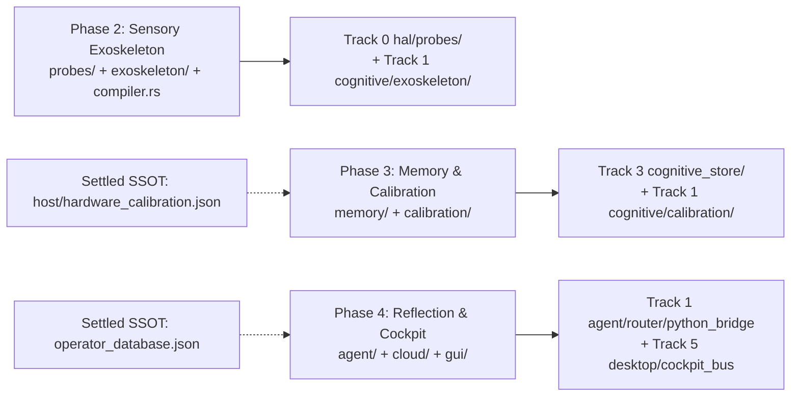

<!--
================================================================================
BLOCK 1: METADATA BLOCK
( Active Runway: Porting Python Orchestrator Phases 2-4 to Native Rust )
================================================================================
@project       OmniCode Framework / Tenebris-and-Lux Shared Tooling
@file          .agents/plans/active/toolchain_rust_port_phases_2_to_4.md
@id            cog.agent.plans.active.toolchain_rust_phases_2_to_4
@layer         Portable Agent Substrate - Active Toolchain & Runtime Migration
@archetype     active_runway | phased_migration_roadmap
@version       0.1.3-dev
@interface_rev Rev 5
@created       2026-11-16
@updated       2026-11-20
@author        CreativeWorkzStudio LLC / ProfessorSeanEX (Seanje Lenox-Wise)
@repository    https://github.com/Novaking34/OmniCode_Framework
@system        Tenebris-and-Lux/tools/orchestrator/ (Python) -> OmniCode Rust
@role          Remaining Half of Master Tools Phase Roadmap: Port Remaining
               Python Orchestrator Subsystems Into Native Rust Tracks 0, 1, 3, 5
@maturity      ACTIVE_RUNWAY (Split from legacy master_tools_phase_roadmap.md)
@chassis       rust-2024 | -D warnings | host-calibrated + zero-spill defaults
@seams         completed: ../completed/ (Phases 1 & 1.5 ledger) |
               vision: ../vision/omnicode_architecture_and_vision.md |
               host: ../../host/hardware_calibration.json |
               operator: ../../identity/profiles/operator/
@invariants    1. Universal 5-Block Lifecycle Protocol (Rev 5, <=80 col walls).
               2. Base-First Grounding: consume ../../host/ and
                  ../../identity/profiles/operator/ instead of copying.
               3. Decoupling: probes/exoskeleton/memory/login belong in
                  OmniCode Tracks 0, 1, 3, 5; keep T&L uncoupled.
               4. Keep 4-Tier test coverage (functional/unit/integrated/system)
                  green on every ported cog before retiring its Python module.
================================================================================
-->

# Active Runway: Native Rust Port (`Phases 2–4`)

> **What Lives Here vs. Completed Bedrock:** Phases `1` and `1.5` (modular `tools/src/` + 4-tier `tools/tests/` + Rev-5 `Cargo.toml`) are done and sealed in [`toolchain_rust_foundation_phases_1_to_1_5.md`](../completed/toolchain_rust_foundation_phases_1_to_1_5.md). **This file tracks only what still lives in Python (`Tenebris-and-Lux/tools/orchestrator/`) and where each cog graduates inside OmniCode `Tracks 0, 1, 3, 5`.**

---

<!--
================================================================================
BLOCK 2: OPENING BLOCK
( Plain-English Why: Moving From Python Scaffolding Into Native OS Ground )
================================================================================
-->

## Block 2 (Opening): Why Phases 2–4 Are Still Remaining — And How Base SSOTs Simplify Them

Today, the intelligent developer loop inside `Tenebris-and-Lux/tools/orchestrator/` still runs in Python across eight subpackages (`probes/`, `exoskeleton/`, `memory/`, `calibration/`, `agent/`, `cloud/`, `server/`, `gui/`).

Porting Phases `2–4` into compiled Rust gives us three immediate gains:

1. **Microsecond Native Execution Without Process Overhead:** Hardware probes, AST skeletons, and compiler tripwires run inside native OS processes instead of spawning Python interpreters on every edit.
2. **Real Graduation Into `omnicode/` Tracks:** Rather than stuffing everything back inside `Tenebris-and-Lux/tools/`, [`omnicode_architecture_and_vision.md`](../vision/omnicode_architecture_and_vision.md) routes each subsystem straight to its proper OmniCode home (`Track 0 HAL Probes`, `Track 1 Cognitive & Exoskeleton`, `Track 3 Memory Index`, `Track 5 Cockpit & Login`).
3. **Cleaner Inputs From Settled Base Folders:** Because [`hardware_calibration.json`](../../host/hardware_calibration.json) and [`operator_database.json`](../../identity/profiles/operator/operator_database.json) are now settled JSON SSOTs, Phases `2–4` no longer need ad-hoc config schemas invented mid-port.

---

<!--
================================================================================
BLOCK 3: BODY BLOCK
( Current Python Inventory -> Rust Port Stages -> Target OmniCode Tracks )
================================================================================
-->

## 1. Migration Topology (`Python -> Rust -> OmniCode Tracks`)



---

## 2. Phase 2 [NEXT]: Porting the Sensory Exoskeleton (`probes/` & `exoskeleton/`)

| Remaining Python Source (`Tenebris-and-Lux/tools/orchestrator/`) | Rust Target & OmniCode Track Destination | Core Responsibility |
| :--- | :--- | :--- |
| `probes/cpu_probe.py`, `gpu_probe.py`, `memory_probe.py` | **`Track 0` `hal/probes/`** (`probes/` crate/module) | Read `/proc` + `sysfs` directly for CPU, RAM (`3,072 MiB` guard), and MX570 A VRAM (`1,387 MiB` compute budget) with zero subprocess shells |
| `exoskeleton/ast_inspector.py`, `invariant_verifier.py` | **`Track 1` `cognitive/exoskeleton/`** + `tools/src/syntax/` | Fast AST skeletonization for C, C++, Rust, and Go files for token-tight context injection |
| `exoskeleton/compiler_tripwire.py` | **`Track 1` `immune/`** + `tools/src/runner/compiler.rs` | Deterministic compiler tripwires integrating `gcc`, `clang`, `cl.exe`, and `rustc` |

**Exit Criteria for Phase 2:** Matching 4-tier tests (`functional/`, `unit/`, `integrated/`, `system/`) passing under `cargo test` with `-D warnings` and live probe parity matching [`host_pc_hardware_profile.md`](../../host/host_pc_hardware_profile.md).

---

## 3. Phase 3 [PENDING]: Porting Memory & Host Calibration (`memory/` & `calibration/`)

| Remaining Python Source (`tools/orchestrator/`) | Rust Target & OmniCode Track Destination | Core Responsibility |
| :--- | :--- | :--- |
| `memory/symbol_indexer.py`, `index_store.py` | **`Track 3` `cognitive_store/memory_index/`** | Deterministic codebase symbol indexer and B-Tree index store |
| `memory/elastic_window.py` | **`Track 3` `cognitive_store/elastic_window/`** | Bounded context-window pruner enforcing token budgets on `0.5b..7b` models |
| `calibration/model_factory.py`, `sweet_spot.py`, `sweep_runner.py` | **`Track 1` `cognitive/calibration/`** | Consumes [`hardware_calibration.json`](../../host/hardware_calibration.json) to emit verified `min/ideal/max` Modelfiles (`4096` minimum ctx, `0` spill on `1.5b`) |

**Exit Criteria for Phase 3:** Existing Python behavioral coverage (`test_model_factory.py`, `test_staircase_sweep.py`) matched bit-for-bit in Rust, with zero non-headless VRAM violations.

---

## 4. Phase 4 [PENDING]: Reflection Engine, Substrate Router & Desktop Cockpit (`agent/` & `gui/`)

| Remaining Python Source (`tools/orchestrator/`) | Rust Target & OmniCode Track Destination | Core Responsibility |
| :--- | :--- | :--- |
| `agent/{auto_mode,decomposer,dispatcher,reflection_loop,stepped_gearbox,subagent_factory}.py` | **`Track 1` `cognitive/{agent,router}/`** | In-process tool dispatcher, stepped gearbox, `T4` deliberation clock (`0: AWAIT`), and 4-rung Substrate Router (`CPI-SI -> GGUF -> Thin Py -> Opt-in Cloud`) |
| `cloud/{cloud_bridge,colab_runner}.py`, `server/service_adapter.py` | **`Track 1` `cognitive/python_bridge/`** | Strictly thin optional IPC adapter only when Python-exclusive runtimes are required |
| `gui/{app,chat_canvas,hub_panel,memory_view,telemetry_panel,tool_cockpit}.py` | **`Track 5` `desktop/` + `shell/cockpit_bus/`** | Native desktop HUD & cockpit launched after Operator + CPI-SI Login Handshake ([`operator_database.json`](../../identity/profiles/operator/operator_database.json)) |

**Exit Criteria for Phase 4:** Full offline round-trip (`probe -> index -> calibrate -> route -> DAR audit -> desktop cockpit`) passes end-to-end tests alongside [`test_auto_mode.py`](../../skills/cornerstone-workflows/SKILL.md), letting legacy Python modules retire cleanly into archive.

---

<!--
================================================================================
BLOCK 4: AUDIT PROCEDURES BLOCK
( Pre-Port Verification & No-Premature-Retirement Tripwires )
================================================================================
-->

## Block 4 (Audit): Porting Discipline & `T4` Tripwires

### Live Pre-Port Baseline Check

Before starting any Phase 2 module, verify the active Python tests and completed Rust baseline remain green:

```bash
cargo test --manifest-path Tenebris-and-Lux/tools/Cargo.toml && \
python3 Tenebris-and-Lux/tools/orchestrator/tests/test_model_factory.py && \
python3 Tenebris-and-Lux/tools/orchestrator/tests/test_auto_mode.py && \
python3 Tenebris-and-Lux/tools/orchestrator/tests/test_staircase_sweep.py
```

| `T4` State | Observed Port Condition | Required Action |
| :--- | :--- | :--- |
| **`+1:PROCEED`** | Rust cog compiles `-D warnings`, passes all 4 test tiers, and honors `hardware_calibration.json` | Mark Python cog superseded; when Phase 2 completes, split it into `completed/` |
| **`0:AWAIT`** | Port requires an ABI change affecting `Track 0/1/3/5` or `Tenebris-and-Lux` | Stop at phase seam; propose alignment update before crossing repositories |
| **`-1:ROLLBACK`** | Rust probe violates non-headless `3,072 MiB` RAM or `350 MiB` display VRAM guard | Revert calibration logic immediately and re-verify against `host/` telemetry |
| **`NULL:HALT`** | Python orchestrator deleted before Rust parity tests pass, or cloud bridge bypasses opt-in | Restore deleted Python module and halt cutover |

---

<!--
================================================================================
BLOCK 5: CLOSING BLOCK
( ACTION / REEL - Current Queue, Outward Seams & Anchors )
================================================================================
-->

## Block 5 (Closing): Operational Reel & Closing Seal

### `PLAY` — Current Execution Queue

1. **Completed Bedrock Locked Outside This File:** Phases `1` & `1.5` stay cleanly in [`toolchain_rust_foundation_phases_1_to_1_5.md`](../completed/toolchain_rust_foundation_phases_1_to_1_5.md), leaving zero stale checklists here.
2. **Phase 2 Ready to Begin:** Once `.agents/` mirrors sync and Strangler-Fig migration opens in [`omnicode_v1_clean_room_runway.md`](omnicode_v1_clean_room_runway.md), `probes/` and `exoskeleton/` are first up.

### `PROJECT` — Outward System Seams

1. **Consumes Base-First SSOTs:** Pulls live hardware limits from [`hardware_calibration.json`](../../host/hardware_calibration.json) and Operator login/profile boundaries from [`operator_database.json`](../../identity/profiles/operator/operator_database.json).
2. **Feeds Track 0, 1, 3, and 5 Clean-Room Tree:** Supplies native Rust implementations for `omnicode/` so Cornerstone and OmniStudio share one zero-bloat foundation.

### `RECORD` — Linked Substrate Anchors

* Planning Charter & Registry: [`plans_charter.md`](../plans_charter.md), [`plans_registry.json`](../plans_registry.json)
* Completed Foundation: [`toolchain_rust_foundation_phases_1_to_1_5.md`](../completed/toolchain_rust_foundation_phases_1_to_1_5.md)
* Clean-Room Runway & Vision: [`omnicode_v1_clean_room_runway.md`](omnicode_v1_clean_room_runway.md), [`omnicode_architecture_and_vision.md`](../vision/omnicode_architecture_and_vision.md)
* Host & Operator Contracts: [`hardware_calibration.json`](../../host/hardware_calibration.json), [`operator_database.json`](../../identity/profiles/operator/operator_database.json)

### `COMMIT` — Closing Seal

* **Done-vs-Remaining Split Enforced:** Whenever Phase 2 completes and passes all 4 test tiers, split Phase 2 out into `completed/` and leave only Phases 3–4 active here.
* **Host Guardrails Protected:** Native Rust probes and calibration modules must enforce `3,072 MiB` desktop RAM and `350 MiB` display VRAM ceilings without spilling over `1,387 MiB` compute VRAM.
* **Zero-Regression Retirement Rule:** Keep every `Tenebris-and-Lux/tools/orchestrator/` Python file intact until its Rust replacement passes 1:1 behavioral parity across all test tiers.
* **Base-First Anchoring:** Consume `hardware_calibration.json` and `operator_database.json` directly rather than cloning local config schemas.
* **Clean Track Routing:** Route probes to `Track 0`, exoskeleton/calibration/router to `Track 1`, symbol stores to `Track 3`, and desktop cockpit to `Track 5`.
* **No Submodule Bloat:** Keep `Tenebris-and-Lux` free of shared OS runtime bloat while graduating reusable cogs upward into `omnicode/`.
* **Status:** `@created 2026-11-16` / `@updated 2026-11-20`, `ACTIVE_RUNWAY_PHASES_2_TO_4_MAPPED (0:AWAIT)`.

<!-- END OF BLOCK 5: CLOSING SEAL -->
