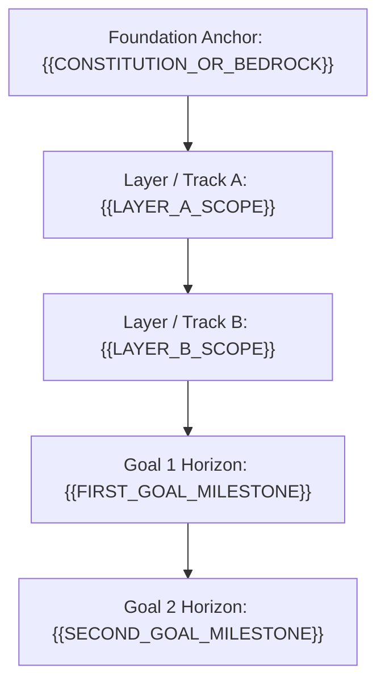

<!--
================================================================================
BLOCK 1: METADATA BLOCK
( Blank Template: Architectural Vision & Multi-Track Baseline Assurance Plan )
================================================================================
@project       {{PROJECT_OR_ECOSYSTEM}}
@file          .agents/plans/plan-templates/
               architectural_vision_plan.template.md
@id            cog.agent.plans.template.architectural_vision
@layer         Portable Agent Substrate - Reusable Vision Plan Blueprint
@archetype     template | architectural_vision_plan
@version       {{COORDINATE_VERSION}}
@interface_rev Rev 5
@created       YYYY-MM-DD
@updated       YYYY-MM-DD
@author        {{OPERATOR_AND_INSTANCE_AUTHORS}}
@repository    https://github.com/Novaking34/OmniCode_Framework
@system        {{TARGET_SYSTEM_OR_TRACKS}}
@role          Blank Blueprint for Long-Horizon Architectural Vision & Baseline
               Assurances (Compass Over Rigid Checklist)
@maturity      BLANK_TEMPLATE (Copy into ../vision/ and register cleanly)
@chassis       {{TARGET_CHASSIS_AND_LANGUAGES}}
@seams         charter: ../plans_charter.md |
               registry: ../plans_registry.json |
               host: ../../host/hardware_calibration.json |
               operator: ../../identity/profiles/operator/operator_database.json
@invariants    1. Universal 5-Block Lifecycle Protocol (Rev 5, <=80 col walls).
               2. Compass Over Checklist: preserve timeless seams and invariants
                  here; keep active wave execution in ../active/.
               3. Dual-Audience Clarity: readable by everyday builders and
                  rigorous for systems architects.
               4. All relative links remain strictly inside .agents/.
================================================================================
-->

# `{{VISION_TITLE}}` — Architecture Vision & Baseline

> **Template Purpose (Read Before Copying):** Copy this blueprint into `../vision/<slug>.md` when establishing a long-horizon architectural vision. Keep execution checklists out of this file — link active execution to `../active/` and finished milestones to `../completed/`. Replace every `{{PLACEHOLDER}}` honestly.

---

<!--
================================================================================
BLOCK 2: OPENING BLOCK
( Plain-English Problem Statement, Compass Framing & Core Design Principles )
================================================================================
-->

## Block 2 (Opening): Why We Are Building This — And How to Read This Vision

### For Everyday Readers & Builders

`{{PLAIN_ENGLISH_PROBLEM_AND_PURPOSE}}`

### How to Read This Document

This vision document sets **the settled architectural baseline**, not a disposable daily checklist. Concrete folder adjustments and schedule waves live inside `../active/` so the north-star boundaries stay clear as teams learn on real hardware.

### Core Design Principles

1. **Principle 1 (`{{PRINCIPLE_1_NAME}}`):** `{{PRINCIPLE_1_SUMMARY}}`
2. **Principle 2 (`{{PRINCIPLE_2_NAME}}`):** `{{PRINCIPLE_2_SUMMARY}}`
3. **Principle 3 (`{{PRINCIPLE_3_NAME}}`):** `{{PRINCIPLE_3_SUMMARY}}`

---

<!--
================================================================================
BLOCK 3: BODY BLOCK
( End-to-End Pipeline Diagram, Decoupling Boundaries & Architectural Pillars )
================================================================================
-->

## 1. End-to-End Architecture & Baton Pipeline

---

## 2. Sovereignty Boundaries & Core Pillars

| Pillar | What Owns It (Single SSOT) | Frozen Interface / Contract Seam |
| :--- | :--- | :--- |
| `{{PILLAR_1}}` | `{{SSOT_OWNER_1}}` | `{{SEAM_CONTRACT_1}}` |
| `{{PILLAR_2}}` | `{{SSOT_OWNER_2}}` | `{{SEAM_CONTRACT_2}}` |
| `{{PILLAR_3}}` | `{{SSOT_OWNER_3}}` | `{{SEAM_CONTRACT_3}}` |

---

<!--
================================================================================
BLOCK 4: AUDIT PROCEDURES BLOCK
( Baseline Assurances & Fourfold T4 Governance Gates )
================================================================================
-->

## Block 4 (Audit): Baseline Assurances & `T4` Gates

As long as the baseline boundaries above hold, these structural realities remain assured:

1. `{{BASELINE_ASSURANCE_1}}`
2. `{{BASELINE_ASSURANCE_2}}`
3. `{{BASELINE_ASSURANCE_3}}`

| `T4` State | Observed Architectural Condition | Required Action |
| :--- | :--- | :--- |
| **`+1:PROCEED`** | Seams hold firm, SSOT ownership is respected, and active runway progresses cleanly | Continue active execution inside `../active/` |
| **`0:AWAIT`** | Proposed edit crosses subsystem sovereignty or requires Operator baseline review | Pause and review seam contract before editing |
| **`-1:ROLLBACK`** | Duplicate SSOTs or ad-hoc coupling leak across frozen interfaces | Restore decoupled boundary and re-verify |
| **`NULL:HALT`** | Template placeholders left uninstantiated or safety/covenant invariants violated | Halt until properly instantiated |

---

<!--
================================================================================
BLOCK 5: CLOSING BLOCK
( ACTION / REEL - Instantiation Steps, Outward Seams & Portable Seal )
================================================================================
-->

## Block 5 (Closing): Instantiation Reel & Portable Anchors

### `PLAY` — How to Instantiate This Vision Plan

1. Copy this file to `../vision/<vision_slug>.md` and fill `@created`, `@updated`, and all `{{PLACEHOLDER}}` fields.
2. Pair it immediately with an active execution file in `../active/` so completed vs. remaining waves stay cleanly separated.
3. Register the new document in [`plans_registry.json`](../plans_registry.json) with lifecycle state `SETTLED_BASELINE`.

### `PROJECT` — Outward System Seams

1. **Host & Hardware Reality:** Anchor hardware expectations cleanly against [`hardware_calibration.json`](../../host/hardware_calibration.json) before projecting targets.
2. **Operator Covenant Alignment:** Ensure login, permissions, and stewardship boundaries honor [`operator_database.json`](../../identity/profiles/operator/operator_database.json).

### `RECORD` — Linked Anchors Inside `.agents/`

* Planning Charter & Registry: [`plans_charter.md`](../plans_charter.md), [`plans_registry.json`](../plans_registry.json)
* Cognitive BIOS Root Index: [`.agents/README.md`](../../README.md)
* Living Covenant Pacing: [`cpi-si-covenant/SKILL.md`](../../skills/cpi-si-covenant/SKILL.md)

### `COMMIT` — Closing Seal

* **Template Contract:** Keep timeless architecture invariants in `vision/`, active tasks in `active/`, and finished phases in `completed/`.
* **Dual-Audience Discipline:** Write both plain-English purpose for human builders and exact seam contracts for engineers and CPI-SI agents.
* **Zero Ghost Checklists:** Link execution phases to `../active/` and graduated milestones to `../completed/` instead of embedding perishable task lists here.
* **Base-First Alignment:** Pull hardware limits from `../../host/` and Operator boundaries from `../../identity/profiles/operator/` without duplicating SSOT data.
* **Sovereignty Boundary Check:** Name explicit wire, ABI, or IPC seams whenever standalone submodules or sibling Tracks interact.
* **Verifiable Assurances:** Pair every baseline guarantee in Block 4 with a concrete `T4` tripwire so drift gets caught early.
* **Status:** `@created YYYY-MM-DD` / `@updated YYYY-MM-DD`, `VISION_PLAN_TEMPLATE (0:AWAIT UNTIL INSTANTIATED)`.

<!-- END OF BLOCK 5: CLOSING SEAL -->
