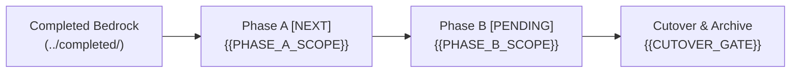

<!--
================================================================================
BLOCK 1: METADATA BLOCK
( Blank Template: Phased Migration Roadmap w/ Done-vs-Remaining Split )
================================================================================
@project       {{PROJECT_OR_ECOSYSTEM}}
@file          .agents/plans/plan-templates/
               phased_migration_roadmap.template.md
@id            cog.agent.plans.template.phased_migration
@layer         Portable Agent Substrate - Phased Migration Roadmap Blueprint
@archetype     template | phased_migration_roadmap
@version       {{COORDINATE_VERSION}}
@interface_rev Rev 5
@created       YYYY-MM-DD
@updated       YYYY-MM-DD
@author        {{OPERATOR_AND_INSTANCE_AUTHORS}}
@repository    https://github.com/Novaking34/OmniCode_Framework
@system        {{SOURCE_SUBSYSTEM}} -> {{TARGET_SUBSYSTEM}}
@role          Blank Blueprint for Multi-Phase Migrations Enforcing Explicit
               Done-vs-Remaining Splits & Base-First SSOT Linking
@maturity      BLANK_TEMPLATE (Copy to ../active/; split finished phases)
@chassis       {{TARGET_LANGUAGE_OR_RUNTIME}}
@seams         charter: ../plans_charter.md |
               registry: ../plans_registry.json |
               host: ../../host/hardware_calibration.json |
               operator: ../../identity/profiles/operator/operator_database.json
@invariants    1. Universal 5-Block Lifecycle Protocol (Rev 5, <=80 col walls).
               2. Mandatory Done-vs-Remaining Split: never keep completed phase
                  checklists duplicated inside active migration files.
               3. Keep working source suites green until target tests pass.
               4. All relative links remain strictly inside .agents/.
================================================================================
-->

# `{{ROADMAP_TITLE}}` — Phased Migration Roadmap (`Phases X–Y`)

> **Template Purpose (Read Before Copying):** Copy this blueprint into `../active/<migration_slug>.md` when migrating modules across languages, directories, or tracks. Whenever a phase completes verification, graduate its record into `../completed/` and leave **only remaining work** here.

---

<!--
================================================================================
BLOCK 2: OPENING BLOCK
( Why This Migration Exists & What Base SSOTs Simplify It )
================================================================================
-->

## Block 2 (Opening): Migration Purpose & Settled Ground

### Plain-English Summary

* **What We Are Moving From:** `{{LEGACY_SOURCE_AND_PAIN_POINT}}`
* **Where Each Piece Graduates:** `{{TARGET_TRACKS_OR_MODULES}}`
* **Already Settled Elsewhere (`../completed/`):** Reference prior finished phases cleanly by link instead of duplicating old checklists.

---

<!--
================================================================================
BLOCK 3: BODY BLOCK
( Migration Flow, Phase-by-Phase Graduation Table & Exit Criteria )
================================================================================
-->

## 1. Migration Flow (`Source -> Airlock -> Target`)



---

## 2. Phase Breakdown & Target Graduation Map

### Phase `{{PHASE_A_NUM}}` [NEXT]: `{{PHASE_A_NAME}}`

| Legacy Source Module | Target Track / Destination | Verification Requirement |
| :--- | :--- | :--- |
| `{{SRC_1}}` | `{{DEST_1}}` | `{{VERIFY_1}}` |
| `{{SRC_2}}` | `{{DEST_2}}` | `{{VERIFY_2}}` |

### Phase `{{PHASE_B_NUM}}` [PENDING]: `{{PHASE_B_NAME}}`

| Legacy Source Module | Target Track / Destination | Verification Requirement |
| :--- | :--- | :--- |
| `{{SRC_3}}` | `{{DEST_3}}` | `{{VERIFY_3}}` |

---

<!--
================================================================================
BLOCK 4: AUDIT PROCEDURES BLOCK
( Parity Verification, Retirement Guard & T4 Tripwires )
================================================================================
-->

## Block 4 (Audit): Migration Parity & `T4` Tripwires

Run before marking any phase complete or retiring legacy source files:

```bash
# Replace with exact build + 4-tier test parity command
echo "VERIFY_MIGRATION_PARITY_PLACEHOLDER"
```

| `T4` State | Observed Migration Condition | Required Action |
| :--- | :--- | :--- |
| **`+1:PROCEED`** | New target compiles cleanly and matches legacy behavior across all test tiers | Graduate completed phase to `../completed/` and advance to next phase |
| **`0:AWAIT`** | Migration hits an unmapped ABI boundary or cross-repo dependency | Pause at phase seam; review with Operator before crossing repos |
| **`-1:ROLLBACK`** | Regression or non-headless resource violation appears in migrated cog | Revert incomplete target cog; preserve working source baseline |
| **`NULL:HALT`** | Legacy module deleted before target tests pass, or unverified test counts claimed | Restore deleted source and halt cutover |

---

<!--
================================================================================
BLOCK 5: CLOSING BLOCK
( ACTION / REEL - Instantiation, Graduation Split Rules & Anchors )
================================================================================
-->

## Block 5 (Closing): Operational Reel & Closing Seal

### `PLAY` — Using This Migration Blueprint

1. Copy this template into `../active/<migration_slug>.md`, fill `@created` / `@updated`, and replace all `{{PLACEHOLDER}}` tokens.
2. Point explicitly to any already-completed prerequisites inside `../completed/` so zero finished tasks clutter the active table.
3. Register the instantiated roadmap inside [`plans_registry.json`](../plans_registry.json).

### `PROJECT` — Graduation & Cleanup Rhythm

1. **Split Upon Verification:** As each phase passes its Block 4 parity gate, extract its finished record into `../completed/` and trim this file down to remaining phases.
2. **Base-First Anchoring:** Consume limits from [`hardware_calibration.json`](../../host/hardware_calibration.json) and Operator contracts from [`operator_database.json`](../../identity/profiles/operator/operator_database.json) directly rather than inventing local config copies.

### `RECORD` — Linked Anchors Inside `.agents/`

* Planning Charter & Registry: [`plans_charter.md`](../plans_charter.md), [`plans_registry.json`](../plans_registry.json)
* Cognitive BIOS Root Index: [`.agents/README.md`](../../README.md)
* Covenant Pacing & Verification: [`cpi-si-covenant/SKILL.md`](../../skills/cpi-si-covenant/SKILL.md)

### `COMMIT` — Closing Seal

* **Zero-Regression Law:** Working source suites stay green until target modules earn full verification parity.
* **Done-vs-Remaining Split Law:** Graduate each verified phase immediately into `../completed/` so this active roadmap stays sharp and readable.
* **Host-First Calibration:** Reference `../../host/hardware_calibration.json` directly instead of inventing per-phase resource guesswork.
* **4-Tier Verification Gate:** Confirm `functional`, `unit`, `integrated`, and `system` coverage before retiring any superseded legacy cog.
* **Track Destination Clarity:** Map every migrated module directly to its final Track or subsystem rather than leaving generic destination buckets.
* **Registry Parity:** Keep `plans_registry.json` updated 1:1 whenever a phase graduates from `active/` to `completed/`.
* **Status:** `@created YYYY-MM-DD` / `@updated YYYY-MM-DD`, `PHASED_MIGRATION_TEMPLATE (0:AWAIT UNTIL INSTANTIATED)`.

<!-- END OF BLOCK 5: CLOSING SEAL -->
