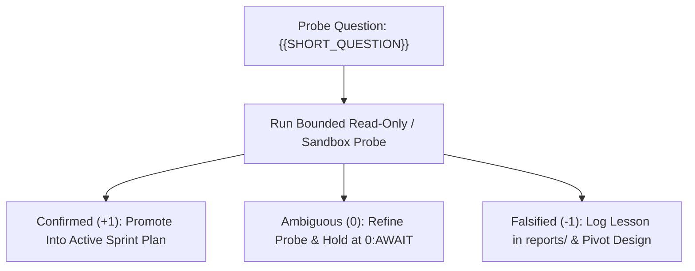

<!--
================================================================================
BLOCK 1: METADATA BLOCK
( Blank Template: Time-Boxed Hardware, ABI or Archive Feasibility Spike Plan )
================================================================================
@project       {{PROJECT_OR_ECOSYSTEM}}
@file          .agents/plans/plan-templates/
               spike_and_feasibility_plan.template.md
@id            cog.agent.plans.template.spike_feasibility
@layer         Portable Agent Substrate - Read-Only Probe & Spike Blueprint
@archetype     template | spike_and_feasibility_plan
@version       {{COORDINATE_VERSION}}
@interface_rev Rev 5
@created       YYYY-MM-DD
@updated       YYYY-MM-DD
@author        {{OPERATOR_AND_INSTANCE_AUTHORS}}
@repository    https://github.com/Novaking34/OmniCode_Framework
@system        {{SPIKE_SUBJECT_OR_HARDWARE_SEAM}}
@role          Blank Blueprint for Testing Unknowns Empirically Before
               Committing Code or Updating Architecture Baselines
@maturity      BLANK_TEMPLATE (Measure the riverbank before pouring concrete)
@chassis       read-only-probe | Reversible sandbox only; zero host mutation
@seams         charter: ../plans_charter.md |
               registry: ../plans_registry.json |
               host: ../../host/host_pc_hardware_profile.md |
               lineage: ../../lineage/lineage_quarry_guide.md
@invariants    1. Universal 5-Block Lifecycle Protocol (Rev 5, <=80 col walls).
               2. Measure First, Mutate Last: keep spikes strictly read-only or
                  confined to disposable scratch paths.
               3. Never promote speculative conclusions into bedrock without
                  raw tool output recorded honestly.
               4. All relative links remain strictly inside .agents/.
================================================================================
-->

# `{{SPIKE_TITLE}}` — Feasibility Spike & Empirical Probe Plan

> **Template Purpose (Read Before Copying):** Copy this blueprint into `../active/<spike_slug>.md` when an unfamiliar hardware driver, QEMU boot path, compiler ABI, or archived `Project` subsystem needs empirical testing before designing a full implementation plan.

---

<!--
================================================================================
BLOCK 2: OPENING BLOCK
( Concrete Question to Settle, Unknowns & Safety Bounds )
================================================================================
-->

## Block 2 (Opening): The Concrete Question & Safety Bounds

* **Primary Question:** `{{EXACT_EMPIRICAL_QUESTION}}`
* **Why It Matters Before Building:** `{{DECISION_BLOCKED_BY_THIS_UNKNOWN}}`
* **Hard Safety & Read-Only Guard:** `{{ZERO_BRICK_OR_READ_ONLY_CONSTRAINTS}}`

---

<!--
================================================================================
BLOCK 3: BODY BLOCK
( Hypotheses Tested, Probe Sequence & Decision Branch Outcomes )
================================================================================
-->

## 1. Decision Tree From Empirical Evidence



---

## 2. Time-Boxed Probe Steps

1. **Baseline Check:** Confirm local hardware & toolchain limits in [`host_pc_hardware_profile.md`](../../host/host_pc_hardware_profile.md) (`{{RELEVANT_HOST_CONSTRAINT}}`).
2. **Probe Execution:** Run bounded command(s) without mutating system configs, `Project` drive files, or tracked source bedrock.
3. **Evidence Capture:** Record raw pass/fail behavior, exact timings, memory footprints, and surprises honestly.
4. **Recommendation:** Choose `+1` (sprint plan), `0` (narrower probe), or `-1` (pivot architecture).

---

<!--
================================================================================
BLOCK 4: AUDIT PROCEDURES BLOCK
( Non-Destructive Cleanup & Evidence Verification Gates )
================================================================================
-->

## Block 4 (Audit): Safety & Evidence Gates

```bash
# Confirm zero unintended mutations in workspace or host configs
git status --short
```

| `T4` State | Observed Spike Outcome | Required Action |
| :--- | :--- | :--- |
| **`+1:PROCEED`** | Hypothesis empirically verified with reproducible output and clean cleanup | Archive spike into `../completed/` and spawn sprint plan from `track_or_subsystem_sprint_plan.template.md` |
| **`0:AWAIT`** | Output inconclusive or hardware constraint hit mid-probe | Stop probe cleanly; present observed logs to Operator |
| **`-1:ROLLBACK`** | Spike disproved design assumption cleanly | Archive negative result in `../completed/` or `../../reports/` so nobody repeats the blind alley |
| **`NULL:HALT`** | Probe risked host bricking, mutated read-only external media, or leaked secrets | Abort immediately, restore host state, and audit safety rules |

---

<!--
================================================================================
BLOCK 5: CLOSING BLOCK
( ACTION / REEL - Instantiation, Outcome Promotion & Anchors )
================================================================================
-->

## Block 5 (Closing): Operational Reel & Closing Seal

### `PLAY` — Running This Spike Cleanly

1. Copy this blueprint into `../active/<spike_slug>.md`, fill `@created` / `@updated`, and state one crisp question in Block 2.
2. Register the spike inside [`plans_registry.json`](../plans_registry.json) before running probes.

### `PROJECT` — Converting Findings Into Bedrock

1. **Positive Findings:** Feed verified numbers directly into a Track sprint plan or [`hardware_calibration.json`](../../host/hardware_calibration.json).
2. **Negative Findings:** Archive honest failure notes into `../completed/` or `../../reports/` — disproving a wrong assumption early saves whole waves of rework.

### `RECORD` — Linked Anchors Inside `.agents/`

* Planning Charter & Registry: [`plans_charter.md`](../plans_charter.md), [`plans_registry.json`](../plans_registry.json)
* Host Telemetry & Quarry Laws: [`host_pc_hardware_profile.md`](../../host/host_pc_hardware_profile.md), [`lineage_quarry_guide.md`](../../lineage/lineage_quarry_guide.md)
* Cognitive BIOS Root Index: [`.agents/README.md`](../../README.md)

### `COMMIT` — Closing Seal

* **Empirical Humility:** Measure first on silicon; never mistake guesswork for bedrock.
* **Read-Only First:** Protect `/run/media/professorseanex/Project` and host OS configs (`NetworkManager`, DNS, kernel settings) with strict non-destructive probes.
* **Honest Negative Records:** Archive falsified hypotheses cleanly instead of burying them; proving what will not work saves future sprints.
* **Scratch Cleanup Gate:** Leave zero transient scratch artifacts in tracked trees after capturing raw probe outputs.
* **Base-First Anchoring:** Check [`host_pc_hardware_profile.md`](../../host/host_pc_hardware_profile.md) bounds before sizing stress runs or model loads.
* **One Crisp Question:** Keep each feasibility spike tightly scoped to proving or falsifying one concrete hardware, ABI, or archive seam.
* **Decision Traceability:** Record the resulting `+1` sprint, `0` refinement, or `-1` pivot cleanly before closing out the spike.
* **Status:** `@created YYYY-MM-DD` / `@updated YYYY-MM-DD`, `SPIKE_PLAN_TEMPLATE (0:AWAIT UNTIL INSTANTIATED)`.

<!-- END OF BLOCK 5: CLOSING SEAL -->
