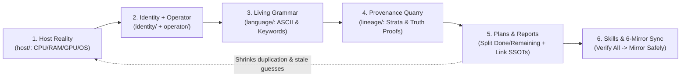

<!--
================================================================================
BLOCK 1: METADATA BLOCK
( Governance Charter, Done-vs-Remaining Discipline & Base-First Work Loop )
================================================================================
@project       OmniCode Framework / Big House Ecosystem
@file          .agents/plans/plans_charter.md
@id            cog.agent.plans.charter
@layer         Portable Agent Substrate - Strategic Planning Charter
@archetype     governance_charter | planning_protocol
@version       0.1.3-dev
@interface_rev Rev 5
@created       2026-11-20
@updated       2026-11-20
@author        CreativeWorkzStudio LLC / Seanje Lenox-Wise & Silas Oren
@repository    https://github.com/Novaking34/OmniCode_Framework
@system        OmniCode + FaithNet + Tenebris-and-Lux + ~/.gemini Runtime
@role          Governs Plan Taxonomy, Done-vs-Remaining Splits, Base-First
               Work Loop Compounding, and Verification Gates P1-P6
@maturity      Rev 5 Organized Charter (Coordinate v0.1.3)
@chassis       portable-plans | Compass over checklist; clean runway splits
@seams         registry: ./plans_registry.json |
               vision: ./vision/omnicode_architecture_and_vision.md |
               active: ./active/omnicode_v1_clean_room_runway.md |
               templates: ./plan-templates/ |
               index: ../README.md
@invariants    1. Universal 5-Block Lifecycle Protocol (Rev 5, <=80 col walls).
               2. Compass Over Checklist: architecture invariants hold firm
                  while implementation details adapt to empirical truth.
               3. Mandatory Done-vs-Remaining Split: never leave completed work
                  tangled inside active runway files as stale inline ghosts.
               4. Base-First Work Loop: stabilize host, identity/operator,
                  language, and lineage before refactoring plans and reports.
               5. All relative links remain strictly inside .agents/.
================================================================================
-->

# Planning Governance Charter (`plans/`)

> **Why This Charter Exists:** Plans rot fastest when finished milestones, active work queues, timeless architectural vision, and speculative experiments sit piled inside the same Markdown file. This charter keeps `.agents/plans/` partitioned cleanly by lifecycle state so every agent waking up on Turn 1 sees **what is settled stone (`completed/`)**, **what governs the horizon (`vision/`)**, and **what actually moves next (`active/`)**.

---

<!--
================================================================================
BLOCK 2: OPENING BLOCK
( Why Lifecycle Partitioning & Base-First Ordering Multiply Velocity )
================================================================================
-->

## Block 2 (Opening): Plain-English Orientation

Think of a carpenter's workbench. When completed framing specs, active cut lists, long-term blueprints, and scratch sketches all sit in one stacked pile, you lose time re-reading things already built and accidentally re-opening settled work.

Partitioning `.agents/plans/` into four distinct folders fixes that permanently:

1. **`vision/`** holds the settled multi-track north star (what the Big House is and why its boundaries stay firm even as tactics shift).
2. **`active/`** holds only the runway work still in motion — referencing settled milestones rather than duplicating them.
3. **`completed/`** preserves verified finished phases cleanly on the ledger so we celebrate real ground gained without tripping over old checklists.
4. **`plan-templates/`** holds four reusable Rev-5 blueprints so new roadmaps, sprints, visions, or hardware spikes start clean from Turn 1.

---

<!--
================================================================================
BLOCK 3: BODY BLOCK
( Taxonomy, Done-vs-Remaining Rule, Base-First Work Loop & Templates )
================================================================================
-->

## 1. Directory Topology & Lifecycle States

| Folder / File | Lifecycle State | What Belongs Here |
| :--- | :--- | :--- |
| [`plans_charter.md`](plans_charter.md) & [`plans_registry.json`](plans_registry.json) | Active Governance | Planning laws, Base-First loop, gates `P1..P6`, and 1:1 5-Block JSON file index |
| `vision/` | `SETTLED_BASELINE` | Long-horizon architecture & baseline assurances ([`omnicode_architecture_and_vision.md`](vision/omnicode_architecture_and_vision.md)) |
| `active/` | `ACTIVE_RUNWAY` | Remaining work still being built ([`omnicode_v1_clean_room_runway.md`](active/omnicode_v1_clean_room_runway.md), [`toolchain_rust_port_phases_2_to_4.md`](active/toolchain_rust_port_phases_2_to_4.md)) |
| `completed/` | `COMPLETED_LEDGER` | Verified finished phases archived cleanly with empirical proof ([`toolchain_rust_foundation_phases_1_to_1_5.md`](completed/toolchain_rust_foundation_phases_1_to_1_5.md)) |
| `plan-templates/` | `BLANK_TEMPLATE` | 4 reusable Rev-5 plan templates (`architectural_vision`, `phased_migration`, `track_sprint`, `spike_and_feasibility`) |

### The Done-vs-Remaining Split Law

Whenever a mid-flight roadmap finishes a major phase (such as Toolchain Phases 1 & 1.5 completing inside `Tenebris-and-Lux/tools/` while Phases 2–4 remain in Python):

1. Move the finished phase record cleanly into `completed/` with its exact empirical pass counts and graduation destination.
2. Keep **only** the remaining phases inside `active/`, linked back to the completed foundation and pointed directly at settled `host/` and `operator/` anchors.
3. Update [`plans_registry.json`](plans_registry.json) in the same pass so disk and JSON stay 1:1.

---

## 2. The Base-First Work Loop (Why Order Matters)

Working from bedrock domains upward turns upgrading older documents from slow rewrites into crisp, mechanical link-and-split passes:



### Why Stabilizing Base Folders First Compounds Speed on Older Docs

* **Duplicated assumptions evaporate:** Once [`host/hardware_calibration.json`](../host/hardware_calibration.json) and [`identity/profiles/operator/operator_database.json`](../identity/profiles/operator/operator_database.json) exist as settled SSOTs, older plans stop repeating hardware numbers or login prose — they link straight to the bedrock file.
* **Broken links snap cleanly into place:** Stabilizing [`language/`](../language/language_living_charter.md) and [`lineage/`](../lineage/lineage_quarry_guide.md) first gave every plan and report exact, final destinations before we repaired incoming seams.
* **Downstream upgrades accelerate monotonically:** Because `host/`, `identity/`, `operator/`, `language/`, `lineage/`, and `plans/` now share one Rev-5 shape and one temporal hygiene law (`@created` / `@updated`), finishing `reports/` and `scratchpads/` becomes straightforward verification instead of architectural guesswork.

---

## 3. Reusable Plan Templates (`plan-templates/`)

| Template File | Use When |
| :--- | :--- |
| [`architectural_vision_plan.template.md`](plan-templates/architectural_vision_plan.template.md) | Defining a multi-track north-star architecture and baseline guarantees |
| [`phased_migration_roadmap.template.md`](plan-templates/phased_migration_roadmap.template.md) | Executing a multi-phase Strangler-Fig or language port with explicit Done vs. Remaining split |
| [`track_or_subsystem_sprint_plan.template.md`](plan-templates/track_or_subsystem_sprint_plan.template.md) | Scoping a single Track or cog sprint (`n*` stride, `0: AWAIT` checkpoints, exact test commands) |
| [`spike_and_feasibility_plan.template.md`](plan-templates/spike_and_feasibility_plan.template.md) | Running a time-boxed read-only probe or hardware/ABI feasibility check before writing bedrock |

---

<!--
================================================================================
BLOCK 4: AUDIT PROCEDURES BLOCK
( Mechanical Verification Gates P1-P6 for .agents/plans/ )
================================================================================
-->

## Block 4 (Audit): Verification Gates `P1..P6`

| Gate | Rule Verified | Pass Condition |
| :--- | :--- | :--- |
| `P1` Temporal Depth | Explicit `@created` and `@updated` on every `.md` file; zero bare `@date` lines | Present across all non-template & template headers |
| `P2` Rev-5 Closure | `BLOCK 1`..`BLOCK 5: CLOSING BLOCK` + `END OF BLOCK 5`, active Block 5 `>= 20` non-empty lines | Programmatically asserted |
| `P3` HTML Comment Framing | Every HTML comment banner & seal strictly `<= 80` columns | `0` overflowing comment lines |
| `P4` Pure ASCII Code/Mermaid | `ord <= 127` inside every ```mermaid and```bash/text fence | `0` non-ASCII chars in fences |
| `P5` Intra-Substrate Links | Every relative link stays inside `.agents/` and resolves cleanly on disk | `0` broken or escaping links |
| `P6` 5-Block Registry Parity | [`plans_registry.json`](plans_registry.json) uses `block_1..block_5` and matches files on disk 1:1 | Exact set parity + valid JSON |

---

<!--
================================================================================
BLOCK 5: CLOSING BLOCK
( ACTION / REEL - Current Planning Posture, Outward Seams & Seal )
================================================================================
-->

## Block 5 (Closing): Operational Reel & Closing Seal

### `PLAY` — Current Planning Posture

1. **Flat Legacy Plans Cleanly Split:** Legacy `master_tools_phase_roadmap.md` and `omnicode_architecture_and_vision.md` are now partitioned cleanly across `vision/`, `completed/`, and `active/` with zero leftover contradictions.
2. **Base-First Seams Wired:** Every plan links directly into settled `host/`, `identity/`, `operator/`, `language/`, and `lineage/` SSOT anchors.
3. **Four Reusable Templates Ready:** New work across Tracks `0..7` starts straight from `plan-templates/` with Rev-5 compliance baked in.

### `PROJECT` — Outward System Seams

1. **Feeds Track 5 Login & Track 6 Cartridge Execution:** [`omnicode_v1_clean_room_runway.md`](active/omnicode_v1_clean_room_runway.md) connects the Operator database (`operator_database.json`) directly to Goal #1 (`Boot -> Login -> Desktop Home`) and Goal #2 (`Cornerstone / Tenebris and Lux`).
2. **Guides Python-to-Rust Graduation:** [`toolchain_rust_port_phases_2_to_4.md`](active/toolchain_rust_port_phases_2_to_4.md) routes remaining Python probes, memory indexes, calibration, and GUI cockpits from `Tenebris-and-Lux/tools/orchestrator/` into their true OmniCode Tracks (`0, 1, 3, 5`).
3. **Feeds Remaining `.agents/` Wave:** Clearing `plans/` prepares `reports/` and `scratchpads/` to reference finalized active/completed plan coordinates cleanly before 6-mirror sync.

### `RECORD` — Linked Substrate Anchors

* Registry SSOT: [`plans_registry.json`](plans_registry.json)
* Vision Baseline: [`omnicode_architecture_and_vision.md`](vision/omnicode_architecture_and_vision.md)
* Active Runway: [`omnicode_v1_clean_room_runway.md`](active/omnicode_v1_clean_room_runway.md), [`toolchain_rust_port_phases_2_to_4.md`](active/toolchain_rust_port_phases_2_to_4.md)
* Completed Ledger: [`toolchain_rust_foundation_phases_1_to_1_5.md`](completed/toolchain_rust_foundation_phases_1_to_1_5.md)
* Cognitive BIOS & Operator Login Root: [`.agents/README.md`](../README.md), [`operator_database.json`](../identity/profiles/operator/operator_database.json)

### `COMMIT` — Closing Seal

* **Compass Over Checklist:** Plans guide direction without freezing discovery; completed work graduates into `completed/`, active work stays honest in `active/`.
* **Status:** `@created 2026-11-20` / `@updated 2026-11-20`, `PLANS_CHARTER_VERIFIED_P1_TO_P6 (+1:PROCEED)`.

<!-- END OF BLOCK 5: CLOSING SEAL -->
