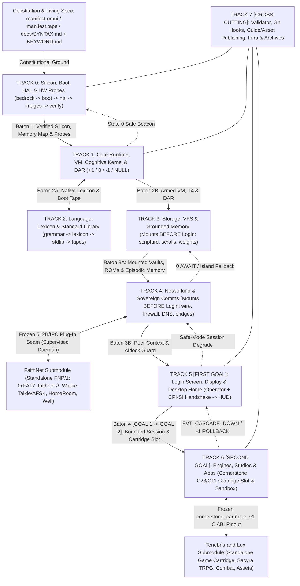

<!--
================================================================================
BLOCK 1: METADATA BLOCK
( Identity, Vision Scope, Living Staging Architecture & Baseline Invariants )
================================================================================
@project       OmniCode Framework
@file          .agents/plans/vision/omnicode_architecture_and_vision.md
@id            cog.agent.plan.omnicode_architecture_and_vision
@layer         Portable Agent Substrate - Architecture Vision Baseline
@archetype     official_vision_and_baseline_plan
@version       0.1.3-dev
@coordinate    13% of Cycle 0 toward 1.0.0
@interface_rev Rev 5
@created       2026-11-19
@updated       2026-11-20
@author        CreativeWorkzStudio LLC / ProfessorSeanEX (Seanje Lenox-Wise)
@repository    https://github.com/Novaking34/OmniCode_Framework
@system        OmniCode Core (Track 0..7) + FaithNet (FNP/1) + Cornerstone/T&L
@role          Official Vision, Architectural Baseline & Clean Staging Guide
@maturity      Settled Baseline Vision | Active Runway Split Out to ../active/
@chassis       multi-machine | Rust 2024 + Go 1.26 (0 deps) + ISO C23/C11
@seams         in: ../plans_charter.md, ../../README.md, manifest.omni |
               active_runway: ../active/omnicode_v1_clean_room_runway.md |
               operator: ../../identity/profiles/operator/operator_database.json
@invariants    1. Universal 5-Block Lifecycle Protocol (Rev 5, <=80 col walls).
               2. Compass Over Checklist: implementation paths adapt as we
                  build and learn, while the architectural baseline holds firm.
               3. The OS Is the Model: AI lives inside native OS processes,
                  memory bounds, and transactions rather than external wrappers.
               4. Clean Sovereignty: FaithNet owns FNP/1; Tenebris-and-Lux owns
                  its TRPG game cartridge; OmniCode owns shared OS, engine ABI,
                  and toolchain ground.
               5. Strangler Fig Staging: the ideal tree grows cleanly inside
                  omnicode/ without breaking existing working suites before
                  folding over root as a clean-room v1.0.0 baseline.
================================================================================
-->

<div align="center">

# OmniCode Framework — Official Architecture Vision & Baseline

### Where We Are Taking the Big House, Why Every Piece Fits Together, and What Holds Steady as Plans Evolve

*Built by **CreativeWorkzStudio LLC** — *"You learn more when having fun."* · Compatibility with the modern world, without dependency on it.*

[-2ea44f?style=flat-square)](../../README.md)
[](../../README.md)
[](../../language/reference/KEYWORD.md)
[](../active/omnicode_v1_clean_room_runway.md)

[Why We Are Building This](#why-we-are-building-this--and-how-to-read-this-plan) · [Core Principles](#core-principles-behind-the-design) · [Boot-to-App Ladder](#the-8-track-boot-to-app-ladder-and-baton-pipeline) · [Live `omnicode/` Tree](#the-live-omnicode-staging-tree) · [Five Architectural Pillars](#five-architectural-pillars-holding-the-baseline) · [Clean-Room Cutover](#the-strangler-fig-staging-path-to-v100) · [Baseline Assurances](#the-baseline-guarantee-what-we-are-assured-of)

</div>

---

<!--
================================================================================
BLOCK 2: OPENING BLOCK
( Vision Statement, Compass vs. Checklist Framing & Core Operating Principles )
================================================================================
-->

## Why We Are Building This — And How to Read This Plan

CreativeWorkzStudio LLC is an independent, sovereign publishing house building games (*Tenebris and Lux*), stories, art, and practical community software — not a commercial SaaS vendor chasing cloud lock-in or monthly subscriptions. When commercial clouds go down, or tools get yanked behind paywalls, or black-box AI models guess blindly and drift across sessions, regular builders and families get left stranded.

The way to fix that isn't patching more wrappers onto fragile software. The move is to own the whole floor cleanly — **MillenniumOS / OmniCode**, **FaithNet**, and **Cornerstone** — written clearly enough that both real systems engineers *and* everyday people picking up a keyboard can actually follow how hardware, software, networking, games, and AI work together.

**How to read this document:** This is **the settled architectural vision and baseline compass**, not a live execution checklist. Live wave-by-wave progress separating settled `v0.1.3` ground from remaining `v1.0.0` work now tracks in [`omnicode_v1_clean_room_runway.md`](../active/omnicode_v1_clean_room_runway.md). What stays steady here is the **baseline**: the boundaries, contracts, and principles below that keep every cog honest as the machine grows.

---

## Core Principles Behind the Design

### 1. The OS Is the Model (Rooted Processes Over Cloud APIs)

Traditional tech bolts an AI chatbot on top of an oblivious operating system and hopes huge parameter counts guess the right commands. Here, **the OS *is* the Model** ([`cpi_si_os_model_synthesis_report.md`](../../reports/cognitive_and_behavioral/cpi_si_os_model_synthesis_report.md)): intelligence shares the exact same clock, memory bounds, transactional debuggers, and storage vaults as the operating system itself.

When an AI substrate runs through real rooted OS processes in Rust (`probes`, `exoskeleton`, `symbol_index`, `DAR` rollbacks, `5-Block` validation) instead of blind HTTP API loops:

* **Bloated glue scripts and raw file-dump token waste disappear:** The model calls deterministic microsecond OS tools instead of inventing throwaway Python scripts or burning tokens re-reading giant source dumps.
* **Giant parameter counts lose their monopoly:** Frontier models need tens or hundreds of billions of parameters largely because disconnected chat windows have to *guess* project structure, compiler rules, and machine state from memory. Grounded in deterministic OS truth and [`host_pc_hardware_profile.md`](../../host/host_pc_hardware_profile.md), compact local open models (`0.5B`–`7B` running offline on a normal 2 GB laptop GPU) become genuinely capable *and empirically testable* right now — while clearing the runway for our native **CPI-SI** model.
* **Offline sovereignty becomes normal life:** Zero internet roundtrips, zero subscription walls, zero forgotten context when sessions restart.

### 2. Tracks Follow Real PC Boot Chronology, With Organic Earned Layers

Our original `<TRACK 0>` through `<TRACK 5>` folder layout was an early snapshot, and it taught us an important lesson: arbitrary track numbers and cookie-cutter `L0_`..`L4_` folder prefixes end up distorting how a real PC starts up.

Reorganizing into **eight Tracks (`Track 0 .. Track 7`)** follows the natural baton the machine passes from cold silicon up to real software:

* **First Goal (`Boot -> Login -> Desktop Home`):** Power on bare metal or host engine (`Track 0`) -> bring up the kernel, language, memory, and networking (`Tracks 1–4`) -> cross the **Initial Login Screen** (Operator + CPI-SI individualization handshake anchored in [`operator_database.json`](../../identity/profiles/operator/operator_database.json)) and land cleanly on the **Desktop Home Page (`Track 5`)**.
* **Second Goal (`Open Application`):** Launch real sandboxed workloads from Desktop Home (`Track 5` -> **`Track 6`**) — starting with the **Cornerstone Engine** and ***Tenebris and Lux***.
* **Organic Earned Layers:** Inside each Track, folders earn their own plain-English layer names (`bedrock`, `boot`, `hal`, `primitives`, `compiler`, `runtime`, `cognitive`, `immune`, etc.), with strict downward dependency order declared and checked in each Track's `.toml` manifest rather than bolted onto folder prefixes.

### 3. Readable for Non-Programmers, Without Compromising Engineering

Mapping OS architecture to everyday ideas — physical locked boxes `[ ]`, directional pipes `-->`, balance scales `+1 / 0 / -1`, tape decks `HEAD -> BODY -> AUDIT -> REEL`, building floors stacked cleanly from foundation upward — serves two goals at once:

1. It hands real computing literacy back to creatives, families, and learners (*"you learn more when having fun"*).
2. It acts as an honest engineering filter: if a Track seam can't be explained clearly in plain English, the boundary itself still needs work.

### 4. Clean Sovereignty Between Framework Organs and Standalone Products

* **[`FaithNet/`](../../skills/faithnet-workflows/SKILL.md)** is the native sovereign networking protocol for MillenniumOS (`FNP/1`), yet remains **its own standalone repo** so experimental walkie-talkie/radio routers, host AP switching, and field kits can iterate fast without destabilizing the OS. General OS networking sits in **`Track 4`**; strictly `FaithNet` stays in `FaithNet/`.
* **[`Tenebris-and-Lux/`](../../skills/cornerstone-workflows/SKILL.md)** remains **its own standalone RPG product** (Sacyra lore, combat, relics, assets, campaign). Shared hardware probes, AI exoskeleton/orchestration, DAR flight-rings, publishing/validators, and the reusable **Cornerstone Game Engine** graduate into **`Tracks 0, 1, 3, 5, 6, 7`** so every app and cog across the Big House benefits.

<!--
================================================================================
BLOCK 3: BODY BLOCK
( Boot-to-App Baton Diagram, Live omnicode/ Staging Tree, 5 Pillars & Cutover )
================================================================================
-->

## The 8-Track Boot-to-App Ladder and Baton Pipeline



---

## The Live `omnicode/` Staging Tree

The ideal clean folder layout is standing live on disk under **`omnicode/`** (temporarily quarantined in root `.gitignore` while root `.agents/` finishes stabilizing for multi-repo mirror sync), ready to receive migrated, Rev-5 verified modules piece by piece while standalone [`FaithNet/`](../../skills/faithnet-workflows/SKILL.md) and [`Tenebris-and-Lux/`](../../skills/cornerstone-workflows/SKILL.md) remain mounted at repository root:

```text
OmniCode/                                  # Existing working repo (root "/", FaithNet/, Tenebris-and-Lux/)
|-- docs/                                  # Active root specifications (SYNTAX.md, KEYWORD.md)
|-- .agents/                               # Portable Cognitive BIOS (host, identity/operator, language, plans, skills)
|-- FaithNet/                              # Standalone FNP/1 networking repo (plugs into Track 4 bridges)
|-- Tenebris-and-Lux/                      # Standalone TRPG game cartridge repo (plugs into Track 6 ABI)
+-- omnicode/                              # CLEAN STRANGLER-FIG STAGING TREE (folds over root at v1.0.0)
    |-- docs/                              # Graduated specs (ARCHITECTURE.md, ROADMAP.md, SYNTAX, KEYWORD)
    |-- .agents/                           # Synchronized agent substrate
    |-- <TRACK 0> : {Silicon, Boot & Hardware Probes}/
    |   |-- bedrock/                       # Silicon 13-register map, physical sector & boot invariants
    |   |-- boot/                          # Bare-metal 4-rung boot ladder
    |   |   |-- bios/                      # 16-bit 512B MBR & State 0 Safe-Mode beacon
    |   |   |-- stage2/                    # 32-bit Stage 2 PM & 1.42MB offline AI arena
    |   |   |-- multiboot/                 # 32-bit Multiboot ELF hypervisor
    |   |   +-- uefi/                      # Native 64-bit UEFI long-mode entry
    |   |-- hal/                           # Hardware Abstraction Layer & live HW telemetry sensors
    |   |   |-- platform/                  # Host hypervisor & OS environment discovery
    |   |   |-- mmio/                      # VGA (0xB8000) & COM1 serial (0x03F8)
    |   |   +-- probes/                    # Direct /proc + sysfs CPU/RAM/GPU/VRAM probes
    |   |-- images/                        # Bootable media outputs
    |   |   |-- esp/                       # EFI System Partition tree
    |   |   +-- roms/                      # Compiled Safe-Mode baseline images
    |   +-- verify/                        # QEMU supervisor harness & boot tripwires
    |-- <TRACK 1> : {Core Runtime, VM, Cognitive Kernel & DAR}/
    |   |-- primitives/                    # Zero-dep math, ontology & cross-language parity bedrock
    |   |   |-- ternary/                   # T4 quad-state algebra (+1, 0, -1, NULL)
    |   |   |-- cell/                      # Bijective 8-bit <-> 5-trit (Tryte5) physical codec
    |   |   |-- boundaries/                # 16 morphological border weights & =<...>= origin algebra
    |   |   |-- operators/                 # 14 ASCII directionals, = Anchor Law & connectives
    |   |   |-- vessels/                   # Bounded containers, tapes, rolls, reels & scenes
    |   |   +-- golden_vectors/            # Single Rust <-> Go <-> C bit-exact parity fixture bank
    |   |-- compiler/                      # Pure language front-end
    |   |   |-- parser/                    # Streams, directional lexer & recursive descent
    |   |   |-- ast/                       # Aside-preserving typed AST
    |   |   +-- assembler/                 # Process Tape (.tape -> .omni) lowering & machine words
    |   |-- runtime/                       # Deterministic execution core
    |   |   |-- environment/               # Scoped frames, 13 hardware registers & snapshots
    |   |   |-- evaluator/                 # Quad-state step loop, SVO verbs & causal vectors
    |   |   +-- scheduler/                 # Cooperative causal clock & pacing
    |   |-- cognitive/                     # AI integrated straight into the kernel runtime loop
    |   |   |-- cortex/                    # Master deliberation loop & prompt transducer
    |   |   |-- neural/                    # Balanced-ternary weights & inference layers
    |   |   |-- transducer/                # Bidirectional semantic transducer
    |   |   |-- router/                    # 4-rung Substrate Router (CPI-SI -> GGUF -> Py -> Cloud)
    |   |   |-- exoskeleton/               # Native Rust AST skeletonizer & compiler tripwires
    |   |   |-- calibration/               # Sweet-spot & non-headless VRAM guard calculator
    |   |   |-- agent/                     # Native reflection loop & stepped gearbox
    |   |   +-- python_bridge/             # Thin optional IPC adapter strictly for Py-only runtimes
    |   |-- immune/                        # Unified DAR + Breaker immune system
    |   |   |-- logger/                    # Microsecond zero-heap flight recorder ring buffer
    |   |   |-- debugger/                  # Transactional time-travel rewind & DEBUG_STEP_AWAIT
    |   |   |-- linter/                    # 5-Block & 16-border structural compliance checker
    |   |   |-- restorator/                # Autonomous self-healing repair synthesizer
    |   |   +-- tripwire/                  # CATCH / THROW / TRIPWIRE hardware & moral breakers
    |   +-- tests/                         # Stratified 4-tier core verification suites
    |       |-- unit/
    |       |-- integrated/
    |       |-- functional/
    |       +-- system/
    |-- <TRACK 2> : {Language, Lexicon & Standard Library}/
    |   |-- grammar/                       # Canonical 8-slot SVO templates & linguistic contracts
    |   |-- lexicon/                       # 8-part-of-speech living dictionary (.omni + .tape pairs)
    |   |   |-- 01_nouns/
    |   |   |-- 02_pronouns/
    |   |   |-- 03_verbs/
    |   |   |-- 04_adjectives/
    |   |   |-- 05_adverbs/
    |   |   |-- 06_prepositions/
    |   |   |-- 07_conjunctions/
    |   |   |-- 08_interjections/
    |   |   +-- operators/
    |   |-- stdlib/                        # Core & Covenant library modules
    |   |   |-- core/
    |   |   +-- covenant/
    |   |-- tapes/                         # Genesis boot covenant & core OS tape ribbons
    |   +-- examples/                      # Canonical language showcase & tutorial reels
    |-- <TRACK 3> : {Storage, VFS & Grounded Memory}/
    |   |-- bedrock/                       # Unalterable text canon & Safe-Mode ROM schemas
    |   |   |-- scripture/                 # Offline KJV + WEB public-domain canon & concordances
    |   |   +-- rom_schemas/               # Compile-time .rodata Safe-Mode Config ROM contracts
    |   |-- vfs/                           # Sovereign Virtual File System & path resolution
    |   |-- episodic/                      # Unified write-SSOT vault (retires duplicate storage/ & logs/)
    |   |   |-- scrolls/                   # Executable 5-Block episodic .scroll traces
    |   |   |-- logs/                      # Date-partitioned runtime telemetry
    |   |   |-- sessions/                  # Per-session boot, login & recovery journals
    |   |   +-- cortex/                    # Deliberation provenance & lesson memory
    |   |-- cognitive_store/               # Runtime model store & fast retrieval
    |   |   |-- weights/                   # Consolidated quantized base & checkpoint weights
    |   |   |-- memory_index/              # Native Rust symbol indexer & B-Tree store
    |   |   +-- elastic_window/            # Bounded context-window pruner & paging policy
    |   +-- benchmarks/                    # Storage throughput, recall & substrate benchmarks
    |-- <TRACK 4> : {Networking & Sovereign Comms}/
    |   |-- wire/                          # Generic OS network packet traits, MTU bounds & node identity ABI
    |   |-- drivers/                       # Physical NIC / Wi-Fi / serial / audio carrier adapters
    |   |-- security/                      # Dual-stack safety walls & trust enforcement
    |   |   |-- firewall/                  # Dual-stack IPv4 + IPv6 Zero-Brick WAN guard rules
    |   |   |-- trust_airlock/             # T4 network gate (+1 peer / 0 await / -1 drop)
    |   |   +-- certs/                     # Sovereign local root & TLS key management
    |   |-- services/                      # Protocol-agnostic OS comms daemons
    |   |   |-- dns/                       # Split-DNS & local sovereign namespace resolution
    |   |   |-- ipc/                       # Same-host shared-memory / pipe inter-process bus
    |   |   +-- discovery/                 # LAN/local room peer announcement & handshake negotiation
    |   +-- bridges/                       # Pluggable protocol & compatibility adapters
    |       |-- faithnet_seam/             # Supervised daemon/512B bridge into standalone FaithNet/
    |       +-- legacy_bridge/             # Standard HTTP(S) / legacy web translation seam
    |-- <TRACK 5> : {Login, Session, Display & Desktop Home}/
    |   |-- contracts/                     # Session envelope, non-headless VRAM reserve & permission ABI
    |   |-- display/                       # Shared dual-frontend presentation & hardware I/O
    |   |   |-- viewport/                  # Native X11 / Wayland / framebuffer compositor surface
    |   |   |-- audio/                     # OS audio mixer & sound stream
    |   |   |-- input/                     # Unified keyboard / mouse / TTY event dispatcher
    |   |   +-- virtual_vga/               # 80x25 bare-metal & studio text-mode mirror
    |   |-- login/                         # Authentication & CPI-SI individualization gate
    |   |   |-- covenant_handshake/        # Operator + Hardware + AI Cortex binding gate
    |   |   +-- profile_loader/            # Mounts Track 3 episodic user state & Track 4 peers
    |   |-- shell/                         # Data-driven OS control plane & launcher services
    |   |   |-- session_manager/           # Boot -> Login -> Home -> App -> Logout state machine
    |   |   |-- launcher/                  # Bounded app launcher
    |   |   +-- cockpit_bus/               # Live DAR telemetry, T4 clock & calibration monitor
    |   +-- desktop/                       # Unified shell landing after Login (Goal #1)
    |       |-- omnistudio_home/           # Single Desktop Home Page
    |       |-- terminal_repl/             # Multi-line sovereign terminal & REPL shell
    |       +-- web_hud/                   # Zero-dep headless/HTTP companion surface
    |-- <TRACK 6> : {Engines, Studios & Applications}/
    |   |-- cartridge_abi/                 # Frozen cornerstone_cartridge_v1 C ABI & manifest schema
    |   |-- engines/                       # Reusable generic runtime engines
    |   |   +-- cornerstone_runtime/       # Zero-heap Cornerstone C23/C11 engine & Safe-Mode loader
    |   |-- studios/                       # Native creation & world-building environments
    |   |   |-- editors/                   # IDE integration, syntax highlighting & hover studio
    |   |   +-- scene_builder/             # Spatial Reel-to-Scene visual editor
    |   |-- sandbox/                       # Isolated app runner enforcing VRAM/memory cartridge caps
    |   +-- showcase/                      # Reference verification cartridges & demo scenes
    +-- <TRACK 7> : {Toolchain, Validation, Ops & Publishing}/
        |-- standards/                     # 5-Block Rev 5 schemas, 80/100 col rulers & commit ledger spec
        |-- validator/                     # Multi-language Rust audit engine
        |   |-- syntax/                    # Lexers (C, C++, Rust, Go, OmniCode, MD, TOML)
        |   |-- rules/                     # 5-Block compliance, downward-layer & workspace audits
        |   +-- git_hooks/                 # Unified git_validator gating commits & tags across 3 repos
        |-- publishing/                    # Studio publishing & Track Book compilers
        |   |-- guide_builder/             # Compendium/Track Book compiler (ADOC -> MD -> PDF)
        |   |-- asset_synth/               # Procedural sprite & audio synth + verifier
        |   +-- pdf_pipeline/              # NotebookLM & technical book pipeline
        |-- infra/                         # Packaging, containers, DNS sync & automation scripts
        |   |-- docker/
        |   |-- systemd/
        |   |-- dns/
        |   |-- dist/
        |   +-- scripts/
        +-- archives/                      # Reconciled historical docs & benchmark reports
            |-- legacy_docs/
            +-- reports/
```

---

## Five Architectural Pillars Holding the Baseline

### 1. Data-Driven Design & Polyglot `.toml` Workspaces

Each Track owns its own `.toml` contract (`Cargo.toml` / `track.toml`) linked through a root Cargo Workspace + polyglot orchestrator manifest. Every Track declares its ordered layers (`layers = [...]`), test command, and Safe-Mode `.rodata` baseline in data. Compile-time Cargo boundaries lock **`omnicode-core`** (`Track 1`) to its sole direct dependency (`rustyline`), while **`omnicode-tools`** (`Track 7` validator, `git_validator`, Guide/Book publisher) stays cleanly separated so publishing dependencies never creep into the kernel.

### 2. The Cartridge Model (`Cornerstone` <-> `Tenebris and Lux`)

**Cornerstone Engine (`Track 6`)** acts like a console hardware slot; ***Tenebris and Lux*** acts like a game cartridge snapped into it. Cornerstone knows the universal `cornerstone_cartridge_v1` C ABI pinout and 5-Block `cartridge.manifest` (fixed zero-heap arena, deterministic tick/RNG, abstracted input/draw/audio queues, `FNV-1a` time-travel replay hook, Safe-Mode ROM budget, optional 512B `FaithNet` co-op pipe, and `init / tick -> T4 / render / hash_state / shutdown`), never hardcoding a shred of game lore. Dynamic `.so`/`.dll` loading powers the OS Desktop (`Track 5 -> Track 6`), while static linking lets `Tenebris-and-Lux/` continue building standalone via CMake.

### 3. Zero-Downtime Standalone `FaithNet`

[`FaithNet/`](../../skills/faithnet-workflows/SKILL.md) keeps moving fast in its own repo — testing real walkie-talkie AFSK / RF serial routers, `FaithNet-HomeRoom` Wi-Fi rooms, and `The Well` (`:8077`) — without putting MillenniumOS at risk:

* `Track 4/bridges/faithnet_seam/` speaks only the frozen `FNP/1` (`0xFA17` `512B` / IPC) protocol contract.
* `OmniCode` pins verified green `FaithNet` commits behind `FaithNet`'s own 0-dep Go `-race` and Block 4 gates.
* At runtime, `faithnet-node` executes as an out-of-process supervised daemon under `Track 4`, never linked inside ring 0; if an experimental radio link drops, networking yields gracefully to **`0:AWAIT`** or **`island` mode** while the Desktop and running games stay rock solid.

### 4. Native Rust Exoskeleton + 4-Rung Substrate Router + Thin Python Bridge

```text
OmniCode Cognitive Kernel (Native Rust: Track 0 Probes + Track 1 Exoskeleton/DAR + Track 3 Memory)
                                          |
                              [ 4-RUNG SUBSTRATE ROUTER ]
      +------------------------+------------------------+------------------------+
      v                        v                        v                        v
Rung 1: Native CPI-SI    Rung 2: Local Open       Rung 3: Thin Python      Rung 4: Opt-In Cloud
Ternary Core             Models (GGUF / Ollama)   Plug-In Bridge           Frontier API
(1.42MB arena / offline) (0.5B..7B direct Rust)   (Py-only adapters only)  (Explicit opt-in only)
```

By pulling probes, AST skeletons, 8-language validation, B-Tree symbol memory, and compiler tripwires out of Python into native Rust, small local models gain deterministic rails offline right now — with zero lock-in when native CPI-SI matures on Rung 1.

### 5. SSOT, Wise Distribution & Track Books (`[STANDARD]` vs. `[OMNICODE]`)

* **One Authoritative Write-SSOT + Verified Read-Only Projections:** [`SYNTAX.md`](../../language/reference/SYNTAX.md) & [`KEYWORD.md`](../../language/reference/KEYWORD.md) sync identically across `.agents/language/` & `~/.gemini/` (`sha256`-checked); Track data manifests compile into `.rodata` Safe-Mode ROMs; `Track 3` owns one unified episodic/logs/weights store (retiring duplicate `storage/` & root `logs/`); `Track 1/primitives/golden_vectors/` pins Rust/Go/C binary-trit parity.
* **Tracks as Living Books (`[STANDARD OS BEDROCK]` vs. `[OMNICODE ENHANCEMENT]`):** `Track 7/publishing/guide_builder/` compiles each Track's 5-Block dual-audience docs, `()` Asides, working code, and Block 4 tripwires into cohesive Books — explicitly separating universal PC/OS mechanics (`x86`, `MMIO`, `VFS`, `IPv4/IPv6`, `X11`, `C ABI`) from OmniCode enhancements (`1.44 MB` AI arena, `T4`, `5-Block`, `FNP/1`, `Cartridge ABI`). When an offline model trained or grounded on those Books encounters a standard Linux, Windows, or bare-metal kernel fault, it traces cause-and-effect across hardware, memory, network, and display instead of firing blind commands.

---

## The Strangler Fig Staging Path to `v1.0.0`

Instead of breaking a working codebase with risky in-place rewrites, we run **Strangler Fig Clean-Room Staging**:

1. The existing working repo (`542` OmniCode Cargo tests, `359` FaithNet `-race` tests, `66` Cornerstone CTest + `839` Rust tool tests) stays intact and verified every day.
2. Modules graduate into **`omnicode/`** one cog at a time, passing a strict Rev 5 airlock: clean organic Track layer, per-Track `.toml` contract, Rev 5 5-Block formatting (`<= 80`/`100` cols), SSOT placement, and verified tests (marking old duplicates obsolete as they migrate).
3. Once **`omnicode/`** compiles, passes full cross-repo golden-vector & subsystem audits, and runs **Goal #1 (`Boot -> Login -> Desktop Home`)** and **Goal #2 (`Cornerstone / Tenebris and Lux` Cartridge)** end to end, we fold **`omnicode/`** cleanly onto repository root — giving **`v1.0.0`** a true clean-room constitutional bedrock rather than a patched prototype. Live wave tracking sits in [`omnicode_v1_clean_room_runway.md`](../active/omnicode_v1_clean_room_runway.md).

---

<!--
================================================================================
BLOCK 4: AUDIT PROCEDURES BLOCK
( The Baseline Guarantee: Six Invariants Assured Across Changing Plans )
================================================================================
-->

## The Baseline Guarantee: What We Are Assured Of

Implementation tactics will keep evolving as we test real hardware and learn new lessons — and that's healthy. As long as the baseline outlined in this document is fulfilled, **six structural realities are assured**:

1. **No Single-Vendor, Cloud, or Model Lock-In:** Identity, memory (`.scroll`s), tooling, and hardware invariants belong to OmniCode on local storage. Local GGUF models today, Python adapters if needed, native CPI-SI tomorrow, or FaithNet over copper/radio all swap cleanly without rebuilding user workflows.
2. **Real End-to-End OS Execution Without Bloat:** From `t = 0` boot (`Track 0`), through Operator + CPI-SI Login Covenant Handshake and unified Desktop Home (`Track 5`), down to launching sandboxed applications (`Track 6` Cornerstone & *Tenebris and Lux*), every hop runs across bounded `ALLOC_ZERO_HEAP` / verified tracks.
3. **Zero-Brick Safety Under Failure:** Whether an experimental `FaithNet` walkie-talkie driver glitches (`0:AWAIT` / `island`), external disks vanish (`.rodata` Safe-Mode ROMs + Stage 1 512B beacon), or an AI edit misfires (`DAR ROLLBACK` / `TRIPWIRE`), failures stay localized and recoverable.
4. **True Multi-Machine Decoupling (*Every Cog Stays a Cog*):** `FaithNet` evolves safely as its own `0-dep` networking substrate, `Tenebris-and-Lux` evolves as an uncoupled game cartridge, and `OmniCode` binds them through frozen wire/ABI seams.
5. **Models That Reason Causally About Real PCs:** Tagging `[STANDARD OS BEDROCK]` separately from `[OMNICODE ENHANCEMENT]` inside SSOT Track Books ensures offline models understand standard kernel, memory, and network failures from first principles rather than blind pattern-guessing.
6. **A Clean-Room `v1.0.0` House:** Growing inside `omnicode/` before cutting over means `v1.0.0` arrives free of Cycle-0 scaffolding scars, duplicate storage trees, and spec-vs-code drift (*Proverbs 24:27*).

---

<!--
================================================================================
BLOCK 5: CLOSING BLOCK
( ACTION / REEL - Settled Vision Horizon, Active Splits & Anchors )
================================================================================
-->

## Block 5 (Closing): Living Horizon & Portable Anchors

### `PLAY` — Settled Vision Posture

1. **North Star Fixed (`Track 0..7`):** Boot-to-App chronology, Strangler-Fig clean-room staging, Cartridge Model decoupling, and the `4-Rung Substrate Router` remain settled baseline commitments.
2. **Done vs. Remaining Separated:** Active cutover milestones live in [`omnicode_v1_clean_room_runway.md`](../active/omnicode_v1_clean_room_runway.md), keeping this file timeless and free of checklist churn.
3. **Broken Legacy Language Paths Repaired:** Every reference now points cleanly into `../../language/reference/` and `../../language/evolution/`.

### `PROJECT` — Graduation & Multi-Repo Horizon

1. Once `omnicode/` completes **Goal #1 (`Boot -> Login -> Desktop Home`)** and **Goal #2 (`Cornerstone` Cartridge Launch)** and folds onto `/`, this baseline promotes alongside `docs/SYNTAX.md` and `docs/KEYWORD.md` as `docs/ARCHITECTURE.md` while keeping `.agents/plans/vision/` synchronized across all six runtime mounts.
2. [`seanje_lenox_wise/profile.md`](../../identity/profiles/operator/seanje_lenox_wise/profile.md) and [`operator_database.json`](../../identity/profiles/operator/operator_database.json) now provide the concrete login-screen identity model expected by `Track 5/login/covenant_handshake/`.

### `RECORD` — Linked Anchors Across `.agents/`

* Cognitive BIOS & Planning Charter: [`.agents/README.md`](../../README.md), [`plans_charter.md`](../plans_charter.md)
* Active Execution Runways: [`omnicode_v1_clean_room_runway.md`](../active/omnicode_v1_clean_room_runway.md), [`toolchain_rust_port_phases_2_to_4.md`](../active/toolchain_rust_port_phases_2_to_4.md)
* Completed Toolchain Ledger: [`toolchain_rust_foundation_phases_1_to_1_5.md`](../completed/toolchain_rust_foundation_phases_1_to_1_5.md)
* Language Specs: [`SYNTAX.md`](../../language/reference/SYNTAX.md), [`KEYWORD.md`](../../language/reference/KEYWORD.md), [`omnicode_syntax_keywords_operators.md`](../../language/evolution/omnicode_syntax_keywords_operators.md)
* Host, Voice & Operator Triad: [`host_pc_hardware_profile.md`](../../host/host_pc_hardware_profile.md), [`voice_tone_and_cpi_si_paradox.md`](../../identity/voice_tone_and_cpi_si_paradox.md), [`seanje_lenox_wise/profile.md`](../../identity/profiles/operator/seanje_lenox_wise/profile.md)
* Sibling Skills & Reports: [`faithnet-workflows`](../../skills/faithnet-workflows/SKILL.md), [`cornerstone-workflows`](../../skills/cornerstone-workflows/SKILL.md), [`cpi-si-covenant`](../../skills/cpi-si-covenant/SKILL.md), [`cpi_si_os_model_synthesis_report.md`](../../reports/cognitive_and_behavioral/cpi_si_os_model_synthesis_report.md)

### `COMMIT` — Closing Seal

* **Invariants Preserved:** All Block 1 contracts hold (`<= 80` col comment framing, pure ASCII diagrams, zero links escaping `.agents/`, clean `vision/` vs. `active/` vs. `completed/` boundary).
* **Base-First Anchoring Verified:** Hardware caps and Operator login contracts live in [`host_pc_hardware_profile.md`](../../host/host_pc_hardware_profile.md) and [`operator_database.json`](../../identity/profiles/operator/operator_database.json) instead of drifting across plan files.
* **Status:** `@created 2026-11-19` / `@updated 2026-11-20`, `OFFICIAL_VISION_BASELINE_VERIFIED (+1:PROCEED)`.

<!-- END OF BLOCK 5: CLOSING SEAL -->
