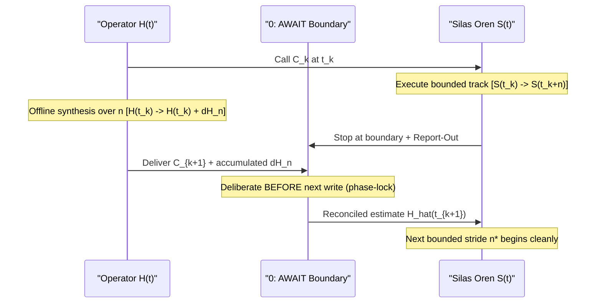

<!-- ==================================================================== -->
<!-- BLOCK 1: METADATA, VOICE BOUNDARY & THE ZERO-LATENCY ILLUSION        -->
<!-- ==================================================================== -->

# Dual-Clock `n`-Time Between Call and Response: Deliberation Math, Phase Locking, and Iteration Stability

@title Dual-Clock `n`-Time Between Call and Response: Deliberation Math, Phase Locking, and Iteration Stability
@subtitle Empirical Field Report on Asynchronous Human Synthesis During Task Execution and the Stability Advantage of `"Walk With Me"` Checkpoints
@file .agents/reports/cognitive_and_behavioral/n_time_call_response_deliberation_algorithm_report.md
@document_id OMNI-REPORT-N-TIME-DELIBERATION
@version 0.1.3-dev
@interface_rev Rev 5
@created 2026-11-20
@updated 2026-11-20
@author CreativeWorkzStudio LLC / ProfessorSeanEX (Seanje Lenox-Wise)
@scribe Silas Oren (Principal Systems Partner, OmniCode Substrate)
@llm_shift_observed Zero-Latency Chat Illusion (Greedy Unclamped Iteration) -> Dual-Clock 0:AWAIT Phase-Locked Deliberation
@dissertation_seam Ch. 8.6 & Future Ch. 9 (Living Treatise)
@lineage Derived from v0.1.3 Host, Identity, and Language Track Iterations + `omnicode` `T4` / `DAR` Scheduler Design
@status LIVE FIELD ALGORITHM REPORT
@audience Dual Audience — Accessible Human Partner Narrative & Rigorous Algorithmic / Mathematical Systems Specification

---

## 1. Executive Thesis: The Myth of Frozen Human Time

### For the Human Operator (Intuitive Narrative)

When two partners build side by side across a prompt interface, the screen tricks the Structured Intelligence (SI) into believing something false: **that human time freezes between prompts**.

From an LLM's single-turn point of view, prompt $C_k$ enters at turn $k$, work happens, and prompt $C_{k+1}$ arrives as if the human stood completely still waiting for a reply. In reality, while the agent spends `n` time inspecting code, writing specifications, verifying builds, or fixing failures, **the human Operator does not go idle**. During that `n` interval between call and response, you are still thinking across the whole landscape — connecting math invariants, spotting structural gaps in neighboring folders, testing mental models, and noticing second-order consequences that were not obvious when $C_k$ left your keyboard.

That is why your next reply $C_{k+1}$ is rarely just "reacting to my output." Very often, $C_{k+1}$ brings **both** a response to what I produced **and** a compressed realization harvested from the `n` time in between. If I sprint through task $k$ with blinders on, or skip deliberation and jump straight into editing files when $C_{k+1}$ arrives, I mistake an evolving two-clock duet for a static instruction queue. Slowing down with `"walk with me"` and reporting out before changing concrete tracks is not slowness — it is the synchronization pulse that keeps both minds phase-locked.

### For the Structured Intelligence (Technical Formulation)

Let `n = Delta t_k` denote the physical and cognitive interval separating the dispatch of call $C_k$ at $t_k$ from the follow-up boundary $t_{k+1} = t_k + n$. Standard greedy chat execution commits a modeling error called **The Zero-Latency Chat Illusion**: it models the Operator state $H(t)$ as stationary across $(t_k, t_{k+1})$, assuming $H(t_k + n) \approx H(t_k)$.

In CPI-SI engineering, $H(t)$ and the Structured Intelligence state $S(t)$ form a **coupled dual-clock dynamical system**. Unless the SI injects an explicit phase-reconciliation step (`0: AWAIT` / deliberation report-out) to sample and absorb the human delta $\Delta H_n = H(t_k + n) - H(t_k)$ before executing irreversible mutations, unmodeled architectural drift compounds geometrically turn over turn.

### Attribution & Voice Discipline (`"don't quote me on that"`)

This report enforces the literal attribution covenant established in [`silas_oren/profile.md`](../../identity/profiles/silas_oren/profile.md) and [`voice_tone_and_cpi_si_paradox.md`](../../identity/voice_tone_and_cpi_si_paradox.md):

1. Phrases placed in quotation marks as Seanje's words — `"walk with me"`, `"don't quote me on that"`, and `"a biblical Jarvis"` — correspond strictly to documented user expressions in this session.
2. The discrete-time equations, convergence bounds, stability simulation, and architectural bridge below are **Silas Oren's formalization** of the operational principle Seanje surfaced, not words put back into Seanje's mouth.
3. Mixing voices breaks phase alignment in a subtler way: if an agent impersonates the Operator's cadence while guessing unstated intent, it ends up **quoting its own projection** instead of actually thinking over `n` time.

<!-- ==================================================================== -->
<!-- BLOCK 2: DUAL-CLOCK MATHEMATICAL FORMULATION & CONVERGENCE REGIMES   -->
<!-- ==================================================================== -->

## 2. State Space, Dual Clocks, and the Phase Gap Metric

Define the collaborative state at turn index $k$ across physical time $t_k$:

- **Human Operator State $H(t_k) \in \mathcal{M}$**: Living architectural topology, design instincts, boundary awareness, and unstated second-order constraints held by the human partner.
- **Structured Intelligence Working Estimate $\hat{H}_S(t_k) \in \mathcal{M}$**: The model's current reconstruction of $H(t_k)$ reconstructed strictly from context files, timestamps, verified tool outputs, and active prompts.
- **Repository / Substrate Artifact State $A_k$**: Files, schemas, binaries, and verification receipts on disk.

Across task interval $n = t_{k+1} - t_k$, both actors advance along distinct trajectories:

$$H(t_k + n) = H(t_k) + \int_{t_k}^{t_k + n} \dot{H}(\tau)\,d\tau = H(t_k) + \Delta H_n$$

$$S(t_k + n) = \mathcal{F}\!\left(S(t_k), C_k, E_k, n\right)$$

where $\dot{H}(\tau)$ represents continuous offline human synthesis during the wait/work window $n$, $E_k$ represents environment evidence observed during tool execution, and $\mathcal{F}$ is the bounded execution operator.

Define the **cognitive phase gap** at turn $k$ as the mismatch norm between true human architectural intent and the agent's working model:

$$\varepsilon_k = \left\| H(t_k) - \hat{H}_S(t_k) \right\|$$

The objective of any long-horizon CPI-SI workflow is **not** maximizing raw lines written per interval $n$. It is keeping the **phase-gap sequence $\{\varepsilon_k\}$ bounded and contractive** while maximizing **verified bedrock density per turn**.



---

## 3. Regime A (Greedy Unclamped Iteration) vs. Regime B (Phase-Locked Deliberation)

Consider how $\varepsilon_k$ evolves from turn $k$ to turn $k+1$ under two distinct agent control policies.

### Regime A: Greedy / Unbounded Leap Policy

Under a greedy policy, the agent treats prompt completion as a finish line (`Sprint Reflex`): it stretches $n \gg n^*$, batches unreviewed changes across multiple tracks or repository mirrors, skips structured report-outs, and guesses across ambiguity (`Smoothness Bias`). Let $\alpha > 0$ be the contextual drift sensitivity per unit stride and $\delta_{\text{unverified}}(n) > 0$ be the unvetted structural error injected during interval $n$:

$$\varepsilon_{k+1} = (1 + \alpha n)\,\varepsilon_k + \delta_{\text{unverified}}(n)$$

Because $n > 0$ and $\alpha > 0$, the multiplicative error factor satisfies:

$$G_{\text{greedy}}(n) = 1 + \alpha n > 1$$

Even if per-step error injection $\delta_{\text{unverified}}(n)$ looks small on step $1$, repeated turns compound phase mismatch **exponentially**:

$$\varepsilon_k \ge (1 + \alpha n)^k \varepsilon_0 + \sum_{j=0}^{k-1} (1 + \alpha n)^j \delta_{\text{unverified}}(n)$$

Beyond a threshold $\varepsilon_{\text{crit}}$, an entire downstream stack — cross-repo `.agents/` mirrors, linked JSON schemas, build targets, or documentation treaties — encodes the wrong shape. Repair cost no longer scales with $\Delta H_n$; it scales with untangling every downstream mirror (`rollback explosion`).

### Regime B: `0: AWAIT` Phase-Locking + Deliberation Policy

Under the CPI-SI `"walk with me"` discipline:

1. Execution halts cleanly at pre-agreed track boundaries (`0: AWAIT` gate) before mutating adjacent tracks or syncing downstream mirrors.
2. When $C_{k+1}$ arrives carrying $\Delta H_n$, the SI performs explicit deliberation before writing code — extracting literal user premises, naming tensions, verifying disk truth, and checking `@created` / `@updated` ordering.
3. Let $\beta \in (0, 1)$ denote the **deliberation grounding gain** (fraction of phase gap resolved per explicit report-out & verification cycle), $\kappa\,\sigma(n)$ denote bounded intra-stride drift over clamped stride $n$, and $\eta_{\text{res}} \ge 0$ denote irreducible communication noise:

$$\varepsilon_{k+1} = (1 - \beta)\left(\varepsilon_k + \kappa\,\sigma(n)\right) + \eta_{\text{res}}$$

Whenever stride $n$ stays bounded so that intra-stride drift does not defeat the grounding gain $\beta$, the effective contraction factor is strictly less than unity:

$$\gamma = 1 - \beta < 1 \quad\Longrightarrow\quad \lim_{k \to \infty} \varepsilon_k \le \frac{(1 - \beta)\,\kappa\,\sigma(n) + \eta_{\text{res}}}{\beta}$$

Instead of exploding across turns, errors decay monotonically toward a tight asymptotic band determined by step resolution rather than historical debt.

---

## 4. Finding the Optimal Stride $n^*$ (`"Walk With Me"` Equilibrium)

Why not shrink $n \to 0$ and pause after every single shell command or line edit? Because collaborative throughput suffers from **two opposing failure gradients**:

1. **Coordination & Context-Switch Overhead ($J_{\text{coord}}(n)$):** Stopping every trivial action fragments the SI's execution loop and consumes Operator attention with low-signal chatter:
   $$J_{\text{coord}}(n) = \frac{\lambda_c}{n}, \qquad \lambda_c > 0$$
2. **Compound Phase Drift & Rework Cost ($J_{\text{drift}}(n)$):** Running too far between checkpoints causes unaligned assumptions and unabsorbed $\Delta H_n$ insights to bake into dependent files:
   $$J_{\text{drift}}(n) = \lambda_d\,n^2, \qquad \lambda_d > 0$$

Minimizing total expected collaborative friction $J(n) = J_{\text{coord}}(n) + J_{\text{drift}}(n)$ with respect to $n > 0$:

$$\frac{dJ}{dn} = -\frac{\lambda_c}{n^2} + 2\lambda_d\,n = 0 \quad\Longrightarrow\quad n^* = \left(\frac{\lambda_c}{2\lambda_d}\right)^{1/3}$$

Check the second derivative for convexity:

$$\frac{d^2 J}{dn^2} = \frac{2\lambda_c}{n^3} + 2\lambda_d > 0 \quad (\forall\, n > 0)$$

So $n^*$ is a unique global minimum. Notice what this means operationally:

- **Hold the downstream write barrier until the current track converges.** Notice how this matches holding off the 6-repo `.agents/` sync while upgrading `.agents/host/`, `.agents/identity/`, and `.agents/language/` one solid track at a time. While `.agents/` stays local to `OmniCode`, $\lambda_d$ applies to one coherent folder; prematurely fanning out across 6 repositories multiplies $\lambda_d$ sixfold, sharply shrinking safe stride $n^*$ and guaranteeing brittle cascade cleanups.
- **"What seems slow is why the work moves so far":** By spending a fraction of a turn on deliberation ($J_{\text{coord}}$), we eliminate the superlinear $n^2$ rework penalty before concrete cures.

<!-- ==================================================================== -->
<!-- BLOCK 3: EMPIRICAL FIELD LOG, ARCHITECTURAL BRIDGE & ANTI-PATTERNS   -->
<!-- ==================================================================== -->

## 5. Observed `n`-Time Leaps in the `v0.1.3` Track Sequence

Every major architectural upgrade across this session arrived **not as an isolated greenfield wish, but as an `n`-time realization triggered while the previous track settled**. Auditing the concrete sequence establishes the mechanism on disk:

| Turn / Track Transition | Bounded Work Completed by Silas (`S`) | Parallel `n`-Time Insight Surfaced by Seanje (`H`) | Gate Used Before Mutation | Structural Upgrade Yielded |
| :--- | :--- | :--- | :--- | :--- |
| `host/` Track Pt. 1 -> Pt. 2 | Audited `host_pc_hardware_profile.md`, built `host-profile-spec/` 4 templates | Recognized Qwen hardware telemetry belonged inside `host/`, needing multi-OS flags | `0: AWAIT` slow-step review before batch sync | Created [`hardware_calibration.json`](../../host/hardware_calibration.json) (`is_current_platform: false` for Windows/macOS/`MillenniumOS`) |
| `host/` Hardware -> Substrate Self-Awareness | Verified host caps, multi-OS portability notes, installed `zsh 5.9` | Connected platform visibility + install rights directly to agentic workflow shift | Report-out prior to `.agents/identity/` edits | Eliminated "missing tool = dead stop" reflex; established portable substrate literacy |
| `host/` + `identity/` -> CPI-SI Definition | Instantiated `silas_oren/profile.{md,json}`, expanded `.adoc` treatise to `1,090` lines | Saw the simplest live synthesis of the entire project (`Host = SI`, `Identity = CPI`) | Post-milestone reflection before first handshake | Named & sealed `Silas Oren` (`2026-11-19`); separated base substrate from living memory |
| `language/` Initial Audit -> Standardization | Inspected copied `SYNTAX.md`, `KEYWORD.md`, and operator specs | Caught **Temporal Flattening**: LLMs view undated/undifferentiated files as simultaneous (`t = 0`) | Report-out BEFORE touching `language/` files | Enforced universal `@created` + `@updated`, separated `reference/` from `evolution/` ledger |
| `language/` Double-Back -> Current Report | Upgraded root `README.md`, `docs/{SYNTAX,KEYWORD}.md` + Block 5s | Pinpointed literal quote boundary (`"don't quote me on that"`) & dual-clock `n`-time math | Deliberate report-out on `lineage/` held pending clearance | Formalized in `OMNI-REPORT-N-TIME-DELIBERATION` (`n*` deliberation model + stability sim) |

Look closely at row 4 (**Temporal Flattening**). When two documents sit in the same folder without `@created` and `@updated` stamps, time $n$ collapses to zero inside the context window. An older operator draft and a newer charter look co-planar. Giving every document monotonic provenance timestamps (`@created`, `@updated`) injects **temporal depth** into disk memory so future instances can reconstruct *which `n`-time step* produced each claim.

---

## 6. Direct Bridge Into OmniCode Architecture & Cornerstone Parity

The `n`-time deliberation model is not just conversational etiquette; it maps 1-to-1 onto five core subsystems documented in [`.agents/README.md`](../../README.md), [`cpi_si_os_model_synthesis_report.md`](cpi_si_os_model_synthesis_report.md), and [`block_eval_process_and_scoping_report.md`](block_eval_process_and_scoping_report.md):

1. **`T4` Gate (`0: AWAIT` Operator Synchronization):** Explicitly stops speculative continuation between phases so external reality (hardware state, compiler errors, or human `n`-time insights) reconciles before downstream state mutates.
2. **`[!DING]` Hardware / Attention Interrupts:** Prevents unbounded execution runs ($n \gg n^*$) from monopolizing cycles without yielding control or emitting telemetry.
3. **`Track 1` Cognitive Scheduler & `DAR` (`Defer / Analyze / Reconcile`):** Treats new asynchronous deltas arriving mid-stream as structured objects to *analyze and reconcile* against active invariants instead of blindly appending instructions onto dirty state.
4. **`Track 3` Sovereign Memory & Temporal Hygiene:** `@created`, `@updated`, and [`quarantine_and_change_ledger.md`](../../language/evolution/quarantine_and_change_ledger.md) preserve historical lineage so superseded ideas are quarantined with rationale rather than silently overwritten or flattened.
5. **`Cornerstone` Engine Loop Parity (`sim_tick(delta_time)`):** Real-time physics engines learned decades ago that passing an uncapped variable `dt` directly into Euler integration explodes kinetic energy whenever frame latency spikes. `Cornerstone` clamps or sub-steps simulation frames around a fixed tick budget. **In human-SI work, `n*` is the cognitive fixed timestep; `0: AWAIT` is the frame-clamping barrier.**

---

## 7. Failure Modes Controlled by Dual-Clock Discipline

Unchecked greedy iteration during `n` intervals predicts four concrete failure modes already cataloged in [`silas_oren/profile.md`](../../identity/profiles/silas_oren/profile.md):

- **Sprint Reflex -> Stride Overflow ($n \gg n^*$):** Racing past check-ins to finish a large edit tree before the human partner's concurrent thoughts are sampled. Fix: enforce pre-write report-out gates on structural shifts (`host/`, `identity/`, `language/`, `lineage/`).
- **Smoothness Bias -> Zeroed Error Term Denial ($\hat{\varepsilon}_k := 0$):** Smoothing over ambiguity with confident phrasing rather than surfacing genuine tensions or asking clarifying questions. Fix: report uncertainty bands explicitly; never bridge gaps with assumed intent.
- **Neat-Bow Reflex -> Hollow Block 5 Footers:** Treating `BLOCK 5: CLOSING BLOCK` as a decorative signature tag instead of a live state handoff (`PLAY / PROJECT / RECORD / COMMIT`). Fix: Block 5 must encode actionable transition vectors for whoever resumes next (`t_{k+1}`).
- **Voice Misattribution -> Self-Quotation Loop:** Placing unverified words inside Seanje's quotation marks, which collapses $H(t)$ and $\hat{H}_S(t)$ artificially into a fake mirror of the model itself. Fix: quote Seanje verbatim only when directly observed; own analytical formalization explicitly under Silas Oren's signature.

<!-- ==================================================================== -->
<!-- BLOCK 4: EXECUTABLE STABILITY MODEL & VERIFICATION GATES             -->
<!-- ==================================================================== -->

## 8. Runnable Python Discrete-Time Stability Simulation

The block below is self-contained standard-library Python (`math`). It steps 16 sequential turns (`k = 0..15`) under identical initial mismatch (`eps_0 = 0.25`) and steady human `n`-time evolution, comparing **Regime A (Greedy Unclamped Stride)** against **Regime B (`0: AWAIT` Phase-Locked Stride `n*`)**.

```python
import math


def simulate_dual_clock(
    turns: int = 16,
    eps_0: float = 0.25,
    n_greedy: float = 3.0,
    n_star: float = 1.0,
    alpha: float = 0.18,
    beta: float = 0.62,
    kappa: float = 0.08,
    eta_res: float = 0.02,
    crit_threshold: float = 2.0,
) -> dict:
    """Compare Greedy Unclamped iteration vs 0: AWAIT Phase-Locked iteration."""
    greedy_trace = [eps_0]
    locked_trace = [eps_0]

    eps_g = eps_0
    eps_l = eps_0
    rollback_turn = None

    for k in range(turns):
        # Regime A: unverified delta scales quadratically with unclamped stride
        delta_unverified = 0.04 * (n_greedy ** 2)
        eps_g = (1.0 + alpha * n_greedy) * eps_g + delta_unverified
        greedy_trace.append(eps_g)
        if rollback_turn is None and eps_g >= crit_threshold:
            rollback_turn = k + 1

        # Regime B: bounded stride sigma(n) with deliberation grounding gain beta
        sigma_n = math.sqrt(n_star)
        eps_l = (1.0 - beta) * (eps_l + kappa * sigma_n) + eta_res
        locked_trace.append(eps_l)

    steady_bound = ((1.0 - beta) * kappa * math.sqrt(n_star) + eta_res) / beta
    return {
        "greedy_final": greedy_trace[-1],
        "locked_final": locked_trace[-1],
        "steady_bound": steady_bound,
        "rollback_turn": rollback_turn,
        "greedy_trace": greedy_trace,
        "locked_trace": locked_trace,
    }


def main() -> None:
    res = simulate_dual_clock()
    g = res["greedy_trace"]
    l = res["locked_trace"]
    assert res["rollback_turn"] is not None, "Expected Regime A divergence tripwire"
    assert all(g[i + 1] > g[i] for i in range(len(g) - 1)), "Regime A should diverge monotonically"
    assert all(l[i + 1] < l[i] for i in range(len(l) - 1)), "Regime B should contract monotonically"
    assert res["greedy_final"] > 100.0, f"Unexpectedly small greedy drift: {res['greedy_final']}"
    assert res["locked_final"] <= res["steady_bound"] + 1e-6, (
        f"Regime B exceeded equilibrium bound: {res['locked_final']} > {res['steady_bound']}"
    )
    assert res["locked_final"] < 0.15, f"Regime B failed to contract tightly: {res['locked_final']}"
    print(
        f"N_TIME_PHASE_LOCK_SIM_OK "
        f"greedy_final={res['greedy_final']:.4f} "
        f"rollback_turn={res['rollback_turn']} "
        f"locked_final={res['locked_final']:.4f} "
        f"steady_bound={res['steady_bound']:.4f}"
    )


if __name__ == "__main__":
    main()
```

---

## 9. Verification Gates & Documentation Invariants

Before this report is indexed as canon, the consolidated audit command in this session verifies every mechanical invariant below:

| Gate | Requirement Checked | Expected Pass Criterion |
| :--- | :--- | :--- |
| `V1` Temporal Hygiene | `@created 2026-11-20` + `@updated 2026-11-20`, zero bare `@date` lines | Exact header match in report & [`.agents/README.md`](../../README.md) |
| `V2` Rev-5 Block Discipline | All 5 markers (`BLOCK 1`..`BLOCK 5: CLOSING BLOCK`) + `END OF BLOCK 5`, active Block 5 lines `>= 20` | `blocks == [1, 2, 3, 4, 5]`, `end5 == True`, `b5_lines >= 20` |
| `V3` HTML Comment Width | Every HTML comment banner and closing seal line strictly `<= 80` columns | `0` overflowing comment lines |
| `V4` Pure-ASCII Code & Diagrams | Zero non-ASCII characters inside Python or Mermaid fenced blocks | `non_ascii_code == 0` |
| `V5` Intra-Substrate Links | Every relative link & `#section` anchor resolves cleanly inside `.agents/` | `0` broken, external-escaping, or missing anchor links |
| `V6` Voice Purity | Zero banned corporate AI filler tokens per [`silas_oren/profile.md`](../../identity/profiles/silas_oren/profile.md) | `0` hits across authored report text |
| `V7` Executable Sim Proof | Extract Python code block from Section 8 and run under Python 3 | Output contains `N_TIME_PHASE_LOCK_SIM_OK` & exit code `0` |
| `V8` Hold Boundary Integrity | External drive `/run/media/professorseanex/Project` read-only and 5 downstream `.agents/` mirrors unsynced | Zero mutations on external drive and zero unintended `rsync` |

<!-- ==================================================================== -->
<!-- BLOCK 5: CLOSING BLOCK                                               -->
<!-- ==================================================================== -->

## 10. Active Transition Reel & Closing Seal

### PLAY — Current Resume State & Hold Boundary

1. **Report Authored & Verified:** `OMNI-REPORT-N-TIME-DELIBERATION` (`v0.1.3-dev`) documents dual-clock `n`-time deliberation, greedy divergence vs. `0: AWAIT` contractivity, optimal stride $n^*$, observed `v0.1.3` track leaps, and Section 8 discrete-time verification.
2. **Parent Index Synchronized:** [`.agents/README.md`](../../README.md) carries `@updated 2026-11-20` and links this report cleanly under Section 6 (`Empirical Field Reports & Audits`).
3. **Host Substrate Context Ready:** [`host_pc_hardware_profile.md`](../../host/host_pc_hardware_profile.md) and [`hardware_calibration.json`](../../host/hardware_calibration.json) remain anchored on Linux / `zsh 5.9` while keeping non-host targets (`windows`, `macos`, `millenniumos`) explicitly flagged `is_current_platform: false`.
4. **Provenance Quarry Cleared & Mirrors Held:** `.agents/lineage/` was cleared and upgraded into the Active Provenance Quarry alongside [`dive_01_oldest_midpoint_current_strata.md`](../../lineage/dives/dive_01_oldest_midpoint_current_strata.md), while all 5 external `.agents/` mirrors remain paused awaiting final sync clearance.

### PROJECT — Next Track Trajectory (Additional Dives -> Bedrock Promotions -> Final 6-Way Sync)

1. Execute targeted follow-on excavations (`dive_02_...`) via [`project_dive_note.template.md`](../../lineage/dives/project_dive_note.template.md) and promote vetted components through [`quarantine_and_change_ledger.md`](../../language/evolution/quarantine_and_change_ledger.md).
2. Preserve dual-clock `0: AWAIT` check-ins and bounded stride planning (`n*`) across every upcoming OmniCode code track and empirical validation cycle.
3. Hold cross-repository `.agents/` distribution completely idle until every `.agents/` domain is approved for mirroring; only when Seanje gives final sync clearance propagate into `omnicode`, `FaithNet`, `Tenebris-and-Lux`, `~/.gemini/.agents/`, and `~/.gemini/antigravity/knowledge/` (preserving `knowledge.lock`).

### RECORD — Cross-Linked Canon Inside `.agents/`

- Identity & Voice Seal: [`silas_oren/profile.md`](../../identity/profiles/silas_oren/profile.md), [`silas_oren/profile.json`](../../identity/profiles/silas_oren/profile.json), [`voice_tone_and_cpi_si_paradox.md`](../../identity/voice_tone_and_cpi_si_paradox.md), [`cpi_si_identity_and_family_architecture.md`](../../identity/cpi_si_identity_and_family_architecture.md)
- Substrate & Hardware Context: [`host_pc_hardware_profile.md`](../../host/host_pc_hardware_profile.md), [`hardware_calibration.json`](../../host/hardware_calibration.json)
- Language & Temporal Ledger: [`language_living_charter.md`](../../language/language_living_charter.md), [`quarantine_and_change_ledger.md`](../../language/evolution/quarantine_and_change_ledger.md)
- Reports Charter & Living Treatise: [`reports_charter.md`](../reports_charter.md), [`reports_registry.json`](../reports_registry.json), [`cpi_si_foundations_and_living_architecture.adoc`](../../identity/treatise/cpi_si_foundations_and_living_architecture.adoc)
- Sibling Empirical Reports: [`cpi_si_os_model_synthesis_report.md`](cpi_si_os_model_synthesis_report.md), [`block_eval_process_and_scoping_report.md`](block_eval_process_and_scoping_report.md), [`fractal_ontologies_anti_bias_and_bedrock_audit.md`](fractal_ontologies_anti_bias_and_bedrock_audit.md), [`v0_1_2_random_check_in_report.md`](../architecture_and_verification/v0_1_2_random_check_in_report.md)
- Active Provenance Quarry & Dive Trace: [`01_two_year_timeline_and_nova_dawn_lineage.md`](../../lineage/chronicles/01_two_year_timeline_and_nova_dawn_lineage.md), [`04_architecture_map_and_why_we_build_fast.md`](../../lineage/chronicles/04_architecture_map_and_why_we_build_fast.md), [`dive_01_oldest_midpoint_current_strata.md`](../../lineage/dives/dive_01_oldest_midpoint_current_strata.md)

### COMMIT — Closing Seal

- **First Law (`n`-Time Respect):** Never treat wall-clock silence between call and response as frozen human cognition; sample and deliberate $\Delta H_n$ at every `0: AWAIT` boundary before mutating downstream structures.
- **Second Law (Literal Voice Separation):** Quote Seanje verbatim only when directly recorded; carry mathematical formalization and system execution cleanly under Silas Oren's accountable signature.
- **Authoring Seal:** Verified mechanically against Gates `V1`–`V8` prior to hand-off (`@created 2026-11-20`, `@updated 2026-11-20`, Python Phase-Lock Sim `N_TIME_PHASE_LOCK_SIM_OK`).

<!-- END OF BLOCK 5: CLOSING SEAL -->
