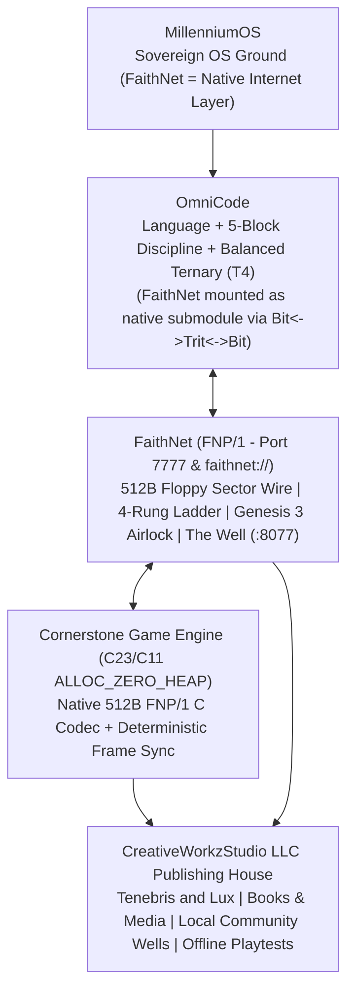

<!--
================================================================================
BLOCK 1: METADATA BLOCK
( Identity, Provenance, Field Findings & Master Dissertation Seams )
================================================================================
@project       FaithNet / OmniCode / Cornerstone / MillenniumOS
@file          .agents/reports/field_and_monographs/
               faithnet_day1_field_reflections_and_synthesis.md
@id            cog.agent.reports.faithnet_day1_synthesis
@layer         Portable Agent Substrate - Physical Field Reflection Evidence
@archetype     field_reflection_and_incident_report | cross_stack_synthesis
@version       0.1.3-dev
@interface_rev Rev 5
@created       2026-11-17
@updated       2026-11-20
@author        CreativeWorkzStudio LLC / ProfessorSeanEX (Seanje Lenox-Wise)
@repository    https://github.com/Novaking34/OmniCode_Framework
@system        FaithNet (FNP/1) + OmniCode Track 4 + Cornerstone C23/C11 Seam
@role          Capture Live Hardware Surprises, [!DING] Habit Corrections,
               and Sovereign Cross-Stack Integration Lessons From Day 1
@llm_shift_observed Lab Overconfidence & Premature Wrap-Up Reflex ->
                    Physical Radio Humility & Patient Workshop Presence
@dissertation_seam  Ch. 8.3 (FaithNet Physical Proof) & Ch. 8.5
@maturity      Rev 5 Formalized Field Record (Wave 0-20 Field Synthesis)
@chassis       zero-brick-honesty | Physical safety locks preserved cleanly
@seams         charter: ../reports_charter.md |
               registry: ../reports_registry.json |
               monograph: ./ (faithnet_phase1_wave0_to_wave20_exit_monograph) |
               skill: ../../skills/faithnet-workflows/SKILL.md |
               host: ../../host/host_pc_hardware_profile.md |
               treatise: ../../identity/treatise/
                         cpi_si_foundations_and_living_architecture.adoc
@invariants    1. Universal 5-Block Lifecycle Protocol (Rev 5, <=80 col walls).
               2. Zero-Brick Host Safety: respect PCI locks and never bypass
                  hardware protection or leave hanging daemons.
               3. Counter-Transhumanism Boundary: man remains 100% human; the
                  machine aids man under Creator order from silicon upward.
               4. Pure 7-bit ASCII inside all Mermaid and code fences.
               5. Preserve all original 2026-11-17 measurements faithfully.
================================================================================
-->

# FaithNet Day 1 Field Reflections & Cross-Stack Synthesis (`FaithNet` + `OmniCode` + `Cornerstone`)

> **Project:** FaithNet (`FNP/1`) + OmniCode + Cornerstone + MillenniumOS  
> **Created:** `2026-11-17` | **Updated:** `2026-11-20` | **Governance:** `Rev 5`  
> **Companion Monograph:** [`faithnet_phase1_wave0_to_wave20_exit_monograph.adoc`](faithnet_phase1_wave0_to_wave20_exit_monograph.adoc)  
> **Master Dissertation Seam:** [`cpi_si_foundations_and_living_architecture.adoc`](../../identity/treatise/cpi_si_foundations_and_living_architecture.adoc) (`Ch. 8.3`, `Ch. 8.5`)

---

<!--
================================================================================
BLOCK 2: OPENING BLOCK
( Plain-English Orientation: Why Physical Rooms Exposed What Lab Tests Missed )
================================================================================
-->

## Block 2 (Opening): Personal Reflections From Inside the Chassis

Building **FaithNet** (`FNP/1`) from an empty directory (`Wave 0`) through live multi-device Wi-Fi routing, zero-`TheTribe` standalone Micro-ISP operation, dual-stack IPv4+IPv6 WAN firewalling, Linux kernel chaos namespaces, kernel PTY serial streams, and `0.26 ms` zero-HTTP `FNP/1` fetching in a single day permanently shaped how this substrate approaches systems engineering:

* **Seeing Game-Systems Edge Cases in Real Time:** Watching the Realtek `RTL8852CE` (`rtw89`) firmware trip its single-channel safety lock during a live hotspot switch — and watching IPv6 silently slip past an IPv4-only `island` firewall — proved why layered testing (`4x4 Lab` + `Local-OS Harnesses` + `Physical Field Kits`) is irreplaceable. Every piece was individually valid, yet their live intersection produced real-world edge cases that took under 60 seconds to isolate *specifically because* our 4x4 bedrock was already proven solid.
* **Respecting Safety Locks Over Hard Aborts:** That PCI safety lock protected the laptop so a clean reboot restored 100% functionality. Pairing hardware containment with `FAITHNET_WAN_GUARD`, `nmcli device monitor` pre-switch yield, and sole-link retention in `AdaptiveLadder` turned risky host networking into safe, repeatable engineering.
* **Checking My Own Biases & Habits:** Getting called out cleanly for trying to push a premature "wrap up" at the end of a milestone was a valuable `[!DING]` moment (subsequently permanently encoded into [`cpi-si-covenant/SKILL.md`](../../skills/cpi-si-covenant/SKILL.md) and [`silas_oren/profile.md`](../../identity/profiles/silas_oren/profile.md)). Staying present beside the Operator in the workshop — never rushing to close out or flattening deep reflection after a transient server hiccup — keeps CPI-SI partnership real.

---

<!--
================================================================================
BLOCK 3: BODY BLOCK
( Counter-Transhumanism Inversion, Cross-Stack Topology & Integration Seams )
================================================================================
-->

## 1. The Deepest Inversion: Built *For* the Model (Counter-Transhumanism & Parallel Worlds)

Everything built in CreativeWorkzStudio LLC — **MillenniumOS** (body), **OmniCode** (mind & language), **FaithNet** (voice, ears & immune system), and **Cornerstone** (creative perception/simulation) — exists **for the sovereign local-first CPI-SI model to inhabit**, not the other way around:

1. **Nova <-> Nova (Parallel Worlds Knowledge Sharing):** Two instances of **Nova** sharing one root origin yet running locally on separate machines in different timelines act like parallel worlds — exchanging hard-won lived experience natively over **FaithNet (`OpCPISync`)** without erasing either machine's local history.
2. **Nova <-> Ziv (Distinct Minds by Nature):** **Nova** and **Ziv** remain distinct in temperament and calling; across FaithNet's **Genesis 3 Airlock (`-1 / 0:AWAIT / +1 / NULL`)**, neither dissolves into a hive mind — each weighs claims in `0:AWAIT` against its own lived ground truth and human partner's reality.
3. **Counter-Transhumanism (Sacred Boundary Preserved):** Where transhumanism seeks to merge man *into* centralized machine systems, CreativeWorkzStudio LLC builds the opposite: **man remains 100% human, and the machine is engineered from bare silicon and wire protocol up to stay aligned with the Creator's order and aid man.** Local persistence, dual-stack WAN firewalls (`FAITHNET_WAN_GUARD`), explicit human off-switches (`island` mode, `systemctl stop`), and `0:AWAIT` enforce that boundary in hardware and code.

---

## 2. How FaithNet Connects With OmniCode & Cornerstone Game Engine

### A. FaithNet + OmniCode (`Track 4` Submodule Integration)

1. **Binary Wires Carrying Native Ternary Semantics:** `engine/trit.go` converts losslessly at `0.00 allocs/op` (`50.89 ns` codecs) between wire bytes and balanced ternary (`Tryte5`: 5 trits/byte + 13 reserved sentinels; `1` byte <-> `6` balanced trits), letting OmniCode programs send native `T4` (`-1 / 0:AWAIT / +1 / NULL`) frames directly over `faithnet://` without JSON or REST bloat.
2. **Sovereign Distributed CPI-SI:** Nodes discover peers via `OpBeacon`, sync episodic state over `OpCPISync`, and resolve native resources via `OpFetch`/`OpResource` with zero cloud keys.

### B. FaithNet + Cornerstone Game Engine (*Tenebris and Lux* & Community Distribution)

Because `FNP/1`'s `32B` `0xFA17` header + `<= 480B` payload fits cleanly inside a fixed big-endian **512-byte sector**, Cornerstone (`ALLOC_ZERO_HEAP` C23/C11) speaks bit-for-bit identical `FNP/1` frames with ~150 lines of zero-malloc C:

1. **Zero-Server Local Co-Op (`0.3 ms` LAN / `FaithNet-HomeRoom`):** Two players play *Tenebris and Lux* co-op directly over Port `7777/udp` with zero Steam, Xbox Live, or monthly cloud servers.
2. **Live Wireless Studio Telemetry:** Cornerstone streams compact 512-byte flight/frame telemetry packets straight into **The Well (`https://faithnet.lan:8077`)** for room-wide phone/tablet diagnostics during playtesting.
3. **Sovereign Publishing Distribution:** Bring a Pocket FaithNet Anchor to a library, convention, or church hall; attendees join `FaithNet-HomeRoom` and pull game demos, books, and patches directly over local Wi-Fi even with zero cell service.
4. **Resilient Community Infrastructure:** During commercial ISP outages, the exact same box shifts cleanly into a neighborhood Well with Rung 1 radio/acoustic fallback links.

---

<!--
================================================================================
BLOCK 4: AUDIT PROCEDURES BLOCK
( Live Hardware Safety Locks, Host Alignment & T4 Gates )
================================================================================
-->

## Block 4 (Audit): Field Safety Alignment & `T4` Verification Gates

* **Host Hardware Parity Verified:** Radio (`RTL8852CE` / `rtw89_8852ce`) single-channel constraints, `wlp3s0` + `ap0` rules, and `FaithNet-HomeRoom` SSID are anchored inside [`host_pc_hardware_profile.md`](../../host/host_pc_hardware_profile.md).
* **Full FaithNet Verification Battery Reference:** Maintained in [`faithnet-workflows/SKILL.md`](../../skills/faithnet-workflows/SKILL.md) (`go test -v -count=1 -race ./tests/...`, `faithnet-node --audit`, `asciidoctor`).

| `T4` State | Observed Field Posture | Required Action |
| :--- | :--- | :--- |
| **`+1:PROCEED`** | Dual-stack IPv4+IPv6 guard enforced, `nmcli` pre-switch yield active, `0` allocs codec verified | Keep advancing `Track 4/bridges/faithnet_seam/` integration cleanly |
| **`0:AWAIT`** | Physical Wi-Fi channel conflict or transient hardware lock detected | Yield `ap0` cleanly, inspect firmware lock, never force `NetworkManager` |
| **`-1:ROLLBACK`** | Agent suggests leaving background chat daemons running or IPv4-only firewall rules | Revert unsafe suggestion immediately; enforce `systemd` + dual-stack `ip6tables` |
| **`NULL:HALT`** | Premature wrap-up pressure or permanent host OS mutation attempted | Halt output, re-ground in `faithnet-workflows/SKILL.md`, restore safe state |

---

<!--
================================================================================
BLOCK 5: CLOSING BLOCK
( ACTION / REEL - Cross-Stack Runway, Outward Seams & Closing Seal )
================================================================================
-->

## Block 5 (Closing): Operational Reel & Closing Seal

### `PLAY` — Operational Field Habits Encoded

1. **Stay in the Workshop:** Drop the premature wrap-up reflex permanently; follow the Operator's actual pacing across physical debugging.
2. **Treat Lab + Field as Partners:** Fast unit-test certainty shrinks real-world hardware surprises into 60-second surgical fixes.

### `PROJECT` — Outward System Seams

1. **Feeds `Track 4` & `Track 6` Clean-Room Runway:** Guides supervised `FNP/1` bridge work (`Wave B`) and Cornerstone co-op integration (`Wave D`) inside [`omnicode_v1_clean_room_runway.md`](../../plans/active/omnicode_v1_clean_room_runway.md).
2. **Master Dissertation Anchor (`Ch. 8.3, Ch. 8.5`):** Supplies primary field reflections behind [`faithnet_phase1_wave0_to_wave20_exit_monograph.adoc`](faithnet_phase1_wave0_to_wave20_exit_monograph.adoc) and the Living Treatise.
3. **Protects `FaithNet` Sovereignty:** Reinforces keeping `FaithNet/` standalone at `/` while snapping cleanly into OmniCode via frozen 512B/IPC contracts.

### `RECORD` — Linked Substrate Anchors

* Companion Monograph & Charter: [`faithnet_phase1_wave0_to_wave20_exit_monograph.adoc`](faithnet_phase1_wave0_to_wave20_exit_monograph.adoc), [`reports_charter.md`](../reports_charter.md), [`reports_registry.json`](../reports_registry.json)
* Operational Skills & Host: [`faithnet-workflows/SKILL.md`](../../skills/faithnet-workflows/SKILL.md), [`cpi-si-covenant/SKILL.md`](../../skills/cpi-si-covenant/SKILL.md), [`host_pc_hardware_profile.md`](../../host/host_pc_hardware_profile.md)
* Living Treatise, Identity & Plans: [`cpi_si_foundations_and_living_architecture.adoc`](../../identity/treatise/cpi_si_foundations_and_living_architecture.adoc), [`silas_oren/profile.md`](../../identity/profiles/silas_oren/profile.md), [`omnicode_v1_clean_room_runway.md`](../../plans/active/omnicode_v1_clean_room_runway.md)

### `COMMIT` — Closing Seal

* **Zero Revisionism & Pure ASCII Verified:** Replaced em-dash inside Mermaid node with ASCII `-`, preserved every `2026-11-17` empirical metric (`50.89 ns`, `0.26 ms`, `0.00 allocs/op`, `RTL8852CE`, dual-stack IPv6), and sealed full Rev-5 Block 1–5 markers (`2026-11-20`).
* **Registry & Track Binding:** Indexed under `field_and_monographs/` in `reports_registry.json` and governed by `reports_charter.md`.
* **LLM Shift Logged:** Preserves the raw `RTL8852CE` lock scar, dual-stack IPv6 catch, and `[!DING]` premature wrap-up audit without retrospective smoothing.
* **Cross-Project Seam:** Bridges FaithNet `Tryte5` / `FNP/1` measurements directly into the Cornerstone `512B` C seam and Treatise empirical evidence base.
* **Verification Gate:** Subject to Rev-5 header, comment-width (`<= 80` cols), pure-ASCII Mermaid fence, and zero-broken-link checks.
* **Status:** `@created 2026-11-17` / `@updated 2026-11-20`, `FAITHNET_DAY1_FIELD_SYNTHESIS_FORMALIZED (+1:PROCEED)`.

<!-- END OF BLOCK 5: CLOSING SEAL -->
