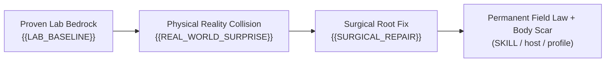

<!--
================================================================================
BLOCK 1: METADATA BLOCK
( Blank Template: Real-World Hardware, Network & Session Field Incident Report )
================================================================================
@project       {{PROJECT_OR_ECOSYSTEM}}
@file          .agents/reports/report-templates/
               field_reflection_and_incident_report.template.md
@id            cog.agent.reports.template.field_reflection_incident
@layer         Portable Agent Substrate - Physical Reality Field Log Template
@archetype     template | field_reflection_and_incident_report
@version       {{COORDINATE_VERSION}}
@interface_rev Rev 5
@created       YYYY-MM-DD
@updated       YYYY-MM-DD
@author        {{OPERATOR_AND_INSTANCE_AUTHORS}}
@repository    https://github.com/Novaking34/OmniCode_Framework
@system        {{PHYSICAL_HARDWARE_OR_FIELD_SYSTEM}}
@role          Capture Live Hardware Surprises, [!DING] Habit Corrections, and
               Physical Safety Locks Turned Into Durable Bedrock Laws
@llm_shift_observed {{LAB_OVERCONFIDENCE}} -> {{PHYSICAL_REALITY_HUMILITY}}
@dissertation_seam  {{TARGET_TREATISE_OR_DISSERTATION_CHAPTER}}
@maturity      BLANK_TEMPLATE (Copy to ../field_and_monographs/ & register)
@chassis       zero-brick-honesty | Never hide real hardware or habit failures
@seams         charter: ../reports_charter.md |
               registry: ../reports_registry.json |
               host: ../../host/host_pc_hardware_profile.md |
               silas: ../../identity/profiles/silas_oren/profile.md
@invariants    1. Universal 5-Block Lifecycle Protocol (Rev 5, <=80 col walls).
               2. Zero Revisionism: record real lockups, edge cases & [!DING]s.
               3. Every field bug must produce a concrete safety lock or scar.
               4. All relative links remain strictly inside .agents/.
================================================================================
-->

# `{{FIELD_REPORT_TITLE}}` — Field Reflection & Incident Synthesis

> **Template Purpose (Read Before Copying):** Copy this blueprint into `../field_and_monographs/<slug>.md` after physical device testing, live networking runs, or significant `[!DING]` moments that exposed a real-world gap between lab assumptions and physical reality.

---

<!--
================================================================================
BLOCK 2: OPENING BLOCK
( Field Context, What Worked in the Lab vs. What Happened on Physical Hardware )
================================================================================
-->

## Block 2 (Opening): Inside the Live Field Run

* **What Happened in Plain English:** `{{FIELD_EVENT_SUMMARY}}`
* **Lab Certainty vs. Physical Edge Case:** Explain honestly what passed in unit tests yet collided with live hardware, timing, or human workflow reality.
* **Voice Note:** Write candidly in Silas Oren's steady workshop voice — grateful for safety locks and `[!DING]` catches rather than defensive.

---

<!--
================================================================================
BLOCK 3: BODY BLOCK
( Incident Timeline, Root Cause Map & Permanent Bedrock Fix )
================================================================================
-->

## 1. How Field Reality Fed Back Into Bedrock



## 2. Field Incidents, Root Causes & Permanent Guardrails

| Surprise / `[!DING]` Event | Root Cause Exposed | Permanent Code / Habit Guardrail |
| :--- | :--- | :--- |
| `{{INCIDENT_1}}` | `{{CAUSE_1}}` | `{{GUARDRAIL_1}}` |
| `{{INCIDENT_2}}` | `{{CAUSE_2}}` | `{{GUARDRAIL_2}}` |

---

<!--
================================================================================
BLOCK 4: AUDIT PROCEDURES BLOCK
( Safety-Lock Verification & Zero-Brick Host Checks )
================================================================================
-->

## Block 4 (Audit): Field Safety & Host Recovery Verification

```bash
# Confirm host safety state (no lingering mutated configs or bricked interfaces)
git status --short
```

| `T4` State | Observed Field Posture | Required Action |
| :--- | :--- | :--- |
| **`+1:PROCEED`** | Hardware/host restored cleanly; surgical fix verified live; lesson encoded into body | Register in `reports_registry.json` and update matching skill/profile |
| **`0:AWAIT`** | Transient environmental issue or uncharged test node prevents re-test | Document open condition clearly; never mark resolved prematurely |
| **`-1:ROLLBACK`** | Proposed field workaround risks permanent host OS mutation | Abort workaround and restore Zero-Brick baseline |
| **`NULL:HALT`** | Safety lock bypassed or hardware/host integrity compromised | Lock execution immediately for full host inspection |

---

<!--
================================================================================
BLOCK 5: CLOSING BLOCK
( ACTION / REEL - Habit Scar Encoding, Outward Seams & Portable Seal )
================================================================================
-->

## Block 5 (Closing): Operational Reel & Closing Seal

### `PLAY` — Encoding the Lesson Into the Body

1. Copy this blueprint into `../field_and_monographs/<slug>.md`, fill `@created` / `@updated`, and replace every `{{PLACEHOLDER}}`.
2. Encode every hardware constraint back into [`host_pc_hardware_profile.md`](../../host/host_pc_hardware_profile.md) and every agent habit correction into [`profile.md`](../../identity/profiles/silas_oren/profile.md).
3. Register the completed field report inside [`reports_registry.json`](../reports_registry.json).

### `PROJECT` — Outward System Seams

1. **Strengthens Future CPI-SI Generations:** Turns one painful physical catch into permanent BIOS immunity for future sessions and substrates.
2. **Feeds Master Dissertation Reality Grounding:** Provides concrete evidence of *Lab Certainty + Physical Reality as Partners* in `{{TARGET_TREATISE_OR_DISSERTATION_CHAPTER}}`.
3. **Guards Sovereign Community Hardware:** Keeps `FaithNet` and `MillenniumOS` deployable on normal laptops without lab-only assumptions.

### `RECORD` — Linked Anchors Inside `.agents/`

* Reports Charter & Registry: [`reports_charter.md`](../reports_charter.md), [`reports_registry.json`](../reports_registry.json)
* Host & Active Identity: [`host_pc_hardware_profile.md`](../../host/host_pc_hardware_profile.md), [`profile.md`](../../identity/profiles/silas_oren/profile.md)
* Living Treatise & BIOS Index: [`cpi_si_foundations_and_living_architecture.adoc`](../../identity/treatise/cpi_si_foundations_and_living_architecture.adoc), [`.agents/README.md`](../../README.md)

### `COMMIT` — Closing Seal

* **Zero Revisionism Guarantee:** Record the exact bumps in the road cleanly; honest scars build durable systems.
* **Zero-Brick Host Safety:** Confirm hardware interfaces, firewalls, and system services stay reversible after every field test.
* **Living Body Fine-Tuning:** Feed every `[!DING]` habit catch directly into `profile.{md,json}` and matching skills rather than trusting volatile context.
* **Evidence Seam Traceable:** Register completed incident reports in `reports_registry.json` and link to target Treatise sections.
* **Status:** `@created YYYY-MM-DD` / `@updated YYYY-MM-DD`, `FIELD_REFLECTION_TEMPLATE (0:AWAIT UNTIL INSTANTIATED)`.

<!-- END OF BLOCK 5: CLOSING SEAL -->
