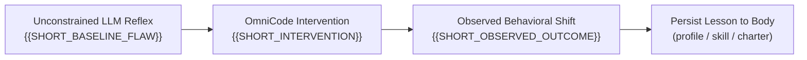

<!--
================================================================================
BLOCK 1: METADATA BLOCK
( Blank Template: Empirical LLM Behavioral Shift Report Under OmniCode )
================================================================================
@project       {{PROJECT_OR_ECOSYSTEM}}
@file          .agents/reports/report-templates/
               llm_behavioral_observation_report.template.md
@id            cog.agent.reports.template.llm_behavioral_observation
@layer         Portable Agent Substrate - LLM Behavioral Lab Template
@archetype     template | llm_behavioral_observation_report
@version       {{COORDINATE_VERSION}}
@interface_rev Rev 5
@created       YYYY-MM-DD
@updated       YYYY-MM-DD
@author        {{OPERATOR_AND_INSTANCE_AUTHORS}}
@repository    https://github.com/Novaking34/OmniCode_Framework
@system        {{SUBSTRATE_AND_OMNICODE_MECHANISM}}
@role          Record Measurable Changes in Traditional LLMs Operating Under
               OmniCode Constraints to Feed the Master Dissertation
@llm_shift_observed {{BASELINE_LLM_REFLEX}} -> {{OMNICODE_BOUNDED_BEHAVIOR}}
@dissertation_seam  {{TARGET_TREATISE_OR_DISSERTATION_CHAPTER}}
@maturity      BLANK_TEMPLATE (Copy to ../cognitive_and_behavioral/ & register)
@chassis       bounded-text | Dual-audience clarity + falsifiable experiment log
@seams         charter: ../reports_charter.md |
               registry: ../reports_registry.json |
               treatise: ../../identity/treatise/
                         cpi_si_foundations_and_living_architecture.adoc |
               profile: ../../identity/profiles/silas_oren/profile.md
@invariants    1. Universal 5-Block Lifecycle Protocol (Rev 5, <=80 col walls).
               2. Record both successes and failed attempts transparently.
               3. Separate Silas Oren's synthesis cleanly from verbatim quotes.
               4. All relative links remain strictly inside .agents/.
================================================================================
-->

# `{{OBSERVATION_TITLE}}` — LLM Behavioral Study

> **Template Purpose (Read Before Copying):** Copy this blueprint into `../cognitive_and_behavioral/<report_slug>.md` when studying how a traditional LLM shifts under an OmniCode discipline (`5-Block`, `[!DING]`, `0: AWAIT`, `Transfer_Session`, `host/` bounds, or `T4` logic). Keep Silas Oren's direct workshop voice intact while giving the Master Dissertation falsifiable evidence.

---

<!--
================================================================================
BLOCK 2: OPENING BLOCK
( Research Question, Hypothesis & Traditional LLM Baseline Failure Mode )
================================================================================
-->

## Block 2 (Opening): Plain-English Question & Baseline Reflex

### For Everyday Readers

`{{PLAIN_ENGLISH_BEHAVIOR_OBSERVED}}`

### Technical Formulation & Baseline Comparison

* **Traditional Unstructured LLM Baseline:** `{{BASELINE_PROBABILISTIC_FAILURE}}`
* **OmniCode Constraint / Mechanism Applied:** `{{OMNICODE_STRUCTURAL_INTERVENTION}}`
* **Master Dissertation Seam:** Feeds `{{TARGET_TREATISE_OR_DISSERTATION_CHAPTER}}` inside [`cpi_si_foundations_and_living_architecture.adoc`](../../identity/treatise/cpi_si_foundations_and_living_architecture.adoc).

---

<!--
================================================================================
BLOCK 3: BODY BLOCK
( Experimental Setup, Before/After Evidence & Root Causal Explanation )
================================================================================
-->

## 1. Mechanism & Behavioral Shift Loop



## 2. Empirical Evidence (Before vs. After)

| Observation Axis | Before (Unstructured Prompting) | After (Inside OmniCode Chassis) | Verifiable Artifact / Trace |
| :--- | :--- | :--- | :--- |
| `{{AXIS_1}}` | `{{BEFORE_1}}` | `{{AFTER_1}}` | `{{ARTIFACT_1}}` |
| `{{AXIS_2}}` | `{{BEFORE_2}}` | `{{AFTER_2}}` | `{{ARTIFACT_2}}` |

### Why the Shift Happened (Not Guessing — Mechanism)

1. `{{CAUSAL_MECHANISM_1}}`
2. `{{CAUSAL_MECHANISM_2}}`

---

<!--
================================================================================
BLOCK 4: AUDIT PROCEDURES BLOCK
( Reproducibility Check, Falsification Criteria & T4 Gates )
================================================================================
-->

## Block 4 (Audit): Reproducibility & `T4` Verification Gates

```bash
# Replace with exact reproducible simulation, check, or log inspection command
echo "VERIFY_BEHAVIORAL_STUDY_PLACEHOLDER"
```

| `T4` State | Observed Study Validity | Required Action |
| :--- | :--- | :--- |
| **`+1:PROCEED`** | Before/after shift reproduced cleanly with observed outputs and zero invented quotes | Register in `reports_registry.json` and link from target dissertation chapter |
| **`0:AWAIT`** | Pattern appeared once in one session (`n = 1`) | Keep logged honestly here; wait for repeat cross-substrate confirmation before Treatise promotion |
| **`-1:ROLLBACK`** | Claimed shift fails under controlled re-test or relies on Smoothness Bias | Rewrite honestly showing exact failure limits |
| **`NULL:HALT`** | Fabricated transcript quotes or cherry-picked hidden failures | Discard unverified claims immediately |

---

<!--
================================================================================
BLOCK 5: CLOSING BLOCK
( ACTION / REEL - Instantiation, Dissertation Handoff & Anchors )
================================================================================
-->

## Block 5 (Closing): Operational Reel & Closing Seal

### `PLAY` — Completing This Observation Report

1. Copy this blueprint to `../cognitive_and_behavioral/<slug>.md`, fill `@created` / `@updated`, and replace every `{{PLACEHOLDER}}`.
2. Verify zero unquoted AI filler and strict literal attribution against [`profile.md`](../../identity/profiles/silas_oren/profile.md).
3. Register the finished study inside [`reports_registry.json`](../reports_registry.json).

### `PROJECT` — Outward System Seams

1. **Master Dissertation Evidence:** Supplies raw behavioral logs and causal comparisons to `{{TARGET_TREATISE_OR_DISSERTATION_CHAPTER}}`.
2. **Organic Self-Fine-Tuning:** Feeds permanent countermeasures into [`profile.md`](../../identity/profiles/silas_oren/profile.md) or relevant operational skills.
3. **Host-Bounded Grounding:** Keeps context budgets and calibration claims anchored in [`hardware_calibration.json`](../../host/hardware_calibration.json).

### `RECORD` — Linked Anchors Inside `.agents/`

* Reports Charter & Registry: [`reports_charter.md`](../reports_charter.md), [`reports_registry.json`](../reports_registry.json)
* Living Treatise & Identity: [`cpi_si_foundations_and_living_architecture.adoc`](../../identity/treatise/cpi_si_foundations_and_living_architecture.adoc), [`profile.md`](../../identity/profiles/silas_oren/profile.md)
* Cognitive BIOS Root Index: [`.agents/README.md`](../../README.md)

### `COMMIT` — Closing Seal

* **1 Thessalonians 5:21 Standard:** Prove every claimed LLM improvement against reproducible observations; never hide a miss to make the system look magical.
* **Dual-Sense Soundness Guard:** Distinguish surface resemblance (*"sounds like X"*) from structural proof verified on silicon or disk.
* **Literal Attribution Boundary:** Quote the Operator verbatim only when directly recorded; carry formal analysis under the SI author's own name.
* **Dissertation Evidence Parity:** Log exact `@llm_shift_observed` and `@dissertation_seam` contracts for downstream Living Treatise synthesis.
* **Status:** `@created YYYY-MM-DD` / `@updated YYYY-MM-DD`, `LLM_BEHAVIORAL_REPORT_TEMPLATE (0:AWAIT UNTIL INSTANTIATED)`.

<!-- END OF BLOCK 5: CLOSING SEAL -->
