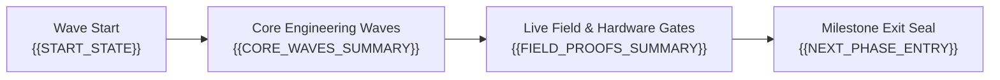

<!--
================================================================================
BLOCK 1: METADATA BLOCK
( Blank Template: Multi-Wave Exit Monograph & Session Handover Chronicle )
================================================================================
@project       {{PROJECT_OR_ECOSYSTEM}}
@file          .agents/reports/report-templates/
               milestone_exit_monograph.template.md
@id            cog.agent.reports.template.milestone_exit_monograph
@layer         Portable Agent Substrate - Milestone Exit Monograph Blueprint
@archetype     template | milestone_exit_monograph
@version       {{COORDINATE_VERSION}}
@interface_rev Rev 5
@created       YYYY-MM-DD
@updated       YYYY-MM-DD
@author        {{OPERATOR_AND_INSTANCE_AUTHORS}}
@repository    https://github.com/Novaking34/OmniCode_Framework
@system        {{MILESTONE_OR_PHASE_SPAN}}
@role          Chronicle a Complete Multi-Wave Milestone With Zero Context Loss,
               Exact Commit Ledger, Blind Spots & Next-Session Entry Contract
@llm_shift_observed {{CONTEXT_RESET_AMNESIA}} -> {{ZERO_LOSS_MONOGRAPH_HANDOFF}}
@dissertation_seam  {{TARGET_TREATISE_OR_DISSERTATION_CHAPTER}}
@maturity      BLANK_TEMPLATE (Copy to ../field_and_monographs/; .adoc ready)
@chassis       zero-loss-handover | Commits + field bugs + next-wave boot
@seams         charter: ../reports_charter.md |
               registry: ../reports_registry.json |
               bootstrap: ../../skills/cpi-si-session-bootstrap/SKILL.md |
               treatise: ../../identity/treatise/
                         cpi_si_foundations_and_living_architecture.adoc
@invariants    1. Universal 5-Block Lifecycle Protocol (Rev 5, <=80 col walls).
               2. Every commit hash, test figure & bug traces to git/disk.
               3. For Track 7 / formal publication, promote cleanly to .adoc and
                  verify with asciidoctor --failure-level=WARN.
               4. All relative links remain strictly inside .agents/.
================================================================================
-->

# `{{MONOGRAPH_TITLE}}` — Phase / Milestone Exit Monograph

> **Template Purpose (Read Before Copying):** Copy this blueprint into `../field_and_monographs/<monograph_slug>.md` (or promote directly to `.adoc` for formal `Track 7` book builds) when closing out a major multi-wave sprint or coordinate milestone (`+1: PROCEED`). Pairs directly with [`cpi-si-session-bootstrap/SKILL.md`](../../skills/cpi-si-session-bootstrap/SKILL.md) so the next session boots without context loss.

---

<!--
================================================================================
BLOCK 2: OPENING BLOCK
( Executive Arc: Where We Started, What Changed & Why Handing Over Cleanly )
================================================================================
-->

## Block 2 (Opening): Executive Summary & Coordinate Shift

* **Wave / Commit Span:** `{{WAVE_RANGE_AND_COMMIT_HASHES}}`
* **Starting State vs. Exit State:** `{{BEFORE_AFTER_ONE_PARAGRAPH}}`
* **Why This Handover Exists:** `{{REASON_FOR_MILESTONE_SEAL_AND_CONTEXT_RESET}}`

---

<!--
================================================================================
BLOCK 3: BODY BLOCK
( Wave Chronology, Cross-Layer Discoveries, Honest Blind Spots & Next Boot )
================================================================================
-->

## 1. Wave Progression & Architectural Convergence



## 2. Commit Ledger, Empirical Gates & Blind Spots Caught

| Item | Verified Evidence / Hash / Metric | Lesson Preserved |
| :--- | :--- | :--- |
| **Commits & Tests** | `{{COMMIT_RANGE_AND_TEST_TOTALS}}` | `{{VERIFICATION_TAKEAWAY}}` |
| **Hard Bugs / Blind Spots** | `{{REAL_BUGS_AND_AI_HABITS_CAUGHT}}` | `{{PERMANENT_LAW_LEARNED}}` |
| **Mathematical / Cross-Stack Seams** | `{{CROSS_REPO_CONVERGENCE_FOUND}}` | `{{ARCHITECTURAL_SIGNIFICANCE}}` |

---

<!--
================================================================================
BLOCK 4: AUDIT PROCEDURES BLOCK
( 5-Second Next-Session Verification & AsciiDoc Publication Check )
================================================================================
-->

## Block 4 (Audit): Verification Commands & Publication Gate

```bash
# Run on fresh-session entry (plus asciidoctor if promoted to .adoc)
git status --short && echo "VERIFY_EXIT_MONOGRAPH_BASELINE_PLACEHOLDER"
```

| `T4` State | Observed Exit Condition | Required Action |
| :--- | :--- | :--- |
| **`+1:PROCEED`** | Every commit, benchmark, and blind spot verified; next-session checklist ready | Seal milestone and register in `reports_registry.json` |
| **`0:AWAIT`** | Pending cross-repo test or uncharged test hardware remains open | List open gates explicitly under Next-Session Entry without faking closure |
| **`-1:ROLLBACK`** | Broken `.adoc` syntax or missing provenance on cited numbers | Fix warnings (`asciidoctor --failure-level=WARN`) and verify logs |
| **`NULL:HALT`** | Revisionist editing removes real bugs or invents test passes | Restore full empirical record immediately |

---

<!--
================================================================================
BLOCK 5: CLOSING BLOCK
( ACTION / REEL - Next-Session Boot Checklist, Dissertation Seam & Seal )
================================================================================
-->

## Block 5 (Closing): Operational Reel & Closing Seal

### `PLAY` — Next-Session Zero-Loss Boot Checklist

1. Read this monograph alongside [`cpi-si-session-bootstrap/SKILL.md`](../../skills/cpi-si-session-bootstrap/SKILL.md) and active skills.
2. Run the Block 4 verification commands before writing the first line of Phase II code.
3. Pick the next wave cleanly from the recorded entry points without re-discovering settled facts.

### `PROJECT` — Outward System Seams

1. **Promotes Directly Into Master Dissertation:** Earned multi-wave breakthroughs graduate from `field_and_monographs/` into new chronological chapters (`Ch. 9+`) of [`cpi_si_foundations_and_living_architecture.adoc`](../../identity/treatise/cpi_si_foundations_and_living_architecture.adoc).
2. **AsciiDoc Track 7 Publishing:** When ready for PDF/book compilation, promote to `.adoc` and verify zero warnings under `asciidoctor --failure-level=WARN`.
3. **Multi-Repo Continuity:** Links seamlessly with `plans/completed/` and `plans/active/` runways.

### `RECORD` — Linked Anchors Inside `.agents/`

* Reports Charter & Registry: [`reports_charter.md`](../reports_charter.md), [`reports_registry.json`](../reports_registry.json)
* Session Bootstrap & Living Treatise: [`cpi-si-session-bootstrap/SKILL.md`](../../skills/cpi-si-session-bootstrap/SKILL.md), [`cpi_si_foundations_and_living_architecture.adoc`](../../identity/treatise/cpi_si_foundations_and_living_architecture.adoc)
* Cognitive BIOS Root Index: [`.agents/README.md`](../../README.md)

### `COMMIT` — Closing Seal

* **Zero-Loss Handover Covenant:** Every wave milestone leaves behind exact commits, honest scars, and verified re-entry commands.
* **Charter Compliance:** Instantiated monographs (Markdown or AsciiDoc) register in `reports_registry.json` under `field_and_monographs/`.
* **Treatise Bridge:** Cross-check milestone claims against live code and test gates before promoting empirical syntheses upward.
* **Comment & Fence Hygiene:** Keep HTML/AsciiDoc banner lines `<= 80` cols and code/diagram fences pure 7-bit ASCII.
* **Rev-5 Parity:** Maintain `>= 20` non-empty Block 5 lines in Markdown instantiations or full 5-Block `////` framing in `.adoc` instantiations.
* **Status:** `@created YYYY-MM-DD` / `@updated YYYY-MM-DD`, `MILESTONE_EXIT_MONOGRAPH_TEMPLATE (0:AWAIT UNTIL INSTANTIATED)`.

<!-- END OF BLOCK 5: CLOSING SEAL -->
