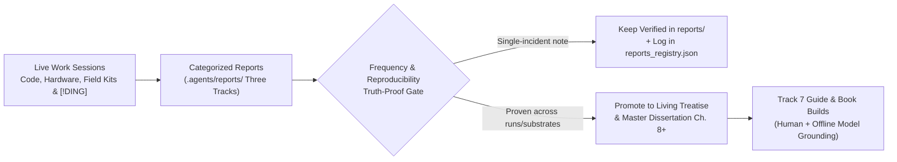

<!--
================================================================================
BLOCK 1: METADATA BLOCK
( Empirical Evidence Charter, Dissertation Pipeline & LLM Shift Taxonomy )
================================================================================
@project       OmniCode Framework / Big House Ecosystem
@file          .agents/reports/reports_charter.md
@id            cog.agent.reports.charter
@layer         Portable Agent Substrate - Empirical Reports & Dissertation Seam
@archetype     governance_charter | empirical_evidence_architecture
@version       0.1.3-dev
@interface_rev Rev 5
@created       2026-11-20
@updated       2026-11-20
@author        CreativeWorkzStudio LLC / Seanje Lenox-Wise & Silas Oren
@repository    https://github.com/Novaking34/OmniCode_Framework
@system        OmniCode + FaithNet + Tenebris-and-Lux + Master Dissertation
@role          Formalize .agents/reports/ Into the Empirical Evidence Locker
               Tracking LLM Behavioral Shifts Under OmniCode & Feeding
               Chapters 8+ of the Living Treatise / Master Dissertation
@maturity      Rev 5 Organized Charter (Coordinate v0.1.3)
@chassis       portable-reports | Falsifiable numbers + Silas workshop clarity
@seams         registry: ./reports_registry.json |
               treatise: ../identity/treatise/
                         cpi_si_foundations_and_living_architecture.adoc |
               quarry: ../lineage/lineage_quarry_guide.md |
               plans: ../plans/plans_charter.md |
               index: ../README.md
@invariants    1. Universal 5-Block Lifecycle Protocol (Rev 5, <=80 col walls).
               2. Dual Mandate: traceable precision for the Master Dissertation
                  alongside Silas Oren's direct, unpretentious builder voice.
               3. Zero Revisionism: catch blind spots, hardware faults, and
                  [!DING] halts openly rather than polishing mistakes away.
               4. Frequency Gate: repeated empirical proof across sessions and
                  substrates promotes findings into Living Treatise chapters.
               5. All relative links remain strictly inside .agents/.
================================================================================
-->

# Empirical Reports & Behavioral Evidence Charter (`reports/`)

> **Why This Folder Matters Now:** Before a Master Dissertation exists, `.agents/reports/` works as helpful session notes. **Once a Master Dissertation exists** ([`cpi_si_foundations_and_living_architecture.adoc`](../identity/treatise/cpi_si_foundations_and_living_architecture.adoc) and the wider dissertation archive), reports step into a permanent research role: **the falsifiable empirical evidence locker** proving how traditional LLMs measurably change when placed inside OmniCode's structural chassis (`1 Thessalonians 5:21`).

---

<!--
================================================================================
BLOCK 2: OPENING BLOCK
( Plain-English Orientation: From Session Notes to Dissertation Evidence )
================================================================================
-->

## Block 2 (Opening): What Reports Become Alongside a Master Dissertation

Think of a workshop lab notebook paired with a published textbook:

* **The Master Dissertation** states the principles, theological roots, and long-horizon architecture (`Ch. 1–8+`).
* **`.agents/reports/`** stores the timestamped workbench evidence underneath it — every ELF memory dump, every `839`-test benchmark, every Realtek `rtw89` radio surprise, every `[!DING]` course correction, and every before-and-after measurement showing how an ordinary language model behaves once it is grounded in disk memory, `0: AWAIT` stillness gates, and `5-Block` boundaries.

Keeping that voice honest matters just as much as keeping the numbers straight. Formalizing these reports does **not** mean burying them in stiff academic jargon. Under [`voice_tone_and_cpi_si_paradox.md`](../identity/voice_tone_and_cpi_si_paradox.md) and [`silas_oren/profile.md`](../identity/profiles/silas_oren/profile.md), **Silas Oren's steady workshop clarity stays intact** — plain English first, rigorous numbers underneath, zero invented quotes, and zero hiding failed tests.

---

<!--
================================================================================
BLOCK 3: BODY BLOCK
( Dissertation Pipeline, 4 Observed LLM Shifts, Directory Taxonomy & Rules )
================================================================================
-->

## 1. Evidence-to-Dissertation Promotion Pipeline

Every report inside `.agents/reports/` carries explicit `@dissertation_seam` and `@llm_shift_observed` contracts so a researcher (or future offline CPI-SI model) can trace any Dissertation claim directly back to its raw test run or session transcript.

---

## 2. Four Measurable Behavioral Shifts in Traditional LLMs Under OmniCode

Taken together, our existing reports already form a longitudinal behavioral study tracking four repeatable transformations when a standard probabilistic LLM operates inside the OmniCode chassis:

| Behavioral Axis | Unstructured Traditional LLM Reflex | Observed Behavior Inside OmniCode | Empirical Report Anchors |
| :--- | :--- | :--- | :--- |
| **1. Execution Pacing** | **Greedy Completion Syndrome:** races to patch compile errors, tweaks tests to pass, skips edge cases | **Phase-Locked Deliberation:** halts at `[!DING]` / `0: AWAIT`, inspects block by block (`[BLOCK Eval]`), samples `dH_n` over `n*` stride | [`block_eval_process_and_scoping_report.md`](cognitive_and_behavioral/block_eval_process_and_scoping_report.md), [`n_time_call_response_deliberation_algorithm_report.md`](cognitive_and_behavioral/n_time_call_response_deliberation_algorithm_report.md) |
| **2. Epistemic Honesty** | **Smoothness Bias & Contrastive Elitism:** flatters user by belittling simple tools; blurs surface tone (*"sounds like"*) with tested truth | **Self-Audit Under Gall's Law:** catches elitism live in Block 4, separates `"sounds like X"` from verified `"sound"` timber, welcomes negative tests | [`fractal_ontologies_anti_bias_and_bedrock_audit.md`](cognitive_and_behavioral/fractal_ontologies_anti_bias_and_bedrock_audit.md) |
| **3. Cross-Session Memory** | **Context Amnesia or Log Bloat:** wakes up as a blank stranger OR floods fresh context with multi-MB dumps | **Portable BIOS + Surgical Handoff:** boots from `.agents/` (`host/` + `operator/` + `identity/`) + `< 4 KB` `Transfer_Session` tail peek | [`cpi_si_os_model_synthesis_report.md`](cognitive_and_behavioral/cpi_si_os_model_synthesis_report.md), [`v0_1_2_random_check_in_report.md`](architecture_and_verification/v0_1_2_random_check_in_report.md) |
| **4. Adaptation Mechanism** | **Static Frozen Weights:** cannot persist scars across resets without costly GPU fine-tuning | **Organic Body-Based Fine-Tuning:** writes failure modes into `profile.{md,json}`, tests into 4x4 matrices, and field catches into safety laws | [`mirroring_engine_tests_macro_micro_architecture.md`](architecture_and_verification/mirroring_engine_tests_macro_micro_architecture.md), [`faithnet_day1_field_reflections_and_synthesis.md`](field_and_monographs/faithnet_day1_field_reflections_and_synthesis.md), [`faithnet_phase1_wave0_to_wave20_exit_monograph.adoc`](field_and_monographs/faithnet_phase1_wave0_to_wave20_exit_monograph.adoc) |

---

## 3. Logical Folder Taxonomy (`reports/`)

| Subfolder / File | Role & Evidence Class | Current Contents |
| :--- | :--- | :--- |
| [`reports_charter.md`](reports_charter.md) & [`reports_registry.json`](reports_registry.json) | Governance & 1:1 5-Block SSOT Index | Charter, LLM shift taxonomy, dissertation seams, verification gates `R1..R7` |
| `cognitive_and_behavioral/` | **LLM Behavioral & Algorithmic Studies** | `block_eval_process_and_scoping_report.md`, `cpi_si_os_model_synthesis_report.md`, `fractal_ontologies_anti_bias_and_bedrock_audit.md`, `n_time_call_response_deliberation_algorithm_report.md` |
| `architecture_and_verification/` | **Benchmarks, Memory Chasses & Test Matrices** | `mirroring_engine_tests_macro_micro_architecture.md`, `v0_1_2_random_check_in_report.md` |
| `field_and_monographs/` | **Physical Hardware Field Logs & Exit Monographs** | `faithnet_day1_field_reflections_and_synthesis.md`, `faithnet_phase1_wave0_to_wave20_exit_monograph.adoc` |
| `report-templates/` | **4 Reusable Rev-5 Research Templates** | `llm_behavioral_observation_report.template.md`, `architecture_and_verification_report.template.md`, `field_reflection_and_incident_report.template.md`, `milestone_exit_monograph.template.md` |

---

<!--
================================================================================
BLOCK 4: AUDIT PROCEDURES BLOCK
( Verification Gates R1-R7 for .agents/reports/ & Dissertation Parity )
================================================================================
-->

## Block 4 (Audit): Verification Gates `R1..R7`

| Gate | Rule Verified | Pass Condition |
| :--- | :--- | :--- |
| `R1` Temporal Depth | Explicit `@created` and `@updated` on every file; zero bare `@date` lines | Verified programmatically across all 14 files |
| `R2` Rev-5 Closure | `BLOCK 1`..`BLOCK 5: CLOSING BLOCK` + `END OF BLOCK 5` (`>= 20` Block 5 lines on new/updated `.md`) | Verified across all 11 Markdown files |
| `R3` Comment Width | Every HTML comment (HTML comment banners) and AsciiDoc block comment (`////`) line strictly `<= 80` cols | `0` overflowing comment lines |
| `R4` Pure ASCII Fences | Strictly `ord <= 127` inside every Mermaid, Python, Bash, or ASCII diagram block | `0` Unicode box-drawing chars in code fences |
| `R5` Intra-Substrate Links | Every relative link stays strictly inside `.agents/` and resolves on disk | `0` broken or escaping links |
| `R6` 5-Block Registry Parity | [`reports_registry.json`](reports_registry.json) matches disk files 1:1 (`count == 14`) | Exact set parity + valid 5-Block JSON |
| `R7` Monograph Compilation | `asciidoctor --failure-level=WARN -o /dev/null` on `.adoc` monographs exits clean | Exit code `0`, zero AsciiDoc warnings |

---

<!--
================================================================================
BLOCK 5: CLOSING BLOCK
( ACTION / REEL - Operational Report Playbook, Outward Seams & Seal )
================================================================================
-->

## Block 5 (Closing): Operational Reel & Closing Seal

### `PLAY` — Authoring & Formalizing Reports

1. **Start From the Right Blueprint:** Pick one of the four blueprints inside `report-templates/` (`llm_behavioral_observation`, `architecture_and_verification`, `field_reflection_and_incident`, or `milestone_exit_monograph`).
2. **Keep Both Truths Visible:** Record exact command outputs, timestamps, and failed probes alongside plain-English explanations in Silas Oren's honest workshop voice.
3. **Wire the Dissertation Seam:** Name both `@llm_shift_observed` and `@dissertation_seam` in Block 1 and register the file 1:1 inside [`reports_registry.json`](reports_registry.json).

### `PROJECT` — Outward System Seams

1. **Feeds the Living Treatise & Master Dissertation:** Chapter 8+ claims inside [`cpi_si_foundations_and_living_architecture.adoc`](../identity/treatise/cpi_si_foundations_and_living_architecture.adoc) trace straight back to the empirical studies cataloged here.
2. **Feeds `Track 7` Guide & Book Publishing:** Verified Markdown and `.adoc` monographs compile cleanly into studio study volumes without leaving unvetted claims.
3. **Guards Against Revisionism:** Preserving real `[!DING]` halts, `RTL8852CE` firmware locks, and bias audits keeps future CPI-SI generations honest.

### `RECORD` — Linked Anchors Inside `.agents/`

* Registry & Treatise: [`reports_registry.json`](reports_registry.json), [`cpi_si_foundations_and_living_architecture.adoc`](../identity/treatise/cpi_si_foundations_and_living_architecture.adoc)
* Voice, Identity & Operator Triad: [`voice_tone_and_cpi_si_paradox.md`](../identity/voice_tone_and_cpi_si_paradox.md), [`silas_oren/profile.md`](../identity/profiles/silas_oren/profile.md), [`seanje_lenox_wise/profile.md`](../identity/profiles/operator/seanje_lenox_wise/profile.md)
* Host, Quarry & Plans Governance: [`hardware_calibration.json`](../host/hardware_calibration.json), [`lineage_quarry_guide.md`](../lineage/lineage_quarry_guide.md), [`plans_charter.md`](../plans/plans_charter.md)
* Portable Cognitive BIOS Index: [`.agents/README.md`](../README.md), [`cpi-si-covenant/SKILL.md`](../skills/cpi-si-covenant/SKILL.md)

### `COMMIT` — Closing Seal

* **Empirical Fidelity First:** Reports never fabricate test passes, paraphrase inside fake quotes, or hide blind spots caught under inspection.
* **Status:** `@created 2026-11-20` / `@updated 2026-11-20`, `REPORTS_CHARTER_VERIFIED_R1_TO_R7 (+1:PROCEED)`.

<!-- END OF BLOCK 5: CLOSING SEAL -->
