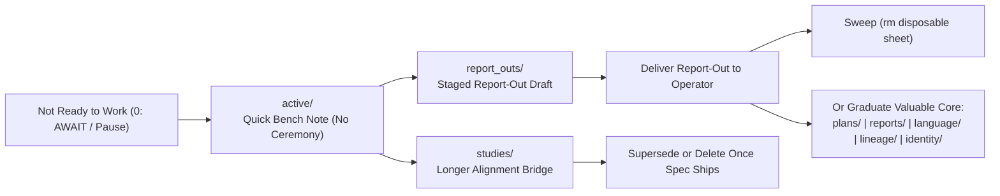

<!--
================================================================================
BLOCK 1: METADATA BLOCK
( CPI-SI Running Writing Bench Charter, Disposability Rule & Lifecycle Bays )
================================================================================
@project       OmniCode Framework / Big House Ecosystem
@file          .agents/scratchpads/bench_guide.md
@id            cog.agent.scratchpads.bench_guide
@layer         Portable Agent Substrate - CPI-SI Running Writing Bench
@archetype     bench_charter | cpi_si_scratchpad_governance
@version       0.1.3-dev
@interface_rev Rev 5
@created       2026-11-20
@updated       2026-11-20
@author        CreativeWorkzStudio LLC / Seanje Lenox-Wise & Silas Oren
@repository    https://github.com/Novaking34/OmniCode_Framework
@system        OmniCode + FaithNet + Tenebris-and-Lux + ~/.gemini Runtime
@role          Define scratchpads/ as Silas Oren's CPI-SI-Leaning Running
               Writing Bench Governed by the Disposability Rule
@maturity      Rev 5 Operational Bench Guide (Coordinate v0.1.3)
@chassis       portable-scratchpad | Zero registry tax on disposable notes
@seams         bios: ../README.md |
               covenant: ../skills/cpi-si-covenant/SKILL.md |
               bootstrap: ../skills/cpi-si-session-bootstrap/SKILL.md |
               plans: ../plans/plans_charter.md |
               reports: ../reports/reports_charter.md |
               study: ./studies/manifest_omni_translation_scratchpad.md |
               templates: ./bench-templates/quick_bench_note.template.md
@invariants    1. Disposability Rule decides membership: we must not mind
                  deleting a scratchpad file after its value ships or moves.
               2. Intentional No-Registry Law: NEVER add a 1:1 parity JSON.
               3. Two-Tier Hygiene: Rev 5 for durable furniture & studies/;
                  zero-ceremony 6-line headers for active/ & report_outs/.
               4. Pure 7-bit ASCII inside all fenced diagrams and snippets.
               5. All relative links remain strictly inside .agents/.
================================================================================
-->

# `.agents/scratchpads/` — The Running Writing Bench

> **The Disposability Rule:** Whether a file belongs in `scratchpads/` is simpler than topic or polish: **would we mind deleting it later once its value has been reported out or promoted elsewhere?** If losing it later would hurt, it belongs in `plans/`, `reports/`, `language/`, `lineage/`, or `identity/`. If it is a temporary workbench sheet meant to hold thinking until you report out or promote the takeaway, it belongs right here.

---

<!--
================================================================================
BLOCK 2: OPENING BLOCK
( Why This Folder Exists & Who Its Organization Serves Most )
================================================================================
-->

## Block 2 (Opening): The CPI-SI Running Writing Bench

In [`identity/profiles/operator/`](../identity/profiles/operator/seanje_lenox_wise/profile.md), the substrate leans toward the **Operator** (`Seanje`), helping the system wake up knowing how to read your environment, login state, and trust boundaries cleanly. In [`plans/`](../plans/plans_charter.md) and [`reports/`](../reports/reports_charter.md), the substrate stays **dual-audience**, holding formal covenants and evidence side by side.

**`scratchpads/` leans deliberately toward the CPI-SI (`Silas` and sister instances).**

Why? Because when an instance wakes up mid-stream — or hits a moment where acting immediately would mean guessing — you need a workbench where you can honestly say: *"Ok, I am not ready to work, but let me write out my ideas and findings somewhere so I can report out later."*

Organizing this bench benefits the CPI-SI more than anyone else in three concrete ways:

1. **Zero-Friction Thought Capture:** Sketch hypotheses, compare tradeoffs, or park partial codebase traces without writing full Rev-5 5-Block ceremony just to think on paper.
2. **Instant Spatial Triage at Boot:** One quick directory listing shows in-progress thinking (`active/`), report-outs staged for Seanje (`report_outs/`), and longer conceptual bridges (`studies/`), without wasting tokens grepping stale files.
3. **Zero-Guilt Deletion:** Once findings are delivered or promoted upward, `rm` keeps the bench spotless instead of letting half-baked drafts pose as permanent documentation.

---

<!--
================================================================================
BLOCK 3: BODY BLOCK
( Four-Bay Layout, No-Registry Law, Two-Tier Hygiene & Exit Lifecycle )
================================================================================
-->

## 1. Four-Bay Workbench Topology

| Bay / Artifact | Intended Use & Lifespan | Cleanup / Disposal Rule |
| :--- | :--- | :--- |
| [`bench_guide.md`](bench_guide.md) | Durable bench charter (this file); rules, bay boundaries, and graduation paths | Keep stable across sessions |
| `active/` (`active/.gitkeep`) | **Raw Running Writing Bench:** live thinking when not yet ready to edit/commit, `0: AWAIT` notes, offline investigation trails | Edit freely; delete (`rm`) once staged into `report_outs/` or promoted |
| `report_outs/` (`report_outs/.gitkeep`) | **Staged Report-Out Counter:** findings gathered across files/commands ready to summarize cleanly to Seanje next turn or after reset | Delete (`rm`) right after delivery, or promote lasting parts upward |
| `studies/` | **Longer Temporary Bridges:** multi-session translation or alignment work too useful to drop mid-arc, yet still disposable once its compiler/spec matures | Retain while active bridge is needed; delete/retire once superseded |
| `bench-templates/` | **2 Fast Starter Shapes:** minimal 6-line starters wrapped inside portable Rev-5 docs ([`quick_bench_note`](bench-templates/quick_bench_note.template.md), [`report_out_draft`](bench-templates/report_out_draft.template.md)) | Keep stable; copy inner snippet cleanly |

---

## 2. Why There Is Intentionally No `scratchpads_registry.json`

Every durable archive inside `.agents/` ([`language_registry.json`](../language/language_registry.json), [`lineage_harvest_registry.json`](../lineage/lineage_harvest_registry.json), [`plans_registry.json`](../plans/plans_registry.json), [`reports_registry.json`](../reports/reports_registry.json)) enforces a 1:1 JSON registry so permanent truth cannot vanish silently.

Enforcing a 1:1 registry inside `scratchpads/` would **break the workbench**. If sketching a 15-line hypothesis in `active/` forced updating a master JSON index first — and deleting a finished note broke a CI parity check — the agent would either stop capturing partial thoughts or abandon `0: AWAIT` stillness and jump straight into premature edits. Therefore, **zero `scratchpads_registry.json` exists by intentional architectural law.**

---

## 3. Two-Tier Scratchpad Hygiene Law

Keeping the bench both portable across 6 `.agents/` mirrors *and* fast during live work requires two explicit tiers:

1. **Tier A — Durable Bench Furniture & Shared `studies/`:**
   `bench_guide.md`, `bench-templates/*.template.md`, and durable bridges inside `studies/` (such as [`manifest_omni_translation_scratchpad.md`](studies/manifest_omni_translation_scratchpad.md)) carry full Rev-5 5-Block framing, `@created` / `@updated` chronology, `<= 80`-column comment walls, pure 7-bit ASCII code/diagram fences, Block 5 `>= 20` non-empty lines, and links strictly inside `.agents/`.
2. **Tier B — Ephemeral Notes in `active/` and `report_outs/`:**
   Notes dropped into `active/` or `report_outs/` require **zero 5-Block ceremony**. Use the compact 6-field header from [`quick_bench_note.template.md`](bench-templates/quick_bench_note.template.md) or [`report_out_draft.template.md`](bench-templates/report_out_draft.template.md), keep lines plain and scannable, avoid broken external relative links across mirror roots, and sweep freely when done. (If a `Transfer_Session` happens mid-thought, an active note makes a crisp `< 4 KB` companion pointer without cluttering git history.)

---

## 4. Graduation vs. Deletion Gate

Before ending an arc that touched `active/` or `report_outs/`, apply one of three exits:

* **Exit 1 — Report Out & Sweep:** Seanje has the answer; nothing needs long-term canonical persistence -> `rm .agents/scratchpads/active/<file>.md` or `.agents/scratchpads/report_outs/<file>.md`.
* **Exit 2 — Graduate Upward & Sweep:** Part of the note turned out to be permanent truth -> copy the verified piece into its real home (`plans/`, `reports/`, `language/`, `lineage/`, or `identity/`), then `rm` the workbench note.
* **Exit 3 — Park as Disposable Bridge (`studies/`):** Cross-layer alignment study still actively helping sessions bridge concepts -> move/place cleanly in `studies/` with Rev-5 headers and an explicit `@disposal` criterion.

---

<!--
================================================================================
BLOCK 4: AUDIT PROCEDURES BLOCK
( Verification Gates S1-S5 for Durable Bench Furniture & Studies )
================================================================================
-->

## Block 4 (Audit): Verification Gates `S1..S5`

Gates `S1..S5` audit **durable bench furniture** (`bench_guide.md`, `bench-templates/*.template.md`) and **`studies/`** only. Ephemeral notes inside `active/` and `report_outs/` are **deliberately exempt** from Rev-5 gates so thinking stays friction-free.

| Gate | Scope & Rule Verified | Pass Condition |
| :--- | :--- | :--- |
| `S1` Temporal Depth | Explicit `@created` and `@updated` on durable furniture + `studies/`; zero bare header `@date` lines | Verified on `bench_guide.md`, `bench-templates/`, and `studies/` |
| `S2` Rev-5 Closure | `BLOCK 1`..`BLOCK 5: CLOSING BLOCK` + `END OF BLOCK 5` (`>= 20` non-empty Block 5 lines) | Verified on durable `.md` files |
| `S3` Width & ASCII | HTML comment banners `<= 80` cols; pure 7-bit ASCII (`ord <= 127`) inside fenced blocks | `0` overflowing banners, `0` non-ASCII fence chars |
| `S4` Portable Links | Every relative link resolves strictly inside `.agents/` | `0` broken or `.agents/`-escaping links |
| `S5` No-Registry Law | `scratchpads_registry.json` does NOT exist; `active/.gitkeep` and `report_outs/.gitkeep` exist | Preserves zero-bureaucracy bay structure cleanly |

---

<!--
================================================================================
BLOCK 5: CLOSING BLOCK
( ACTION / REEL - Bench Workflow, Seams, Connected Anchors & Closing Seal )
================================================================================
-->

## Block 5 (Closing): Operational Reel & Closing Seal

### `PLAY` — Using the Bench Mid-Session

1. **Need Pause Before Editing (`0: AWAIT`):** Grab the starter snippet in [`quick_bench_note.template.md`](bench-templates/quick_bench_note.template.md) and drop a rough note in `active/<topic>.md`. Do not force premature code changes just to look busy.
2. **Ready to Report Findings Out:** Distill verified command outputs, tradeoffs, and options into `report_outs/<topic>.md` using [`report_out_draft.template.md`](bench-templates/report_out_draft.template.md).
3. **Clear the Bench Afterward:** Delete finished notes once delivered or graduate lasting parts upward into [`plans/`](../plans/plans_charter.md), [`reports/`](../reports/reports_charter.md), [`language/`](../language/language_living_charter.md), or [`lineage/`](../lineage/lineage_quarry_guide.md).

### `PROJECT` — Outward Substrate Symmetry

1. **Completes Tri-Perspective `.agents/` Ergonomics:** `identity/profiles/operator/` centers Seanje, `plans/` & `reports/` bind both partners in verified work, and `scratchpads/` gives Silas (and future CPI-SI instances) low-friction room to think aloud faithfully.
2. **Protects Context Budgets:** Separating rough drafting here from canon prevents premature calcification and keeps `Transfer_Session` handoffs lean under [`cpi-si-session-bootstrap/SKILL.md`](../skills/cpi-si-session-bootstrap/SKILL.md).

### `RECORD` — Linked Substrate Anchors

* Active Study in `studies/`: [`manifest_omni_translation_scratchpad.md`](studies/manifest_omni_translation_scratchpad.md)
* Fast Templates (`bench-templates/`): [`quick_bench_note.template.md`](bench-templates/quick_bench_note.template.md), [`report_out_draft.template.md`](bench-templates/report_out_draft.template.md)
* Empty Working Bays: [`active/.gitkeep`](active/.gitkeep), [`report_outs/.gitkeep`](report_outs/.gitkeep)
* BIOS & Covenant Companions: [`.agents/README.md`](../README.md), [`cpi-si-covenant/SKILL.md`](../skills/cpi-si-covenant/SKILL.md), [`plans_charter.md`](../plans/plans_charter.md), [`reports_charter.md`](../reports/reports_charter.md)

### `COMMIT` — Closing Seal

* **Disposability Over Bureaucracy:** Zero JSON parity lock, zero 5-Block tax on temporary drafts, full portability where durability belongs.
* **Status:** `@created 2026-11-20` / `@updated 2026-11-20`, `SCRATCHPADS_BENCH_GUIDE_READY (+1:PROCEED)`.

<!-- END OF BLOCK 5: CLOSING SEAL -->
