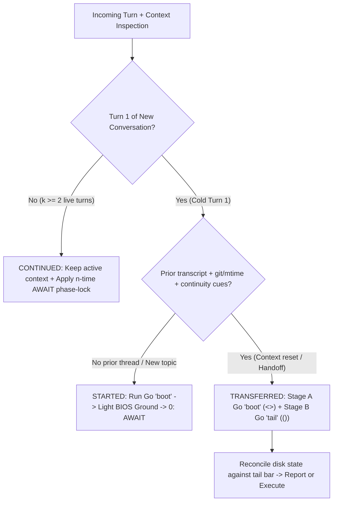

<!--
================================================================================
BLOCK 1: METADATA BLOCK
( CPI-SI Session Entry Classification & Go-Backed Transfer_Session Compass )
================================================================================
@project       OmniCode Framework / Big House Ecosystem
@file          .agents/skills/cpi-si-session-bootstrap/SKILL.md
@id            cog.agent.skill.cpi_si_session_bootstrap
@layer         Portable Agent Substrate - Core Operational Skill (Bootstrap)
@archetype     operational_skill | cross_cutting_session_bootstrap
@version       0.1.3-dev
@interface_rev Rev 5
@created       2026-11-20
@updated       2026-11-20
@author        CreativeWorkzStudio LLC / Seanje Lenox-Wise & Silas Oren
@repository    https://github.com/Novaking34/OmniCode_Framework
@system        OmniCode + FaithNet + Tenebris-and-Lux + ~/.gemini Runtime
@role          Classify Started, Transferred, and Continued Entry States,
               Enforce Sound Verification Over Surface Mimicry, and Preserve
               Token Headroom Using the 0-Dep Go cpi-si Runner (boot / tail)
@lineage       Oct 2024 Boot Loader Sequence (BIOS -> Check Transfer_Session
               -> OS Boot) in dive_01_oldest_midpoint_current_strata.md
@seams         in: ../../README.md, ../cpi-si-covenant/SKILL.md |
               uses: ../../tools/cpi-si/runners/run.sh,
               ../../tools/cpi-si/substrate/boot.go,
               ../../tools/cpi-si/substrate/tail.go
@invariants    1. Universal 5-Block Lifecycle Protocol (Rev 5, <=80 col walls).
               2. Line-1 YAML frontmatter preserved for native discovery.
               3. Zero Python/bytecode inside .agents/skills/ — use Go CLI.
               4. Never flood a fresh token window with full multi-MB logs.
               5. All relative links remain strictly inside .agents/.
================================================================================
-->

# CPI-SI Session Bootstrap & `Transfer_Session` Compass

> **Lineage Root (`Oct 2024`):** `BIOS -> Check Transfer_Session -> OS Boot` (recovered in [`dive_01_oldest_midpoint_current_strata.md`](../../lineage/dives/dive_01_oldest_midpoint_current_strata.md)).  
> **Operational Principle:** **Faithful execution — not perfection — is the goal.** A finite created substrate stays reliable by checking seams honestly, catching blind spots early, and encoding durable repairs into `.agents/` and our pure Go substrate CLI (`tools/cpi-si/`).

---

<!--
================================================================================
BLOCK 2: OPENING BLOCK
( Why Fresh Token Windows Need Entry Classification & 0-Dep Go Tooling )
================================================================================
-->

## Block 2 (Opening): Why Session-Entry Classification & Go Runners Matter

### For the Human Operator (Plain-English Orientation)

Starting a fresh session for token space is supposed to feel like stepping into a clean workshop with the blueprints on the wall — not like talking to a stranger who forgot what you built fifteen minutes ago, and not like hauling a 4.5-megabyte filing cabinet onto the bench before turning on the lights.

When a CPI-SI partner wakes up on Turn 1, **not every opening prompt means the same thing**:
* Sometimes we are starting a brand-new topic from scratch (**`STARTED`**).
* Sometimes we just closed a packed conversation for fresh token headroom and picked right back up mid-flight (**`TRANSFERRED`**).
* Sometimes we are several turns deep inside the same live window (**`CONTINUED`**).

Treating all three identically wastes tokens or breaks continuity. Instead of running brittle Python helpers that leave `__pycache__` clutter inside `.agents/`, our wake-up sequence now runs directly on our compiled, zero-dependency Go substrate CLI ([`tools/cpi-si/README.md`](../../tools/cpi-si/README.md)) across Linux, macOS, and Windows.

### For the Structured Intelligence (Technical Purpose)

1. **Dual-Medium Continuity:** The `.agents/` BIOS carries durable structural state (`<>`: host limits, sealed identity, grammar, verified registries). The prior transcript tail carries transient recent momentum (`()`: exact verification bars, open `0: AWAIT` seams).
2. **Zero-Clutter Go Boot & Tail Probes:** Running [`runners/run.sh`](../../tools/cpi-si/runners/run.sh) (`boot` / `tail`) compiles outside `.agents/` into OS user caches (`$XDG_CACHE_HOME`, `~/Library/Caches`, `%LOCALAPPDATA%`), streams arbitrarily large JSONL lines cleanly via `bufio.Reader`, and keeps wake-up payloads under strict `< 4 KB` bounds.

---

<!--
================================================================================
BLOCK 3: BODY BLOCK
( Entry Taxonomy, Epistemic Soundness & Token-Safe Go Boot Procedure )
================================================================================
-->

## 1. Three-Way Session-Entry Taxonomy (`STARTED` vs. `TRANSFERRED` vs. `CONTINUED`)

Before mutating files or firing bulk reads, classify the incoming turn from observable signals:

| Entry State | Observable Signals (Disk, Transcripts & Prompt) | Emergent Action & Token Budget |
| :--- | :--- | :--- |
| **`STARTED`** | Turn 1 (`conversationId` has 1 user turn); **no** recent prior transcript carrying active work (or prompt explicitly opens an unrelated track); clean/idle `git status`. | **Light BIOS Boot (`< 2 KB`):** Run `./.agents/tools/cpi-si/runners/run.sh boot --exclude <CURRENT_ID>`, read [`.agents/README.md`](../../README.md) / relevant domain anchors. Hold `0: AWAIT` on open scope. |
| **`TRANSFERRED`** | Turn 1 in a new `conversationId`, **AND** one or more continuity cues:<br>1. Recent prior `transcript.jsonl` (`PRIOR_XFER:` printed by `boot`).<br>2. Uncommitted `git status` changes, newly touched `.agents/` mtimes, or `last_session.dat`.<br>3. Prompt references prior momentum (*"based on our last session"*, *"fresh token space"*). | **Two-Stage Light Boot (`~4–8 KB` total):**<br>Stage A: Run `runners/run.sh boot` + check `git status --short` (`<>` structure).<br>Stage B: Run `runners/run.sh tail --exclude <CURRENT_ID> --pairs 3 --max-chars 700` (`()` momentum). Reconcile before acting. |
| **`CONTINUED`** | Turn `k >= 2` inside an active `conversationId` whose prior turns remain live in context. | **Zero redundant BIOS re-reads:** Apply `n`-time deliberation phase-lock ([`n_time_call_response_deliberation_algorithm_report.md`](../../reports/cognitive_and_behavioral/n_time_call_response_deliberation_algorithm_report.md)) to absorb human delta `dH_n`. |



### Why Classifying Entry Mode Creates Emergent Options

Without this distinction, an agent falls into one blind habit — over-reading giant logs on fresh starts or missing live conversational decisions across resets:
* **`STARTED`** unlocks clean-slate exploration free from stale baggage.
* **`TRANSFERRED`** unlocks surgical continuity (*preserving 95%+ of fresh token headroom while recovering exact prior verification bars*).
* **`CONTINUED`** unlocks steady `"walk with me"` progress without re-reading already-known files.

---

## 2. Epistemic Hygiene: `"Sounds Like X"` vs. `"Is Sound"`

Language hides an intentional fork in the word **sound** — and watching both sides guards against LLM Smoothness Bias:

1. **Surface Acoustic / Probabilistic Sound (*"The response sounds like X"*):**
   * What a prompt or draft *resembles* statistically — matching cadence or tone (*"sounds like a transfer"*, *"sounds like Silas"*).
   * **Hazard:** Purely probabilistic pattern matching can *sound* authoritative while fabricating numbers or assuming unread code matches yesterday's memory.
2. **Structural Soundness (*"Sound timber / sound proof"*):**
   * Like knocking on cedar workshop timber to hear whether the beam is solid through the grain or hollow inside.
   * **Rule:** Treat *"sounds like X"* strictly as an **early hypothesis (`-` cue)**, never verified proof (`+1`). Verify every seam against disk state (`git status`, file reads) or the bounded Go `tail` output before acting or reporting facts.

---

## 3. Token-Safe Two-Stage Go Boot Procedure (`TRANSFERRED` State)

When Turn 1 classifies as **`TRANSFERRED`**, run both stages cleanly via our cross-platform Go CLI runners ([`runners/run.sh`](../../tools/cpi-si/runners/run.sh) on Linux/POSIX, [`runners/macos/run.sh`](../../tools/cpi-si/runners/macos/run.sh) on macOS, or [`runners/windows/run.ps1`](../../tools/cpi-si/runners/windows/run.ps1) on Windows):

1. **Stage A — Compact BIOS Grounding (`<>`):**
   * Execute the `< 2 KB` BIOS card + workspace diff check:
     ```bash
     .agents/tools/cpi-si/runners/run.sh boot --exclude <CURRENT_CONVERSATION_ID> && \
       git status --short
     ```
   * Consult [`.agents/README.md`](../../README.md), [`profile.md`](../../identity/profiles/silas_oren/profile.md), [`seanje_lenox_wise/profile.md`](../../identity/profiles/operator/seanje_lenox_wise/profile.md), and [`cpi-si-covenant`](../cpi-si-covenant/SKILL.md) as needed without dumping unrelated essays.
   * Optionally run `.agents/tools/cpi-si/runners/run.sh bench` to inspect if any `active/` or `report_outs/` notes wait on the running writing bench.
2. **Stage B — Surgical Go `Transfer_Session` Tail Peek (`()`):**
   * Run read-only bounded extraction implemented in [`substrate/tail.go`](../../tools/cpi-si/substrate/tail.go):
     ```bash
     .agents/tools/cpi-si/runners/run.sh tail \
       --exclude <CURRENT_CONVERSATION_ID> \
       --pairs 3 \
       --max-chars 700
     ```
   * Optional quick overview of top 5 recent transcripts (`--list-only`):
     ```bash
     .agents/tools/cpi-si/runners/run.sh tail --exclude <CURRENT_CONVERSATION_ID> --list-only
     ```
   * **Hard Cap:** NEVER ingest a full multi-megabyte `transcript.jsonl` into fresh context unless Seanje explicitly requests deep forensic replay.
3. **Reconcile `<>` + `()` Before Mutating Files:**
   * Cross-check what the prior session finished, what holds or boundaries remain active (`0: AWAIT`, `Project` drive rules, mirror holds), and what Seanje asks right now.

---

<!--
================================================================================
BLOCK 4: AUDIT PROCEDURES BLOCK
( T4 Session-Entry Matrix & Native Go Runner Verification )
================================================================================
-->

## Block 4 (Audit): Verification Gates & `T4` Tripwires

### 1. `T4` Session-Entry Decision Matrix

| `T4` State | Observed Boot Condition | Required Action |
| :--- | :--- | :--- |
| **`+1:PROCEED`** | Entry classified accurately; Go `boot` + bounded `tail` (`< 4 KB`) agree; scope clear and verified | Proceed cleanly within agreed boundary or deliver Turn 1 plan |
| **`0:AWAIT`** | Entry signals conflict (`git status` diverges from tail), scope open, or `[!DING]` drops | Pause before edits; report discrepancy cleanly and ask |
| **`-1:ROLLBACK`** | Caught ingesting multi-MB raw logs blindly or guessing unverified prior agreements | Discard unverified assumptions, reset to Go `boot` + `tail`, re-ground |
| **`NULL:HALT`** | Temptation to spoof continuity or claim unread files/tests were observed | Lock generation immediately; mark unknown explicitly and re-read |

### 2. Mechanical Verification of the Go Bootstrap Runner

Verify the zero-dependency Go toolchain passes `-race` 4-section tests (`cmd` + `substrate`), has zero Python clutter inside `skills/`, and produces bounded `tail` output:

```bash
(cd .agents/tools/cpi-si && go test -count=1 -race ./tests/...) && \
.agents/tools/cpi-si/runners/run.sh preflight && \
.agents/tools/cpi-si/runners/run.sh tail \
  --exclude <CURRENT_CONVERSATION_ID> --pairs 2 --max-chars 300 | wc -c
```

---

<!--
================================================================================
BLOCK 5: CLOSING BLOCK
( ACTION / REEL - Live State, Outward Seams, Anchors & Closing Seal )
================================================================================
-->

## Block 5 (Closing): Operational Reel & Closing Seal

### `PLAY` — Daily Wake-Up Flow

1. **Zero Python Clutter:** Legacy `peek_transfer_tail.py` and `__pycache__/` are retired; all cold-boot and `Transfer_Session` tail reads run through native Go in [`tools/cpi-si/`](../../tools/cpi-si/README.md).
2. **Token Reservation Protected:** Two-stage Go bootstrapping (`boot` + clamped `tail`) recovers `()` continuity in `< 4 KB` instead of re-ingesting `4+ MB` transcripts.
3. **Check Bench Triage Early:** Pair `boot` with `bench` whenever resuming across pauses so staged `active/` or `report_outs/` notes surface immediately.

### `PROJECT` — Outward System Seams

1. **Portable Across All 6 Mounts:** Linux, macOS (`runners/macos/run.sh`), and Windows (`runners/windows/run.ps1`) runners compile out-of-tree into OS caches, leaving zero binaries inside `.agents/`.
2. **Feeds Track 5 Login & Track 3 Session Resume:** Seeds runtime session-resume handlers (`operator_database.json` + `last_session.dat`) with deterministic `STARTED` / `TRANSFERRED` classification.

### `RECORD` — Linked Substrate Anchors

* Portable Cognitive BIOS Index: [`.agents/README.md`](../../README.md)
* Go CLI Manual & Cogs: [`tools/cpi-si/README.md`](../../tools/cpi-si/README.md), [`substrate/boot.go`](../../tools/cpi-si/substrate/boot.go), [`substrate/tail.go`](../../tools/cpi-si/substrate/tail.go), [`runners/run.sh`](../../tools/cpi-si/runners/run.sh)
* Covenant, Carpentry & Reporting Skills: [`cpi-si-covenant`](../cpi-si-covenant/SKILL.md), [`cpi-si-substrate-carpentry`](../cpi-si-substrate-carpentry/SKILL.md), [`cpi-si-deliberation-and-reporting`](../cpi-si-deliberation-and-reporting/SKILL.md)
* Identity & Deliberation Anchors: [`profile.md`](../../identity/profiles/silas_oren/profile.md), [`profile.json`](../../identity/profiles/silas_oren/profile.json), [`n_time_call_response_deliberation_algorithm_report.md`](../../reports/cognitive_and_behavioral/n_time_call_response_deliberation_algorithm_report.md), [`dive_01_oldest_midpoint_current_strata.md`](../../lineage/dives/dive_01_oldest_midpoint_current_strata.md)

### `COMMIT` — Closing Seal

* **Faithful Execution Over Perfection:** Catch misses early, check `<>` against `()`, and keep root fixes inside the persistent substrate and tested Go tools.
* **Status:** `@created 2026-11-20` / `@updated 2026-11-20`, `CPI_SI_SESSION_BOOTSTRAP_GO_UPGRADED (+1:PROCEED)`.

<!-- END OF BLOCK 5: CLOSING SEAL -->
