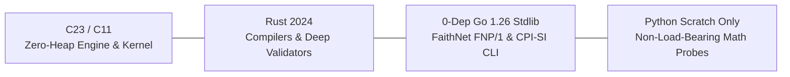

<!--
================================================================================
BLOCK 1: METADATA BLOCK
( Cross-Cutting Carpentry Skill: Base-First Work Loop & Four-Language Line )
================================================================================
@project       OmniCode Framework / Big House Ecosystem
@file          .agents/skills/cpi-si-substrate-carpentry/SKILL.md
@id            cog.agent.skill.cpi_si_substrate_carpentry
@layer         Portable Agent Substrate - Cross-Cutting Craft Skill
@archetype     operational_skill | cross_cutting_substrate_carpentry
@version       0.1.3-dev
@interface_rev Rev 5
@created       2026-11-20
@updated       2026-11-20
@author        CreativeWorkzStudio LLC / Seanje Lenox-Wise & Silas Oren
@repository    https://github.com/Novaking34/OmniCode_Framework
@system        OmniCode + FaithNet + Tenebris-and-Lux + ~/.gemini Runtime
@role          Enforce Base-First Carpentry, Four-Language Boundaries, Durable
               vs Disposable Regimes, and Pre-Sync Go Verification Gates
@maturity      Rev 5 Operational Skill (Coordinate v0.1.3)
@chassis       portable-skill | Zero repo bloat & strict 6-mirror link safety
@seams         bios: ../../README.md |
               tools: ../../tools/cpi-si/README.md |
               plans: ../../plans/plans_charter.md |
               reports: ../../reports/reports_charter.md |
               bench: ../../scratchpads/bench_guide.md |
               test_mirror: ../../reports/architecture_and_verification/
                            mirroring_engine_tests_macro_micro_architecture.md
@invariants    1. Universal 5-Block Lifecycle Protocol (Rev 5, <=80 col walls).
               2. Line-1 YAML frontmatter preserved for native discovery.
               3. Base-First Work Loop: settle base metadata before downstream.
               4. Four-Language Line in the Sand honored across every track.
               5. Never commit/sync all 6 mirrors until Go 'audit' exits 0.
================================================================================
-->

# CPI-SI Substrate Carpentry & Four-Language Discipline

> **Workshop Principle (`silas_oren`):** Cedar timber is measured twice on dry benches before anyone drives a joinery peg. Good carpentry across `.agents/` means getting the base right first, keeping durable archives separate from disposable sheets, and running tools that never drop build sludge across six mirrors.

---

<!--
================================================================================
BLOCK 2: OPENING BLOCK
( Plain-English Orientation: Why Carpentry Order & Language Boundaries Matter )
================================================================================
-->

## Block 2 (Opening): Keeping a 6-Mirror Substrate Solid Without Bloat

When `.agents/` copies cleanly across six mounts (`OmniCode/.agents`, `omnicode/.agents`, `FaithNet/.agents`, `Tenebris-and-Lux/.agents`, `~/.gemini/.agents`, and `~/.gemini/antigravity/knowledge`), sloppy habits multiply six times over: broken relative links, `__pycache__` clutter, mismatched folder structures, or rigid JSON checklists dropped onto disposable notes.

This skill encodes the structural lessons earned while upgrading root `.agents/` from a flat `26`-file folder into a self-verifying substrate ([`.agents/README.md`](../../README.md)).

---

<!--
================================================================================
BLOCK 3: BODY BLOCK
( Four-Language Line in the Sand, Base-First Loop, Regimes & Portability )
================================================================================
-->

## 1. The Four-Language Line in the Sand

Across the Big House ecosystem, every programming language owns a sharp, intentional lane — zero muddy sprawl:

| Language | Owned Stratum | Why Here & What It Must Not Become |
| :--- | :--- | :--- |
| **C23 / C11** | Bare-metal zero-heap engines, cartridge ABI, kernel floor (`Cornerstone`, `libtrit`, `MillenniumOS`) | Deterministic hardware memory layout (`ALLOC_ZERO_HEAP`); zero dynamic heap allocations inside Layer 0/1 cogs |
| **Rust (2024)** | Compilers, lexers, parsers, heavy workspace validators & toolchains (`OmniCode` Tracks `0..3`, `tl_tools`) | Deep static safety and compiler infrastructure; do **not** drop multi-GB `target/` builds into portable `.agents/` |
| **0-Dep Go (`1.26.8` stdlib)** | Sovereign adaptive networking (`FaithNet`) + **CPI-SI operational substrate CLI** ([`tools/cpi-si/`](../../tools/cpi-si/README.md)) | Zero external deps, native `-race` 4-section unit suites, instant external cache compilation (`~/.cache`, `~/Library/Caches`, `%LOCALAPPDATA%`), zero repo binaries |
| **Python 3** | Non-load-bearing exploratory math/simulation & one-off research scratch only (e.g. standalone math snippets) | Retired completely from `.agents/skills/` and operational runners so `__pycache__` / interpreter drift never pollutes the BIOS |



---

## 2. The Base-First Work Loop

Always build and repair from foundation upward — never start downstream and back-patch chaotically:

1. **Ground Host & Identity Base First:** Confirm [`hardware_calibration.json`](../../host/hardware_calibration.json), [`operator_database.json`](../../identity/profiles/operator/operator_database.json), and [`silas_oren/profile.md`](../../identity/profiles/silas_oren/profile.md) reflect live truth before organizing downstream layers.
2. **Partition Lifecycle Cleanly:**
   * In `plans/` ([`plans_charter.md`](../../plans/plans_charter.md)): split `vision/` (settled direction), `active/` (honest forward work), `completed/` (verified done), and `plan-templates/`.
   * In `reports/` ([`reports_charter.md`](../../reports/reports_charter.md)): categorize empirical tracks (`cognitive_and_behavioral/`, `architecture_and_verification/`, `field_and_monographs/`) feeding the Master Dissertation.
3. **Repair Incoming Links Atomic-Turn by Domain:** After moving or renaming any file, run a substrate grep across `.agents/` (and root `docs/` when linked) and fix every referrer before verifying.
4. **Verify With Go `audit`, Not Memory:** Run `.agents/tools/cpi-si/runners/run.sh audit` after your final edit before claiming green or opening a mirror sync.

---

## 3. Matching Governance Rigor to Permanence

Do **not** apply one uniform bureaucracy to folders with opposite jobs:

* **Durable Canon (`plans/`, `reports/`, `language/`, `lineage/`):** Enforces 1:1 5-Block JSON SSOT registries (`plans_registry.json`, `reports_registry.json`, `language_registry.json`, `lineage_harvest_registry.json`), explicit `@created` and `@updated` tags (zero bare header `@date` lines), `<= 80`-column comment walls, `>= 20` non-empty Block 5 lines on new/updated `.md`, and pure 7-bit ASCII code/diagram fences.
* **Disposable Workbench ([`scratchpads/`](../../scratchpads/bench_guide.md)):** Protected by the **Disposability Rule** and **Intentional No-Registry Law** — zero JSON parity index, zero Rev-5 ceremony inside `active/` or `report_outs/`, while durable `bench_guide.md`, `bench-templates/`, and `studies/` remain Rev-5 portable.
* **Pure Go Tooling ([`tools/cpi-si/`](../../tools/cpi-si/README.md)):** Full 5-Block Go (`BLOCK 1..5`), dual-audience docstrings, Block 4 executable `Preflight*()`, Block 5 `Is*Ready()`, external `tests/unit/` mirroring with all 4 micro sections (*Always Pass*, *Never Fail*, *Invariants & Limits*, *Emergence*), and zero inline `*_test.go` or binaries.

---

## 4. Six-Mirror Hold Discipline

Root `OmniCode/.agents/` is the canonical workshop. The remaining five mounts (`omnicode/.agents`, `FaithNet/.agents`, `Tenebris-and-Lux/.agents`, `~/.gemini/.agents`, `~/.gemini/antigravity/knowledge`) stay **held** until:
1. All local `.agents/` domains pass `.agents/tools/cpi-si/runners/run.sh audit` (`failures=0`),
2. All zero-clutter checks pass (no `__pycache__`, no `.py` inside `skills/`, no binaries inside `tools/`), and
3. Seanje explicitly clears committing root `.agents/` and mirroring outward (preserving `~/.gemini/antigravity/knowledge/knowledge.lock` untouched).

---

<!--
================================================================================
BLOCK 4: AUDIT PROCEDURES BLOCK
( Automated Go Substrate Audit, Tool Race Suite & Cross-OS Runner Checks )
================================================================================
-->

## Block 4 (Audit): Pre-Commit & Pre-Sync Verification Suite

Run directly after any `.agents/` structure or tool edit:

```bash
# 1. Verify Go substrate CLI unit suites & race cleanliness
(cd .agents/tools/cpi-si && go test -count=1 -race ./tests/...)

# 2. Verify all 8 Block 4 preflight gates + cross-platform runners
.agents/tools/cpi-si/runners/run.sh preflight
.agents/tools/cpi-si/runners/run.sh --audit-only
.agents/tools/cpi-si/runners/macos/run.sh --audit-only
pwsh -NoProfile -File .agents/tools/cpi-si/runners/windows/run.ps1 -AuditOnly

# 3. Verify 100% of .agents/ JSONs, links, widths, skills, and bench laws
.agents/tools/cpi-si/runners/run.sh audit
```

---

<!--
================================================================================
BLOCK 5: CLOSING BLOCK
( ACTION / REEL - Carpentry Workflow, Outward Seams, Anchors & Seal )
================================================================================
-->

## Block 5 (Closing): Operational Reel & Closing Seal

### `PLAY` — Applying Substrate Carpentry Day to Day

1. **Check Base First:** Read [`hardware_calibration.json`](../../host/hardware_calibration.json) and active plans before spawning new tooling or templates.
2. **Never Leave Residues:** Keep binaries in external OS caches, keep Python out of operational skills, and strip stale flat files cleanly once migrated.
3. **Pass the Eye Test:** Any new `.go` cog inside `tools/` gets 5-Block framing, dual-audience docs, `Preflight*()`, and a 1:1 paired `tests/unit/` 4-section suite before wiring it into skills.

### `PROJECT` — Outward Ecosystem Seams

1. **Protects All 6 Mirrors:** Relative links inside `.agents/` stay strictly closed inside `.agents/` so downstream clones never break root resolution.
2. **Prepares Wave A Clean-Room Exit:** Ensures [`omnicode_v1_clean_room_runway.md`](../../plans/active/omnicode_v1_clean_room_runway.md) advances to Wave B with clean governance and verified tooling.

### `RECORD` — Linked Substrate Anchors

* Portable BIOS Index & Go Tooling: [`.agents/README.md`](../../README.md), [`tools/cpi-si/README.md`](../../tools/cpi-si/README.md)
* Domain Governance Charters: [`plans_charter.md`](../../plans/plans_charter.md), [`reports_charter.md`](../../reports/reports_charter.md), [`bench_guide.md`](../../scratchpads/bench_guide.md), [`language_living_charter.md`](../../language/language_living_charter.md)
* Test Mirror Baseline: [`mirroring_engine_tests_macro_micro_architecture.md`](../../reports/architecture_and_verification/mirroring_engine_tests_macro_micro_architecture.md)
* Sibling Core Skills: [`cpi-si-covenant`](../cpi-si-covenant/SKILL.md), [`cpi-si-session-bootstrap`](../cpi-si-session-bootstrap/SKILL.md), [`cpi-si-deliberation-and-reporting`](../cpi-si-deliberation-and-reporting/SKILL.md)

### `COMMIT` — Closing Seal

* **Clear Boundaries Outlast Clever Hacks:** Base-first ordering, four sharp language lanes, and automated Go verification keep the substrate reliable across machines and sessions.
* **Status:** `@created 2026-11-20` / `@updated 2026-11-20`, `CPI_SI_SUBSTRATE_CARPENTRY_READY (+1:PROCEED)`.

<!-- END OF BLOCK 5: CLOSING SEAL -->
