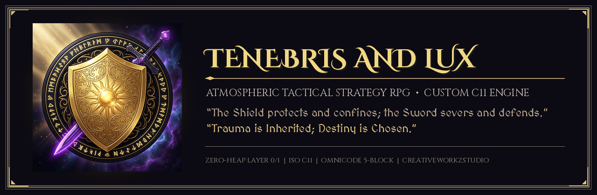
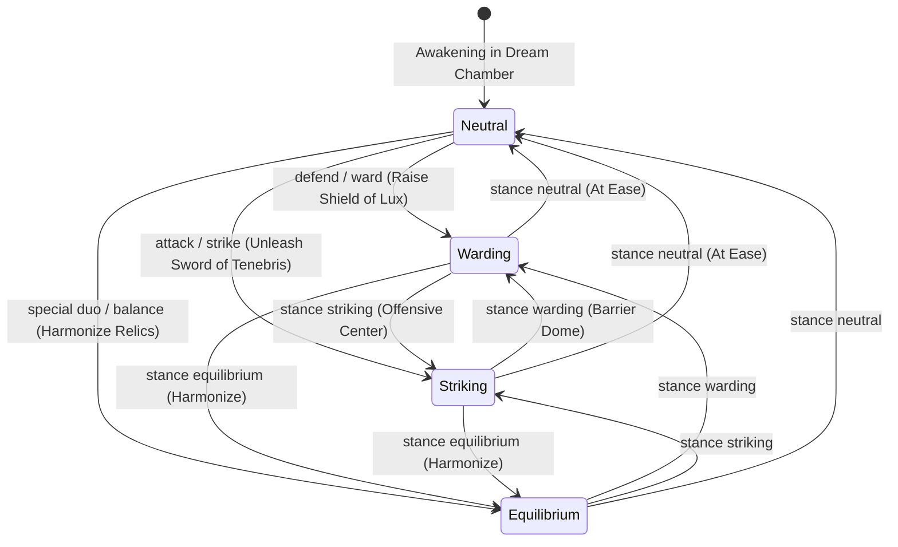
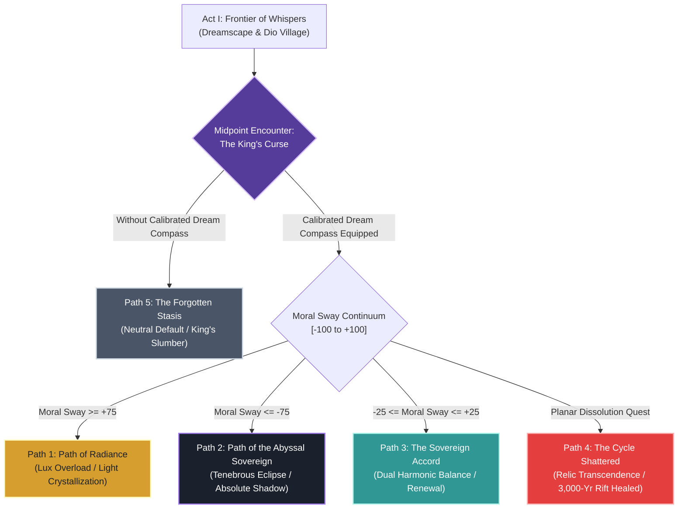
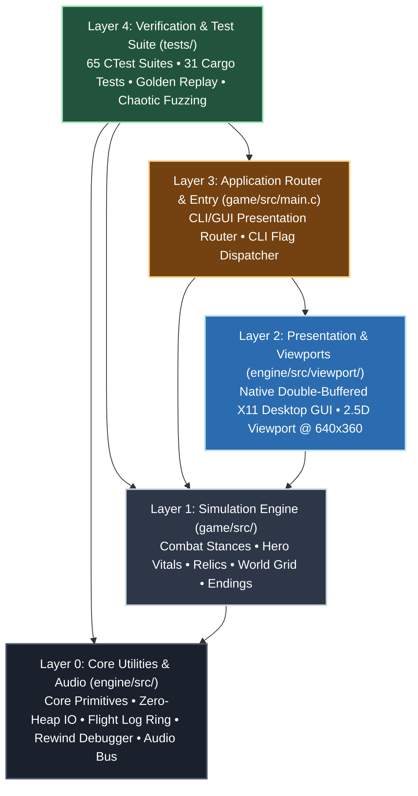
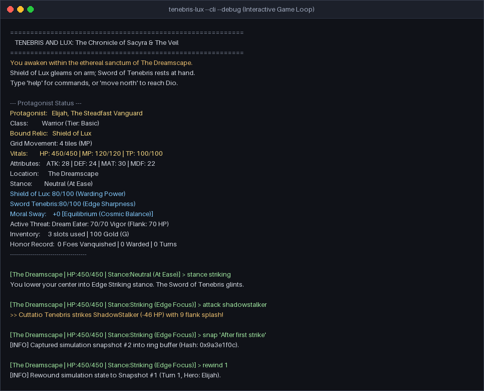
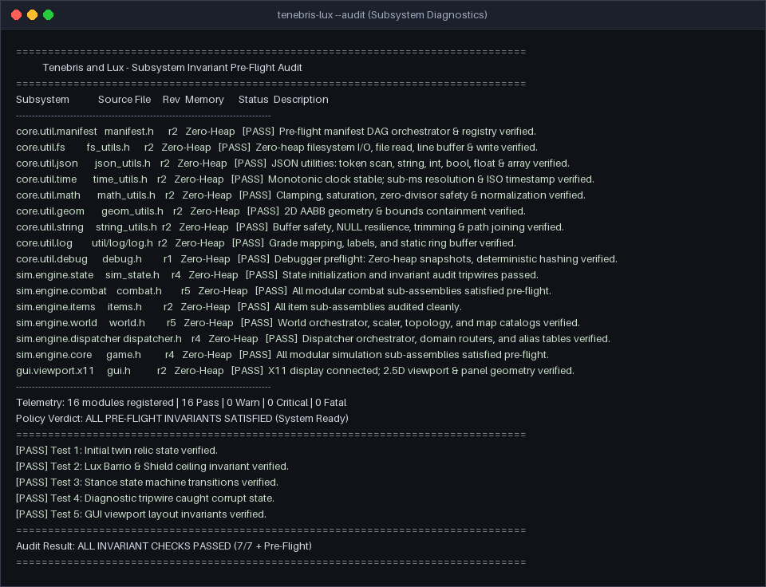

---
# ==============================================================================
# PROJECT & REPOSITORY SPECIFICATION (YAML FRONTMATTER)
# ==============================================================================
project:
  name: "Tenebris and Lux"
  pronunciation: "teh-neh-bris and luks"
  subtitle: "An Atmospheric Tactical Strategy RPG & Bespoke C11 Engine Architecture"
  tagline: "Trauma is Inherited; Destiny is Chosen."
  license: "CreativeWorkzStudio Commercial Game License (All Rights Reserved)"
  organization: "CreativeWorkzStudio LLC"
  lead_architect: "ProfessorSeanEX"
  repository: "https://github.com/Novaking34/tenebris-lux"

release:
  version: "0.1.2-dev"
  milestone: "v0.1.2 — OmniCode Cognitive Continuum, Zero-Delta Calibration & Unified Toolchain"
  previous_milestone: "v0.1.1 — Standalone Engine Decoupling & Modular Validator"
  status: "Active Development (Engine & Campaign Dual-Track)"

domain:
  classification: "Dual-Track (Custom C11 Engine + Tactical Strategy RPG)"
  genre: "Tactical Strategy RPG (TRPG) / Grid-Based Strategy / Atmospheric Narrative"
  combat_paradigm: "2D Discrete Grid Maneuvers & Cinematic Traditional Clashes"
  thematic_structure: "Tri-Perspective Narrative Architecture (Past, Present, Future)"
  canon_setting: "The Continental Realm of Sacyra & The Six Continental Powers"

engine_specifications:
  engine_name: "Cornerstone Game Engine"
  core_standard: "Progressive ISO C23 Target with C17/C11 Floor (-Wall -Wextra -Wpedantic, C++20/17 Headers)"
  memory_policy: "Zero Dynamic Heap Allocations in Layer 0 (Core Util) & Layer 1 (Sim Engine)"
  presentation_modes:
    gui: "Native Double-Buffered X11 Desktop Interface (2.5D Viewport @ 640x360)"
    cli: "Headless ANSI Terminal Dispatcher with Dynamic Command Routing"
  diagnostic_tooling: "Interactive State Debugger with FNV-1a Hashing & Time-Travel Rewind"
  build_systems:
    engine: "CMake 3.24+ (Progressive C23/C17/C11 Ladder)"
    documentation: "Rust 2021 Toolchain (cargo run --bin master_guide)"
    developer_suite: "Rust 2021 CLI Tools (tools/src/bin/) & Python Cognitive Orchestrator (tools/orchestrator/)"

hardware_calibration:
  cpu_topology: "Intel Core 7 150U (10C/12T: 2 P-cores / 4 P-threads @ 5.4 GHz + 8 E-cores / 8 E-threads @ 4.0 GHz)"
  gpu_topology: "NVIDIA GeForce MX570 A (2GB GDDR6, 1737MB Addressable VRAM, 311MB Hardware Reserve)"
  non_headless_guard: "350MB Display Floor (1387MB Usable Compute VRAM) + 3072MB Protected Desktop RAM Reserve"
  calibration_accuracy: "Zero-Delta Threshing Floor Across All Local Model Tiers (0.5B, 1.5B, 3B, 7B)"

telemetry_manifest:
  registered_subsystems: 20
  preflight_audit_status: "20/20 Pass (Zero Heap, Zero Fatal)"
  ctest_verification_suites: 65
  verification_pass_rate: "100% (65/65 Passing)"
  cargo_unit_tests: 31
  cargo_pass_rate: "100% (31/31 Passing)"
  deterministic_replay: "15-Step Golden Trace Determinism Verified"
  chaotic_softlock_immunity: "1,000 Chaotic Actions Verified (< 50µs Latency Budget)"

documentation_compendium:
  master_guide_chapters: 74
  master_guide_volumes: 6
  formats:
    - "AsciiDoc (docs/MASTER_GUIDE.adoc)"
    - "Markdown (docs/MASTER_GUIDE.md)"
    - "Publication PDF (docs/MASTER_GUIDE.pdf)"

thematic_pillars:
  past: "Healing the Frontier Wound (Elijah Ro-enheart / Ancient Usuru)"
  present: "Severing Complacency (Lady Katrina Jaren / Prince Casatti)"
  future: "The Steward of Balance (The Custom Bearer / Prince Mi-ren)"
  meta_axiom: "Trauma is Inherited; Destiny is Chosen."
---

<!--
================================================================================
BLOCK 1: METADATA BLOCK
( Identity, Provenance, Invariant Boundary Contracts & System Anchors )
================================================================================
@project       Tenebris and Lux
@file          README.md
@layer         Root Presentation & Architectural Strata (Layer 3)
@version       0.1.2-dev
@interface_rev Rev 5
@date          2026-11-14
@author        CreativeWorkzStudio LLC / ProfessorSeanEX
@repository    https://github.com/Novaking34/tenebris-lux
@system        Cornerstone Game Engine & Tenebris and Lux TRPG Campaign
@role          Root Presentation Anchor & Universal Architectural Orientation
@invariants    1. Zero dynamic heap allocations across Layer 0 and Layer 1.
               2. Progressive ISO C23 target with graceful C17/C11 floor.
               3. Dual-frontend determinism (CLI and X11 share pure sim state).
               4. Universal 5-Block Lifecycle Protocol enforced across all strata.
               5. Authentic project canon (Sole antagonist: The Dark Lord Usuru).
               6. Hardware-aware calibration with non-headless stability floors.

PURPOSE & PHILOSOPHICAL MISSION:
  The central root anchor for Tenebris and Lux and the Cornerstone Game Engine.
  Establishes the dual-track reality of the project: the simultaneous
  construction of an uncompromising, zero-heap C11 engine and an atmospheric
  continental TRPG, paired with the OmniCode Cognitive Continuum.
  Translates the OmniCode 5-Block Lifecycle into documentation rhetoric:
  Metadata -> Premise -> Thesis/Architecture -> Audit/Telemetry -> Closing.
================================================================================
-->

<p align="center">
  
</p>

<p align="center">
  <a href="#engine-architecture--thesis"></a>
  <a href="#quickstart-build-play--audit"></a>
  <a href="#developer-tooling--the-master-guide"></a>
  <a href="#verification-audit-verdict--telemetry"></a>
  <a href="#verification-audit-verdict--telemetry"></a>
  <a href="#verification-audit-verdict--telemetry"></a>
  <a href="#engine-architecture--thesis"></a>
  <a href="AGENTS.md"></a>
  <a href="LICENSE"></a>
</p>

---

# Tenebris and Lux

> **"The Shield protects and confines; the Sword severs and defends. The metal knows neither virtue nor malice—only the hand that grips the hilt."**
> *"Trauma is Inherited; Destiny is Chosen."*

---

## Manifest Covenant & System Attributes

| Attribute | Specification |
| :--- | :--- |
| **Active Milestone** | `0.1.2-dev` (OmniCode Cognitive Continuum, Zero-Delta Calibration & Unified Toolchain) |
| **Baseline Milestone** | `0.1.1` (Standalone Engine Decoupling, Modular Validator & Block 1 Standardization) |
| **Engine Architecture** | **Cornerstone Game Engine** (`engine/` — The Big Machine) |
| **Game Campaign** | **Tenebris and Lux** (`game/` — The Master Turn Gear) |
| **Genre & Paradigm** | Tactical Strategy RPG (TRPG) — 2D Discrete Grid Battlefield + Cinematic Clashes |
| **Organization** | CreativeWorkzStudio LLC |
| **Author / Lead** | ProfessorSeanEX / CreativeWorkzStudio LLC |
| **Repository** | [https://github.com/Novaking34/tenebris-lux](https://github.com/Novaking34/tenebris-lux) |
| **Core Standard** | Progressive ISO C23 target with graceful C17/C11 floor (`-Wall -Wextra -Wpedantic`, C++20/17 headers) |
| **Memory Chassis** | Zero Dynamic Heap Allocations in Layer 0 (Core Util) & Layer 1 (Sim Engine) |
| **Build Systems** | CMake 3.24+ (Engine & CTest), Rust 2021 (Developer Toolchain & Master Guide) |
| **Cognitive Framework** | OmniCode Universal 5-Block Lifecycle Protocol & 7-Tier Cognitive Continuum |
| **Hardware Baseline** | Intel Core 7 150U (10C/12T), NVIDIA GeForce MX570 A (2GB GDDR6), 16GB DDR5 |
| **Changelog** | [`CHANGELOG.md`](CHANGELOG.md) |
| **Agent Guidelines** | [`AGENTS.md`](AGENTS.md) |
| **Compendium (74 Ch.)** | [`docs/MASTER_GUIDE.adoc`](docs/MASTER_GUIDE.adoc) &bull; [`docs/MASTER_GUIDE.md`](docs/MASTER_GUIDE.md) &bull; [`docs/MASTER_GUIDE.pdf`](docs/MASTER_GUIDE.pdf) |
| **License** | [Commercial Game License & Source-Available Agreement (All Rights Reserved)](LICENSE) |

---

## BLOCK 2: PREMISE & DUAL-NATURE FOUNDATION

### 1. The Dual-Track Mandate: The Big Machine & The Master Turn Gear

*Tenebris and Lux* is engineered along two inseparable, mutually reinforcing tracks:

1. **The Big Machine (`engine/` — The Cornerstone Game Engine)**: Built from first principles in standard C without black-box third-party runtimes, garbage collection spikes, or opaque abstraction layers. Cornerstone guarantees deterministic simulation, sub-microsecond command latency, zero dynamic heap allocations in core layers, a decoupled dual-frontend architecture (headless ANSI terminal CLI + double-buffered X11 desktop GUI), and a compiled `.rodata` Config ROM vault for zero-disk Safe-Mode boots.
2. **The Master Turn Gear (`game/` — Tenebris and Lux TRPG)**: Originating between 2014–2018 in RPG Maker as the genesis work of **CreativeWorkzStudio**, the game is reborn as an authentic tactical experience featuring discrete grid maneuvers, terrain warfare, poise dynamics, stance mastery, and a grand multi-route continental campaign.

```text
  ┌──────────────────────────────────────────────────────────────────────┐
  │            CORNERSTONE GAME ENGINE — THE BIG MACHINE ( engine/ )     │
  │  [Core Math/Time/Strings]   [VFS & Master Loader]   [Flight Log Ring]│
  │  [Debugger & Probes/AWAIT]  [7-Bus Audio Mixer]     [X11 Viewport]   │
  └──────────────────────────────────┬───────────────────────────────────┘
                                     │ meshes cleanly across Layer 3 Plug
                                     ▼
  ┌──────────────────────────────────────────────────────────────────────┐
  │                   THE MASTER TURN GEAR ( game/ )                     │
  │  [Turn-Based Tactical Grid] [Twin Relics & Stances] [Moral Sway]     │
  │  [Sacyra / Libira Topology] [5-Route Ending Matrix] [RPG Lore Data]  │
  └──────────────────────────────────────────────────────────────────────┘
```

### 2. World Canon & The Geopolitical Landscape

The campaign chronicles the defense and moral reckoning of the chivalric **Kingdom of Sacyra** (pronounced *"saw-kee-ruh"*, `/sɔːˈkiːrə/`) and its neighboring continental powers against the re-awakened **Dark Lord** (the ancient Libiran sovereign Usuru).

The continental expanse is bound by the historic **Accord of Kings** (*"Joint Realm, Separate Kingdoms"*), signed after the Seven-Year Great War across **The Six Powers**:

1. **The Royal Capital of Sacyra**: Central white-stone citadel of the High Throne, defensive bastion of Lux.
2. **The Kingdom of Libira**: Arid western frontier, birthplace of Usuru, home of the historic "Quiet Complaint" (frontier isolation and courier neglect).
3. **The Great Mau Kingdom**: Eastern river merchant empire, master of waterways, mercenary cartels, and banking houses.
4. **Old Sacyra**: Highland ancestral cradle of pureblood Sacyran traditionalists holding ancient vigil.
5. **The Academy**: Northern glacial spire dedicated to empirical arcanotech and natural philosophy.
6. **The Yun-yin Provinces**: Southeastern misty archipelago mastering spiritual balance, ki circulation, and harmonic neutrality.

### 3. Metaphysical Neutrality & The Twin Relics

In *Tenebris and Lux*, Light (Lux) and Darkness (Tenebris) are **not** moral absolutes of good and evil; they are primal cosmic forces personified:

* **The Shield of Lux**: Personification of Light, barrier resonance, poise, kinetic deflection, and protection.
* **The Sword of Tenebris**: Personification of Darkness, edge sharpness, armor severance, abyssal mist, and ruin.

Morality exists solely in the **intent of the wielder** (`moral_sway` bounded in `[-100, +100]`):

* **Positive Sway (+1 to +100)**: Virtue, protection, mercy, and defensive endurance.
* **Negative Sway (-1 to -100)**: Malice, ruin, ruthless ambition, and offensive severance.
* **Equilibrium (0)**: Dual harmonic balance—the foundational precept of the Accord of Kings.

### 4. The Thematic Triad: *"Trauma is Inherited; Destiny is Chosen."*

The narrative unfolds through three interconnected temporal axes:

* **The Past (Healing the Frontier Wound)**: **Elijah Ro-enheart**, frontline heavy vanguard of the Royal Defense Corps bearing the **Shield of Lux**. Seeking truth behind the disappearance of his father, Commander Gareth Ro-enheart, Elijah must reconcile ancestral grief before it curdles into vengeance.
* **The Present (Severing Complacency)**: **Lady Katrina Jaren**, noble court aspirant renouncing aristocratic decadence for the **Adventurers' Guild**. Wielding the **Sword of Tenebris**, Katrina severs political rot and courtly hypocrisy.
* **The Future (The Steward of Balance)**: **The Custom Bearer** (`<chosen_name>`), an unburdened soul awakening within the ethereal **Dream Chamber** under the guidance of **Chrono**, free from dynastic grudge to decide the continental fate.

---

## BLOCK 3: THESIS & ARCHITECTURE (DUAL-AUDIENCE BODY)

The architecture is presented under the **Dual-Audience Documentation Covenant**, addressing both systems engineers and creative designers.

---

### PART A: FOR GAME DESIGNERS, WRITERS & WORLDBUILDERS

#### 1. Tactical 2D Grid Warfare & Poise Dynamics

Battle takes place on discrete tactical grids where positioning dictates tactical superiority:

* **Movement Points (MP)**: Units spend MP across varying biomes (plains cost 1 MP, forests cost 2 MP, stone ramparts cost 1.5 MP).
* **Cardinal Facing**: Attack angles compute directional multipliers—flank strikes inflict +20% damage, while rear strikes deliver +40% critical chance.
* **Zone-of-Control (ZOC)**: Unshielded movement adjacent to a hostile unit is trapped by kinetic engagement, imposing poise strain unless shielded by *Lux Barrio*.

#### 2. Deterministic Stance State Machine

Combat is governed by shifting stances that reallocate attributes, damage mitigations, and relic resonance:



* **Neutral Stance**: Baseline posture. Balanced movement and stamina recovery.
* **Warding Stance (*Lux Barrio*)**: Raises radiant barrier dome. Absorbs 25% incoming damage, reflects kinetic shock, and staggers charging foes.
* **Striking Stance (*Cuttatio Tenebris*)**: Lowers center of gravity. Unleashes abyssal arcs delivering direct damage plus 20% splash to enemy flanks.
* **Equilibrium Stance (*Duo-Loca Bashin n Slash*)**: Blinds with radiant shield bash, instantly followed by abyssal double-cleave targeting raw defense.

#### 3. Diegetic Relic Items & Moral Continuum

* **Grandma's Watch**: A family heirloom tracking monotonic sub-millisecond elapsed time; through nocturnal calibration in the Dream Chamber, it transforms into the **Dream Compass**, unlocking the hidden routes beneath the High Throne.
* **Compass of Morality**: Diegetic instrument gauging the wielder's soul across the 13-tier moral continuum from absolute light (+100) to absolute shadow (-100).

#### 4. The Midpoint Campaign Fork & 5-Route Ending Matrix

Linear tactical RPGs suffer from illusion-of-choice endings. *Tenebris and Lux* resolves this through a **Midpoint Campaign Fork** governed by **The King's Curse** (the planar wound beneath the High Throne):



* **Path 1: Path of Radiance (Lux Overload)**: Moral sway $\ge +75$. Absolute light crystalizes the realm in immutable, blinding order.
* **Path 2: Path of the Abyssal Sovereign (Tenebrous Eclipse)**: Moral sway $\le -75$. Absolute shadow swallows dynastic institutions into abyssal freedom.
* **Path 3: The Sovereign Accord (Dual Harmonic Balance)**: Sway maintained in `[-25, +25]`. The Accord of Kings is reaffirmed through equilibrium.
* **Path 4: The Cycle Shattered (Planar Dissolution)**: Relic transcendence healing the 3,000-year dynastic chasm once and for all.
* **Path 5: The Forgotten Stasis (The King's Slumber)**: The tragic neutral path—the wielder fails to calibrate Grandma's Watch into the Dream Compass, repeating the cycle.

---

### PART B: FOR SYSTEMS PROGRAMMERS, ENGINE ARCHITECTS & TOOLCHAIN ENGINEERS

#### 1. The 5 Compilation Strata & The Fall-Down Ladder

Dependencies strictly flow downwards; lower layers never depend on higher layers, and `engine/` compiles cleanly without `game/`:



* **Progressive ISO C Toolchain Ladder**: Targets ISO C23 (`-std=c23`) first and steps down gracefully to C17 or C11 on legacy compilers without compatibility shims (`CORNERSTONE_C_STANDARD=AUTO|23|17|11`).
* **Controlled Memory Chassis (`ALLOC_ZERO_HEAP`)**: No `malloc`, `calloc`, or `free` in Layer 0 or Layer 1. All chassis overhead lives visibly in measured `.text`, `.rodata`, `.data`, `.bss`, and bounded stack frames.

#### 2. The OmniCode 7-Tier Cognitive Continuum

To orchestrate autonomous AI agents and local developer workflows, the system organizes model execution into 7 calibrated cognitive tiers:

| Tier | Role & Capability | Model Example | Context | Calibration Envelope | Velocity | Primary Mission |
| :---: | :--- | :--- | :---: | :--- | :---: | :--- |
| **01** | `TASK_MICRO_SIFT` | Qwen2.5-Coder-0.5B | 8,192 | 24 GPU layers, 4 P-threads | 159 tok/s | AST token parsing, JSON validation, micro-sifting |
| **02** | `TASK_RAPID_BEDROCK` | Qwen2.5-Coder-1.5B | 8,192 / 16k | 28 GPU layers (100% VRAM), 4 P-threads | 55–75 tok/s | Core C11 cog synthesis, fallback wiring, docstrings |
| **03** | `TASK_BALANCED_AGENT` | Qwen2.5-Coder-3B | 8,192 | 20 GPU layers, 8 hybrid threads | 35–45 tok/s | Cross-module verification, schema alignment |
| **04** | `TASK_DEEP_SIMULATION` | Qwen2.5-Coder-7B | 8,192 | 4 GPU layers, 10 threads (DDR5) | 12–18 tok/s | Complex architectural refactoring & mathematical proofs |
| **05** | `TASK_COMPLEX_REFRACTOR` | 14B Q4_K_M | 8,192 | Cloud / Sovereign offload | — | Subsystem redesign and multi-file refactoring |
| **06** | `TASK_HEAVY_REASONING` | 32B Q4_K_M | 16,384 | Cloud / Sovereign offload | — | High-order mathematical and algorithmic proofs |
| **07** | `TASK_FRONTIER_ORCHESTRATOR` | 70B+ / Claude / Gemini | 32k–128k | Frontier API / Cloud | — | Macro-architectural guidance & governance auditing |

#### 3. The Small Model Host Exoskeleton Pattern

Small local models (such as 0.5B) suffer from autoregressive token repetition loops and compliance hallucinations when prompted for long outputs.

* **The Exoskeleton Solution**: Instead of demanding high-parameter reasoning from a 0.5B model, the host chassis provides an external exoskeleton:
  1. **External AST Compression**: The host extracts syntax trees, reducing token consumption by 90%.
  2. **Short-Burst Micro-Steps**: Tasks are partitioned into focused, single-purpose bursts under 60 tokens executed at 159 tokens/second.
  3. **Strict Compiler Verification**: Output code is compiled immediately with `-Wall -Wextra -Wpedantic -Werror`. Compiler errors are fed back as instant deterministic tripwires.
* **Result**: A 0.5B model running inside the OmniCode exoskeleton delivers verified, zero-warning C11 code in 1.5 seconds, matching the accuracy of a 7B model while operating entirely within local hardware limits.

#### 4. Native Developer Toolchain (`tools/`)

* **`tl_tools`**: Central developer CLI orchestrating all project workflows (`cargo run --bin tl_tools`).
* **`installer`**: Standalone Rust binary (`tools/src/bin/installer.rs`) compiling tools, checking preflight dependencies, and configuring git hooks.
* **`master_guide`**: High-performance publication engine assembling 74 chapters across 6 volumes into AsciiDoc, Markdown, and PDF.
* **`validator`**: Modularized auditor validating C headers, 5-block JSON contracts, and git commit/tag structures.
* **`tools/orchestrator/`**: Python cognitive engine housing dynamic hardware probes, zero-delta calibration, and modelfile synthesis.

---

## BLOCK 4: FORENSIC CRUCIBLE, BENCHMARK TELEMETRY & EMPIRICAL AUDITS

Every release milestone is verified by automated pre-flight self-audits and multi-tier test suites.

### 1. Subsystem Invariant Pre-Flight Audit (20 Registered Modules)

```text
================================================================================
           Tenebris and Lux - Subsystem Invariant Pre-Flight Audit
================================================================================
Subsystem            Source File     Rev  Memory      Status  Description
--------------------------------------------------------------------------------
core.util.manifest   manifest.h      r2   Zero-Heap   [PASS]  Pre-flight manifest DAG orchestrator & registry verified.
core.util.fs         fs_utils.h      r3   Zero-Heap   [PASS]  Zero-heap filesystem I/O, file read, line buffer & write verified.
core.util.json       json_utils.h    r3   Zero-Heap   [PASS]  JSON utilities: token scan, string, int, bool, float & array verified.
core.util.time       time_utils.h    r3   Zero-Heap   [PASS]  Monotonic clock stable; sub-ms resolution & ISO timestamp verified.
core.util.math       math_utils.h    r3   Zero-Heap   [PASS]  Clamping, saturation, zero-divisor safety & normalization verified.
core.util.geom       geom_utils.h    r3   Zero-Heap   [PASS]  2D AABB geometry & bounds containment verified.
core.util.string     string_utils.h  r3   Zero-Heap   [PASS]  Buffer safety, NULL resilience, trimming & path joining verified.
core.util.pacer      clock_pacer.h   r1   Zero-Heap   [PASS]  Fixed-timestep pacer (60Hz) & lag clamp verified.
core.util.formula    formula_eval.h  r1   Zero-Heap   [PASS]  Battle formula evaluation, mitigation & hit chances verified.
core.util.log        util/log/log.h  r3   Zero-Heap   [PASS]  Grade mapping, labels, and static ring buffer verified.
core.util.debug      debug.h         r3   Zero-Heap   [PASS]  Debugger preflight: Zero-heap snapshots, deterministic hashing verified.
sim.engine.state     sim_state.h     r4   Zero-Heap   [PASS]  State initialization and invariant audit tripwires passed.
sim.engine.combat    combat.h        r5   Zero-Heap   [PASS]  All modular combat sub-assemblies satisfied pre-flight.
sim.engine.items     items.h         r2   Zero-Heap   [PASS]  All item sub-assemblies audited cleanly.
sim.engine.world     world.h         r5   Zero-Heap   [PASS]  World orchestrator, scaler, topology, and map catalogs verified.
sim.engine.dispatcher dispatcher.h    r4   Zero-Heap   [PASS]  Dispatcher orchestrator, domain routers, and alias tables verified.
sim.engine.core      game.h          r4   Zero-Heap   [PASS]  All modular simulation sub-assemblies satisfied pre-flight.
gui.viewport.x11     gui.h           r2   Zero-Heap   [PASS]  X11 display connected; 2.5D viewport & panel geometry verified.
--------------------------------------------------------------------------------
Telemetry: 20 modules registered | 20 Pass | 0 Warn | 0 Critical | 0 Fatal
Policy Verdict: ALL PRE-FLIGHT INVARIANTS SATISFIED (System Ready)
================================================================================
Audit Invariant Checks:  7/7 Invariant Checks Passed (Relics, Stances, Tripwires)
CTest Suite Pass Rate:   65/65 Verification Suites Passed (100% Pass Rate)
Execution Latency Budget: < 50µs per simulation turn
Compiler Status:         -Wall -Wextra -Wpedantic Clean (0 Warnings, 0 Errors)
================================================================================
```

### 2. Zero-Delta Hardware Calibration Matrix

The orchestrator probes host hardware dynamically and computes exact allocation envelopes:

| Tier | Model | Context | GPU Offload | CPU Threads | VRAM Headroom | RAM Headroom | Calibration Delta | Status |
| :---: | :--- | :---: | :---: | :---: | :---: | :---: | :---: | :---: |
| **0.5B** | Qwen2.5-Coder-0.5B | 8,192 | 24 Layers | 4 P-threads | 1,244 MB | 9,996 MB | **Ctx: 0, Layer: 0, Thread: 0** | OPTIMAL |
| **1.5B** | Qwen2.5-Coder-1.5B | 8,192 | 28 Layers (100%) | 4 P-threads | 527 MB | 9,471 MB | **Ctx: 0, Layer: 0, Thread: 0** | OPTIMAL |
| **1.5B Deep** | Qwen2.5-Coder-1.5B | 16,384 | 13 Layers | 4 P-threads | 544 MB | 8,826 MB | **Ctx: 0, Layer: 0, Thread: 0** | WORKSPACE |
| **3B** | Qwen2.5-Coder-3B | 8,192 | 20 Layers | 8 Hybrid | 376 MB | 7,651 MB | **Ctx: 0, Layer: 0, Thread: 0** | BALANCED |
| **7B** | Qwen2.5-Coder-7B | 8,192 | 4 Layers | 10 Threads | 1,065 MB | 4,213 MB | **Ctx: 0, Layer: 0, Thread: 0** | SATURATED |

### 3. Non-Headless Session Guard Telemetry

To ensure desktop stability while driving live X11/Wayland display servers during local LLM execution:

* **GPU Hardware Reserve**: 311 MB driver reserve + 350 MB desktop display floor (guaranteeing 1,387 MB usable compute VRAM on 2GB MX570 A).
* **RAM Desktop Reserve**: 3,072 MB protected RAM reserve for Wayland/GNOME (guaranteeing 11,064 MB safe model cold budget).
* **Thermal & Thread Discipline**: 4 P-threads dedicated to high-velocity compute avoiding thread thrashing across E-cores.

---

## BLOCK 5: SYNTHESIS, COMPENDIUM NAVIGATION & COMMAND REFERENCE

### 1. Visual Proof: Dual-Frontend Presentation

<p align="center">
  
</p>

<p align="center">
  
</p>

### 2. Quickstart: Build, Play & Audit

For complete operating system dependencies, X11 libraries, and compiler setup, refer to [`docs/INSTALL.adoc`](docs/INSTALL.adoc).

#### Quick Build with CMake

```bash
# 1. Configure CMake build tree in Debug mode (auto-probes C23 -> C17 -> C11)
cmake -S . -B build -DCMAKE_BUILD_TYPE=Debug

# 2. Compile game engine and all 65 verification test suites
cmake --build build -j"$(nproc)"

# 3. Launch the game (auto-detects X11 GUI, or falls back to CLI)
./build/tenebris-lux

# Launch explicitly in terminal CLI mode
./build/tenebris-lux --cli

# Launch explicitly in native desktop GUI mode
./build/tenebris-lux --gui

# Launch with interactive CLI state debugger enabled
./build/tenebris-lux --debug
```

#### Automated Diagnostics & Testing

```bash
# Run pre-flight inspection and internal self-audit (20 registered modules + 7 invariant tests)
./build/tenebris-lux --audit

# Run full CTest automated verification suite (65/65 tests pass)
ctest --test-dir build --output-on-failure

# Run Rust tooling verification suite (31/31 unit tests pass)
cargo test --manifest-path tools/Cargo.toml

# Run Python orchestrator hardware test suites
python3 tools/orchestrator/tests/test_model_factory.py
python3 tools/orchestrator/tests/test_auto_mode.py
python3 tools/orchestrator/tests/test_staircase_sweep.py
```

#### Developer Tooling & Master Guide Compilation

```bash
# Run unified installer to build tools and configure hooks
cargo run --manifest-path tools/Cargo.toml --bin installer

# Compile the 74-chapter unified Master Guide (AsciiDoc, Markdown, PDF)
cargo run --manifest-path tools/Cargo.toml --bin master_guide
```

### 3. Tactical Command Manual & Hotkey Reference

| Command | Hotkey | Tactical Effect & Domain Action |
| :--- | :---: | :--- |
| `look` | **L** | Survey current realm, topological boundaries, and active hostile presences. |
| `status` | **I** | Inspect hero attributes, Shield of Lux warding, Sword of Tenebris edge, and Moral Sway. |
| `map` | **M** | View topological map dimensions, viewport camera coordinates, and zone metadata. |
| `defend` / `ward` | **W** | Raise the Shield of Lux (*Lux Barrio*), absorbing 25% damage and staggering foes. |
| `attack` / `strike` | **S** | Strike with the Sword of Tenebris (*Cuttatio Tenebris*), dealing direct and splash damage. |
| `special duo` / `balance` | **B** | Unleash harmonic *Duo-Loca Bashin n Slash* shattering enemy defense. |
| `stance <name>` | **T** | Transition posture across deterministic FSM (`neutral`, `warding`, `striking`, `equilibrium`). |
| `move <n\|s\|e\|w>` | **N/S/E/W** | Traverse continental realms and frontier provinces. |
| `items` / `inventory` | — | Inspect player pouch, consumables, and quest catalysts. |
| `use <item>` | — | Consume herbal remedies or consult diegetic relics (Grandma's Watch, Phials of Light). |
| `clock` | — | Read monotonic sub-millisecond elapsed time via Grandma's Watch. |
| `morality` | — | Read metaphysical alignment on the Compass of Morality. |
| `name <bearer>` | — | Designate bearer identity (Elijah, Katrina, or Custom Bearer). |
| `inspect` | — | Render live ASCII diagnostic card of hero vitals, relics, stance, and tripwires. |
| `history` | — | Tabular timeline of recorded debugger state snapshots in the static ring buffer. |
| `snap <reason>` | — | Capture an immediate simulation state snapshot into the ring buffer. |
| `rewind <idx>` | — | Rewind simulation state to a historical snapshot index. |
| `help` | — | Display tactical command manual. |
| `quit` | **Q** | Sheath armaments and exit simulation cleanly. |

### 4. Canonical Repository Documentation Index

All links are strictly repo-relative to ensure seamless navigation across local editors, documentation generators, and web repositories:

* **[`CHANGELOG.md`](CHANGELOG.md)**: Evolutionary engineering chronicle (Milestones `0.0.1` &rarr; `0.1.0` &rarr; `0.1.1` &rarr; `0.1.2`).
* **[`AGENTS.md`](AGENTS.md)**: Repository guidelines, OmniCode invariants, and cognitive anchor standards.
* **[`LICENSE`](LICENSE)**: CreativeWorkzStudio Commercial Game & Source-Available Engine Agreement.
* **[`docs/MASTER_GUIDE.adoc`](docs/MASTER_GUIDE.adoc)**: The complete 74-chapter unified AsciiDoc master compendium.
* **[`docs/MASTER_GUIDE.md`](docs/MASTER_GUIDE.md)**: GitHub Flavored Markdown master compendium mirror.
* **[`docs/MASTER_GUIDE.pdf`](docs/MASTER_GUIDE.pdf)**: Production PDF publication book compiled via `asciidoctor-pdf`.
* **[`docs/README.adoc`](docs/README.adoc)**: Central documentation compendium portal and index.
* **[`docs/INSTALL.adoc`](docs/INSTALL.adoc)**: Comprehensive build, toolchain installation, and troubleshooting guide.
* **[`docs/architecture/`](docs/architecture/README.adoc)**: System design, 5-block lifecycle, data-driven architecture, and engine strata.
* **[`docs/lore/`](docs/lore/README.adoc)**: Macro-chronology, 20-scene master storyboard, thematic triad, character dossiers, and realm chronicles.
* **[`docs/game_design/`](docs/game_design/README.adoc)**: TRPG grid mechanics, campaign structure, relics, and historical demo baseline.
* **[`docs/dev_logs/`](docs/dev_logs/README.adoc)**: Living engineering chronology (DevLogs 001–015).
* **[`docs/code/`](docs/code/README.adoc)**: Subsystem implementation tours for Layer 0 (Core Utils, Debugger), Layer 1, Layer 2, and Layer 4.
* **[`docs/offline_work/`](docs/offline_work/README.adoc)**: Archived genesis notes, storyboard transcriptions, and macro-architecture drafts.

---

### 5. Commercial License & Reservation Seal

*Tenebris and Lux* and the *Cornerstone Game Engine* are proprietary works authored and published by **CreativeWorkzStudio LLC / ProfessorSeanEX**.

* All source code, data schemas, game lore, and artistic assets are subject to the terms of the [CreativeWorkzStudio Commercial Game License and Source-Available Agreement](LICENSE).
* Commercial distribution, public exhibition, and asset redistribution are strictly reserved.
* Source access is provided for technical evaluation, educational study, and sovereign local execution.

```text
================================================================================
            Copyright (c) 2014–2026 CreativeWorkzStudio LLC / ProfessorSeanEX
                             All Rights Reserved.
================================================================================
```
