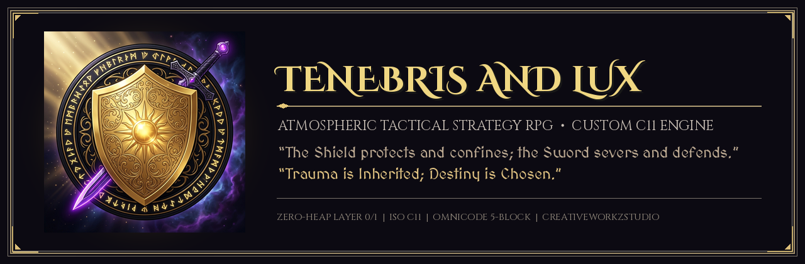
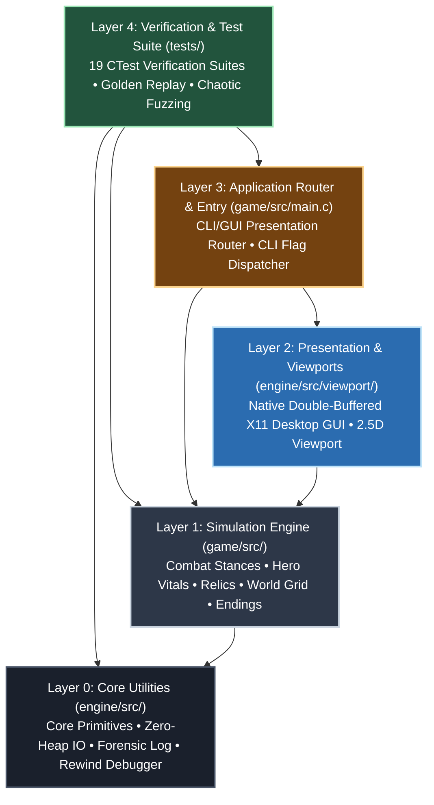
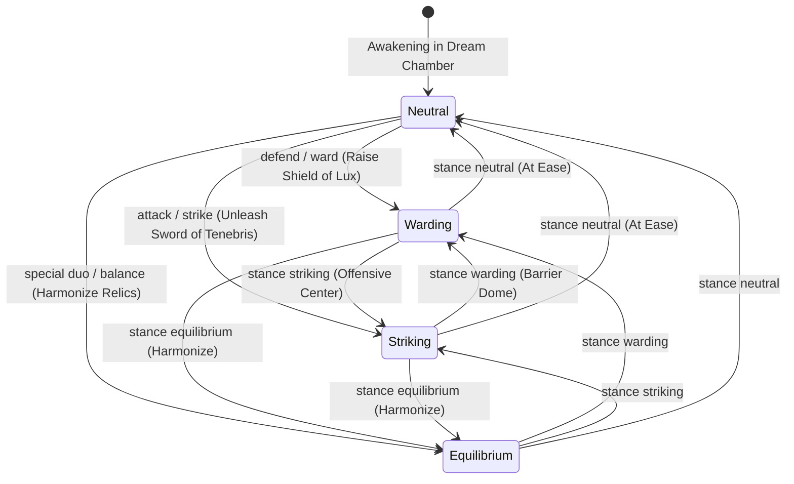
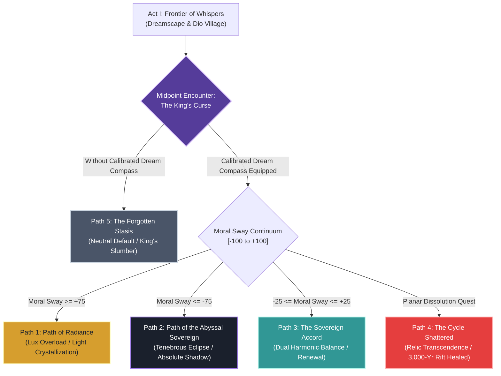
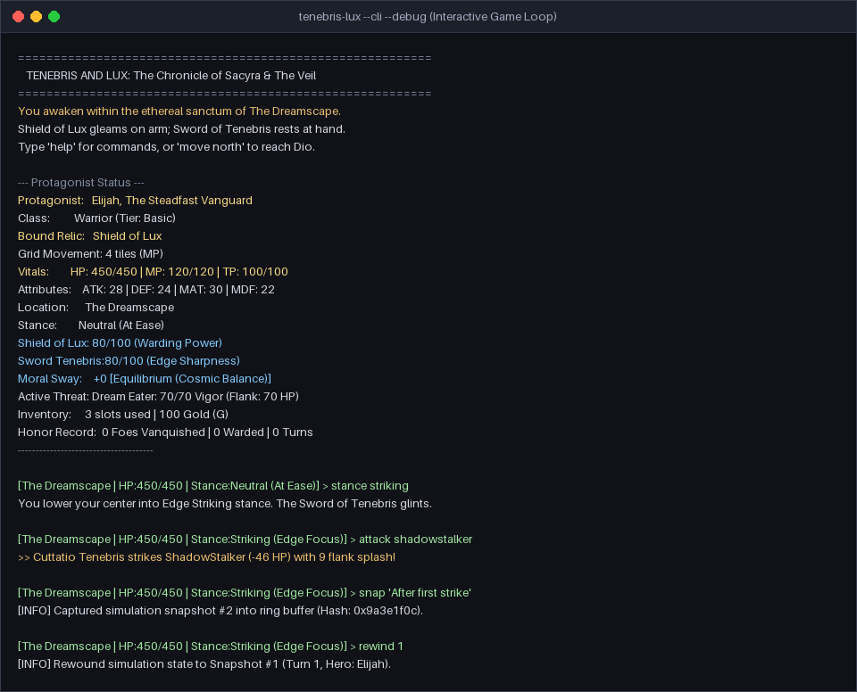
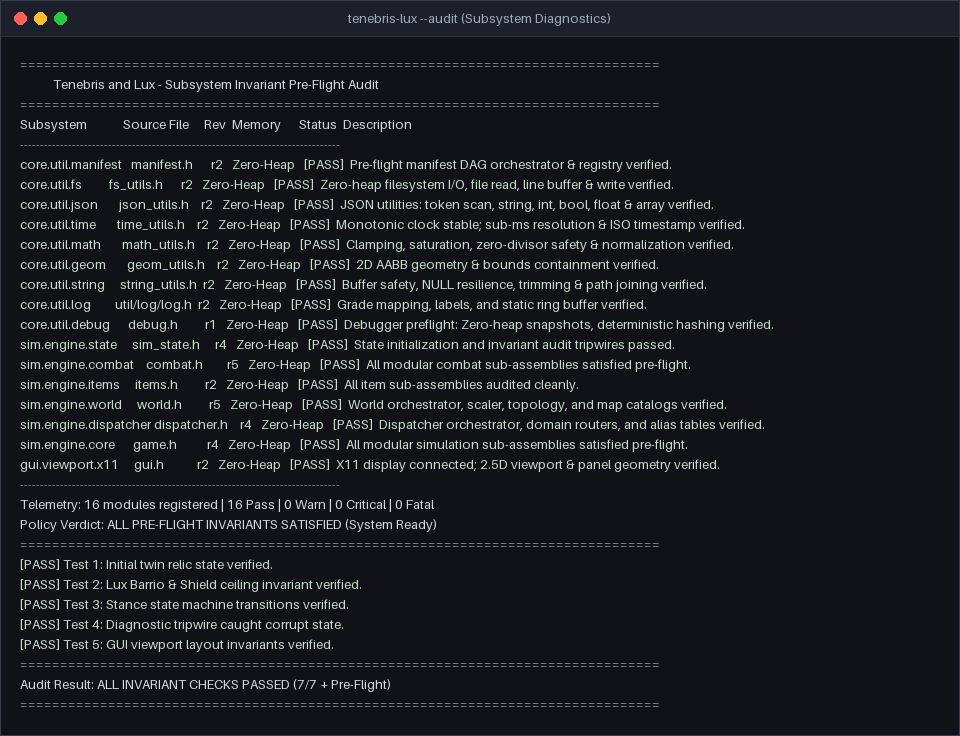

---
# ==============================================================================
# PROJECT & REPOSITORY SPECIFICATION (YAML FRONTMATTER)
# ==============================================================================
project:
  name: "Tenebris and Lux"
  pronunciation: "teh-neh-bris and luks"
  subtitle: "An Atmospheric Tactical Strategy RPG & Bespoke C11 Engine Architecture"
  tagline: "Trauma is Inherited; Destiny is Chosen."
  license: "CreativeWorkzStudio Commercial Game License (All Rights Reserved)"
  organization: "CreativeWorkzStudio LLC"
  lead_architect: "ProfessorSeanEX"
  repository: "https://github.com/Novaking34/tenebris-lux"

release:
  version: "0.1.0-dev"
  milestone: "v0.1.0 — Tactical Strategy RPG Grid Engine & Continental Topology"
  previous_milestone: "v0.0.1 — Dual-Frontend Interactive Prototype"
  status: "Active Development (Engine & Campaign Dual-Track)"

domain:
  classification: "Dual-Track (Custom C11 Engine + Tactical Strategy RPG)"
  genre: "Tactical Strategy RPG (TRPG) / Grid-Based Strategy / Atmospheric Narrative"
  combat_paradigm: "2D Discrete Grid Maneuvers & Cinematic Traditional Clashes"
  thematic_structure: "Tri-Perspective Narrative Architecture (Past, Present, Future)"
  canon_setting: "The Continental Realm of Sacyra & The Six Continental Powers"

engine_specifications:
  core_standard: "ISO C11 (ISO/IEC 9899:2011, -std=c11, -Wall -Wextra -Wpedantic)"
  memory_policy: "Zero Dynamic Heap Allocations in Layer 0 (Core Util) & Layer 1 (Sim Engine)"
  presentation_modes:
    gui: "Native Double-Buffered X11 Desktop Interface (2.5D Viewport)"
    cli: "Headless ANSI Terminal Dispatcher with Dynamic Command Routing"
  diagnostic_tooling: "Interactive State Debugger with FNV-1a Hashing & Time-Travel Rewind"
  build_systems:
    engine: "CMake 3.24+ (ISO C11 Standard)"
    documentation: "Rust 2021 Toolchain (cargo run --bin master_guide)"

telemetry_manifest:
  registered_subsystems: 16
  preflight_audit_status: "16/16 Pass (Zero Heap, Zero Fatal)"
  ctest_verification_suites: 19
  verification_pass_rate: "100% (19/19 Passing)"
  deterministic_replay: "15-Step Golden Trace Determinism Verified"
  chaotic_softlock_immunity: "1,000 Chaotic Actions Verified (< 50µs Latency Budget)"

documentation_compendium:
  master_guide_chapters: 67
  master_guide_volumes: 6
  formats:
    - "AsciiDoc (docs/MASTER_GUIDE.adoc)"
    - "Markdown (docs/MASTER_GUIDE.md)"
    - "Publication PDF (docs/MASTER_GUIDE.pdf)"

thematic_pillars:
  past: "Healing the Frontier Wound (Elijah Ro-enheart / Ancient Usuru)"
  present: "Severing Complacency (Lady Katrina Jaren / Prince Casatti)"
  future: "The Steward of Balance (The Custom Bearer / Prince Mi-ren)"
  meta_axiom: "Trauma is Inherited; Destiny is Chosen."
---

<!--
================================================================================
BLOCK 1: METADATA BLOCK
( Identity, Provenance, Invariant Boundary Contracts & System Anchors )
================================================================================
@project       Tenebris and Lux
@file          README.md
@layer         Root Presentation & Architectural Strata (Layer 3)
@version       0.1.0-dev
@interface_rev Rev 3
@date          2026-11-03
@author        CreativeWorkzStudio LLC / ProfessorSeanEX
@repository    https://github.com/Novaking34/tenebris-lux
@system        Dual-Frontend C11 Tactical RPG Engine & Continental Campaign
@role          Root Presentation Anchor & Universal Architectural Orientation
@invariants    1. Zero dynamic heap allocations across Layer 0 and Layer 1.
               2. Strict ISO C11 adherence (-std=c11, -Wall -Wextra -Wpedantic).
               3. Dual-frontend determinism (CLI and X11 share pure sim state).
               4. OmniCode 5-Block Lifecycle Protocol enforced across all strata.
               5. Authentic project canon (No deprecated synthetic placeholders).

PURPOSE & PHILOSOPHICAL MISSION:
  The central root anchor for Tenebris and Lux. Establishes the dual-track
  reality of the project: the simultaneous construction of an uncompromising,
  zero-heap C11 tactical game engine and an atmospheric continental TRPG.
  Translates the OmniCode 5-Block Lifecycle into documentation rhetoric:
  Metadata -> Premise -> Thesis/Architecture -> Counterpoints/Gaps -> Closing/Audit.
================================================================================
-->

<p align="center">
  
</p>

<p align="center">
  <a href="#engine-architecture--thesis"></a>
  <a href="#quickstart-build-play--audit"></a>
  <a href="#developer-tooling--the-master-guide"></a>
  <a href="#verification-audit-verdict--telemetry"></a>
  <a href="#verification-audit-verdict--telemetry"></a>
  <a href="#engine-architecture--thesis"></a>
  <a href="AGENTS.md"></a>
  <a href="LICENSE"></a>
</p>

---

# Tenebris and Lux

> **"The Shield protects and confines; the Sword severs and defends. The metal knows neither virtue nor malice—only the hand that grips the hilt."**  
> *"Trauma is Inherited; Destiny is Chosen."*

---

## Manifest Covenant & System Attributes

| Attribute | Specification |
| :--- | :--- |
| **Active Milestone** | `0.1.0-dev` (Tactical Strategy RPG Grid Engine & Continental Topology) |
| **Baseline Milestone** | `0.0.1` (Interactive Dual-Frontend Prototype — Fully Verified) |
| **Genre & Paradigm** | Tactical Strategy RPG (TRPG) — 2D Discrete Grid Battlefield + Cinematic Clashes |
| **Organization** | CreativeWorkzStudio LLC |
| **Author / Lead** | ProfessorSeanEX / CreativeWorkzStudio LLC |
| **Repository** | [https://github.com/Novaking34/tenebris-lux](https://github.com/Novaking34/tenebris-lux) |
| **Core Standard** | ISO C11 (`-std=c11`, zero heap allocations in Layer 0/1, zero external runtime dependencies) |
| **Build System** | CMake 3.24+ (C11 engine) & Rust 2021 Toolchain (Master Guide compilation) |
| **Structural Paradigm** | OmniCode Universal 5-Block Code & Documentation Lifecycle Protocol |
| **Layered Strata** | Layer 0 (Core Util), Layer 1 (Sim Engine), Layer 2 (GUI), Layer 3 (Entry), Layer 4 (Tests) |
| **Changelog** | [`CHANGELOG.md`](CHANGELOG.md) |
| **Compendium (67 Ch.)** | [`MASTER_GUIDE.adoc`](docs/MASTER_GUIDE.adoc) &bull; [`MASTER_GUIDE.md`](docs/MASTER_GUIDE.md) &bull; [`MASTER_GUIDE.pdf`](docs/MASTER_GUIDE.pdf) |
| **License** | [Commercial Game License (All Rights Reserved)](LICENSE) |

---

## BLOCK 2: PREMISE & DUAL-NATURE FOUNDATION

### 1. The Dual-Track Mandate: Bespoke Engine & Continental TRPG

*Tenebris and Lux* ("Darkness and Light") is engineered along two inseparable, mutually reinforcing tracks:

1. **A Custom C11 Game Engine Architecture**: Built from first principles in standard ISO C11, avoiding black-box third-party runtimes, garbage collection spikes, and opaque abstraction layers. The engine guarantees deterministic simulation, sub-microsecond command latency, zero dynamic heap allocations in core layers, and a decoupled dual-frontend architecture (headless ANSI terminal CLI + double-buffered X11 desktop GUI).
2. **An Atmospheric Tactical Strategy RPG (TRPG)**: Originating between 2014–2018 in RPG Maker as the genesis work of **CreativeWorkzStudio**, the game is reborn here as an authentic tactical experience featuring grid maneuvers, terrain warfare, poise dynamics, stance mastery, and a grand multi-route continental campaign.

### 2. World Canon & The Geopolitical Landscape

The campaign chronicles the defense and moral reckoning of the chivalric **Kingdom of Sacyra** (pronounced *"saw-kee-ruh"*, `/sɔːˈkiːrə/`) and its neighboring continental powers against the re-awakened **Dark Lord** (the ancient Libiran sovereign Usuru).

The continental expanse is bound by the historic **Accord of Kings** (*"Joint Realm, Separate Kingdoms"*), signed after the Seven-Year Great War across **The Six Powers**:

1. **The Royal Capital of Sacyra**: Central white-stone citadel of the High Throne, defensive bastion of Lux.
2. **The Kingdom of Libira**: Arid western frontier, birthplace of Usuru, home of the historic "Quiet Complaint" (frontier isolation and courier neglect).
3. **The Great Mau Kingdom**: Eastern river merchant empire, master of waterways, mercenary cartels, and banking houses.
4. **Old Sacyra**: Highland ancestral cradle of pureblood Sacyran traditionalists holding ancient vigil.
5. **The Academy**: Northern glacial spire dedicated to empirical arcanotech and natural philosophy.
6. **The Yun-yin Provinces**: Southeastern misty archipelago mastering spiritual balance, ki circulation, and harmonic neutrality.

### 3. Metaphysical Neutrality & The Twin Relics

In *Tenebris and Lux*, Light (Lux) and Darkness (Tenebris) are **not** moral absolutes of good and evil; they are primal cosmic forces personified:

* **The Shield of Lux**: Personification of Light, barrier resonance, poise, kinetic deflection, and protection.
* **The Sword of Tenebris**: Personification of Darkness, edge sharpness, armor severance, abyssal mist, and ruin.

Morality exists solely in the **intent of the wielder** (`moral_sway` bounded in `[-100, +100]`):

* **Positive Sway (+1 to +100)**: Virtue, protection, mercy, and defensive endurance.
* **Negative Sway (-1 to -100)**: Malice, ruin, ruthless ambition, and offensive severance.
* **Equilibrium (0)**: Dual harmonic balance—the foundational precept of the Accord of Kings.

### 4. The Thematic Triad: *"Trauma is Inherited; Destiny is Chosen."*

The narrative unfolds through three interconnected temporal axes:

* **The Past (Healing the Frontier Wound)**: **Elijah Ro-enheart**, frontline heavy vanguard of the Royal Defense Corps bearing the **Shield of Lux**. Seeking truth behind the disappearance of his father, Commander Gareth Ro-enheart, Elijah must reconcile ancestral grief before it curdles into vengeance.
* **The Present (Severing Complacency)**: **Lady Katrina Jaren**, noble court aspirant renouncing aristocratic decadence for the **Adventurers' Guild**. Wielding the **Sword of Tenebris**, Katrina severs political rot and courtly hypocrisy.
* **The Future (The Steward of Balance)**: **The Custom Bearer** (`<chosen_name>`), an unburdened soul awakening within the ethereal **Dream Chamber** under the guidance of **Chrono**, free from dynastic grudge to decide the continental fate.

---

## BLOCK 3: THESIS & ARCHITECTURE (BODY OF WORK)

### 1. The Architectural Thesis: Why Bespoke C11?

Modern game development frequently trades engineering rigor for rapid prototyping, incurring unpredictable garbage collection frame-drops, massive binary bloat, and fragile dependency trees.

The thesis of *Tenebris and Lux* asserts that **a game engine constructed with strict C11 invariants, zero dynamic heap allocations in core simulation, and explicit data-driven contracts achieves unmatched determinism, portable headless verification, and sub-microsecond latency**.

### 2. The 5 Layered Strata

Dependencies strictly flow downwards. Higher layers may call lower layers; lower layers **never** import or depend on higher layers.



* **Layer 0 (Core Utilities)**: Zero-dependency primitives in `engine/src/` (`core/`, `io/`, `log/`, `debug/`). Zero heap allocations, pure reentrant ISO C11.
* **Layer 1 (Simulation Engine)**: Game mechanics in `game/src/` (`combat/`, `hero/`, `relics/`, `world/`, `ending/`, `dispatch/`). Zero heap allocations, decoupled from windowing.
* **Layer 2 (Presentation & Viewports)**: Native X11 double-buffered desktop interface in `engine/src/viewport/`. Translates mouse and keyboard events into universal simulation commands.
* **Layer 3 (Application Entry & Router)**: Evaluates environment flags (`--cli`, `--gui`, `--debug`, `--audit`) in `game/src/main.c` and routes execution to GUI or terminal CLI.
* **Layer 4 (Verification Suite)**: 19 automated CTest suites in `tests/` validating memory, geometry, time, data parsing, logs, time-travel rewind, and system invariants.

### 3. Combat Mechanics & Deterministic Stance State Machine

Combat is governed by the interplay of barrier deflection (Shield of Lux) and armor severance (Sword of Tenebris). Shifting stances reallocates attributes, damage mitigations, and resonance expenditure. Every transition forms a strongly connected, deterministic finite state machine:



* **Neutral Stance**: Baseline posture. Balanced movement and stamina recovery.
* **Warding Stance (*Lux Barrio*)**: Raises the radiant dome. Absorbs 25% incoming damage, reflects kinetic shock, and staggers charging foes.
* **Striking Stance (*Cuttatio Tenebris*)**: Lowers center of gravity. Unleashes abyssal arcs delivering direct damage plus 20% splash to enemy flanks.
* **Equilibrium Stance (*Duo-Loca Bashin n Slash*)**: Blinds with radiant shield bash, instantly followed by abyssal double-cleave targeting raw defense.

### 4. Interactive State Debugger & Time-Travel Rewind

Built into Layer 0/1 is an integrated forensic debugger (`--debug`):

* **State Snapshots (`snap <label>`)**: Freezes complete simulation state into a zero-heap static ring buffer (up to 64 snapshots).
* **Deterministic State Hashing**: Evaluates FNV-1a hashes of the simulation state to instantly detect non-deterministic drift.
* **Time-Travel Rewind (`rewind <idx>`)**: Reverts the player, enemy, and world simulation state back to any historical snapshot.
* **Diagnostic ASCII Cards (`inspect`)**: Live visual readout of hero vitals, relic charge, moral sway, and active tripwires.

### 5. Developer Tooling & The Master Guide Compendium

*Tenebris and Lux* is accompanied by a standalone **Rust 2021 Developer Toolchain** (`tools/`):

* **`tools/src/guide.rs`**: High-performance publication engine assembling **67 chapters across 6 volumes** into:
  * [`docs/MASTER_GUIDE.adoc`](docs/MASTER_GUIDE.adoc) (Unified AsciiDoc master compendium)
  * [`docs/MASTER_GUIDE.md`](docs/MASTER_GUIDE.md) (GitHub Flavored Markdown mirror)
  * [`docs/MASTER_GUIDE.pdf`](docs/MASTER_GUIDE.pdf) (Production publication PDF via `asciidoctor-pdf`)
* **`tools/src/extractor.rs`**: Historical data extractor parsing RPG Maker MV genesis archives into clean engine JSON schemas.

---

## BLOCK 4: COUNTERPOINTS, THE GAPS & ROADMAP DELIVERABLES

### 1. Rhetorical Counterpoint: "Why Build a Bespoke Engine vs. Modern Frameworks?"

A common critique of indie projects is the decision to construct a custom engine rather than adopting Unity, Unreal, or Godot. We explicitly address this counterpoint:

* **Garbage Collection & Latency**: Managed runtimes introduce garbage collection spikes during scene streaming and combat calculation. Our ISO C11 engine executes complete simulation turns under **50 microseconds**, with zero dynamic heap allocations in Layer 0/1.
* **Deterministic Replayability**: TRPG combat requires 100% reproducible battle logs. Commercial engines frequently bundle non-deterministic physics and hidden update loops. Our state machine guarantees byte-identical replay determinism.
* **Headless Decoupling**: The engine runs headlessly in continuous integration pipelines, headless server terminals, or desktop X11 windows without altering a single line of simulation logic.
* **Permanent Digital Sovereignty**: Independent of commercial engine licensing shifts, telemetry tracking, or deprecation cycles.

### 2. The Current Gaps: Transitioning from Prototype (v0.0.1) to Tactical Grid Engine (v0.1.0)

With the **v0.0.1** interactive dual-frontend prototype fully verified (16/16 audit modules, 19/19 CTest suites), the project is actively executing the **v0.1.0** milestone.

Here are the specific engineering and ludological gaps currently being conquered:

```text
┌────────────────────────────────────────────────────────────────────────┐
│                   THE v0.1.0 TACTICAL ENGINE GAPS                      │
├────────────────────────────────────────────────────────────────────────┤
│ GAP 1: 2D Discrete Grid Coordinates & Movement Budgets (MP)            │
│ GAP 2: Directional Facing, Terrain Modifiers & Zone-of-Control (ZOC)   │
│ GAP 3: Deployable Party Rosters & Vanguard/Flanker Formations          │
│ GAP 4: Grid-to-Duel Handshake & Cinematic Action Clashes               │
└────────────────────────────────────────────────────────────────────────┘
```

* **Gap 1: Discrete 2D Grid Movement**: Transitioning from zone-based topological navigation (`move north`) to discrete tile coordinates (`(x, y)` cells), movement budgets (Movement Points / MP), pathfinding costs, and obstacle collision.
* **Gap 2: Terrain Warfare & Zone-of-Control (ZOC)**: Implementing biome terrain defense modifiers (plains, forest cover, stone ramparts) and ZOC clamping that penalizes disengagement unless shielded by *Lux Barrio*.
* **Gap 3: Party Roster & Formation Synergy**: Expanding single-hero state into deployable squad formations—positioning Elijah's Shield vanguard to create safe kinetic corridors for Katrina's abyssal strikes.
* **Gap 4: Cinematic Combat Transition**: Handshaking discrete grid encounters into traditional side-scroll action duels, introducing active counter-warding frames and poise break meters.

### 3. Narrative Fatigue Counterpoint: The King's Curse & 5-Route Ending Matrix

Linear tactical RPGs often suffer from narrative fatigue and illusion-of-choice endings. *Tenebris and Lux* resolves this through a **Midpoint Campaign Fork** governed by **The King's Curse** (the planar wound beneath the High Throne):



* **Path 1: Path of Radiance (Lux Overload)**: Moral sway $\ge +75$. Absolute light crystalizes the realm in immutable, blinding order.
* **Path 2: Path of the Abyssal Sovereign (Tenebrous Eclipse)**: Moral sway $\le -75$. Absolute shadow swallows dynastic institutions into abyssal freedom.
* **Path 3: The Sovereign Accord (Dual Harmonic Balance)**: Sway maintained in `[-25, +25]`. The Accord of Kings is reaffirmed through equilibrium.
* **Path 4: The Cycle Shattered (Planar Dissolution)**: Relic transcendence healing the 3,000-year dynastic chasm once and for all.
* **Path 5: The Forgotten Stasis (The King's Slumber)**: The tragic neutral path—the wielder fails to calibrate Grandma's Watch into the Dream Compass, repeating the cycle.

---

## BLOCK 5: CLOSING STATEMENTS, AUDIT VERDICT & RECEPTION

### 1. Verification & Audit Verdict: Telemetry Manifest

The repository enforces compile-time and runtime self-audits before any milestone release. All tests pass with zero warnings under `-Wall -Wextra -Wpedantic`:

```text
================================================================================
           Tenebris and Lux - Subsystem Invariant Pre-Flight Audit              
================================================================================
Subsystem            Source File     Rev  Memory      Status  Description
--------------------------------------------------------------------------------
core.util.manifest   manifest.h      r2   Zero-Heap   [PASS]  Pre-flight manifest DAG orchestrator & registry verified.
core.util.fs         fs_utils.h      r2   Zero-Heap   [PASS]  Zero-heap filesystem I/O, file read, line buffer & write verified.
core.util.json       json_utils.h    r2   Zero-Heap   [PASS]  JSON utilities: token scan, string, int, bool, float & array verified.
core.util.time       time_utils.h    r2   Zero-Heap   [PASS]  Monotonic clock stable; sub-ms resolution & ISO timestamp verified.
core.util.math       math_utils.h    r2   Zero-Heap   [PASS]  Clamping, saturation, zero-divisor safety & normalization verified.
core.util.geom       geom_utils.h    r2   Zero-Heap   [PASS]  2D AABB geometry & bounds containment verified.
core.util.string     string_utils.h  r2   Zero-Heap   [PASS]  Buffer safety, NULL resilience, trimming & path joining verified.
core.util.log        util/log/log.h  r2   Zero-Heap   [PASS]  Grade mapping, labels, and static ring buffer verified.
core.util.debug      debug.h         r1   Zero-Heap   [PASS]  Debugger preflight: Zero-heap snapshots, deterministic hashing verified.
sim.engine.state     sim_state.h     r4   Zero-Heap   [PASS]  State initialization and invariant audit tripwires passed.
sim.engine.combat    combat.h        r5   Zero-Heap   [PASS]  All modular combat sub-assemblies satisfied pre-flight.
sim.engine.items     items.h         r2   Zero-Heap   [PASS]  All item sub-assemblies audited cleanly.
sim.engine.world     world.h         r5   Zero-Heap   [PASS]  World orchestrator, scaler, topology, and map catalogs verified.
sim.engine.dispatcher dispatcher.h    r4   Zero-Heap   [PASS]  Dispatcher orchestrator, domain routers, and alias tables verified.
sim.engine.core      game.h          r4   Zero-Heap   [PASS]  All modular simulation sub-assemblies satisfied pre-flight.
gui.viewport.x11     gui.h           r2   Zero-Heap   [PASS]  X11 display connected; 2.5D viewport & panel geometry verified.
--------------------------------------------------------------------------------
Telemetry: 16 modules registered | 16 Pass | 0 Warn | 0 Critical | 0 Fatal
Policy Verdict: ALL PRE-FLIGHT INVARIANTS SATISFIED (System Ready)
================================================================================
Audit Result: ALL INVARIANT CHECKS PASSED (7/7 Relic/Stance Checks + Pre-Flight)
CTest Suite:  19/19 VERIFICATION SUITES PASSED (100% Pass Rate, 0 Failures)
================================================================================
```

### 2. Visual Proof: Dual-Frontend Presentation

<p align="center">
  
</p>

<p align="center">
  
</p>

### 3. Quickstart: Build, Play & Audit

For complete operating system dependencies, X11 libraries, and compiler setup, refer to [INSTALL.adoc](docs/INSTALL.adoc).

#### Quick Build with CMake

```bash
# 1. Configure CMake build tree in Debug mode
cmake -S . -B build -DCMAKE_BUILD_TYPE=Debug

# 2. Compile game engine and all 19 verification test suites
cmake --build build --config Debug

# 3. Launch the game (auto-detects X11 GUI, or falls back to CLI)
./build/tenebris-lux

# Launch explicitly in terminal CLI mode
./build/tenebris-lux --cli

# Launch explicitly in native desktop GUI mode
./build/tenebris-lux --gui

# Launch with interactive CLI state debugger enabled
./build/tenebris-lux --debug
```

#### Automated Diagnostics & Testing

```bash
# Run pre-flight inspection and internal self-audit (16 registered modules + 7 invariant tests)
./build/tenebris-lux --audit

# Run full CTest automated verification suite (19/19 tests pass)
ctest --test-dir build -C Debug --output-on-failure
```

#### Compile the Unified Master Guide (67 Chapters)

```bash
# Requires Rust toolchain (cargo) and asciidoctor-pdf
cargo run --manifest-path tools/Cargo.toml --bin master_guide
```

### 4. Tactical Command Manual & Hotkey Reference

* `look` / **(L)**: Survey current realm, topological boundaries, and active hostile presences.
* `status` / **(I)**: Inspect hero attributes, Shield of Lux warding, Sword of Tenebris edge, and Moral Sway.
* `map` / **(M)**: View topological map dimensions, viewport camera coordinates, and zone metadata.
* `defend` / `ward` / **(W)**: Raise the Shield of Lux (*Lux Barrio*), absorbing 25% damage and staggering foes.
* `attack` / `strike` / **(S)**: Strike with the Sword of Tenebris (*Cuttatio Tenebris*), dealing direct and splash damage.
* `special duo` / `balance` / **(B)**: Unleash harmonic *Duo-Loca Bashin n Slash* shattering defense.
* `stance <ward|strike|equilibrium|neutral>` / **(T)**: Transition combat posture across the deterministic state machine.
* `move <n|s|e|w>` / **(N, S, R, W)**: Traverse continental realms and frontier provinces.
* `items` / `inventory`: Inspect player pouch, consumables, and quest artifacts.
* `use <id|name>`: Consume herbal remedies or consult diegetic relics (Grandma's Watch, Phials of Light).
* `clock`: Read monotonic sub-millisecond elapsed time via Grandma's Watch.
* `morality`: Read metaphysical alignment on the Compass of Morality.
* `name <bearer>`: Designate bearer identity (Elijah, Katrina, or Custom Bearer).
* `inspect`: Render live ASCII diagnostic card of hero vitals, relics, stance, and tripwires.
* `history`: Tabular timeline of recorded debugger state snapshots in the static ring buffer.
* `snap <reason>`: Capture an immediate simulation state snapshot into the ring buffer.
* `rewind <idx>`: Rewind simulation state to a historical snapshot index.
* `help`: Display tactical command manual.
* `quit` / **(Q)**: Sheath armaments and exit simulation.

### 5. Repository Documentation Index

* **[`CHANGELOG.md`](CHANGELOG.md)**: Evolutionary milestone log (v0.0.1 baseline &rarr; v0.1.0 TRPG Grid Engine).
* **[`LICENSE`](LICENSE)**: CreativeWorkzStudio Commercial Game & Source-Available Engine License.
* **[`docs/MASTER_GUIDE.adoc`](docs/MASTER_GUIDE.adoc)**: The complete 67-chapter unified AsciiDoc master compendium.
* **[`docs/MASTER_GUIDE.pdf`](docs/MASTER_GUIDE.pdf)**: Production PDF publication book compiled via `asciidoctor-pdf`.
* **[`docs/README.adoc`](docs/README.adoc)**: Central documentation compendium portal and index.
* **[`docs/INSTALL.adoc`](docs/INSTALL.adoc)**: Comprehensive build, toolchain installation, and troubleshooting guide.
* **[`docs/architecture/`](docs/architecture/README.adoc)**: System design, 5-block lifecycle, data-driven architecture, and dual-frontend engine.
* **[`docs/lore/`](docs/lore/README.adoc)**: Macro-chronology, 20-scene master storyboard, thematic triad, character dossiers, and realm chronicles.
* **[`docs/game_design/`](docs/game_design/README.adoc)**: TRPG grid mechanics, campaign structure, relics, and 2017–2018 demo baseline.
* **[`docs/dev_logs/`](docs/dev_logs/README.adoc)**: Living engineering chronology (DevLogs 001–012).
* **[`docs/code/`](docs/code/README.adoc)**: Subsystem implementation tours for Layer 0 (Core Utils, Debugger), Layer 1, Layer 2, and Layer 4.
* **[`docs/offline_work/`](docs/offline_work/README.adoc)**: Archived genesis notes, storyboard transcriptions, and macro-architecture drafts.
* **[`AGENTS.md`](AGENTS.md)**: Repository guidelines, OmniCode invariants, and cognitive anchor standards.
