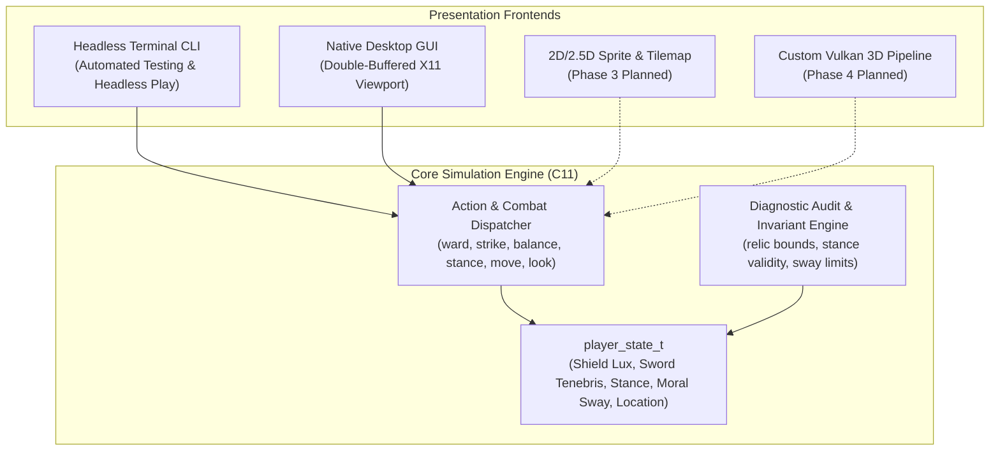

# Architecture & Technical Design

> **Project**: Tenebris and Lux  
> **Subsystem**: Core Engine & Game Simulation  
> **Standard**: OmniCode 5-Block Ontological Architecture  

---

## 1. Design Overview

*Tenebris and Lux* ("Darkness and Light") is an atmospheric chivalric fantasy game and custom engine architecture. The story centers upon two primordial relics—**The Shield of Lux** and **The Sword of Tenebris**—wielded amidst a Kingdom fractured by ideological schism and threatened by the re-awakening of the **Dark Lord Malakor**.

The engine strictly separates **simulation state** from the **presentation layer**:



---

## 2. The Universal 5-Block Code Structure

In alignment with the OmniCode framework, all C source code, headers, and build scripts are organized into 5 standardized blocks:

1. **BLOCK 1: METADATA BLOCK**  
   Defines module identity, layer, author, version, role, and invariant axioms.
2. **BLOCK 2: OPENING / TYPES BLOCK**  
   Header imports, constants, state structures (`player_state_t`, `relic_resonance_t`, `moral_sway_t`), and location enumerations (`location_id_t`).
3. **BLOCK 3: BODY BLOCK**  
   Core simulation routines, relic stance transitions, combat calculations, and moral alignment resolution.
4. **BLOCK 4: AUDIT PROCEDURES BLOCK**  
   Self-healing diagnostic routines, invariant tripwires, and game development testing verification harnesses.
5. **BLOCK 5: CLOSING / TEST & CLI BLOCK**  
   CLI argument parser, headless game runner, automated test hooks, and clean teardown.

---

## 3. Core Mechanics & State Invariants

### The Twin Relics: Shield and Sword

- **The Shield of Lux (`shield_power`, $0 \dots 100$)**:
  Represents radiant warding, defense, barrier integrity, and illumination.
- **The Sword of Tenebris (`sword_edge`, $0 \dots 100$)**:
  Represents umbral sharpness, severance, kinetic strike force, and mist cloaking.
- **Tactical Stance (`combat_stance_t`)**:
  - `STANCE_NEUTRAL`: Relics held in readiness.
  - `STANCE_WARDING`: Shield raised forward; enhances defensive warding; mitigates incoming damage.
  - `STANCE_STRIKING`: Sword drawn for offensive severance; boosts strike damage.
  - `STANCE_EQUILIBRIUM`: Twin mastery; balances offensive and defensive resonance.
- **Moral Sway (`moral_sway_t`, $-100 \dots +100$)**:
  - Positive ($> 0$): **Virtue & Mercy** (using power to protect the defenseless, seek harmony, and heal the realm).
  - Negative ($< 0$): **Tyranny & Ruin** (using power for cruel domination, ruthless execution, and feeding the Dark Lord).

### Invariant Axioms

1. **Shield Power Boundary**: $0 \le \text{state.shield\_power} \le \text{MAX\_POWER}$.
2. **Sword Edge Boundary**: $0 \le \text{state.sword\_edge} \le \text{MAX\_EDGE}$.
3. **Moral Sway Bounded Range**: $-100 \le \text{state.moral\_sway} \le +100$.
4. **Valid Location Invariant**: $0 \le \text{state.current\_location} < \text{LOCATION\_COUNT}$.
5. **Deterministic Replay Guarantee**: Any identical sequence of actions from a given initial state must produce identical state telemetry.

---

## 4. Multi-Phase Engine Evolution

```text
Phase 1: Dual CLI + Native GUI Prototype ---> Twin Relics, Stance Loop, Kingdom Topology, Audit Suite.
Phase 2: Decoupled Core Subsystems      ---> Event bus, tick scheduler, ECS (Entity Component System).
Phase 3: 2D / 2.5D Presentation Layer   ---> Sprite animations, dynamic shadow caster, tactical grid.
Phase 4: Custom 3D Game Engine          ---> Vulkan rendering, spatial audio, 3D character controllers.
```
