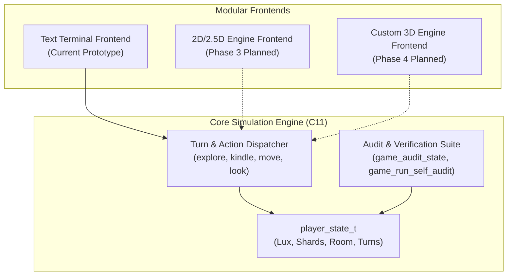

# Architecture & Technical Design

> **Project**: Tenebris and Lux  
> **Subsystem**: Core Engine & Game Simulation  
> **Standard**: OmniCode 5-Block Ontological Architecture  

---

## 1. Design Overview

*Tenebris and Lux* ("Darkness and Light") is architected with a strict separation between **simulation state** and **presentation layer**. The current prototype operates via dual presentation frontends (a headless terminal CLI and a native double-buffered X11 GUI), while the underlying state machines are decoupled to allow plug-and-play migration to 2D tilemaps, 2.5D isometric viewports, and full 3D rendering engines.



---

## 2. The Universal 5-Block Code Structure

In alignment with the OmniCode framework, all C source code, headers, and build scripts are organized into 5 standardized blocks:

1. **BLOCK 1: METADATA BLOCK**  
   Defines identity, layer, author, version, role, and invariant axioms.
2. **BLOCK 2: OPENING / TYPES BLOCK**  
   Header imports, constants, state structures (`player_state_t`), and room enumerations (`room_id_t`).
3. **BLOCK 3: BODY BLOCK**  
   Core game simulation, command execution, state transitions, and light attenuation logic.
4. **BLOCK 4: AUDIT PROCEDURES BLOCK**  
   Self-healing diagnostic routines, tripwire assertions, and invariant verification reports.
5. **BLOCK 5: CLOSING / TEST & CLI BLOCK**  
   CLI interface, argument parsing, automated test runs, and teardown.

---

## 3. Core Mechanics & State Invariants

### Light & Darkness Balance

- **Lux ($\text{Light}$)**: A bounded integer between 0 and 100 (`MAX_LUX`). Every deliberate action costs $5$ Lux by default.
- **Tenebris ($\text{Darkness}$)**: When Lux reaches $0$, the player is enveloped by darkness and the run terminates.
- **Lumina Shards**: Rare crystals discovered during exploration. Consuming $1$ shard restores $+30$ Lux, capped at $\text{MAX\_LUX}$.
- **Room Topology**: A connected discrete graph of locations representing ancient chambers, corridors, and sanctuaries.

### Invariant Axioms

1. **Lux Boundary Invariant**: $0 \le \text{state.lux} \le \text{MAX\_LUX}$.
2. **Inventory Non-Negativity**: $\text{state.lumina\_shards} \ge 0$.
3. **Valid Location Invariant**: $0 \le \text{state.current\_room} < \text{ROOM\_COUNT}$.
4. **Audit Reliability**: The self-audit suite must return non-zero exit codes if any invariant fails during validation.

---

## 4. Multi-Phase Engine Evolution

```text
Phase 1: Pure C11 Text Prototype  ---> Game loop, state, inventory, lore.
Phase 2: Decoupled Core Subsystems ---> Event queue, tick scheduler, math.
Phase 3: 2D / 2.5D Visualization   ---> Tile rendering, sprite animations, dynamic lighting.
Phase 4: Custom 3D Game Engine     ---> Custom shader pipeline, spatial audio, scene graph.
```
