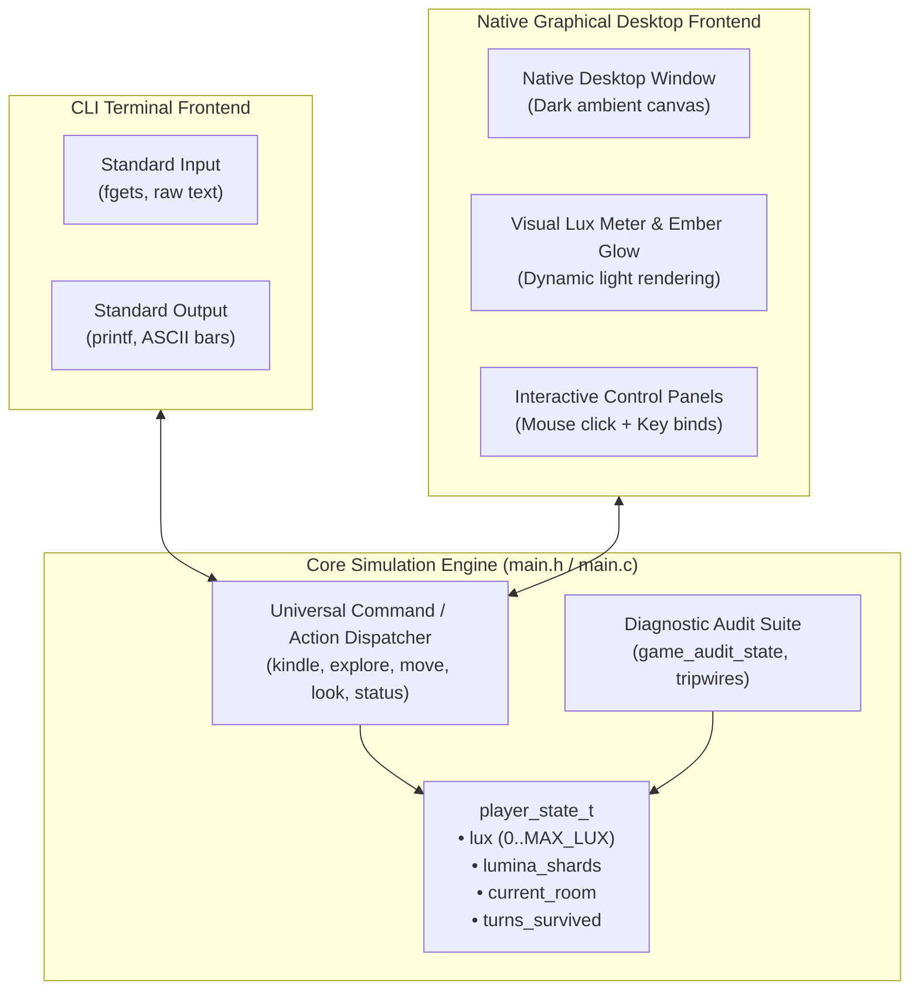

# Architectural Specification: The Dual CLI + Native GUI Paradigm

> **Project**: Tenebris and Lux  
> **Document**: `02_architecture/dual_frontend_design`  
> **Status**: Approved Architectural Standard  

---

## 1. Executive Summary & Rationale

### Why Start with Dual Frontends (CLI + GUI) Before Deep World Building?

A common pitfall in game development is intertwining gameplay content (lore, room topologies, dialogue scripts, item inventories) directly into the presentation harness. When a game begins as a quick terminal script and content is accumulated for weeks, porting to a visual window becomes a grueling, bug-ridden rewrite.

Conversely, beginning with a **Dual-Frontend Architecture** guarantees:

1. **Strict Invariant Boundary Enforcement**:
   - The game simulation lives entirely in pure C11 structures (`player_state_t`).
   - Neither the CLI nor the GUI owns the game state. They are merely observers and intent emitters.
   - Any action that can be performed in the GUI can be executed in the CLI, and vice versa.

2. **Headless Verification vs Human Immersion**:
   - **CLI Mode**: Used for rapid automated testing, script piping (`printf ... | ./build/tenebris-lux`), CI regression test suites (`ctest`), and instant debugging.
   - **GUI Mode**: Used for player immersion, aesthetic atmosphere, spatial light attenuation, ambient audio, and visual exploration.

3. **Freedom to Expand the World Without Architectural Regressions**:
   - Once both frontends are wired to the same action dispatcher, authoring new rooms, enemies, light relics, and lore passages *automatically* works in both interfaces without touching frontend code.

---

## 2. Desktop GUI Strategy: Why Not Web?

This project explicitly rejects web-based wrappers (Electron, Tauri, Chromium, WebSockets) in favor of a **lean native desktop binary**:

- **Zero Runtime Bloat**: Web runtimes bundle 150MB+ of browser engines, garbage collectors, and DOM layers. A native C11 window compiles into a compact, single-digit megabyte binary that launches in milliseconds.
- **Direct GPU & Engine Readiness**: A native window directly lays the foundation for 2D sprite shaders, 2.5D lighting maps, and custom 3D OpenGL/Vulkan pipelines in future phases.
- **Predictable Latency & Memory Footprint**: Deterministic memory layout with zero garbage collection pauses or browser rendering bottlenecks.
- **Controlled Dependency Footprint**: Using a lean, battle-tested C graphics layer (such as Raylib) eliminates the deep multi-package dependency tree that broke early SDL3 builds on Linux, while preserving cross-platform compilation across Linux, Windows, and macOS.
